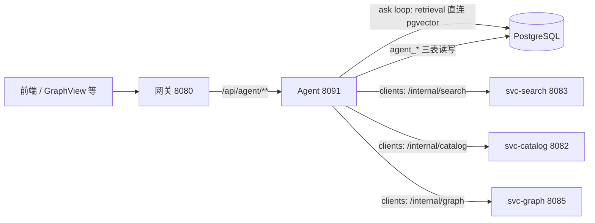

## 用户需求

把 Domain 3（智能域）的 agent 部分补齐，范围以问答时确认的四项决策为准：

- **本轮范围**：工具接入模型（bind_tools 多轮取证）+ 会话落库 + 多轮记忆 + `GET /api/agent/history` + 工具数据源迁到 `clients` 走各 svc 的 `/internal`
- **数据源**：4 个已写好的工具原本直连 PG/Neo4j，本轮改走 `clients` → `svc-catalog / svc-search / svc-graph` 的 `/internal/**`，统一检索口径
- **不做**：`/coach`、`/grade`（09 契约里只有一行端点、没有字段细则，留到下一轮）
- **验证条件**：可启动 Docker Desktop，中间件起来后补做 3 项图谱真数据实打

## 核心功能

1. **工具真正生效**：现在 `ALL_TOOLS` 除测试外无人引用、`llm.py` 没有 `bind_tools`，`ask` 实际是单轮 RAG。本轮让模型能自主选工具、多轮取证，并把每次调用以 SSE `tool` 事件推给前端、落 `agent_tool_call` 表。
2. **会话可追溯**：`agent_conversation` / `agent_message` / `agent_tool_call` 三张表已建但全空。本轮写入并支持 `GET /api/agent/history` 列出当前用户的会话。
3. **多轮记忆**：带 `conversationId` 提问时能接上之前的对话，而不是每次都从零开始。
4. **口径统一**：工具与各 svc 查同一份数据，不再出现「前端从 BFF 查和从 Agent 查结果不同」。

## 视觉与交付效果

本轮不新增页面，也无 UI 改动。可见效果是接口层面的：`/api/agent/ask` 的 SSE 流里会出现真实的工具轨迹（`tool` 事件带工具名、耗时、命中数），`/api/agent/history` 能返回会话列表，前端已有页面不必改动。

## 一、现状基线（已实核）

| 项 | 事实 |
| --- | --- |
| 端点 | 7 个契约端点做了 4 个（health / ask/sync / ask / formula/diff） |
| 工具 | `app/tools/` 4 个已写好（`search_formula`、`search_case`、`semantic_recall`、`graph_neighbors`），统一六字段外壳 `{ok,hit,count,items,hint,notice}`，一律不抛异常 |
| 工具是否生效 | 否。`ALL_TOOLS` 只被 `tests/test_tools.py` 引用；`llm.py` 只有 `ainvoke/astream`，无 `bind_tools` |
| 工具数据源 | 全部直连库：`tools/catalog.py` 用 psycopg 跑 SQL，`tools/graph.py` 用 `get_neo4j_driver()`，`tools/recall.py` 调 `retriever.retrieve` |
| 会话表 | `agent_conversation(id,user_id→app_user,title,created_at)`、`agent_message(id,conversation_id,role,content,created_at)`、`agent_tool_call(id,message_id,tool_name,args_jsonb,result_summary,latency_ms,created_at)`，全部 0 行 |
| SSE | `rag/sse.py` 已有 `tool/token/citation/done` 四类事件；`ask.py` 目前只发 `retrieval` 的 start/done |
| 测试 | `pytest tests -q` → 105 passed，且除 `test_formula_diff.py` 外全部零外部依赖（`helpers.py` 有 `pg_ready/neo4j_ready` 守卫） |
| svc internal 可用性 | `svc-catalog:8082 /internal/catalog/**`（formula/{id}、case/{id}、batch、quote/list、formula/{id}/related）、`svc-search:8083 /internal/search`（GET 多维检索）与 `/internal/search/recall`（POST 混合召回）、`svc-graph:8085 /internal/graph/{neighbors,subgraph,formula,path,map}` |
| 关键约束 | svc 的 `/internal` **成功返回裸 DTO，错误返回 `R{code,msg}`**（4000/4040/5000）；`svc-catalog` **没有**按方名/药味模糊查方剂的端点 |


## 二、技术选型

- 语言与框架沿用现状：Python 3.11 + FastAPI + pydantic v2 + LangChain（`langchain-core` / `langchain-openai` 已在 env 与 requirements 中）
- HTTP 客户端：`httpx.AsyncClient`（requirements 已有，版本 0.28.1），单例 + 连接池，在 `lifespan` 里建/关，与 `db.py` 的资源管理风格一致
- **不引入 langgraph、不使用 LangGraph checkpointer**：多轮记忆直接用 `agent_message` 表里的历史行（本来就要落库，等于同一份数据两用），避免多一个依赖与一套 schema。此为对 08 §6 的**有意偏差**，需写进文档
- 工具调用循环**手写**（`bind_tools` + `tool_calls` 判空），不用 `langchain.agents.create_agent`：需要精确控制 SSE 事件时序、工具轮次上限、失败降级，手写约 60 行且完全可单测

## 三、实现方案

### 3.1 clients 层（新增 `agent/app/clients/`）

- `base.py`：全局 `httpx.AsyncClient` 单例（`init_clients()/close_clients()`，挂进 `lifespan`），超时 connect=1s / read=5s；统一出口 `get_json(path, params)` 与 `post_json(path, body)`：
- 2xx → 直接返回裸 JSON（不拆 `R`，因为 internal 成功时不包壳）
- 非 2xx → 解析响应体里的 `R.msg`，抛 `SvcError(status, msg)`，由工具层转 `error_result`
- 连接异常 → `SvcError(0, "服务不可达")`
- `catalog.py`：`search(q, type, herb, page, size)` → `GET /internal/search`；`formula(id)` / `batch(ids, names)` → `/internal/catalog/**`
- `search.py`：`recall(q, type, size)` → `POST /internal/search/recall`
- `graph.py`：`neighbors(entity, label, hops, limit)` → `GET /internal/graph/neighbors`（svc-graph 已按 f_*/h_* 出参，4040/4000 语义齐备）

### 3.2 4 个工具迁移（保持六字段外壳与「一律不抛异常」纪律）

| 工具 | 迁移后数据源 | 口径变化与处理 |
| --- | --- | --- |
| `search_formula` | `svc-search /internal/search?type=formula&q=&herb=` | 原实现是「库内原文子串匹配（确定性）」，svc-search 是混合召回。为不让近似结果被当成确证，工具在返回的每条 item 上补 `matchedBy` 与 `exact`（本地做一次「关键词是否为 title/herbs/snippet 子串」的确定性校验），`hint` 里说明「exact=false 表示只是语义相近」 |
| `search_case` | `svc-search /internal/search?type=case&q=` | 同上；症状关键词走 `q`（搜索已覆盖 content 文本） |
| `semantic_recall` | `svc-search /internal/search/recall` | 保留 `top_k`（夹紧 1~10）与 `score >= 0.5` 阈值（与现有 `retrieval_min_score` 一致），保证「无命中」语义不变 |
| `graph_neighbors` | `svc-graph /internal/graph/neighbors` | 直接映射；`label` 白名单校验保留在工具层，非法值本地拦掉，不浪费一次 HTTP |


`app/rag/retriever.py` **不动**：`ask` 主链（问题 → pgvector → 提示词）的检索口径已按 0.5 阈值与 6:4 配额校准过，本轮只迁工具，避免同时改两处导致问答质量不可归因。

### 3.3 工具调用循环（新增 `agent/app/agent/runner.py`）

```
build_messages(question, units, history) → messages
loop (最多 3 轮):
    resp = await model.bind_tools(ALL_TOOLS).ainvoke(messages)
    if not resp.tool_calls: break
    for call in resp.tool_calls:
        emit sse.tool(name, "start", args=...)
        t0; result = await tool.ainvoke(call["args"])   # 单工具 5s 超时、失败重试 1 次
        emit sse.tool(name, "done", ms=..., hit=..., count=...)
        messages.append(ToolMessage(result, tool_call_id=...))
final: 最后一轮用 astream 逐字输出
```

- 工具全失败或模型仍要调用超限 → 退回现有「单轮 RAG + 降级答案」路径，保证问答不会被工具拖死
- 开关 `AGENT_TOOLS_ENABLED`（默认 true），出问题时一个环境变量回退到当前行为
- `/ask/sync` 与 `/ask` 共用同一 runner，避免两条链路行为不一致

### 3.4 会话落库 + 多轮记忆 + history（新增 `app/repo/conversation.py`、`app/routers/history.py`）

- `ensure_conversation(conv_id, user_id, title)`：先 `SELECT 1 FROM app_user WHERE id=%s`；存在 → 正常插入；不存在 → 以 `user_id=NULL` 插入并 warning（`agent_conversation.user_id` 有外键指向 `app_user`，而真实用户要等域2 登录链路产出；**agent 绝不写 `app_user`**）
- `append_message(conv_id, role, content)` 返回 message id；`record_tool_call(message_id, name, args, summary, ms)`
- `recent_messages(conv_id, limit=6)` → 喂给多轮记忆
- `list_conversations(user_id, limit)` → 单条聚合 SQL（`count(m.id)`、`max(m.created_at)`），走已有索引 `idx_agent_conv_user`
- 路由：`GET /api/agent/history?limit=20`（默认 20、上限 50，缺 `X-User-Id` → 401），`R[HistoryData]`，`data = {conversations:[{id,title,createdAt,messageCount,lastAt}], total}`
- 落库失败只 warning，**绝不影响问答返回**（与现有「永不 500」策略一致）
- `AskData` 新增可选字段 `toolCalls`（工具名、耗时、命中）供同步端点回传；属契约新增字段，需在 `09` 变更记录里注明

### 3.5 文档更新（需三人 review，改动冻结文档）

- `09_API契约清单.md`：新增 §13.4 `GET /api/agent/history` 字段细则（含 8 项：归属/数据源/鉴权/参数/响应/错误码/示例/备注）；§10 状态表把 history 标为已实现；`AskData` 补 `toolCalls` 说明
- `08_Agent服务设计_LangChain1.x.md`：§11 更新为「工具经 `clients` 调 `/internal`；ask 主链检索仍直连 pgvector（口径已校准，不迁）」；§6 注明「多轮记忆用 `agent_message` 表而非 checkpointer」

## 四、性能与可靠性

- 工具轮次 ≤3、单工具超时 5s + 重试 1 次 ⇒ 最坏工具耗时 3×3×5s 会突破网关 60s；因此**增加整体预算**：一次问答的工具阶段累计超 15s 即停止调工具、直接生成
- `httpx` 单例连接池（上限 20）避免每次调用重建 TLS
- `history` 查询走 `idx_agent_conv_user(user_id, created_at DESC)`，`messageCount` 用聚合而非 N+1
- 已知退化：会话落库会多 2~3 次 PG 写入（每次问答），对 3~5 人规模无压力；用 `ON CONFLICT DO NOTHING` + 短超时（3s）防拖慢
- 观测：日志只记录工具名/耗时/命中数，不记问题原文（沿用现有 `fp` 指纹机制）

## 五、架构与目录



```
agent/app/
├── agent/runner.py              [NEW] 工具调用循环 + SSE 工具轨迹 + 工具预算
├── clients/{base,catalog,search,graph}.py   [NEW] 各 svc /internal 客户端（裸 DTO + R 错误解析）
├── repo/conversation.py         [NEW] 会话/消息/工具轨迹落库、历史查询、多轮记忆读取
├── routers/history.py           [NEW] GET /api/agent/history
├── routers/ask.py               [MODIFY] 改走 runner；检索前读记忆、生成后落库
├── tools/{catalog,graph,recall}.py  [MODIFY] 直连库 → clients，保留六字段外壳，新增 exact/matchedBy
├── config.py                    [MODIFY] svc_*_url、agent_tools_enabled、agent_max_tool_rounds、agent_tool_budget_ms、history_limit
├── schemas.py                   [MODIFY] HistoryData/ConversationBrief/AskData.toolCalls
├── main.py                      [MODIFY] 挂 history 路由、lifespan 建/关 httpx、更新模块 docstring 的已实现清单
└── .env.example                 [MODIFY] 新增配置项（不动真实 .env）
agent/tests/
├── test_clients.py              [NEW] httpx MockTransport：2xx 裸 DTO / 非 2xx R 错误 / 超时
├── test_agent_loop.py           [NEW] 假模型产出 tool_calls → 断言工具执行、事件顺序、轮次上限、降级
├── test_history.py              [NEW] 假池断言 SQL 与 401 / 空列表 / 聚合字段
├── test_ask_memory.py           [NEW] 带 conversationId 时历史消息进入 messages
└── test_tools.py                [MODIFY] 单元层从「假 PG 池/假 Neo4j」改为「假 httpx」，集成层保留
```

## 六、执行注意

- 迁移后**工具不再依赖 PG/Neo4j，而依赖 svc 是否在跑**：svc 未启动时问答必须仍能回答（模型拿 `error_result` 后继续生成），验证时要专门测一次「svc 全停但 PG 通」的场景
- `test_tools.py` 的单元层当前用假 PG 池/假 Neo4j Driver，迁移后必须整体改写，否则测试会「假通过」
- 红线保持不变：工具只返回库内原文，`exact=false` 的结果不得表述为「确证」；不给剂量与处方建议；能规则算的不交模型
- 分支纪律：先提交遗留的 `frontend/src/api/graph.ts`（在 `feat/web-graph-api`），再从 master 切 `feat/agent-tool-calling`；每步动手前核实不在 master；commit/push/合并前先问
- 不改 `herbmind-common` / `herbmind-contract` / BFF / `database/pg` DDL；`09`、`08` 属冻结/设计文档，改动提交后要交给三人 review

### SubAgent

- **code-explorer**
- 用途：在迁移前做一次影响面复核——列出所有引用 `app.tools`、`app.rag.retriever.retrieve`、`ALL_TOOLS` 的位置，确认没有遗漏的调用点（例如 `formula_diff` 或 smoke 脚本间接依赖）
- 预期产出：一份「文件:行号 → 依赖关系」清单，作为迁移改动范围的边界

### Skill

- **code-unit-tester**
- 用途：对本轮新增的 `clients/`、`agent/runner.py`、`repo/conversation.py` 生成并执行单测，产出结构化测试报告（Markdown）
- 预期产出：覆盖「裸 DTO 解析 / R 错误转 error_result / 工具轮次上限 / 降级路径 / 记忆拼接 / history 401 与空列表」的报告，且全量 `pytest tests -q` 保持全绿