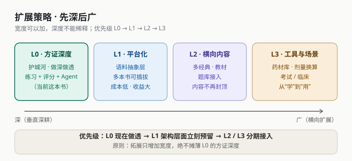
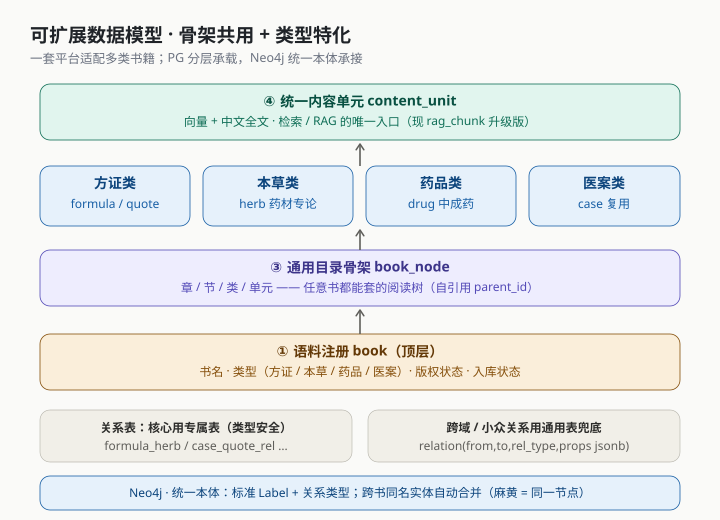

# 14 · 插拔式书籍扩展方案（可扩展性与实用性增强）

> 状态：**已采纳**（评审通过：采纳插拔式模型、L1 在 M1 落地、第二批语料为《伤寒论》原文）
> 关联：[01 产品定位](01_产品定位与用户研究.md)、[06 数据库设计](06_数据库设计_PostgreSQL.md)、[07 知识图谱](07_知识图谱设计_Neo4j.md)、[12 路线图](12_分阶段迭代路线图.md)

---

## 一、问题：单本书会封顶"平台实用性"

若平台只服务《中医经典方证案例研究》一本，实用性存在天花板：

| 问题 | 说明 |
|---|---|
| **内容会耗尽** | 535 条方证，认真练两周见底，之后无新内容 → 用户流失 |
| **需求会错配** | 真实学习/临床需求是"《伤寒论》体系""方剂学""考试大纲"，一本只覆盖一小块 |
| **缺乏日常性** | 工具类应用靠"每天都能用"（查药、查方、刷题）留住用户，单本书做不到 |

**结论**：要扩展，但**不能靠"堆功能"**，而要靠**架构的平台化**。

---

## 二、核心结论：先深后广（L0 → L3）



| 层级 | 目标 | 内容 |
|---|---|---|
| **L0 方证深度** | 护城河（**做透**） | 练习 + 评分 + Agent；把这一本书的体验做到极致 |
| **L1 平台化** | 架构预留（**近乎零成本**） | 语料抽象层，让多种书可插拔 |
| **L2 横向内容** | 打开内容上限 | 接入公版古籍（伤寒论/金匮要略/温病条辨/神农本草经）、教材、题库 |
| **L3 工具与场景** | 从"学"到"用" | 药材库、剂量换算、执医/考研刷题、症状查方 |

> **原则：扩展只增加宽度，绝不摊薄 L0 的方证深度。**

---

## 三、平台化的本质

不是"每种书对应一层"，而是：

> **让不同"书类型"共用一套通用骨架、各自特化。**

可插拔的书籍类型（本方案要适配的目标）：

| 书类型 | 代表 | 核心实体 |
|---|---|---|
| 方证书 | 本书 | 方剂 / 条文 / 医案 |
| 本草书（药草） | 《神农本草经》《本草纲目》 | 药材（性味/归经/功效/主治/炮制/禁忌） |
| 药品书 | 中成药/现代药理手册 | 药品（成分/规格/适应症/用法/不良反应/批准文号） |
| 医案书（病例） | 各家医案集 | 医案（可无主方） |

---

## 四、数据模型设计（核心）



### 4.1 PostgreSQL：四层"骨架 + 特化"

当前 PG 是**方证专用**模型（`formula`/`case_record` 是一等表），接第二类书会崩。改造为四层：

**① 语料注册 `book`（顶层）**
`id, title, book_type(方证/本草/药品/医案), author, dynasty, edition, source_license(版权), ingest_status, created_at`
> 关键：`book` 是"文献"，**一本书可覆盖多部经典**（本书即含伤寒/温病/金匮），故层级为 `book → classic → chapter → section → category → 单元`。

**② 通用目录骨架 `book_node`（阅读结构通用化 · 选项 A 真收敛）**
原 `book_chapter / book_section / book_category` **三表删除**，全部并入一棵自引用目录树：
`id, book_id, classic_id, parent_id, node_type(chapter/section/category/unit), title, seq, path_text`
> 层级：`book → classic → book_node（章/节/类/单元，parent_id 递归）→ 内容`。任意语料通用；"典籍浏览/阅读"页面**无需为语料改**。

**③ 类型特化实体（各管各的字段）**
| 类型 | 表 | 关键字段 |
|---|---|---|
| 方证类 | `formula / formula_herb / classic_quote` | 现表继续用 |
| 本草类 | `herb` + `herb_source` | 性味、归经、功效、主治、用法、炮制、禁忌、产地 |
| 药品类 | `drug` | 成分、规格、适应症、用法用量、不良反应、厂家、批准文号 |
| 医案类 | `case_record` | 复用，允许无 `main_formula_id` |

> 运行时按 `book.book_type` 选择对应实体表。**保留强类型字段 = 查询快、约束清晰、可维护。**

**④ 统一内容单元 `content_unit`（检索层通用化）**
`content_unit`（由 `rag_chunk` 升级而来）：`id, book_id, unit_type, ref_type, ref_id, title, content, embedding vector(1024), search_tsv, meta_jsonb`
> 所有书、所有类型的"知识块"都登记到这一张表 → **检索 / 向量化 / RAG 只面向一张表**，无论接多少本书，检索层不用改。

### 4.2 关系表泛化

| 策略 | 说明 |
|---|---|
| **核心关系用专属表** | `formula_herb`、`case_quote_rel` 等，类型安全、JOIN 快、约束明确 |
| **跨域/小众关系用通用表兜底** | `relation(from_type, from_id, rel_type, to_type, to_id, props jsonb, book_id)` |

> ⚠️ 不要一上来全用 EAV / 通用表——性能与维护性双重陷阱。

### 4.3 Neo4j：统一本体（低成本）

图库**天然适配异构**（不同书类型 = 不同 Label，加节点/属性不用"改表"）。但**必须先定义统一本体**：

**标准 Label（约 15–20 个，保持稳定）**
`Book / Classic / Chapter / Section / Category / Formula / Herb / Drug / Case / Quote / Syndrome / Symptom / Sign / Treatment`

**标准关系**
`IN_BOOK / CONTAINS / HAS_CATEGORY / INCLUDES / COMPOSED_OF / INDICATES / MODIFIES / PRIMARY_FORMULA / DIAGNOSED_AS / MANIFESTS / CITES / OF_CLASSIC / CORRESPONDS / SIMILAR_TO / CO_OCCURS / PREREQUISITE`

**杀手锏**：**跨书同名实体自动合并** —— "麻黄"在本书、《神农本草经》、中成药说明书中是**同一个节点**，天然实现跨书知识融合。

> 工作量主要在**建图 ETL 的"字段 → 本体"映射**，而非改结构。

### 4.4 两类数据库分工

| 数据库 | 是否需改造 | 改造量 | 重点 |
|---|---|---|---|
| **PostgreSQL** | **需要** | 中~高 | 通用骨架 + 类型特化实体 + 统一 `content_unit` + 关系泛化 |
| **Neo4j** | 基本天然支持 | 低 | 只需先定义**统一本体**，严禁随意新增 Label |

---

## 五、插拔式机制：新增一本书的标准流程

```
① 注册      → 写入 book（书名/类型/版权/状态）
② 解析      → ETL 通用导入器按"栏目规则模板"拆出 章/节/类/单元 → book_node
③ 特化映射  → 按 book_type 把字段写入对应实体表（formula / herb / drug / case…）
④ 内容登记  → 生成 content_unit（含 向量 + 全文），统一检索入口
⑤ 建图      → 按统一本体写入 Neo4j（同名实体 MERGE 合并）
⑥ 治理      → 进入校验工单流，通过后发布
```

**"插拔"的含义**：前置一次"栏目规则模板 + 字段→本体映射"的配置，之后**加书 = 跑流程，无需改代码/改表**。

---

## 六、扩展路线与优先级

| 阶段 | 内容 | 优先级 |
|---|---|---|
| **L1 平台化** | `book` / `book_node` / `content_unit` / 本体定义 | **P0（M1 就做）** |
| **L2-A 公版古籍** | 《伤寒论》原文（113 方）、《金匮要略》、《温病条辨》、《神农本草经》 | P1（无版权，同构，直接复用） |
| **L2-B 教材题库** | 方剂学、中药学、中医内科学、执医/考研题库 | P2（**版权需评估**） |
| **L2-C UGC** | 用户导入医案笔记（走治理流沉淀） | P2 |
| **L3 工具场景** | 药材库、剂量换算器、考试刷题、症状查方 | P1~P2 |

**只加三件事（性价比排序）**：
1. **L1 平台化**（一本变书架，近零成本）
2. **接入 4 部公版经典原文**（无版权、同构、复用模块）
3. **药材库独立实体**（图谱与方剂详情已有基础）

---

## 七、风险与边界

| 风险 | 应对 |
|---|---|
| **摊薄 L0 深度** | 护城河始终是方证深度 + 练习 + Agent；扩展只加宽度 |
| **数据质量参差** | 每本书 = 一份清洗 + 一份治理；**M8 治理流须先行**，否则越接越脏 |
| **版权合规** | 古籍原文属公版可放心；**现代教材/题库有版权**，需授权或只做索引/题眼 |
| **EAV 陷阱** | 不追求"一张表装天下"；有限标准本体 + 每类型特化表 |
| **Neo4j Label 爆炸** | Label 固定为标准本体，禁止每本书自定义 |
| **过早膨胀** | L2/L3 必须在 L0/L1 稳固后推进 |

---

## 八、对现有交付文档的修订建议（待你确认后执行）

| 文档 | 建议修订 |
|---|---|
| `01 产品定位与用户研究` | 定位从"单本书平台"→**"可插拔的多语料中医知识平台（本书为首个语料）"** |
| `05 系统技术架构` | 新增"语料管理与插拔"小节；`svc-catalog` 增加 `book` 域 |
| `06 数据库设计` | 引入 `book / book_node` 顶层 + `content_unit` 统一表 + 关系泛化 + 三类书特化表示例 |
| `07 知识图谱设计` | 增加 `Book` 节点与 `IN_BOOK` 关系；明确"统一本体 + 跨书合并"约定 |
| `10 数据 ETL 与治理` | ETL 泛化为"通用古籍导入器"（栏目规则模板 + 字段→本体映射） |
| `12 迭代路线图` | M1 目标追加"可扩展数据模型落地"；新增 L2/L3 分期 |

---

## 九、决策记录

| # | 决策项 | 结论 |
|---|---|---|
| 1 | 是否采纳"插拔式书籍"模型 | ✅ **采纳**（PG 四层 + Neo4j 统一本体） |
| 2 | L1 平台化是否在 M1 落地 | ✅ **同意，M1 落地** |
| 3 | 第二批语料 | ✅ **《伤寒论》原文**（公版，L2-A） |
| 4 | 教材题库是否纳入 | ⏳ **待定**（涉及版权，见 §十） |
| 5 | 是否同步修订 01/05/06/07/10/12 | ✅ **已修订** |
| 6 | 目录表收敛方式 | ✅ **选项 A（真收敛）**：删除 `book_chapter/section/category`，统一 `book_node` 单树 |
| 7 | 一致性修复（审查清单 7 项） | ✅ **已修复**（`rag_chunk→content_unit`、工具数 11、svc 数 7、白名单、登录粒度等） |
| 8 | **路由分层** | ✅ **方案 A**：`/api/biz/**` 仅 BFF、`/api/agent/**` 仅 Agent、各 svc 只用 `/internal/**` |
| 9 | 结构规范补齐 | ✅ 已补：svc 内部包结构、数据归属与同步、登录态约定、Agent 目录（prompts/evals/observability）、LLM 健壮性 |
| 10 | 前端目录路由 | ✅ 统一为 **`/node/:id`**（任意层级按 `node_type` 渲染），取消 `/classic/:id`、`/chapter/:id` |
| 11 | 书架 vs 切书器 | ✅ 二者**分工不重叠**：书架=语料管理页；切书器=全局快速切"当前语料" |
| 12 | 是否拆 `svc-corpus` | ✅ **一期不拆**，留在 `svc-catalog`（内部 `corpus` 包预留边界），规模化后再拆 |
| 13 | Agent 工具范围 | ✅ **一期挂 6 个高频**（二期补至 11） |
| 14 | 评分实现 | ✅ **规则兜底**：药味/剂量用确定性集合运算，仅证候语义比对交 LLM（`temperature=0`） |

> 文档状态：本文档由"待评审"转为**已采纳**；01/02/03/05/06/07/08/09/10/12 等已按本方案回改。

## 十、关于"教材题库"（决策 4 · 说明）

**"教材题库"指两类东西：**
1. **现代中医教材**：《中医基础理论》《中药学》《方剂学》《中医内科学》等国家规划教材 —— 提供"方证"之外的**体系化知识框架**。
2. **题库**：执业医师考试、考研中医综合、校内期末题 —— 直接喂养 M3 练习（练习引擎通用，**换套题即可**）。

**为什么有用**：教材补"知识体系"，题库补"日常刷题"—— 这两块是学生群体**每天都会用**的高频场景，能显著提升平台实用性。

**为什么"涉及版权"（关键）：**
- **古籍原文**（伤寒论等）作者已故久远 → **公版，可自由使用**；
- 但**现代教材与题库是当代编者 / 出版社的著作权作品**（考试真题亦可能受保护）—— **全文搬运 = 侵权风险**。

**可选策略（由轻到重）：**

| 方案 | 做法 | 风险 / 成本 |
|---|---|---|
| ① 不碰 | 只接公版古籍 | 最安全；缺"体系化 + 刷题"的日常价值 |
| ② 只做索引 / 题眼 | 不复制教材全文，只做"知识点标题 + 自编摘要 + 出处指向"；题库只收自编题 | 低风险；工作量在自编 |
| ③ 获授权 | 联系出版社 / 学校授权（校内 / 课程项目常可谈） | 需沟通；有授权则最优 |
| ④ UGC | 用户 / 老师自行上传，责任转移 + 平台审核 | 需审核机制 |

**建议**：本期 L2 **先只接公版古籍（伤寒论等）**；教材题库列为 **L2-B（P2，待评估）**，产品验证后优先走"**自建题库 + 授权教材**"路线。
