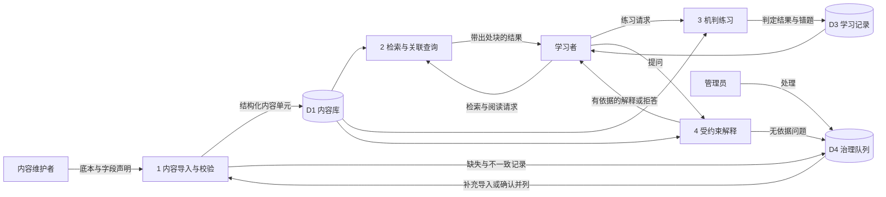

# 02 可行性研究报告

**版本：** v0.5
**状态：** 待评审
**最后更新：** 2026-11-24
**变更摘要：** 两轮修订。第一轮按“教学整理本首版导入、原文保真、首版练习限定结构化题型”决策回改：§2.1 RV-01 补教学整理本准则；§7.3.1 增逐段性质标注要求，§7.3.2 环节表由 9 增为 10，§7.3.3 难度与结论由两处难点改为三处；§7.7.1 增教学整理本形态、解除与 `docs/01` v0.5 的冲突，§7.7.2 增显示值与归一值分层及只读约束；§9.2 补性质标注成本并调低机判练习成本；§11 增教学整理本著作权与授权口径；§12.3 增默写延期代价；§13 阶段 5 补去重与性质标注；§14.2 增 RISK-15～RISK-17；§15.2 增默写与条文补全延期项；§16 增 Q-011。第二轮补实测：新增 §7.9 最小验证实验，用一份 1.24 MB 真实底本实测结构（无标题样式、1638 段重复、78 表中仅 2 个真表格、约 14% 碎片段），据此纠正“docx 即有标题样式”的假设，并在 §7.1 的 C-1 检验办法中补入段落性质标注正确率。第三轮收敛外部条件：Q-001～Q-003 与 Q-011 已答（课程无模板、以 Word 交付、3 人至 2026-12-10、教学整理本授权可用），§10.1 与 §10.2 据此明确本次只交付文档体系与窄范围原型，系统实现不在范围内，§11 的条件式结论由三处减为两处。第四轮完成 100 段分层抽样核对（§7.9.4）：31 段明确预标全部正确，覆盖率仅 31%，查出三处缺陷（半角方括号标记未识别、页眉重复章名导致重复建树、条文识别率仅 1.6%），据此把段落性质标注的自动化程度由“半自动”下调为“人工为主、规则仅预填”。第五轮修正：课程要求交付**可运行系统**，撤销“系统实现不在本次交付范围”的表述，改为必须实施但收窄为窄范围原型（导入链 + 检索 + 出处，练习只做选择题与组成匹配，解释默认关闭），有效人力按 1.5 人估，并新增 RISK-18 与“可运行系统范围窄”的代价。第六轮：确定实现在既有代码上改造而非重写，新增 §13.1（单向改造、差距清单、四段追踪三条机制）与 RISK-19（文档与实现不一致），把“不能 ab 货”写成可检查的约束而不是口头要求。

## 1. 文档信息

### 1.1 目的

判断 `docs/01` 定义的问题是否值得投入、是否具备实施条件，在若干候选方案中选出推荐方案，并给出后续开发计划的草案。

本文档给出明确判断，不只罗列优缺点。

### 1.2 范围

覆盖：规模与目标复查、现有系统与替代方式研究、目标系统高层逻辑模型、问题再次定义、候选方案与自动化边界、技术—操作—经济—进度—法律五类可行性、推荐行动方针、开发计划草案、风险与前提、需要缩小或放弃的范围。

不覆盖：功能需求编号与验收条件（`docs/03`）、详细建模（`docs/04`）、架构与模块设计（`docs/05`）、表结构（`docs/06`）、完整项目计划（`docs/07`）。

### 1.3 读者对象

课程指导教师与评审、项目组成员、后续文档编写者。

### 1.4 术语与缩略语

沿用 `docs/01` §1.4 的术语。本文新增：

| 术语 | 说明 |
|---|---|
| 自动化边界 | 系统各处理环节中，由人承担与由计算机承担的划分线 |
| 确定性处理 | 结果只由库内数据与固定规则决定，不含生成式模型的自由输出 |
| 受约束生成 | 生成内容必须逐句依据库内原文，无依据即拒答 |
| 判据字段 | 可作为判定依据的字段，如原文文本、方名、药味组成 |
| 覆盖底本 | 导入时的具体出版物或整理文本，其形态决定导入可行性与字段完整度 |

### 1.5 参考资料

| 编号 | 资料 | 用途 |
|---|---|---|
| REF-01 | `docs/01_问题定义与项目背景.md` | 问题基线、范围、约束、风险 |
| REF-02 | `track/2026-11-21_课程与学习场景调研.md` | 课程结构、学生规模、练习能力分层 |
| REF-03 | `track/2026-11-21_前期调研材料.md` | 竞品能力对比、电子书与 AI 风险 |
| REF-04 | 教育部《对十三届全国人大三次会议第5319号建议的答复》，2020-12-17 | 经典课程学时占比 |
| REF-05 | 国家中医药管理局提案答复函，2022-12-26 | 同上 |
| REF-06 | Pierard, Svihla, Clement & Fazio, 2020，电子书学习障碍研究 | 阅读器交互成本的实证参照 |
| REF-07 | `track/00_决策与工作日志.md` | 决策 D-001～D-027 |

## 2. 复查系统规模与目标

本节不是引用 `docs/01`，而是对它执行复查：找出表述含糊、约束遗漏、术语不明确之处，并给出处理意见。

### 2.1 复查结论

| 编号 | 复查发现 | 原文位置 | 处理意见 | 状态 |
|---|---|---|---|---|
| RV-01 | “典籍原文”未界定“典籍”的判定标准，由谁认定某书属于典籍范围不明确 | `docs/01` §8.1 | 由管理员按准则判定：属于公认的中医经典著作及其注本、校注本，或以典籍原文为主体、逐段可区分原文与论述的教学整理本，不含现代教材、讲义、期刊论文、科普读物；用户可提交书目申请（元信息与目录，不含文件） | 已在 `docs/01` v0.3 §8.2 落地；v0.5 扩宽至教学整理本并增第 4 条（逐段性质标注） |
| RV-02 | “课程学习者”未区分在读、毕业备考、继续教育，影响操作可行性与术语难度判断 | `docs/01` §3.1 | 不细分。角色区分属 `docs/03` 的设计内容；可行性阶段仅保留“具备基本文言阅读能力”这一假设 | **作废**（v0.1 提出，v0.2 撤回） |
| RV-03 | “学习记录”含义过宽 | `docs/01` §8.3 | 不细分。`docs/01` 保持“学习记录”粒度；记录分类属数据设计，移交 `docs/06` | **作废**（v0.1 提出，v0.2 撤回） |
| RV-04 | 成功标准全部为“待基线”，本阶段无法判定是否达标 | `docs/01` §6.3 | 可行性阶段只验证“指标可测”，不验证“指标达标” | 已在本文件 §9 采用 |
| RV-05 | 约束 C-01（无专家审核）只写了后果，未写它是否随时间解除 | `docs/01` §9.1 | 明确为“首版约束，后续版本计划引入专家评审”，不作为永久设计前提 | 已在 `docs/01` v0.3 §9.1 落地 |
| RV-06 | 未说明现有实现在可行性研究中的地位 | 全文 | 按 D-023：技术可行性按“从零能否做”评估，现有实现仅作成本参考，不作设计依据 | 已在本文件 §3.1 说明 |
| RV-07 | 出处块“必须含书名与篇名”只是隐含要求，可能被下游当作尽力目标 | `docs/01` §6.3、§9.1 | 新增约束 C-07：任何输出必须含书名与篇名，无法提供时不得输出 | 已在 `docs/01` v0.3 §9.1 落地 |
| RV-08 | 导入动作由谁执行、用户能否上传文件，`docs/01` 未定义 | `docs/01` §8 | 新增约束 C-08：导入由管理员独占；用户仅可提交书目申请，不含文件本体，不触发导入 | 已在 `docs/01` v0.3 §8.2、§9.1 落地 |

### 2.2 规模与目标确认

复查后确认以下规模判断成立，作为本文件的评估基准：

| 维度 | 确认结果 | 依据 |
|---|---|---|
| 目标用户规模 | 中医药专业在校生约 62.6 万，其中中医类本科及以上约 27 万；经典课程约占培养总学时 10% | REF-04、REF-05 |
| 服务口径 | 面向经典学习的专用工具，不覆盖中医学全部课程 | REF-01 §2.1 |
| 内容规模 | 由导入清单决定，首版不做全库覆盖承诺 | REF-01 §8.1、D-019 |
| 功能规模 | 三类内容、四类能力（阅读、检索与关联、机判练习、受约束解释） | REF-01 §7.1、D-017 |
| 团队规模 | 未知 | Q-003，阻塞进度可行性 |

`[待确认]` 目标用户规模数据来自会议报道与媒体转引，口径不完全一致，正式提交前需核对原始来源。

## 3. 现有系统与替代方式研究

### 3.1 研究边界

本节研究现有系统的**用户可见行为与问题**，不涉及其内部实现。

依据 D-002，现有代码不作为需求来源与设计约束；依据 D-023，现有实现在本文件中仅以“可降低多少成本”的形式出现（见 §9.3）。

教材要求“研究正在使用的系统”，其目的是确认新系统必须保留哪些基本功能、必须解决哪些旧问题。本节按此目的执行，不进行代码审查与架构评估。

### 3.2 现有系统与替代方式的能力对照

| 能力 | 纸质书与教材 | 通用电子书阅读器 | 院校课程与讲义 | 通用 AI 助手 | 现有系统形态 |
|---|---|---|---|---|---|
| 原文阅读 | 有，受携带与检索限制 | 有，交互成本见 REF-06 | 有，受学期进度约束 | 无 | 有 |
| 跨书全文检索 | 几乎无 | 有，限单本或单平台 | 无 | 有，但来源不可控 | 有 |
| 按药味反查方剂 | 无 | 无 | 无 | 不稳定 | 未验证 |
| 类方组成差异比较 | 需人工逐条比对 | 无 | 需人工 | 不稳定 | 未验证 |
| 方证关系检索 | 需人工翻检 | 无 | 部分（教材归纳） | 无出处 | 未验证 |
| 出处可回溯到条 | 需人工 | 页码级 | 页码级 | 通常缺失 | 未验证 |
| 自测与判分 | 无 | 无 | 有，依赖教师 | 有，但不依据指定库 | 未验证 |
| 库内无依据时拒答 | 不适用 | 不适用 | 不适用 | 通常不拒答 | 未验证 |

“未验证”表示该能力是否存在于现有系统、是否易被发现，尚未通过任务走查确认，属于 `docs/01` §5.2 已记录的证据缺口。

### 3.3 研究结论

1. 现有替代方式各自覆盖部分任务，**没有任何一种同时覆盖“按药味反查”与“出处可回到条”**，这两项构成本系统的必要性基础。
2. 通用 AI 助手在“自测”与“解释”上看似覆盖，但其输出通常无法回溯到指定底本的具体条文，与 `docs/01` 的约束 C-02、C-04 冲突，不能直接作为替代。
3. 现有系统在阅读与检索上已有可用能力，因此新方案必须至少保留这些基本功能，不能用“功能更少”的方案替换（对应教材“新系统必须能完成现有系统的基本功能”的要求）。

## 4. 目标系统高层逻辑模型

本节给出高层数据流图与数据字典，用于与用户复查问题定义（教材第 3、4 步）。本节不涉及模块划分、部署与表结构。

### 4.1 图 4-1 说明

图 4-1 要回答的问题：系统的数据从哪来、经过哪些加工、最终以什么形式回到学习者，以及治理信息如何回流。



*图 4-1 目标系统高层数据流图（概念层）*

图中编号 1～4 是加工，D1～D4 是数据存储。图中不体现技术实现，只体现数据流向。

### 4.2 主要加工

| 编号 | 加工 | 输入 | 输出 | 确定性 |
|---|---|---|---|---|
| 1 | 内容导入与校验 | 底本文件、导入者的字段声明 | 结构化内容单元、缺失与不一致记录 | 确定性 |
| 2 | 检索与关联查询 | 检索请求 | 带出处块的结果集 | 确定性 |
| 3 | 机判练习 | 出题范围 | 题目、判定结果、错题 | 确定性 |
| 4 | 受约束解释 | 自然语言提问 | 带出处的解释，或拒答与缺口记录 | 受约束生成 |

### 4.3 数据字典（高层）

| 数据项 | 含义 | 组成 | 关键约束 |
|---|---|---|---|
| 内容单元 | 可检索、可引用、可定位的最小内容记录 | 定位字段（书名、版本、篇名、条号）、内容类型、正文文本、结构化字段 | 定位字段中的书名与篇名为必填（`docs/01` A-05 的字段分级） |
| 定位字段 | 标明内容来源的字段集合 | 书名、版本、作者、篇名、条号 | 条号与版本可缺失，缺失时出处退化为篇级 |
| 方剂记录 | 方名与组成的记录 | 方名、别名、药味组成、剂量（可选）、来源条文关联 | 方名与组成属于判据字段，缺失则不入练习池 |
| 医案记录 | 诊疗过程原始记录 | 来源书目、正文、涉及方剂、涉及条文 | 证候标注为选择性字段，缺失时不做证候检索 |
| 关联关系 | 方—条文、方—医案、药—方 | 源对象、目标对象、关系类型、来源位置 | 只记录库内已有的挂接，不表示推理 |
| 出处块 | 输出的统一定位信息 | 书名、篇名、条号（可得时）、原文片段 | 每次输出必须含至少书名与篇名 |
| 治理记录 | 内容缺口与内容不一致 | 类型、涉及对象、两处原文、状态 | 缺口与冲突分列，冲突不做裁决 |
| 学习记录 | 用户侧记录 | 练习作答、错题、阅读进度、收藏、笔记 | 最小收集，支持删除 |

### 4.4 逻辑模型对问题定义的反馈

| 反馈 | 影响 |
|---|---|
| 加工 4 的输出包含“拒答与缺口记录”，说明 P-07 不是附加功能，而是模型内置的一条数据流 | 支持 `docs/01` 将 P-07 列为问题 |
| 加工 1 直接产出治理记录，说明内容质量在导入环节即被检查，而非事后补救 | 支持 O-09 |
| 数据字典要求“出处块至少含书名与篇名”，说明 C-03（出处可定位）在实践中是 100% 要求而非尽力而为 | 支持 §7.1 的判定条件 |

## 5. 问题的再次定义

### 5.1 复查动作

以图 4-1 与 §4.3 数据字典为基础，对 `docs/01` 的问题陈述与范围做一次复查，检查“提出的问题是否都能在模型中找到对应加工与数据”。

| 问题 | 对应加工或数据 | 是否闭合 |
|---|---|---|
| P-01 首次进入不理解用途 | 无对应加工，属界面表达问题 | 闭合（不需数据流支持） |
| P-02 学习上下文不连续 | 加工 2、3 与 D1、D3 的衔接 | 闭合 |
| P-03 出处需人工核对 | 出处块、定位字段 | 闭合 |
| P-04 错题无回流路径 | 加工 3 输出至 D3，再从 D3 回到加工 2 | 闭合 |
| P-05 内容关联难判断 | 加工 1 的校验输出、治理记录 | 闭合 |
| P-06 技术术语表达价值 | 同 P-01 | 闭合 |
| P-07 内容缺口不可见 | 加工 4 的缺口输出、D4 | 闭合 |

### 5.2 复查发现的问题

本次复查未推翻 `docs/01` 的问题陈述，但发现三处需要回改：

1. **RV-01、RV-03**：范围与术语需要精确化（见 §2.1）。
2. **`docs/01` §8.2 的“学习记录”在数据字典中被拆为四类**，正文表述需与之一致。
3. **出处块“必须含书名与篇名”这一约束在 `docs/01` 中只是隐含要求**，应显式写入约束，否则下游可能把它当作尽力目标。

上述三项列入 `docs/01` 的待更新事项，本文件不直接修改上游文档。

### 5.3 复查循环的结论

经一轮循环，问题陈述、数据流与数据字典三者一致，未发现需要重新定义问题的情况。复查到此结束，不再迭代。

## 6. 候选方案与自动化边界

### 6.1 方案划分原则

方案差异来自**自动化边界**的划分，即系统各环节由人还是由计算机承担：

| 环节 | 可选的承担方式 | 本系统采用 |
|---|---|---|
| 内容整理与结构化 | 人工整本录入 / 工具半自动 + 人工校对 | 工具半自动 + 人工校对 |
| 内容校验 | 人工通读 / 规则检查 + 抽样人工核对 | 规则检查 + 抽样人工核对 |
| 检索与关联 | 人工翻检 / 确定性检索 | 确定性检索 |
| 判定对错 | 人工判分（现状对照） / 规则判分 | 规则判分 |
| 解释生成 | 人工讲解 / 受约束生成 / 不生成 | 不生成（默认），受约束生成为可选 |
| 内容冲突裁决 | 专家裁决 / 并列呈现不裁决 | 并列呈现不裁决 |

两点说明：

1. 系统内不设教师角色，判分全部由规则完成（`docs/01` C-03）。表中“人工判分”“人工讲解”只作为现状对照列出，不作为方案选项。
2. “工具半自动”的具体含义见 §7.3：结构化处理可自动化，正确性判定不能自动化。

`docs/01` 的约束 C-01（无专家）使“专家裁决”“人工判分”两项不可选，这直接压缩了可行方案空间。

### 6.2 方案 P0：维持现状（基线）

不建设新系统。学习者使用纸质书、教材、通用搜索与通用 AI 助手完成经典学习。

| 维度 | 评估 |
|---|---|
| 技术可行性 | 不涉及 |
| 成本 | 最低 |
| 是否解决问题 | 不能。P-03、P-04 无法解决；L-08、L-09 依然存在 |
| 作用 | 作为比较基线，用于论证新系统必要性 |

### 6.3 方案 PA：纯确定性系统（首版默认交付形态）

所有加工均为确定性处理，不含生成式模型。解释功能不提供，只提供原文、出处与结构化关联。

| 维度 | 评估 |
|---|---|
| 覆盖问题 | P-02（部分）、P-03、P-04、P-05、P-07 的缺口记录 |
| 未覆盖 | 无生成式解释，用户“读不懂”的需求只能通过原文与关联条文间接回应 |
| 技术难度 | 低。无模型输出，全部结果可复现、可测试 |
| 红线合规 | 最安全 |
| 主要风险 | 用户可能认为“就是个检索工具” |

本方案是首版默认交付形态（D-034），理由见 §12.2。

### 6.4 方案 PB：确定性 + 受约束生成（可选增强，默认关闭）

在 PA 基础上增加解释能力，生成内容必须逐句依据库内原文与官方基础事实数据，无依据即拒答，并记录缺口。

| 维度 | 评估 |
|---|---|
| 覆盖问题 | PA 的全部，加“读不懂”的辅助解释 |
| 技术难度 | 中。核心不确定性集中在拒答可控性（§7.5） |
| 红线合规 | 受约束生成 + 出处块 + 拒答，满足 C-02 与设计红线 |
| 启用成本 | 需由管理员配置单一模型密钥；未配置时系统行为等同 PA |
| 主要风险 | 密钥与调用费用由部署方承担；拒答率过高会使用户认为“什么都不会” |
| 首版定位 | 架构上保留，默认关闭（D-035）；开启后可用，关闭后退化为 PA |

### 6.5 方案 PC：全面智能化

在 PB 基础上增加病案辨证分析、处方思路评价与个性化学习规划。

| 维度 | 评估 |
|---|---|
| 技术可行性 | 部分可行（可生成文本），但判定正确性无法保证 |
| 与约束的关系 | 直接违反 C-01（无专家可判定）与 C-03（只做机判），也违反“不做病案自动评分” |
| 定位冲突 | 与 `docs/01` §6.2 的定位表述冲突 |
| 结论 | 技术上可做，但定位不允许，排除 |

### 6.6 四方案能力对照

| 能力 | P0 | PA | PB | PC |
|---|---|---|---|---|
| 原文阅读与定位 | 纸质 | 有 | 有 | 有 |
| 跨书检索 | 通用工具 | 有 | 有 | 有 |
| 按药味反查方剂 | 无 | 有 | 有 | 有 |
| 类方组成比较 | 无 | 有 | 有 | 有 |
| 方证关系检索 | 无 | 有 | 有 | 有 |
| 机判练习与错题回流 | 无 | 有 | 有 | 有 |
| 受约束解释 | 通用 AI，无出处 | 无 | 有（默认关闭） | 有 |
| 病案辨证自动评分 | 无 | 无 | 无 | 有（违规） |
| 个性化学习规划 | 无 | 无 | 无 | 有 |
| 缺口与冲突治理 | 无 | 有 | 有 | 有 |
| 红线合规 | 不适用 | 高 | 中高 | 低 |
| 首版默认启用 | 不适用 | **是** | 否，可选开启 | 否 |

## 7. 技术可行性

### 7.1 核心点的判定方式

核心点失败会导致产品性质改变，而非体验下降。每项必须给出可执行的检验办法；阈值待有数据后确定，但检验方式现在确定。

| 编号 | 核心点 | 检验办法 | 通过条件 |
|---|---|---|---|
| C-1 | 内容能否入库并结构化 | 取一份真实覆盖底本跑完整导入链，抽样 100 条比对切分结果与原文结构；并统计段落性质标注正确率（仅教学整理本） | 切分正确率达到设定值；性质标注正确率达到设定值且未标注段为零；失败项定位到具体环节 |
| C-2 | 判据是否可靠 | 抽样核对方名、药味组成与底本原文的一致性；不一致项进入冲突队列 | 一致率达到设定值；不允许静默合并 |
| C-3 | 出处能否精确定位 | 统计导入后内容单元中“书名 + 篇名”的覆盖率 | **必须 100%**。这是合规要求，不是体验指标 |
| C-4 | 拒答是否可控 | 构造两组问题：库内确无答案的、库内明确有答案的 | 前者全部拒答；后者全部给出可引用出处 |

C-3 是四项中唯一允许写死为 100% 的，理由：出处是 `docs/01` 约束 C-01 下唯一的信任来源，也无法通过降级规避。

#### 7.1.1 学习端形态带来的额外技术成本

`docs/01` §8.6 确定学习端为微信小程序。这带来三项必须计入成本的技术约束：

| 约束 | 影响 | 成本判断 |
|---|---|---|
| 正式发布需 HTTPS 域名，并完成小程序备案与域名 ICP 备案 | 域名、证书与备案周期（约 1 个月，受属地管局进度影响） | **开发与演示阶段可规避**（开发者工具与真机调试可关闭域名校验）；仅发布时构成强制要求 |
| 小程序不能直连第三方模型接口，必须经自有后端转发 | 与“服务端统一出口”方向一致 | 不增加额外成本 |
| 长文本渲染能力受限 | `rich-text` 支持标签有限；第三方 Web 阅读器库依赖 DOM 不可用；长列表需分页或虚拟化 | **中等**：分页、滚动位置记忆、字号切换后重排、弹出定位均需自研 |

两条查证结论必须一并记入：

1. ICP 备案取决于**域名注册主体所在地**，与服务器位置无必然联系；境内注册域名必须备案，境外注册域名无需也无法备案。因此把服务器放到境外**不能**免除备案义务。
2. 微信云开发官方文档称“小程序原生能力无需配置业务域名，也无需备案”，但云函数调用是否完全属于该范围未见明文，列为待实测（RISK-13）。

### 7.2 重要点与降级预案

| 编号 | 重要点 | 不达标时的降级 |
|---|---|---|
| I-1 | 检索相关性（药味反查、类方比较） | 缩小为按方名精确检索，界面标注能力范围 |
| I-2 | 方证关系覆盖率 | 仅对已挂接的方提供关联，显示覆盖范围 |
| I-3 | 解释质量 | 退化为 PA：只给原文与出处，不给解释 |
| I-4 | 性能与规模 | 分页、限制并发、限制单次检索范围 |

降级预案的意义：四项重要点即使全部不达标，系统仍可作为 PA 交付，不会导致项目失败。

### 7.3 书籍导入链路的可行性

这是技术可行性的主要工作量所在，也是唯一需要自研较多环节的部分。

#### 7.3.1 首版底本范围

| 底本形态 | 首版 | 理由 |
|---|---|---|
| DOCX（带标题样式） | 支持 | Word 标题样式可直接还原篇、章层级 |
| DOCX（无标题样式，仅段落） | 支持，但按 txt 难度处理 | 实测常见：全文无 `pStyle` 与 `outlineLvl`，标题只能靠正则识别（§7.9） |
| TXT | 支持（受限） | 无结构信息，标题只能靠正则识别 |
| PDF（含文字层） | 不支持，后续考虑 | 需版面还原，成本高于收益 |
| 扫描影印件 | 不支持 | 需 OCR 与句读，无专家无法保证质量 |

必须纠正两个易犯的错误。

错误一：**docx 与 txt 不属于同一难度档**。

- docx 有标题样式作为结构线索，层级可直接取得。
- txt 是纯文本，标题只能靠正则猜；判错一处，整棵章节树就歪，后续全部单元会挂到错误节点上。

错误二：**“是 docx”不等于“带标题样式的 docx”**。实测（§7.9）一份 1.24 MB、10522 段的真实底本，全部段落既无 `pStyle` 也无 `outlineLvl`，标题样式信息为零，实际难度等同 txt。因此不能由扩展名推定结构可得，导入前必须逐份探测样式有无，并据此决定建树是全自动还是半自动。

因此：docx 为主支持格式；txt 作为兜底格式，要求导入者同时提供目录文本或在导入时标注标题格式，否则校对成本不可接受。

另需注意教学整理本的额外要求（`docs/01` §8.2 第 4 条）：该类底本必须逐段标注性质，取值为典籍原文、注释、教学论述、医案四类之一，标注缺失或不明的段落不得作为判据与出处入库。这不是格式问题而是判据可靠性问题：同一段落在整理本中可能是原文，也可能是整理者的按语，混同会使判分依据与引用同时失真，且错误不会在导入时自然暴露，只会以“判分莫名错误”的形式在练习阶段出现。

#### 7.3.2 处理环节与工具

| 环节 | 任务 | 自动化程度 | 工具 |
|---|---|---|---|
| 1 文档读取 | 取段落文本与标题样式 | 全自动 | `python-docx`；txt 用标准库（需处理编码） |
| 2 节点建树 | 生成篇、章、段层级 | 全自动（docx）/ 半自动（txt） | 自研规则 |
| 3 条文切分 | 切出可引用单元并生成定位标签 | 半自动 | 自研规则 + 人工校对 |
| 4 段落性质标注 | 标注典籍原文／注释／教学论述／医案；仅“典籍原文”段可进入判据池 | **人工为主**，规则仅预填（§7.9.4 实测规则认不出多数原文段） | 自研规则 + 平台内校对工作台 |
| 5 实体识别 | 标出方名、药名 | 全自动 | `pyahocorasick`（多模式匹配） |
| 6 别名消歧 | 对应到库内方剂 | 半自动 | `rapidfuzz` 出候选 + 人工确认 |
| 7 质检 | 检查必填字段缺失与结构异常，含“段落性质未标注” | 全自动 | 自研规则 |
| 8 人工校对 | 逐条确认、修正、驳回 | 人工 | 平台内校对工作台 |
| 9 入库 | 写入内容库 | 全自动 | 自研 |
| 10 抽样复核 | 按比例抽查并记录错误率 | 人工 | 平台内抽样页 |

工具范围收缩的收益：只支持 docx/txt 后，OCR、版面还原与 PDF 解析类工具**全部不需要**，六个环节可实现自动化，三个人工环节（段落性质标注、人工校对、抽样复核），其中段落性质标注只对教学整理本生效，且实测下来无法靠规则自动完成（§7.9.4）。这显著降低了技术风险，也减少了工具许可证方面的顾虑。

关键判断：第 5 环节采用词典匹配而非训练识别模型。理由是缺少标注数据与专家校验，模型错误的定位与修复成本高于词典漏检；词典匹配的结果可枚举、可修正、可解释。

#### 7.3.3 自研难度预测

| 环节 | 难度 | 依据 |
|---|---|---|
| docx 读取（含标题样式） | 低 | 库成熟，标题层级可直接取得；**无样式时按 txt 处理，难度等同下一行**（§7.9 实测即属此类） |
| txt 标题识别 | 中高 | 无结构信息，只能正则；错误会传导到整棵树 |
| 条文切分 | 中 | 规则本身简单，但夹注、方后注、异体字、缺标点会干扰 |
| 段落性质标注 | 高 | 无客观判据；实测规则预标覆盖率仅 31%、且认不出多数原文段（§7.9.4），只能逐段人工；工作量随篇幅线性增长，错误在练习判分阶段才暴露 |
| 词典匹配 | 低 | Aho-Corasick 为成熟算法，一次扫描完成 |
| 别名消歧 | 中 | 同名异方、异名同方必须人工确认，无法全自动 |
| 校对工作台 | 中 | 功能不复杂，效率取决于交互设计 |

结论：单个环节都不难，难在三处——**切分规则要按书定制**（换书需调规则），**校对工作量随书目线性增长**，**教学整理本的逐段性质标注只能人工完成且随篇幅线性增长**。导入成本的瓶颈是人力而非技术（见 §9.2）。

#### 7.3.4 导入工作流

```text
[管理员] 上传 docx/txt，填写元信息（书名、作者、朝代、版本、目录）
   ↓
[系统] 1 读取：取段落与标题样式（docx）或正则识别标题（txt）
   ↓
[系统] 2 建树：生成 篇 → 章 → 段 节点层级
   ↓
[系统] 3 切分：切出条文单元，生成定位标签
   ↓
[系统] 4 识别：词典匹配标出方名、药名
   ↓
[系统] 5 消歧：别名候选对应库内方剂，低置信度标记待确认
   ↓
[系统] 6 质检：检查必填字段缺失与结构异常，生成问题清单
   ↓
[平台] 7 校对工作台：人工逐条确认、修正、驳回
   ↓
[系统] 8 入库：确认项写入内容库，未确认项留在队列
   ↓
[平台] 9 抽样复核：按比例抽查已入库内容，记录错误率
```

风险集中在第 2、3 步：这两步出错，下游结果全部作废。

#### 7.3.5 人工校对能否在平台内完成

可行，且应作为首版设计方向，但不建议一次做成完整工作台。

| 维度 | 评估 |
|---|---|
| 技术实现 | 低到中。本质是列表、双栏对照与状态流转，无算法难点 |
| 已有基础 | 现有前端已有导入页面（含上传区与治理状态查询），“提交—审核—查询”骨架已存在，扩展为校对工作台属增量 |
| 价值一 | 校对工作量可度量（条数、耗时），直接支撑 §10 与 §13 的估算 |
| 价值二 | 修正记录可审计，可作为内容质量的证据 |
| 价值三 | 校对不依赖开发者在本地运行脚本，可多人分派 |
| 代价 | 校对界面本身是中等规模模块，不是附带功能 |
| 风险 | 效率高度依赖交互设计；设计不当会比直接改脚本更慢 |

首版建议范围：左右对照、确认/修正、下一条，仅支持条文类单元，不做批量操作与多人分派。流程跑通后再扩展。

#### 7.3.6 该链路的结论

技术可行。成本可控有三个前提：底本为 docx 或结构良好的 txt；切分规则可配置而非硬编码；校对工作台能实质提升人工效率。三者缺一，导入成本会显著上升。

### 7.4 方证关系数据的可得性

| 数据来源 | 可得性 | 问题 |
|---|---|---|
| 原文中“某方主某证”一类表述 | 中 | 表述形式不统一，抽取规则需按书定制 |
| 方剂组成 | 高 | 需与药味词表对齐；不同底本组成可能有差异，进入冲突队列 |
| 医案中的用方记录 | 中 | 医案正文结构化程度低，方名识别依赖词表覆盖 |
| 教学整理本自带的教学挂接 | 中高 | 整理本常附方证对应表，是成本最低的挂接来源；但须区分原文记载与整理者按语，按语不得作为方证依据 |
| 证候标准化 | 低 | 无权威标注来源，不做标准化映射（`docs/01` RISK-05） |

结论：方证关系只能作为“库内已有挂接的检索”，不能承诺完整性。需在导入后统计覆盖率作为内容建设指标（I-2 的降级依据）。

### 7.5 拒答可控性与受约束生成

#### 7.5.1 拒答机制

机制由三个条件共同构成，缺一不可：

1. 检索必须命中库内内容；
2. 命中内容中必须存在可引用的原文片段；
3. 生成内容必须逐句对应到第 2 条的片段。

任一条不成立即拒答，并记录为内容缺口。

不确定性：第 1 条的“命中”判定标准无法在无数据时确定。过松会生成无依据内容（违反红线），过严会大量拒答（I-3 降级）。该参数必须在有真实语料后调优，不能在文档中预设数值。

#### 7.5.2 受约束生成的四类约束

“受约束”必须写成可验收的清单，否则 `docs/03` 无法据此写验收条件。

| 约束类型 | 内容 | 可验收方式 |
|---|---|---|
| 来源约束 | 只能使用检索命中的库内内容与官方基础事实数据，不得使用模型自身知识 | 抽查输出中每一句能否对应到检索结果 |
| 引用约束 | 每处结论后必须带出处块（书名、篇名、条号），无法提供则不得输出（C-07） | 逐条检查出处完整性 |
| 拒答约束 | 检索未命中或无可用原文片段时，必须拒答并记录内容缺口 | 用库内无答案的问题集测试，应全部拒答 |
| 范围约束 | 不得给出诊断、处方、剂量建议；不得做证治推演；不得生成新方 | 抽样审查，命中任一项即判不合格 |

**可写清与不可写清的分界**：约束清单现在可以确定；命中阈值、相似度标准这类数值必须等真实语料到位后确定，写死了会误导后续阶段。

#### 7.5.3 模型服务的选择约束

受约束生成需要调用模型服务，选型受两条现实约束：

1. **部署位置**。若服务端部署在境内，优先选择已完成备案的境内模型服务；调用境外服务的网络可达性与合规性需实测，不能假定可用。
2. **密钥归属**。按 `docs/01` C-10，密钥由管理员在服务端配置，用户不配置；未配置时系统行为等同方案 PA。

费用口径：按调用量计费，属可变成本。因默认关闭、且仅对检索命中的提问触发，实际调用量取决于使用频度，不做预先估算。

### 7.6 技术筛除结论

| 方案 | 技术是否可行 | 说明 |
|---|---|---|
| P0 | 不适用 | 不是系统方案 |
| PA | 可行 | 全确定性，无技术不确定性 |
| PB | 可行（有不确定性） | 不确定性集中在拒答阈值，可通过降级到 PA 兜底 |
| PC | 技术部分可行 | 病案评分的技术实现可行，但正确性无法保证；排除原因为定位与约束冲突，非技术不可行 |

技术筛除后保留 PA、PB、PC 三个方案进入后续筛选；PC 在 §6.5 已因约束冲突排除，后续仅比较 PA 与 PB。

### 7.7 内容模型与存储可行性

本节判断两件事：系统要承载的典籍形态差异较大时，统一的内容模型能否覆盖；以及是否必须依赖关系型数据库的强约束能力。

#### 7.7.1 内容形态分类

按“最小可引用单元”划分，不按书名划分——因为字段由单位形态决定，与书名无关。

| 类型 | 最小单元 | 首版是否涉及 |
|---|---|---|
| 条文体 | 条文 | 涉及 |
| 篇章体 | 段 | 涉及 |
| 方书 | 方（方名与组成） | 涉及 |
| 医案集 | 案 | 涉及 |
| 本草 | 药 | 部分涉及，仅取药名与别名作词表 |
| 注本、校注本 | 注条（指向某条原文） | 不涉及注文，仅取所注原文；注条后移 |
| 教学整理本 | 段（带性质标记：典籍原文／注释／教学论述／医案） | 涉及，仅取标注为“典籍原文”的段 |
| 汇编、综合 | 混合，含以上多种 | 不涉及，后移 |

结论：首版涉及条文体、篇章体、方书、医案集四类，另取本草作词表；教学整理本按“段 + 性质标记”纳入，只有标注为“典籍原文”的段可作判据与出处；注条与汇编仍后移，但结构上必须预留扩展位，否则后续加入注本需要改表。内容单元须新增“段落性质”字段，该字段缺失的段不得进入判据池。

#### 7.7.2 存储依赖的分层

| 部分 | 依赖程度 | 判断依据 |
|---|---|---|
| 方剂组成 | 强 | 是练习判分与药味反查的判据，必须强约束且可做集合运算 |
| 关联关系（方—条文、方—医案、药—方） | 强 | 需按任一端反查 |
| 定位字段 | 强 | 出处 100% 可定位属合规要求（§7.1 的 C-3） |
| 显示值与归一值的对应关系 | 强 | `docs/01` C-11：显示值不改写，检索与判分使用归一值，两者差异须可回溯到校勘记录 |
| 正文文本（显示值）与展示类字段 | 弱 | 仅需存取与全文检索；不得为检索或判分的方便而改写正文 |

由此得出一条可直接约束后续设计的结论：**参与判分或集合运算的字段必须强约束；仅用于展示与全文检索的字段可宽松存放。** 另有一条同源结论：**原文显示值只读，任何修正都写在校勘记录与归一值上，不写回显示文本**（`docs/01` C-11）；归一值必须能由显示值确定性生成，不允许反向改写，否则校勘记录与实际文本会失去对应关系。

#### 7.7.3 结构形态比较

| 形态 | 优点 | 缺点 | 新增类型的代价 |
|---|---|---|---|
| 单一单元表 + 专有字段容器 | 新增类型不改表 | 专有字段无强约束 | 最低 |
| 公共表 + 每类一张子表 | 强类型、约束清晰 | 每加一类需加表并改查询 | 最高 |
| 混合：公共单元表 + 判据实体独立表 + 展示字段容器 | 判据强约束、展示灵活 | 需判断哪些字段值得独立成表 | 中低 |

推荐混合形态。理由与 §7.1 的核心点 C-2 一致：判据字段若放入宽松容器，练习判分的可靠性无从保证。

#### 7.7.4 技术筛除

| 排除的做法 | 理由 |
|---|---|
| 引入图数据库 | 关联类型固定、查询深度不超过 2 跳，关系表与索引足够；且按约束 C-05 不做推断，不需要图查询能力 |
| 引入文档数据库 | 异构程度可由专有字段容器吸收，无需更换存储类型 |
| 为每类典籍建独立表 | 扩展成本最高，而首版不会导入全部类型 |
| 强行统一各书编号体系 | 各书编号规则不同，统一后产生无意义字段；改为统一“书目 + 节点 + 序号 + 可读标签”，体系差异由标签表达 |

#### 7.7.5 扩展预留点

以下三点必须在结构上预留，否则后续扩展需改表：

1. 注本类通过“注条关联到另一单元”表达，需要单元间自关联能力。
2. 汇编类通过“父单元—子单元”表达，需要层级能力。
3. 定位标签必须必填，且允许各书使用不同格式。

#### 7.7.6 本节结论的边界

具体字段、类型、可空性、主键外键、索引与约束写法属于数据设计，移交 `docs/06`。

本节不保存字段清单，理由：字段应在 `docs/03` 明确需求后重新定义；提前固定容易变成后续设计的隐性约束，也会使 `docs/06` 退化为摘抄。

唯一必须保留的硬结论是 §7.7.2 的分层判断，它防止后续设计把判据字段放进宽松容器。

### 7.8 官方基础事实数据的定位

#### 7.8.1 定位

系统维护一份由管理员维护的基础事实数据，作为检索与解释的第二个数据源。它只承载**可核对的事实项**：

| 纳入 | 不纳入 |
|---|---|
| 方名、别名 | 证候解释 |
| 药味组成 | 类方选用理由 |
| 药名、别名、性味 | 用法心得与临床经验 |
| 与原文的对应关系 | 任何“某证宜用某方”的判断 |

每条事实项必须带出处，与导入内容同等对待：两者冲突时并列展示并标注来源，不做权威优先。

#### 7.8.2 为什么不做“更宽的知识库”

| 维度 | 基础事实表 | 更宽的知识库 |
|---|---|---|
| 可核对性 | 高，可对照原文逐项核对 | 低，判断类内容无唯一答案 |
| 无专家能否建设 | 能 | 不能 |
| 与设计红线的关系 | 安全 | 高风险，易滑向证治推演 |
| 冲突处理 | 字段级比对即可 | 需语义裁决，与 C-05 冲突 |
| 维护成本 | 低 | 高 |

结论：更宽的知识库不是工作量问题，而是与已定约束冲突。留作后续版本，且届时必须先解决专家审核问题（即 `docs/01` C-01 的解除条件）。

#### 7.8.3 技术判断

技术上无新增难点：它是一张可按方名、药名检索的事实表，与导入内容共用检索与出处机制。主要成本在内容整理与校对，归入 §9.2 的“内容校对”一项。

#### 7.8.4 与 C-02 的衔接

`docs/01` C-02 已扩为“已导入内容 + 官方基础事实数据”。由此产生一条必须遵守的规则：**基础事实数据不得成为绕过内容缺失的捷径**。

具体做法：某条解释若只能靠基础事实数据支撑而无原文片段，仍应按拒答处理；或在输出中明确标注“依据为事实表，非典籍原文”。

这条规则是防止基础事实表在实际使用中逐渐变成“第二真相源”的关键约束。

### 7.9 最小验证实验：用真实底本跑一遍导入链

本节要补两个缺口：§7.1 的四个核心点此前没有实测数字，§7.3 的结论依赖“底本形态可控”这一未验证前提。做法是取一份真实底本走通导入链的结构部分，把“技术可行”从推断变成有数据的判断。

#### 7.9.1 实验对象与实测数据

| 项 | 实测值 |
|---|---|
| 文件 | 1.24 MB docx，内容为以典籍原文为主体的教学整理本，并含教学论述与医案；**仅作可行性验证样本，不是首版正式底本**（Q-006） |
| 结构 | 10522 个段落元素、78 个表格 |
| 非空段落 | 递归解析 10348 段；仅取 `body` 直接子段落为 8710 段，差额 1638 段为重复 |
| 字数 | 直接子段落合计约 40.9 万字 |
| 标题样式 | `pStyle` 命中 0、`outlineLvl` 命中 0 |
| 段落长度 | 中位 17 字，90 分位 128 字，最长 1382 字；不足 6 字的碎片段 1210 个（约 14%） |
| 表格形状 | 76 个为 1 行 3 列的目录行表，2 个为真表格（5×3、4×5） |

#### 7.9.2 实测结论

1. **样式假设不成立**。该底本无任何标题样式，建树只能走正则，属 §7.3.3 判定的“半自动”，不是“全自动”。
2. **标题层级仍然存在，但藏在文本里**。正则命中：章 196、节 39、“一、”175、“(一)”92、阿拉伯条目 1513。说明层级可提取，只是不能依赖样式。
3. **重复段落必须去重**。同一段落被解析两次（文本框与兼容内容各一份），共 1638 段重复。不去重会导致条文重复入库、条号错乱，且症状出现在检索阶段（同一段出现两次），排查成本高于导入时去重。
4. **碎片段需清洗**。不足 6 字的段落 1210 个，多为目录页码、引导点与标点残留；不清洗会生成大量无意义内容单元，直接影响 C-1 的切分正确率。
5. **表格不能一律转换**。78 个表格中 76 个是带引导点的目录行表，只有 2 个是真表格。一律转 `unit_type='table'` 会引入大量垃圾单元。
6. **段落性质可规则预标，但不能自动定稿**。底本无“【原文】”这类显式标记（命中 0），但存在【原文回顾】【提要】【讨论】【证治归纳】【问题】【案例】等分节标题；典籍原文段落普遍以“(条号)”收尾；医案段落含“初诊／二诊／处方：／g（克）”等特征。据此可以做规则预标，准确率未知，仍需人工确认。

#### 7.9.3 未验证部分与判定

已得到的是结构数据；未得到的是正确率与人工耗时，两者都必须靠人工抽样比对，本次未做。因此本节给出的是**有条件的技术可行**：

| 待补数据 | 取数方式 | 判定标准 |
|---|---|---|
| 切分正确率 | 抽样 100 条人工比对 | 达到设定值，且错误可定位到具体环节 |
| 段落性质标注正确率 | 抽样 100 条人工确认（**形式核对已完成**见 §7.9.4，内容考据待与原书对校） | 达到设定值，且未标注段为零 |
| 出处字段覆盖率 | 全量统计书名、篇名、条号 | 必须 100%（C-3） |
| 每千字人工校对耗时 | 计时记录 | 用于换算 §9.2 成本与 §10 工期 |

结论：导入链的**结构部分已证可行**——能读、能去重、能识别层级、能预标性质；“正确率与成本部分”待一次人工抽样后补齐。在补齐之前，§7.6 的“PA 技术可行”应读作“未发现技术阻塞”，不应读作“已验证”。

#### 7.9.4 抽样核对：段落性质预标的准确率与覆盖率

针对 7.9.2 第 6 条，对同一底本做一次 100 段分层抽样（按章分层，剔除目录行与不足 6 字的碎片段），先用规则预标，再逐段人工核对。

全量预标分布（清洗后 7418 段）：

| 预标性质 | 段数 | 占比 |
|---|---|---|
| 未标注 | 5420 | 73.1% |
| 分节标签（`【…】`） | 769 | 10.4% |
| 医案 | 642 | 8.7% |
| 结构标题（章／节／“一、”／“(一)”） | 472 | 6.4% |
| 典籍原文（以“(条号)”收尾） | 115 | 1.6% |

抽样核对结果：

| 项 | 结果 |
|---|---|
| 样本 | 100 段，覆盖 8 章 |
| 有明确预标 | 31 段（结构标题 11、分节标签 11、医案 8、典籍原文 1） |
| 预标正确 | 31 段，样本内无错判 |
| 覆盖率 | 31%，其余 69% 落在“未标注”，须人工判定 |

核对中发现三个必须修正的缺陷：

1. **两种标记并存，规则只认了全角 `【】`**。底本同时使用 `【原文回顾】` 这类全角标记与 `[药]`、`[理]`、`[证]`、`[法]`、`[方]`、`[原文]`、`[提要]` 七类半角方括号标记。样本中因漏认方括号而未标注的达 17 段。补这一条规则即可提升约 17 个百分点覆盖率，改动成本极低。
2. **页眉文本混入正文，会导致重复建树**。样本 11 段“结构标题”中有 8 段是重复出现的章名（同一句“第二章《伤寒论》方证案例研究”在多个节下各出现一次）。照此建树，同一章会被创建多次、内容挂到错误节点。必须按位置剔除页眉页脚，不能只按文本去重。
3. **条文识别率过低**。“典籍原文”全量只命中 115 段（1.6%），而样本中另有大量条文以引号直引（如“阳明温病，汗多谵语……”）或 `[原文]` 前缀出现，均未识别。1.6% 明显低于原文在全书的实际占比，说明“以条号收尾”这一条规则远远不够。

结论：**段落性质标注必须以人工为主，规则只做预填与提示**。规则能可靠认出结构标题、分节标签与医案（样本 31 段全对），但认不出大部分典籍原文段落，而恰恰只有后者能作判据与出处。由此推出三条：

1. §7.3.1 所说的“规则预标 + 人工确认”里，人工不是抽查而是逐段过一遍；
2. C-1 的“性质标注正确率达到设定值”，达标前提是人工确认，不能指望规则自动完成；
3. §9.2 把导入与校对视作“最高”成本项的判断不变，但性质标注在其中的占比应据此上调。

局限：本节核对的是“形式是否与预标一致”，不含“该段是否确为某书某条原文”的考据——后者需与原书对校，超出本次范围。

## 8. 操作可行性

### 8.1 学习者侧

| 因素 | 评估 | 依据 |
|---|---|---|
| 上手成本 | 中。术语门槛存在，需在首次使用处提供内联解释 | `docs/01` L-07、O-10 |
| 与既有习惯的冲突 | 低。阅读与检索行为与通用阅读器接近 | REF-06 的交互障碍可借鉴规避 |
| 需要改变的工作方式 | 需要接受“库内没有就查不到”这一限制 | 约束 C-02 |
| 主要阻力 | 用户可能期望像通用 AI 一样有问必答 | RISK-03 |

结论：操作可行，前提是首次使用必须明确说明“只依据已导入内容”，否则拒答会被理解为能力缺失。

### 8.2 内容维护者侧

| 工作 | 负担 | 说明 |
|---|---|---|
| 导入与校对 | 高 | 条文切分与实体识别结果必须人工校对 |
| 字段补录 | 中 | 选择性字段缺失可接受，判据字段缺失需补或排除 |
| 治理队列处理 | 中高 | 缺口与冲突会持续产生，处理能力决定系统可用性 |
| 冲突判定 | 不可承担 | 无专家时只能并列呈现，不能裁决 |
| 段落性质标注 | 高（仅教学整理本） | 逐段人工确认，无客观判据；§7.9 实测该底本无显式标记，只能规则预标后复核 |

结论：操作可行的前提是**治理队列的处理量不超过维护者可承受范围**。该前提无法在无运行数据时量化，列为 `[待确认]`。若同时导入教学整理本，维护负担按篇幅线性增加，且这部分不随规模效应摊薄（§7.3.3、§9.2）。

### 8.3 组织与责任

约束 C-01 意味着首版没有专业背书。可行性的判断是：在没有背书的情况下，只要做到“每处结论可回溯原文、不一致处并列呈现、不生成无依据内容”，系统仍可交付使用，但不能对外宣称内容经过专业审核。

该约束是首版约束，不随系统演进而永久存在（RV-05）。

### 8.4 端形态与账号对运营的影响

| 事项 | 影响 | 判断 |
|---|---|---|
| 学习者在 PC 登录 | 仅提示“请使用小程序”，不提供学习界面 | 降低界面成本，但会给希望在大屏阅读的用户带来不便 |
| 账号跨端统一 | 需将小程序授权身份与 PC 登录身份绑定到同一账号 | 需 `docs/03` 定义绑定方式；不复杂但必须做，否则收藏与笔记跨端不一致 |
| 管理员在小程序登录 | 首版不作要求 | 轻量审批可能在手机上完成，属后续优化 |
| 校对工作台仅在 PC | 手机无法承载双栏对照 | 与 `docs/01` C-09 一致 |
| 小程序类目与用户提交内容合规 | 需核实平台现行要求 | 列入 Q-008 |

结论：端形态在运营上可行，代价有两项——学习者无法在大屏使用完整功能；跨端身份绑定需额外机制。

## 9. 经济可行性（资源口径）

### 9.1 口径说明

本课程项目无独立经费与商业目标，因此不进行商业投资回报分析，也不做市场规模与付费意愿测算。本节只估算资源投入与可获得的非货币收益。

不做商业分析的理由：所需数据（付费意愿、获客成本、竞品定价）当前均无来源，强行估算等于编造。

### 9.2 成本估算（按相对工作量）

绝对人日依赖团队规模与工期（Q-003），暂以相对占比表示，依据是各环节的自研比例与人工校对密度。

| 成本项 | 主要内容 | 相对占比 | 依据 |
|---|---|---|---|
| 内容导入与校对 | 切分规则、实体识别词表、逐条校对、教学整理本的逐段性质标注 | 最高 | §7.3 中三个人工环节；性质标注为新增项，只对教学整理本生效 |
| 检索与关联实现 | 三类对象检索、方证关联查询、类方比较 | 高 | 确定性逻辑，工作量可预估 |
| 机判练习 | 出题生成、选项与判据设计、错题回流 | 中 | 首版题型判据为枚举与集合运算；自由输入题型的容错规则随默写延期一并移出首版 |
| 受约束解释与拒答 | 检索约束、出处绑定、缺口记录 | 中 | 不确定性最高，可能需要降级到 PA |
| 内容治理 | 缺口队列、冲突检测与并列展示 | 中 | 规则实现为主 |
| 阅读界面 | 阅读器、定位跳转、出处块呈现 | 中低 | 按 D-017 排在最后 |
| 测试与文档 | 用例、校对记录、课程文档 | 中 | 不可压缩 |

`[待确认]` 相对占比需在确定团队规模后换算为绝对工作量。

### 9.3 现有实现作为成本参考

按 D-023，现有实现在本文件中只提供“可降低多少成本”的参考，不作为设计依据，也不作为候选方案。

| 已有部分 | 可减少的工作 |
|---|---|
| 内容单元与检索的既有实现 | 减少检索与关联环节的从零开发 |
| 既有的内容导入流程 | 减少入库与校验环节的开发，但切分与实体识别仍需按新底本重做 |
| 既有的图谱式关联数据 | 可减少关联查询的开发，但覆盖率与准确性需重新抽样评估 |

结论：现有实现可显著降低“检索与关联”与“入库校验”两部分的成本，但**不能降低内容导入与校对这一最大成本项**。因此不能得出“项目已经很接近完成”的结论。

### 9.4 收益

| 收益类型 | 内容 |
|---|---|
| 课程价值 | 覆盖问题定义、可行性、需求、分析、设计、测试、管理的完整链路 |
| 复用价值 | 导入链、判分规则、出处机制可复用于其他典籍类内容 |
| 非货币收益 | 形成可检查的内容质量记录与治理流程 |

不列货币收益，理由见 §9.1。

### 9.5 结论

按资源口径，本方案的成本集中在内容导入与人工校对，属于**可承担但不可低估**的范围。若团队规模不足，应优先削减阅读界面与解释能力（降级到 PA），不应削减内容校对，否则 C-2、C-3 两项核心点不成立。

## 10. 进度可行性（条件式）

### 10.1 阶段与相对工作量

| 阶段 | 主要产出 | 相对工作量 | 依赖 |
|---|---|---|---|
| 问题定义 | `docs/01` | 已完成 | 无 |
| 可行性研究 | `docs/02` | 已完成初稿 | 无 |
| 需求规格 | `docs/03` | 中 | 01、02 |
| 需求分析模型 | `docs/04` | 中 | 03 |
| 系统设计 | `docs/05` | 中高 | 03、04 |
| 数据库设计 | `docs/06` | 中 | 04、05 |
| 内容导入实现与校对 | 可用内容库 | 最高 | 05、06 |
| 功能实现 | 可运行系统 | 高 | 05、06 |
| 测试与验收 | `docs/08` | 中 | 全部 |
| 项目管理 | `docs/07` | 低，可并行 | 03 |
| 用户手册与答辩 | `docs/09`、`docs/10` | 低 | 全部 |

说明：上表是全项目的阶段划分。课程要求交付**可运行系统**，因此阶段 5～7 的编码实现必须实施，不能只写在文档里。问题在于资源：按 3 人、其中主力仅 1 人的实际配置，全部阶段无法在短期内完成，因此实施范围必须按 §15.3 收窄为窄范围原型，而不是把系统排除在交付之外。收窄的顺序与代价见 §15.3 与 §12.3。

实现的起点是**既有代码**：本次不在空白项目上重写，而在现有实现上改造。改造方向只有一个——从文档到实现，不允许反向。既有代码只提供“哪些部分可复用、可省多少工作量”的信息，不构成设计依据（D-023 不变）。改造与文档不符时的处理规则见 §13.1。

### 10.2 条件式结论

| 条件 | 结论 |
|---|---|
| 若团队 ≥ 4 人且工期 ≥ 12 周 | 按 PB 范围推进可行 |
| 若团队 2～3 人或工期 8～12 周 | 应降级到 PA（不含解释），保留内容与练习 |
| 若团队 ≤ 2 人或工期 < 8 周 | 只能交付“导入链 + 检索 + 出处”的窄范围原型，练习与解释延期 |
| 若无人可承担内容校对 | 项目不可行，因为 C-1 与 C-3 无法达成 |
| **本项目实际条件**：3 人（1 名组长为主力 + 2 名组员配合），2026-11-24 起，文档与可运行系统**统一截止 2026-12-10**（约 2.3 周） | 命中第三档：文档体系必须完成；**可运行系统只能交付窄范围原型**（导入链 + 检索 + 出处），练习与受约束解释延期 |

Q-003 已答（3 人、文档截止 2026-12-10、系统实现期限可延长），上述条件式结论据此收敛为上表末行。据此调整四条判断：

1. 阶段 1～4（`docs/03`～`docs/06`）在 16 天内完成；阶段 5～7 必须实施，但只做窄范围原型，范围按 §15.3 的缩减顺序执行。
2. 有效人力按 1.5 人估，不按 3 人估：一名主力承担需求、设计、核心编码，两名组员承担资料、校对与测试配合。按 3 人折算会系统性低估工期。
3. 分工按文档产出与模块切分，不按“分析、设计、开发、测试”四角色切——后者是四人以上团队才成立的分工。
4. 文档与可运行系统统一截止 2026-12-10，没有额外缓冲。因此 16 天内必须同时完成 10 份文档与可运行窄原型，这是本次交付最紧的约束（RISK-18）；任何一项超出窄原型范围的功能，都要以牺牲另一项为代价。

## 11. 法律与合规可行性（条件式）

| 事项 | 判断 | 条件 |
|---|---|---|
| 古籍原文 | 通常属于公有领域 | 需确认具体底本年代与是否含校注 |
| 现代点校本的标点与校注 | 可能受著作权保护 | 若使用点校本，仅取原文文字，不复制其校注与编排说明；或改用自有整理文本 |
| 教学整理本 | 原文部分与古籍原文同属公有领域，但其编排体例、注释与教学论述可能受著作权保护 | 仅取标注为“典籍原文”的段；不整体复制其注释与论述，也不复制其版式。授权已由用户于 2026-11-24 确认可用，仍需在书目申请中记录授权来源（Q-011） |
| 影印本 | 影印出版可能含出版者权利 | 不使用影印页面作为内容来源；首版不处理扫描件，此项风险自然规避 |
| 文档处理库 | 多为宽松许可 | 选型时核对许可证，避免强著佐权许可影响分发 |
| 生成模型服务 | 使用条款与备案要求各异 | 默认关闭；启用时由管理员配置，优先选择已完成备案的境内服务；调用境外服务的网络可达性与合规性需实测 |
| 用户数据 | 仅学习记录，最小收集 | 不做患者数据，不做实名医疗信息；提供删除机制 |
| 内容免责 | 必须声明 | 不构成诊疗建议，不替代医师判断（设计红线） |
| 小程序备案 | 境内主体须完成小程序备案 | 仅正式发布时强制；开发与演示阶段不涉及 |
| 域名 ICP 备案 | 境内注册域名必须备案，与服务器位置无关 | 同上 |
| 小程序类目与用户提交内容 | 中医内容可能被归入医疗健康类目，涉及主体资质；若允许用户提交内容，还涉及内容安全义务 | **未核实**，列入 Q-008。不得凭印象判断 |

结论：在上述条件下法律可行。两处待确认会使结论转为条件式——小程序类目资质（Q-008）、模型服务条款。底本授权已于 2026-11-24 确认可用（Q-011 关闭），书目申请中记录授权来源即可，不再作为条件。若剩余两项无法满足，对应能力需削减：类目受限则放弃小程序端或调整内容定位；模型条款受限则保持默认关闭。

## 12. 推荐行动方针

### 12.1 明确结论

**建议继续本项开发，以方案 PA 为首版交付形态，方案 PB 作为架构保留、默认关闭的可选增强；首版范围按 §15 限定。**

### 12.2 理由

1. P0（维持现状）无法解决 P-03 与 P-04，且 L-08、L-09 仍然存在，说明问题真实存在且未被替代方式覆盖。
2. PA 全部为确定性处理，无模型输出，结果可复现、可测试，是在无专家、无预算条件下唯一能稳定交付的形态。
3. PB 保留为可选增强而不作默认：受约束生成技术上可行（§7.5），但会引入密钥保管、调用费用与拒答阈值调优三项持续成本；默认关闭时系统行为等同 PA，开启成本由部署方承担。
4. PC 技术可实现但违反 C-01 与 C-03，属定位不允许，不进入选择范围。
5. 成本集中在内容导入与校对，属可承担但不可低估；若资源不足，应降级功能而非削减校对。

### 12.3 选择的代价

必须同时承认以下代价，不掩饰：

| 代价 | 说明 |
|---|---|
| 内容覆盖有限 | 只覆盖已导入内容，未导入的书查不到 |
| 无专业背书 | 不能宣称内容经专家审核 |
| 默认无解释能力 | 用户问“为什么”时只能得到原文与出处；开启生成需管理员配置密钥并承担费用 |
| 拒答会显得能力不足 | 需通过界面文案与引导缓解 |
| 维护负担持续 | 治理队列需要长期处理 |
| 练习题型单一 | 只有可机判题型，无病案分析 |
| 默写与条文补全延期 | 首版只能用选择题、组成匹配与类方比较检验，属辨识而非回忆；条文记忆的自测强度弱于默写，需后续版本补 |
| 可运行系统范围窄 | 课程要求系统可运行，但受人力与工期约束只能交付窄原型（导入链、检索、出处），练习仅两类题型，解释默认关闭；答辩时须如实说明这不是完整实现 |
| 端形态单一 | 学习者仅能用小程序，大屏阅读受限 |

## 13. 开发计划草案

按教材要求给出阶段划分与工作量，绝对时间待 Q-003 补齐。

| 阶段 | 主要工作 | 产出 | 工作量 | 人力需求 |
|---|---|---|---|---|
| 1 需求 | 角色、用例、需求与验收条件 | `docs/03` | 中 | 分析 1 人 |
| 2 分析建模 | 用例规约、领域模型、活动与时序 | `docs/04` | 中 | 分析 1 人 |
| 3 设计 | 架构、模块、接口、界面 | `docs/05` | 中高 | 设计 1～2 人 |
| 4 数据设计 | 实体、约束、缺失标记、定位字段 | `docs/06` | 中 | 设计 1 人 |
| 5 导入链与校对工作台 | 读取与去重、建树、切分、段落性质标注、识别、消歧、质检；校对与抽样页面 | 可运行的导入与校对工具 | 高 | 开发 1～2 人 |
| 6 内容校对 | 逐条确认与修正，生成治理记录 | 可用内容库 | 最高 | 全员参与 |
| 7 学习端实现 | 小程序：阅读与定位、检索与关联、机判练习、错题回流；解释接口保留但默认关闭 | 可运行的移动端 | 高 | 开发 1～2 人 |
| 8 管理端实现 | PC：书目审核、治理队列、冲突与缺口处理、抽样复核 | 可运行的管理端 | 中 | 开发 1 人 |
| 9 测试与验收 | 用例执行、抽样校验、追踪矩阵 | `docs/08` | 中 | 测试 1 人 |
| 10 文档与答辩 | 用户手册、答辩材料 | `docs/09`、`docs/10` | 低 | 全员 |

说明：

1. 阶段 5 与 6 不能压缩，它们决定 C-1～C-3 三项核心点是否成立。
2. 阶段 5 中的校对与抽样页面必须先于阶段 6 可用，否则校对只能靠本地脚本，效率与可审计性都会下降。
3. 阶段 7 与 8 可并行，但阶段 6 的治理记录需要阶段 8 的页面才能闭环处理。
4. 阶段 10 的答辩材料必须引用前序文档结论，不另立说法。
5. 阶段 1～4 可与阶段 5 的准备工作部分并行。
6. 课程要求可运行系统，阶段 5～7 必须实施；但按 3 人（有效 1.5 人）与文档截止 2026-12-10 的条件，实施范围收窄为“导入链 + 检索 + 出处”的窄原型：阶段 5 保留读取、去重、建树、切分与校对工作台，段落性质标注只提供人工录入界面、不做规则预标引擎；阶段 7 保留阅读、检索与出处跳转，练习只做选择题与组成匹配两类；受约束解释保持默认关闭，可不实现。此收窄不触碰 §15.3 列出的不可削减项（条文校对、出处定位、判分规则、校对工作台）。上表“人力需求”列是全项目实施时的配置，不是本次分工。

### 13.1 既有代码改造的约束与一致性检查

课程要求交付可运行系统，而本项目已有可运行代码。以既有代码为起点能省大量时间，但会引入一种新的失败模式：文档写一套、系统跑另一套，答辩时两头对不上。本节规定防止该结果的三条机制。

#### 13.1.1 单向改造

改造方向固定为「文档 → 实现」。允许的动作：按 `docs/05`、`docs/06` 的设计修改代码。不允许的动作：因为代码已是某种样子，回头改文档的设计结论去迁就它。

若发现某条设计确实不可实现，必须走变更流程：记录「哪条设计、为什么不可实现、替代方案、影响哪些需求」，确认后先改文档再改代码。**不允许静默偏离**——代码与文档不一致且无变更记录，一律视为未完成。

#### 13.1.2 差距清单

实施前必须产出一份「文档设计 vs 现有实现」逐项对照表，字段至少含：需求编号、设计条目、现有实现状态（符合／部分符合／缺失／冲突）、改造动作、预计工作量。

这份清单有三个用途：决定窄原型的具体范围、作为 `docs/07` 的 WBS 输入、作为 `docs/08` 验收用例的来源。没有它排不出真实工期——这也是 §10.2 把有效人力按 1.5 人估的直接原因。

#### 13.1.3 四段追踪

每条需求在 `docs/08` 的追踪矩阵中要有四段：需求 → 设计 → 实现位置（接口或文件）→ 测试用例。任一段为空即为断链，按下表处理：

| 断链形态 | 含义 | 处理 |
|---|---|---|
| 需求有、设计无 | 需求漏了设计 | 补设计或删需求，二选一并在追踪表注明 |
| 设计有、实现无 | 设计未落地 | 从原型范围中移出并写明，不得含糊带过 |
| 实现有、需求无 | 代码里有多余功能（既有代码常见） | 在原型中关闭，或标注「既有实现、非本项目需求」；不得写进演示脚本冒充成果 |
| 测试无 | 无法验收 | 补用例，或把该项标为未验收 |

第三条是本项目最容易出问题的地方：既有系统有大量本项目并未要求的功能，若不加区分地展示，等于把他人的工作算作自己的成果，评审追问一句就露。

## 14. 风险、前提与依赖

### 14.1 继承 `docs/01` 的风险

RISK-01～RISK-07 全部继承，本文不重复定义。其中对可行性判断影响最大的是：

| 风险 | 对可行性的影响 |
|---|---|
| RISK-01 无专家审核 | 决定内容权威性只能依赖出处与抽样校验 |
| RISK-03 拒答阈值 | 决定 PB 能否成立，否则降级 PA |
| RISK-07 判据字段缺失或解析失败 | 决定练习能否出题 |

### 14.2 本文件新增风险

| 编号 | 风险 | 影响 | 缓解 |
|---|---|---|---|
| RISK-08 | 覆盖底本不可得或形态超出预期 | 导入可行性下降，可能需改抓取方式或更换底本 | 早期取得至少一份真实底本做试导入 |
| RISK-09 | 结构化文档解析工具的许可证为强著佐权 | 影响分发方式 | 选型时核对许可证，优先宽松许可 |
| RISK-10 | 条文切分规则按书定制，换书即重做 | 导入成本随书目数量线性上升 | 把切分规则做成可配置而非硬编码 |
| RISK-11 | 治理队列处理量超出维护能力 | 冲突与缺口堆积，界面出现大量未处理项 | 限制首版导入书目数量，优先保证质量 |
| RISK-12 | 微信云开发免费额度的政策有效性不确定（官方两处页面截止时间不一致） | 若活动已结束，云开发路线需付费，端形态成本上升 | 以小程序的云开发后台实际显示为准；不以“免费”作为方案前提 |
| RISK-13 | 云开发能否绕开服务器域名配置未实测 | 若不能，发布阶段仍需域名与备案 | 用最小样例实测后再定夺 |
| RISK-14 | 小程序类目资质或用户提交内容的合规要求无法满足 | 端形态需调整，甚至放弃小程序端 | 核实 Q-008 后决定；备选为 PC Web 单端或改用公众号形态 |
| RISK-15 | 教学整理本的段落性质标注缺失或误标 | 非原文段落被当作判据与出处使用，判分依据与引用同时失真 | 性质标注作为入库硬前置，未标注段不得进入判据池；规则仅预填，人工逐段确认后抽样复核（§7.9.4 实测规则无法独自完成） |
| RISK-16 | 归一值与显示值不同步，或校勘记录与实际修正不一致 | 用户看到的原文与判分依据不符，可信度受损且难以解释 | 归一值由显示值确定性生成、不反向改写；归一化规则变更须留痕并按书籍版本重建 |
| RISK-17 | 底本解析引入伪内容单元：文本框造成的重复段落、目录页码与标点碎片、被当成内容单元的目录行表 | 内容库出现重复条文与垃圾单元，切分正确率与检索结果同时失真，且症状在使用阶段才显现 | 导入时强制去重与碎片清洗；表格按形状与内容甄别后再转换（§7.9 实测 78 个表中仅 2 个为真表格）；去重率与清洗量计入质检项 |
| RISK-18 | 文档截止与可运行原型双重压力：16 天内既要 10 份文档，又要窄原型可演示，而有效人力仅约 1.5 人 | 两头都不达标：文档停在框架层，原型跑不通，答辩既无深度也无演示 | 优先保文档主链（`docs/03`～`docs/06`）与原型的最小可演示路径（导入→检索→出处）；`docs/07`～`docs/10` 按课程要求完成但不做超额分析；不承诺超出 §13 所列范围的功能 |
| RISK-19 | 文档与实现不一致：同一功能在文档里写 A、在系统里是 B（既有代码改造时高发） | 答辩追问即穿；后续维护按文档改代码会越改越乱；等于交付两套事实 | 按 §13.1 三条机制执行：单向改造（文档→实现，不可反向）、实施前出差距清单、追踪矩阵四段不缺；`docs/08` 把一致性检查列为验收项，任一段断链即判该项未完成 |

### 14.3 前提与依赖

| 类型 | 内容 |
|---|---|
| 前提 | 至少一份形态合格的覆盖底本可供试导入 |
| 前提 | 有可承担条文校对的人力 |
| 依赖 | 方剂与药味词表的完整性 |
| 依赖 | Q-003 的团队与工期数据 |

## 15. 需要缩小、延期或放弃的范围

### 15.1 明确放弃

| 内容 | 理由 |
|---|---|
| 病案辨证与处方的自动评分 | 违反 C-01、C-03 |
| 个性化学习规划 | 与当前问题定义无对应问题，属范围外 |
| 西医课程内容 | 违反 `docs/01` §8.1 |
| 扫描影印件的句读处理 | 无专家无法保证质量 |
| 承诺与教材或考纲口径一致 | 违反 C-04 |
| 用户上传文件 | 违反 C-08；会引入版权责任、内容安全与存储审核 |
| 学习者 PC 专属界面 | 违反 C-09；界面层工作量接近翻倍 |
| 用户自带模型密钥 | 违反 C-10；目标用户不具备配置条件 |
| PDF 与扫描件导入 | 首版只支持 docx/txt（§7.3.1） |

### 15.2 延期

| 内容 | 延期到 | 条件 |
|---|---|---|
| 专家内容评审 | 后续版本 | 有专家参与时（`docs/01` C-01 的解除条件） |
| 证候标准化 | 后续版本 | 有权威标注来源时 |
| 更丰富的阅读标注 | 后续版本 | 核心能力稳定后 |
| 更宽的知识库（证候解释、类方选用理由） | 后续版本 | 先解决专家审核问题；否则违反设计红线 |
| PDF 与扫描件导入 | 后续版本 | 有 OCR 与句读能力，且有专家校对时 |
| 默写比对与条文补全（自由输入判定） | 后续版本 | 建立正字集、异体映射表与差异分类规则，并有可承担校勘确认的人力时；首版只用结构化题型 |
| 生成式解释默认开启 | 视预算 | 有稳定密钥与调用预算时 |

### 15.3 资源不足时的缩小顺序

按“先削减不损害核心点的部分”原则：

1. 削减阅读排版打磨（字号、主题、版式）。
2. 削减管理端的抽样复核页面，改为手工抽样并记录。
3. 削减导入书目数量，保留少量高质量底本。
4. 不再削减：条文校对、出处定位、判分规则、校对工作台。前三项一旦削减，系统不再满足 `docs/01` 的定位；校对工作台一旦削减，人工成本会失控，实际上等于变相削减校对。

## 16. 待确认事项

| 编号 | 事项 | 影响 | 需要的答复 |
|---|---|---|---|
| Q-001 | 课程模板、章节要求、评分标准 | 决定本文档结构是否需调整 | **已答 2026-11-24**：课程未规定模板，采用标准软件工程文档结构 |
| Q-002 | 提交格式 | 决定图与导出方式 | **已定 2026-11-24**：Markdown 为源文件，导出 Word 提交（`pandoc` 直出 docx，不依赖 LaTeX） |
| Q-003 | 团队人数、角色、截止时间 | 决定 §10 与 §13 的绝对工作量 | **已答 2026-11-25**：3 人（1 名组长为主力 + 2 名组员配合）；文档与可运行系统统一截止 2026-12-10，无额外缓冲 |
| Q-004 | 课程侧重 | 决定后续文档深度 | 课程要求 |
| Q-005 | 是否开展学习者任务观察 | 决定 `docs/01` 中假设的验证程度 | 可行或不可行 |
| Q-006 | 首版可获得的覆盖底本 | 决定 §7.3 的可行性判定是实证还是推断 | **部分答 2026-11-24**：已提供一份 docx 作可行性验证样本（§7.9），明确仅作样本；首版正式底本仍未定 |
| Q-007 | 治理队列处理量的可承受范围 | 决定 §8.2 的操作可行性结论 | 运行后统计，暂无法回答 |
| Q-008 | 小程序类目要求与用户提交内容的合规义务 | 决定 §11 与端形态是否成立 | 核实平台现行规定 |
| Q-009 | 云开发免费环境当前是否仍有效 | 决定 RISK-12 的走向 | 查看小程序后台实际显示 |
| Q-010 | 生成式解释启用时的模型服务选型 | 决定 §7.5.3 的落地方案 | 结合部署位置与预算确定 |
| Q-011 | 教学整理本的使用授权以什么形式确认 | 决定 §11 的条件式结论能否成立，并决定 `docs/03` 书目申请流程是否需要授权凭证字段 | **已答 2026-11-24**：授权可用；书目申请中记录授权来源即可 |

## 17. 变更记录

| 日期 | 版本 | 变更 |
|---|---|---|
| 2026-11-23 | v0.1 | 首次形成正文。按教材 8 步组织：规模与目标复查（RV-01～RV-06）、现有系统与替代方式研究、高层数据流图与数据字典、问题再次定义与复查循环、四个候选方案（P0/PA/PB/PC）、技术核心点 C-1～C-4 与重要点 I-1～I-4、操作与经济（资源口径）与进度（条件式）与法律（条件式）可行性、推荐方案 PB 及代价、开发计划草案、新增风险 RISK-08～RISK-11、缩小与放弃范围。 |
| 2026-11-23 | v0.2 | RV-01 处理意见改为“管理员按准则判定，用户可提交书目申请”；RV-02（课程学习者细分）、RV-03（学习记录细分）作废；新增 RV-07（C-07 出处块硬约束）、RV-08（C-08 导入角色权限），两项已在 `docs/01` v0.3 落地；新增 §7.7 内容模型与存储可行性，明确判据字段强约束、展示字段可宽松、排除图与文档数据库、保留三个扩展预留点，字段清单不留档并移交 `docs/06`。 |
| 2026-11-23 | v0.3 | 端形态与生成能力定稿后的全面修订：§6.1 增“本系统采用”列并明确系统不设教师角色；§6.3 标注 PA 为首版默认交付，§6.4 改为 PB 默认关闭的可选增强，§6.6 增“首版默认启用”行；新增 §7.1.1 小程序端三项技术成本（含备案取决于域名注册地、境外服务器不免除备案的查证结论）；§7.3 收缩为仅支持 docx/txt，重写为 9 环节工具表、自研难度、导入工作流、校对工作台可行性；§7.5 拆为拒答机制、四类约束、模型服务选择约束；新增 §7.8 官方基础事实数据（定位、与宽知识库对比、与 C-02 的衔接规则）；新增 §8.4 端形态与账号影响；§11 增小程序备案、域名备案、类目资质；§12 推荐结论改为 PA 默认、PB 可选；§13 阶段由 9 段调为 10 段，增校对工作台与管理端；§14 增 RISK-12～RISK-14；§15 增四项明确放弃与三项延期，缩小顺序重排；§16 增 Q-008～Q-010。 |
| 2026-11-24 | v0.4 | 按“教学整理本首版导入、原文保真、首版练习限定结构化题型”修订：§2.1 RV-01 补教学整理本准则；§7.3.1 增逐段性质标注要求，§7.3.2 环节表增至 10 环节并插入性质标注，§7.3.3 改三处难点；§7.7.1 增教学整理本形态并解除与 `docs/01` v0.5 的冲突，§7.7.2 增显示值/归一值分层与只读约束；§9.2 补标注工作量；§11 增教学整理本著作权与授权口径；§14.2 增 RISK-15/RISK-16。 |
| 2026-11-24 | v0.5 | 补实测与代价披露：§7.1 的 C-1 检验办法增“段落性质标注正确率”，否则新决策引入的失败模式无法被核心点发现；§7.3.1 底本表增“无标题样式的 docx”一档并纠正“是 docx 即有标题样式”的假设，§7.3.3 的 docx 读取难度加限定；§7.4 增教学整理本自带挂接；新增 §7.9 最小验证实验（真实底本实测：10522 段/78 表、`pStyle` 与 `outlineLvl` 命中 0、1638 段重复、不足 6 字的碎片段 1210 个、78 表中仅 2 个真表格、性质可规则预标但准确率未测；含 6 条结论与 4 项待补正确率）；§8.2 增段落性质标注的维护负担；§12.3 增“默写与条文补全延期”代价；§13 阶段 5 补去重与性质标注；§14.2 增 RISK-17（解析引入伪内容单元）；§16 增 Q-011（教学整理本授权形式）。同轮答复到位后：Q-001～Q-003 与 Q-011 关闭（无课程模板、Markdown 源导出 Word 交付、3 人至 2026-12-10、授权可用），§10.1 与 §10.2 据此明确本次只交付文档与窄范围原型、系统实现不在范围内，§11 条件式结论由三处减为两处，§13 增交付范围说明，§7.9.1 标注底本仅作样本。同轮新增 §7.9.4（100 段分层抽样核对）：预标覆盖率 31%、明确预标 31 段全对、查出半角方括号漏认、页眉重复章名、条文识别率 1.6% 三项缺陷；§7.3.2 环节 4 与 §7.3.3 难度、RISK-15 缓解据此改为“人工为主、规则仅预填”。随后按课程要求更正交付形态：撤销“系统实现不在交付范围”，改为必须交付窄范围原型（§10.1 说明、§10.2 末行与四条判断、§13 说明 6 重写），有效人力按 1.5 人计，§12.3 增“可运行系统范围窄”代价，§14.2 增 RISK-18（文档与原型双重压力），Q-003 补系统实现期限未定。再一轮：实现方式定为「基于既有代码改造」，§10.1 补单向改造原则，新增 §13.1（单向改造、差距清单、四段追踪）与 RISK-19（文档与实现不一致），一致性检查列为 `docs/08` 验收项。 |
