# 04 需求分析模型

**版本：** v0.7
**状态：** 待评审
**最后更新：** 2026-11-26
**变更摘要：** v0.7 关闭 G4 前的三处模型待定，只改一处结构、其余为定性注记：①`CaseRecord` 去掉 `text`，改为 `unitId` 引用 `ContentUnit`，并删去 `ContentUnit—CaseRecord` 的 M:N "相关条文"关系——相关条文经 `case_formula → formula → mention` 派生，保留它会制造第二事实源并要求第 31 张表；②`data_defect` 登记为设计补充对象、不升类，类数仍 22，`05` §11.5 仍按第 9 张支撑表处理；③`Question` 的 `fingerprint`／`invalidatedAt` 属设计层生命周期（`05` §19.1.2），不进领域类图。`05` 升 v0.19 同步"失效由 M-09 写"的归属。
**变更摘要（历史）：** v0.6 与 `docs/03` v1.5 对齐：待验收需求计数 76→77（`03` 新增 FR-808 管理员登录／登出），仅 §12 覆盖检查一处引用受影响，模型结构未变。v0.5 与 `docs/03` v1.3 对齐：`ContentUnit` 增 `quotedFrom`（原典归属，可空，三段），类图、实体属性表与约束表三处同步，用于区分"底本里的这段"与"这段原本引自哪本书"。首次形成正文（v0.1）。v0.2 修正模型层缺陷：补齐 03 有需求但 §9.2 未列实体的 5 个类（书目申请、导入任务、题目、收藏、提交内容）与 1 个提及关联类，修正复习条目与作答的基数方向，补齐 `User.role`、`Gap.bookRef`、`Conflict.entityType` 等与上游数据词典对不上的属性，把"出处条文"与"顺带提及"分开，明确 `ContentUnit.seq` 与 `clauseNo` 的职责边界，判定表 5-1 补"出处完整"条件与数据缺陷列、5-2 明确唯一正解属生成阶段、5-3 条件二值化，并消除用例图中"模型服务是角色"与正文的矛盾。

## 1. 文档信息

### 1.1 目的

`docs/03` 已经说明系统"做什么"，本文档用模型说明"谁和系统做什么、系统里有哪些对象、对象如何变化"，使需求可以被设计、被测试、被检查是否有遗漏。

判断标准不是图画得全，而是每张图能回答一个具体问题：

| 模型 | 回答什么问题 |
|---|---|
| 用例图与规约 | 17 个用例与两类角色的边界是否闭合，异常流有没有漏 |
| 领域类图 | 出处、冲突、判据这三条硬约束落在哪些对象上 |
| 活动图 | 拒答、出题、导入的门禁条件在哪一步生效 |
| 时序图 | 归一值、出处块、降级分别由哪个环节产生 |
| 状态图 | 有状态对象是否存在无人可触发的死状态 |
| 判定表 | 多条件规则是否穷尽、有无重叠或空档 |

### 1.2 与上下游的分工

- **上游**：`docs/03` v1.0 是需求条款的唯一来源；本文档不得新增或修改需求，只做表达。
- **`docs/03` §9** 已给需求层概览（顶层数据流、实体关系、状态迁移），本文档把它细化到可设计、可测试的粒度。两者冲突时以 `docs/03` 的条款为准，并回改本文档。
- **下游**：`docs/05` 取本文档的模块划分与判定表做结构设计与过程设计；`docs/06` 取类图做表结构；`docs/08` 取活动图与判定表的每条分支做测试用例。

### 1.3 建模方法与符号

采用 UML 的用例图、类图、活动图、时序图与状态图。图示以 Mermaid 源码维护，便于版本比对；**导出 Word 前必须把源码渲染为图片**，图号已固定，不得直接把源码粘进 Word。

面向对象建模而不是继续画数据流图，理由有三：`docs/03` 的数据单元与实体本身就有稳定的对象边界（书、篇、条、方、药、案）；行为模型需要表达"同一对象在不同状态下响应不同"，数据流图表达不了；下游设计按模块与接口组织，类图可以直接映射。

## 2. 用例模型

### 2.1 用例图

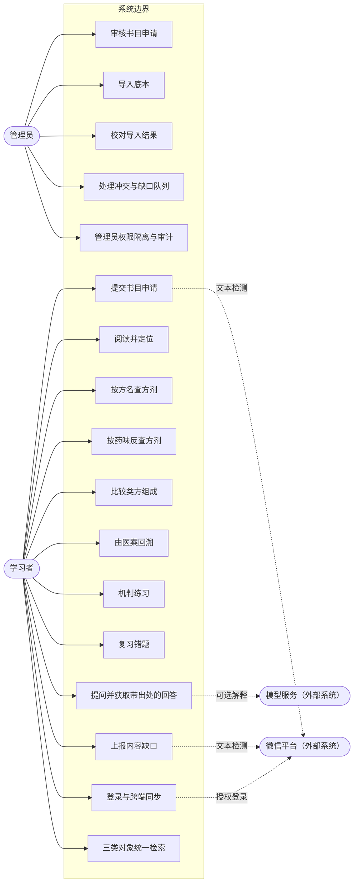

图 4-1 用例图。实线为角色与用例的关联，虚线为对外部系统的依赖。图中画了四个框，但**系统角色只有学习者和管理员两个**；微信平台与模型服务是外部系统（括号标注），不参与用例划分。微信平台承担授权登录与内容安全检测（FR-901、FR-902、NFR-25），模型服务默认关闭、只在服务端调用（FR-501、NFR-26）。v0.1 把它们画成参与者又在图注写"不是本系统的角色"，属于图文自相矛盾，v0.2 已标注清楚。

这张图要回答的问题是：**系统边界是否只包含 17 个用例、是否有角色在用例之外直接访问数据**。结论是边界闭合：管理员不直接操作内容库，一律经导入与校对用例；学习者不触发导入（FR-103、BR-10）。

### 2.2 用例关系

| 关系 | 涉及用例 | 说明 |
|---|---|---|
| include | 除 UC-15 外的全部用例 | 都需要已登录，登录与会话恢复由 UC-15 提供；UC-15 失败时其余用例不可达 |
| extend | UC-12 → UC-13 | 拒答时自动生成缺口（FR-601），用户也可在 UC-13 手动上报（FR-602） |
| extend | UC-10 → UC-11 | 答错进入错题簿并排入复习（FR-408、FR-409），答对不进入 |
| extend | UC-05／UC-06／UC-10 → UC-12 | 从"读不懂这段"或"想追问"发起的提问，携带上下文锚（FR-209） |

用例清单与优先级沿用 `docs/03` §4，此处不重复；本节只补充上述关系，因为用例图不表达 include／extend 时容易误读为"17 个互不相关的功能"。

### 2.3 核心用例规约

以下 8 个用例覆盖了全部硬约束（出处、拒答、判据、权限、检测），详规约；其余 9 个见 2.4 简表。

#### UC-03 导入底本

| 项 | 内容 |
|---|---|
| 参与者 | 管理员（主）；无支持参与者 |
| 前置条件 | 书目已通过审核（FR-104）；管理员已选定 docx 或 txt 文件 |
| 触发 | 管理员点击"开始导入" |
| 关联需求 | FR-111～FR-118、FR-122、FR-803、DR-12 |

主成功场景：

1. 系统校验角色与文件格式，非管理员或非 docx／txt 一律拒绝并说明原因（FR-111、BR-10）。
2. 解析文档，抽取段落与表格；目录行表不转为内容单元（FR-114）。
3. 对重复段落去重、清洗碎片段，两类数量各自计数（FR-112、FR-113）。
4. 依据章／节／序号规则建章节树（FR-115）。
5. 规则预填段落性质；未识别的段落留空待人工标注（FR-116）。
6. 抽取方剂与药味，计算词表匹配率（FR-118）。
7. 计算归一值并做碰撞检查；无法由规则逐字解释的合并进人工确认队列（DR-02、DR-12）。
8. 质检门禁：书名／篇名缺失、性质未标注、出处不全的记录阻止入库并列出（FR-117、FR-122）。
9. 生成导入报告，任务置"已完成"（FR-118）。

扩展流：

| 分支 | 条件 | 处理 |
|---|---|---|
| 3a | 重导同一底本时，去重数较上次报告偏差超过 20% | 报告标注异常，需人工确认后才可进入第 6 步；首次导入无基线，只记录不判定 |
| 4a | 页眉重复章名导致重复建树 | 允许人工纠正节点，纠正留痕（FR-115、FR-120） |
| 5a | 规则预标覆盖率低于报告参考基线（首版取 `docs/02` 实测 31%，仅作参考） | 不阻断门禁，报告记明需人工标注的段数；参考基线随换书重测，不写死为通用阈值 |
| 7a | 碰撞检查命中隐式合并 | 该批记录挂起，未确认不得入库（DR-12） |
| 8a | 门禁不通过 | 任务置"失败"，定位到具体环节（解析／切分／标注／质检），可整批重试（NFR-20） |

后置条件：内容单元入库且性质已标注；导入报告可查；失败时不留下可见的半成品数据。

验收要点：用损坏底本导入，失败后该书在内容库中无孤立单元；同一底本重复导入，内容单元数不变（NFR-05）。

#### UC-05 阅读原文并定位

| 项 | 内容 |
|---|---|
| 参与者 | 学习者（主） |
| 前置条件 | 该书已入库并通过质检 |
| 触发 | 从书目列表进入某书 |
| 关联需求 | FR-201～FR-209 |

主成功场景：

1. 系统按原书段落顺序返回首屏正文，不重组、不合并段落（FR-201、BR-03）。
2. 同时展示章节目录树与当前书名、篇名；书名篇名常驻（FR-202、FR-204）。
3. 用户滚动阅读，正文分批加载，首屏不等待全书（NFR-01）。
4. 系统记录最后阅读位置，下次进入恢复到该段附近（FR-203）。
5. 正文中的方名可点击，进入方剂详情；返回后回到原位置（FR-205、FR-209）。
6. 阅读页固定展示免责声明（FR-207）。

扩展流：

| 分支 | 条件 | 处理 |
|---|---|---|
| 1a | 该书未通过质检 | 不展示正文，提示"内容整理中"，不显示半截内容 |
| 3a | 网络失败或接口超时 | 已加载部分保留，给出重试入口（NFR-13） |
| 5a | 从检索或练习跳转进入 | 恢复上下文锚，返回时回到发起处（FR-209） |

后置条件：阅读进度写入，供跨端恢复（FR-702）。

验收要点：抽 20 段比对显示值与底本逐字一致；繁体字不得被转成简体展示（FR-206、BR-03）。

#### UC-06 按方名查方剂

| 项 | 内容 |
|---|---|
| 参与者 | 学习者（主） |
| 前置条件 | 方剂已入库 |
| 触发 | 输入方名 |
| 关联需求 | FR-301～FR-304、FR-307、BR-01、BR-03 |

主成功场景：

1. 用户输入方名，可用繁体或异体写法。
2. 系统对输入跑归一规则，得到检索键（FR-307）。
3. 与库中归一值列做精确匹配，不做相似度匹配。
4. 命中多条时按书名分组，不合并成一条（FR-301）。
5. 聚合详情：组成、出处条文、其他典籍的记载差异（FR-302、FR-303）。
6. 每条结果与详情均带出处块（书名 + 篇名 + 条号 + 原文片段）（FR-304）。

扩展流：

| 分支 | 条件 | 处理 |
|---|---|---|
| 3a | 未命中 | 不猜相似词，直接走 UC-12 的拒答分支（BR-02） |
| 5a | 某书无该方记载 | 显示"库内无此书记载"，不留空白也不补写 |
| 5b | 两书组成不同 | 逐味并列两值，不取"标准组成"（FR-303、BR-07） |

后置条件：无（只读）。

验收要点：用繁体写法检索能命中；命中结果的出处块不得缺书名或篇名（BR-01）。

#### UC-10 做机判练习

| 项 | 内容 |
|---|---|
| 参与者 | 学习者（主） |
| 前置条件 | 所选范围（章／节／方）属于已入库且质检通过的内容 |
| 触发 | 选择范围并开始练习 |
| 关联需求 | FR-401～FR-407、BR-08、BR-09 |

主成功场景：

1. 用户选择范围（章／节／方）。
2. 系统筛选"性质为典籍原文 + 判据字段完整 + 出处完整"的记录（FR-406、BR-09）。
3. 按三类题型之一生成题目，保证恰有一个可由库内数据唯一确定的正解（FR-401、FR-403、FR-404）。
4. 用户作答，系统判分（FR-405）。
5. 展示依据：原文片段与出处（FR-405）。
6. 记录作答：题目、作答、正误、时间（FR-407）。

扩展流：

| 分支 | 条件 | 处理 |
|---|---|---|
| 2a | 范围内无合格记录 | 提示"该范围题目不足"，不用推断数据补题（BR-09） |
| 3a | 生成时出现歧义选项 | 剔除该题重出，不把歧义题留给用户（FR-404） |
| 4a | 用户中途退出 | 已提交的作答保留，未答部分不记 |
| 6a | 答错 | 进入错题簿并排入复习（FR-408、FR-409） |

后置条件：作答记录入库；错题条目带原文位置。

验收要点：组成不全的方剂不得出现在组成匹配题中；每题解析区必须有原文与书名篇名。

#### UC-12 提问并获得带出处的回答

| 项 | 内容 |
|---|---|
| 参与者 | 学习者（主）；模型服务（支持，可选） |
| 前置条件 | 内容库中已有通过质检的内容；问题不限于某一本书，从阅读或检索发起时携带上下文锚（FR-209） |
| 触发 | 输入问题，或在阅读／检索页对当前条目发起追问 |
| 关联需求 | FR-501～FR-507、BR-02、BR-05、BR-06、BR-12 |

主成功场景：

1. 用户输入问题，可携带上下文锚（当前篇、条或方）。
2. 系统按 UC-06 的检索路径查找依据：归一、精确匹配、词表。
3. 命中且有可用原文片段：生成式解释默认关闭，此时直接返回原文与出处（FR-501）。
4. 每条输出挂出处块；无出处的句子不得出现（FR-504、BR-01）。

扩展流：

| 分支 | 条件 | 处理 |
|---|---|---|
| 2a | 检索未命中 | 拒答，给出"换用更具体的篇名或方名"类提示，并生成缺口（FR-503、FR-601） |
| 2b | 命中但无可用原文片段 | 同 2a 拒答（FR-502） |
| 3a | 已启用生成但模型超时／失败 | 降级为原文与出处，界面标注"本次未提供解释"（NFR-21） |
| 3b | 生成内容无法逐句对应到片段 | 拒答，不用无依据内容补位（FR-502、FR-505） |
| 3c | 问题要求诊断、处方或剂量建议 | 只给原文史料，明确说明不提供建议（FR-506、BR-06） |
| 3d | 输出出现功效推断或证治推演 | 判为不合格，需重生成或拒答（BR-05） |

后置条件：命中时无写操作；拒答时写入缺口队列。

验收要点：用库外问题集测试须全部拒答；拒答提示可操作；缺口记录自动生成且可区分"查不到"与"系统故障"（NFR-23）。

#### UC-13 上报内容缺口

| 项 | 内容 |
|---|---|
| 参与者 | 学习者（主）；微信平台（支持） |
| 前置条件 | 触发过拒答，或发现内容缺失 |
| 触发 | 在拒答提示处点击"上报缺失"，或从帮助入口提交 |
| 关联需求 | FR-601、FR-602、FR-901、FR-902 |

主成功场景：

1. 用户填写问题原文与涉及书目（可得时）。
2. 系统调用内容安全检测（FR-901）。
3. 检测通过后进入队列，记为"待处理"（FR-602）。
4. 用户看到提交成功与可查询状态。

扩展流：

| 分支 | 条件 | 处理 |
|---|---|---|
| 2a | 检测不通过 | 拒绝提交，提示内容含违规信息，不入库（FR-901） |
| 2b | 检测接口不可用 | 暂存为"待检"，对管理员不可见，恢复后补检（FR-902） |
| 2c | 补检仍不通过 | 丢弃并提示用户（FR-902） |

后置条件：队列新增一条，或暂存一条待检记录。

验收要点：违规测试文本被拒且队列无新增；断网提交后进入待检态，恢复后自动补检。

#### UC-14 处理冲突与缺口队列

| 项 | 内容 |
|---|---|
| 参与者 | 管理员（主） |
| 前置条件 | 队列中存在待处理条目 |
| 触发 | 打开治理队列 |
| 关联需求 | FR-603～FR-607、FR-805、BR-07 |

主成功场景：

1. 系统分开展示缺口与冲突两类条目，支持按状态与超期筛选（FR-805）。
2. 打开一条冲突，并列显示两个及以上取值及各自来源（FR-605）。
3. 管理员标记处理结果：已确认差异、已修正、已驳回；或对缺口标记已补、不可补（FR-603、FR-606）。
4. 系统记录处理人、时间与依据，形成轨迹（FR-606）。
5. 超期条目（入队 7 个自然日未处理）可被筛出（FR-603、FR-606）。

扩展流：

| 分支 | 条件 | 处理 |
|---|---|---|
| 3a | 管理员试图合并两值为单一"正确值" | 系统不提供该操作；只能标记差异或修正来源（BR-07、FR-607） |
| 4a | 标记"不可补"未填理由 | 拒绝提交（FR-603） |
| 5a | 条目已修正 | 修正确实写入并留痕，不覆盖原值（FR-120） |

后置条件：条目状态更新，轨迹可查。

验收要点：界面不得出现"以某书为准"类结论；任一处理动作都可追溯到操作人。

#### UC-16 管理员权限隔离与审计

| 项 | 内容 |
|---|---|
| 参与者 | 管理员（主） |
| 前置条件 | 有管理员账号 |
| 触发 | 管理员登录管理端 |
| 关联需求 | FR-801、FR-806、FR-903 |

主成功场景：

1. 管理员登录，系统校验角色（FR-801）。
2. 管理员执行导入、审核、修正、删除等关键操作，系统同步写入审计（FR-806）。
3. 审计记录含操作人、时间、对象、动作，不可修改、不可删除（DR-08 的审计口径、NFR-08）。

扩展流：

| 分支 | 条件 | 处理 |
|---|---|---|
| 1a | 学习者访问管理接口 | 返回权限错误，不泄露管理端结构（FR-801、NFR-22） |
| 2a | 内容安全检测拦截用户提交 | 写处置记录，不保存违规正文（FR-903） |

后置条件：审计记录落库。

验收要点：抽查 5 类操作均有审计；学习者访问管理接口被拒。

### 2.4 其余用例简规约

| 用例 | 前置 | 主路径要点 | 关键异常 | 关联需求 |
|---|---|---|---|---|
| UC-01 提交书目申请 | 已登录 | 填书名、作者、朝代、版本、目录、用途；检测通过后入待审队列 | 检测不通过拒收；接口不可用转待检 | FR-101～FR-103、FR-901、FR-902 |
| UC-02 审核书目申请 | 有待审申请 | 查看目录与版本，通过或驳回并填理由 | 缺目录／缺版本不得通过；驳回后可重提且旧记录不覆盖 | FR-104～FR-106、FR-802 |
| UC-04 校对导入结果 | 已产出待校对项 | 逐条对照底本，确认／修正／驳回；抽样复核 | 修正必须留原值；抽样比例不足 10% 不算完成 | FR-119～FR-121、FR-804 |
| UC-07 按药味反查方剂 | 词表可用 | 输入单味药，得到含该药的方剂清单，每条可回溯出处 | 药名有异名时按词表匹配，不猜 | FR-305 |
| UC-08 比较类方组成 | 选中 ≥2 个方 | 并排显示组成，差异高亮、共同项可折叠 | 两方来自不同书时分别标注来源，不合并 | FR-306 |
| UC-09 由医案回溯 | 医案已入库 | 按方名或关键词检索医案，详情给所用方与相关条文 | 不得出现证治推演结论句 | FR-308、FR-309 |
| UC-11 复习错题 | 有错题记录 | 按 1／2／4／7／15／30 天排程；答对进一档、答错退一档 | 无"已掌握"终态；跳原文后可返回 | FR-408～FR-412 |
| UC-15 登录与跨端同步 | 有账号 | 小程序授权登录与 PC 登录绑定同一账号，数据一致 | PC 端不提供学习界面，只提示用小程序 | FR-701～FR-706 |
| UC-17 三类对象统一检索 | 三类对象均已入库 | 一次输入返回原文、方剂、医案三类结果并分组，每条带出处 | 某一类无结果时该组显示空态，不影响其他组 | FR-310 |

## 3. 领域模型

### 3.1 概念类清单

| 类（图中名） | 职责 | 关键属性 | 对应需求／数据项 |
|---|---|---|---|
| 提交内容 Submission（抽象） | 会被他人看到的用户提交，统一承载检测状态 | 场景、检测状态、提交时间 | FR-901～FR-903、DR-09 |
| 书目申请 BookApplication | 学习者提交、管理员审核的申请记录 | 书名、作者、朝代、版本、目录、用途、状态、驳回理由、审核人、审核时间 | FR-101～FR-106、FR-802、DI-02 |
| 书目 Book | 一部底本入库后的登记与可用状态 | 书名、作者、朝代、版本、状态 | FR-104、FR-202、DI-02 |
| 导入任务 ImportTask | 一次导入的执行状态与产出报告 | 状态、当前环节、开始时间、报告各计数 | FR-118、FR-803、NFR-20 |
| 篇章 Chapter | 书的层级结构（父子树） | 篇名、层级、同级序号 | FR-115、FR-202、DI-03 |
| 内容单元 ContentUnit | 可检索、可引用、可定位的最小单位 | 标识、篇内序号、显示值、归一值、归一规则版本、段落性质、条号、原典归属、判据完整标记、缺失说明 | DI-01、DI-04～DI-08、DI-20、DR-01、DR-02 |
| 方剂 Formula | 以方名标识、挂在某一本书下的方剂记录 | 名称、别名集合 | FR-301、DI-10 |
| 药味 Herb | 单味药 | 标准名、异名集合 | FR-305、DI-11 |
| 组成项 Composition | 方与药的对应及原文用量表述 | 原文用量文本 | FR-302、FR-303、DI-12 |
| 提及项 Mention | 内容单元与方剂的提及关系，区分"记载该方"与"顺带提到方名" | 单元标识、方剂标识、是否主要记载 | FR-302、FR-303 |
| 医案 CaseRecord | 医案记录及所用方；正文引用内容单元，不复制 | 正文单元标识、所用方引用 | FR-308、FR-309、DI-13 |
| 题目 Question | 一次生成的具体题目及其唯一正解 | 题型、题干、选项、正解、正解唯一标记、依据单元集合（1..n） | FR-401～FR-406、DI-08 |
| 用户 User | 账号、角色与端绑定 | 账号标识、角色、已绑定端 | FR-701、FR-702、FR-801 |
| 阅读进度 Progress | 最后阅读位置 | 书、篇、段、时间 | FR-203、FR-702 |
| 收藏 Favorite | 学习者收藏的条文或方剂 | 对象类型、对象标识、时间 | FR-703、FR-702 |
| 笔记 Note | 学习者私有笔记 | 文本、对象引用、时间 | FR-703、FR-702 |
| 作答 Attempt | 一次作答 | 题目引用、作答、正误、时间 | FR-407、DI-14 |
| 复习条目 ReviewItem | 某个学习对象的间隔状态 | 学习对象引用、间隔档、下次到期时间 | FR-409、FR-410、DI-15 |
| 缺口 Gap | 内容缺失条目（继承 Submission） | 问题原文、涉及书目、状态、处理结果、处理人、处理时间 | FR-601～FR-603、DI-16、DR-09 |
| 冲突 Conflict | 同一实体跨底本的字段差异 | 实体类型、实体标识、字段、取值集合、来源集合、状态、处理结果、处理人、处理时间 | FR-604～FR-607、DI-17 |
| 审计记录 AuditLog | 管理操作留痕，只增不改 | 操作人、动作、对象、时间 | FR-806、DI-18 |
| 检测记录 SafetyCheck | 提交内容的检测结果 | 场景、结果、对象匿名标识、时间（不含正文） | FR-903、DR-09 |

三条与本表有关的注记：

- **CaseRecord 不复制正文**。早期把它写成"文本"属性，但 FR-116 要求医案段必须有 `sourceNature = 医案`，同一段正文存两处必然漂移。模型上只保留 `unitId` 指向承载正文的 `ContentUnit`；"相关条文"经 `case_formula → formula → mention → content_unit` 派生，不另建 M:N 关联表。
- **`data_defect` 是设计补充对象，不进入本类图**。它承载"组装出处时被剔除的单元、跨表不一致项"，是 `05` §11.5 的第 9 张支撑表，不是领域概念；类数仍为 22。
- **`Question` 的 `fingerprint` 与 `invalidatedAt` 属设计层生命周期**（`05` §19.1.2），不进领域类图；类图只保留题型、题干、选项、正解与依据单元。

### 3.2 类图

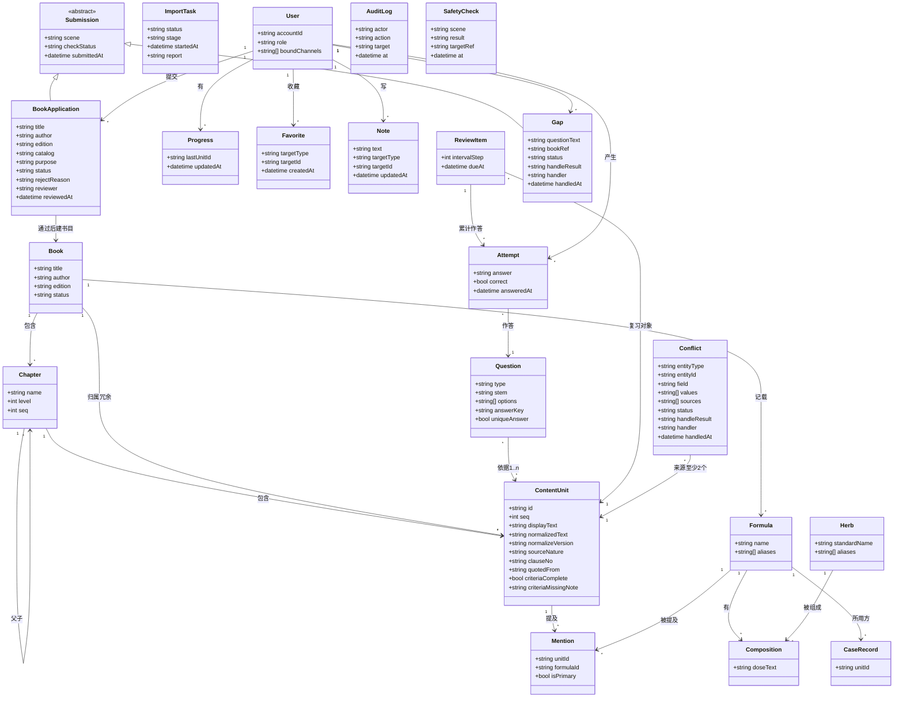

图 4-2 领域类图。类名用英文以便渲染，中文职责见 3.1 表。关系上的基数即约束：`Conflict` 与来源之间标 `*` 并在标签注明"来源至少 2 个"，因为单来源不构成冲突（BR-07）；`ContentUnit` 必须同时归属 Book 与 Chapter（两条 `1` 端），否则出处块不完整（DR-01、BR-01）。

v0.1 的类图有五处实质性缺陷，v0.2 已修：

1. **对象缺失**：状态图 4-11 画了"导入任务"的七个状态，§4.4 表用了"书目申请"与"提交内容"，但三个对象都不在类图里——有状态的对象在领域模型中找不到，等于状态图悬空。现补 `ImportTask`、`BookApplication`，并把"提交内容"提为抽象父类 `Submission`（`Gap` 与 `BookApplication` 均需检测，检测状态上移到这里，避免两个子类各存一份）。
2. **基数方向写反**：v0.1 写 `Attempt "1" --> "1" ReviewItem`，等于"一次作答恰好对应一个复习条目、且一个条目只有一次作答"，与状态图 4-14 的"答对进一档、答错退一档"（同一条目被多次作答）直接矛盾。现改为 `ReviewItem "1" --> "*" Attempt`。
3. **关联缺失**：`Chapter` 没有父子自关联，画不出 FR-115／FR-202 要求的"章／节／条"多层树；`Book` 没有到 `Formula` 的关联，"同名跨书不合并"（DI-10）无处落点；`ReviewItem` 没有指向学习对象的关联，DI-15 的"某学习对象"无从得知。
4. **属性缺失**：`User.role`（FR-801 权限隔离）、`Gap.bookRef`（FR-601 涉及书目）、`Conflict.entityType/entityId`（DI-17 的"实体"）、`AuditLog.target`（FR-806 的"对象"）、`Attempt.answer`（FR-407 的"作答"）在 v0.1 都缺，导致对应用例的验收点无法实现。另补 `Question` 类：FR-403 要求题目可由规则复现、FR-404 要求唯一正解、FR-407 要求记录"题目"，若题目只以字符串存在作答记录里，既不能复现也不能校验。
5. **"提及"粒度过粗**：v0.1 用 `ContentUnit "*" --> "*" Formula` 一条多对多表达"提及"。但 FR-302 要聚合的是"出处条文"，一段完整记载方的正文与一句"参见桂枝汤"在这种关联里没有区别，结果是把顺带提到方名的段落也列为该方的出处条文。现改为关联类 `Mention`，用 `isPrimary` 区分"该段抽取出组成项"与"仅提及方名"，方剂详情的出处条文只取 `isPrimary=true`。

这张图要回答的问题是：**03 里三条硬约束（出处必须全、冲突必须并列、判据必须可判）分别落在哪个对象的哪个属性上**。答案是：出处落在 ContentUnit 的 Book／Chapter 关联与 clauseNo；冲突落在 Conflict 的 entityType／entityId／values／sources；判据落在 ContentUnit 的 criteriaComplete 与 sourceNature。

### 3.3 关键约束（模型层注记）

| 约束 | 模型表达 | 来源 |
|---|---|---|
| 内容单元必须能唯一定位 | ContentUnit 同时挂 Book 与 Chapter，`seq`（篇内序号）保证顺序与定位，`clauseNo` 只承载底本原有的条号且可为空；两者都不参与归一 | DR-01、DI-04、FR-201 |
| 显示值与归一值分列，归一可重算 | displayText 与 normalizedText 两列，配 normalizeVersion | DR-02、DR-10、NFR-06 |
| 冲突值并列不合并 | Conflict 用 entityType + entityId 指明被比较的实体，values 与 sources 为多值且等长，第 i 个取值对应第 i 个来源 | BR-07、FR-605、DI-17 |
| 判据缺失显式标记 | criteriaComplete 布尔 + criteriaMissingNote 文本；缺失时说明必填而非空串，理由有处可查 | BR-09、DR-08 |
| 只有原文可作判据 | sourceNature 为五值枚举（v0.4 随 `03` v1.2 补"其他（非正文）"）；Question 只能挂"典籍原文"的单元；"其他"段不进检索结果、不作引用 | BR-04、FR-116、FR-406 |
| 章节树是树不是链 | Chapter 自关联父子，level 从 1 起、同级 seq 从 1 起，父子不得成环 | FR-115、FR-202 |
| 冗余归属必须一致 | ContentUnit.bookId 必须等于其所属 Chapter 的 bookId，二者不一致即数据缺陷 | DR-01、BR-01 |
| 同名跨书不合并 | Formula 挂 Book，实体唯一键为（bookId，归一后方名），不设跨书全局唯一 | FR-301、DI-10 |
| 治理结论必须可追溯到人 | Gap 与 Conflict 的 handleResult／handler／handledAt 三者填齐才允许离开"待处理/已检出"态；标记"不可补"或"驳回"时理由非空 | FR-603、FR-606、FR-120 |
| 审计只增不改 | AuditLog 只有写入语义，模型上不提供 update／delete；target 记录被操作对象 | FR-806、NFR-08、DR-08 |
| 提交内容检测状态 | Submission.checkStatus（待检／通过／拦截）由 Gap 与 BookApplication 继承，SafetyCheck 另记结果且不含正文 | DR-09、FR-901～FR-903 |
| 出处条文与顺带提及分开 | Mention.isPrimary 标记该段是否抽取出组成项；方剂详情的"出处条文"只取 isPrimary=true 的段，其余仅作检索索引，不参与组成差异比对 | FR-302、FR-303 |
| 枚举属性必须有值域 | Book.status ∈ 待导入／已入库／已停用；ContentUnit.sourceNature ∈ 典籍原文／注释／教学论述／医案／其他（非正文）；Submission.checkStatus ∈ 待检／通过／拦截；Conflict.status 见 4.3.3，Gap.status 见 4.3.2 | FR-104、DI-07、FR-603、FR-606、FR-902 |
| 引文须区分底本与原典 | `quotedFrom` 可空；非空时出处块追加"转引自《X》"，检索与定位仍以底本为准（书名为底本、原典另列）；只对"典籍原文"段有意义 | BR-01、FR-307、DI-20 |

### 3.4 相对 `docs/03` §9.2 的细化

`docs/03` §9.2 给的是实体与关系的概览，本文档补了四类内容：属性级定义（如 ContentUnit 的 normalizeVersion）、操作层需求引用（每个类对应哪些 FR）、约束在模型上的落点（3.3 表），以及 03 §9.2 未列但 §9.3 与功能需求已经在用的对象（书目申请、导入任务、题目、收藏、提交内容、检测记录）。

前三类是细化；第四类不是新增需求，而是把需求里已经出现的对象补进模型——03 §9.3 明确列了"书目申请""导入任务""提交内容"三个有状态对象，FR-401～FR-407 明确要求生成并记录题目，FR-703 明确要求收藏。03 §9.2 的 10 个实体及其基数约束原样保留，未被改动。

## 4. 行为模型

### 4.1 活动图

#### 4.1.1 阅读与定位

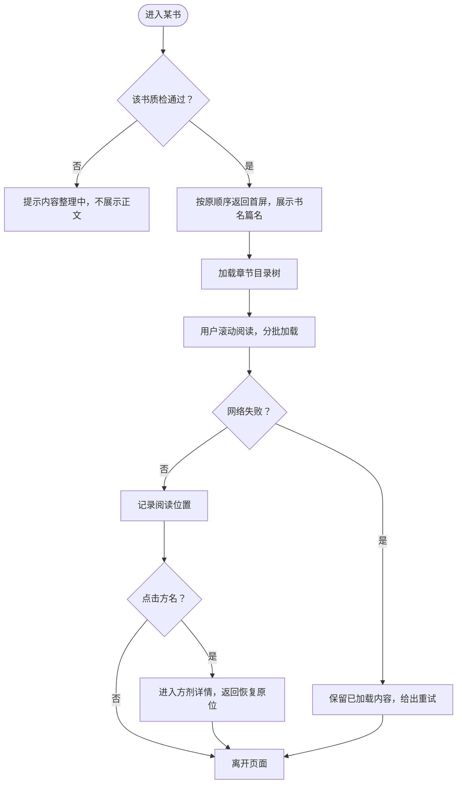

图 4-3 阅读与定位活动图。回答的问题是：**"内容整理中"和"网络失败"两种不可读情况是否被区分**——前者不展示半截正文，后者保留已加载内容，处理方式不同。

#### 4.1.2 检索（事务型四入口）

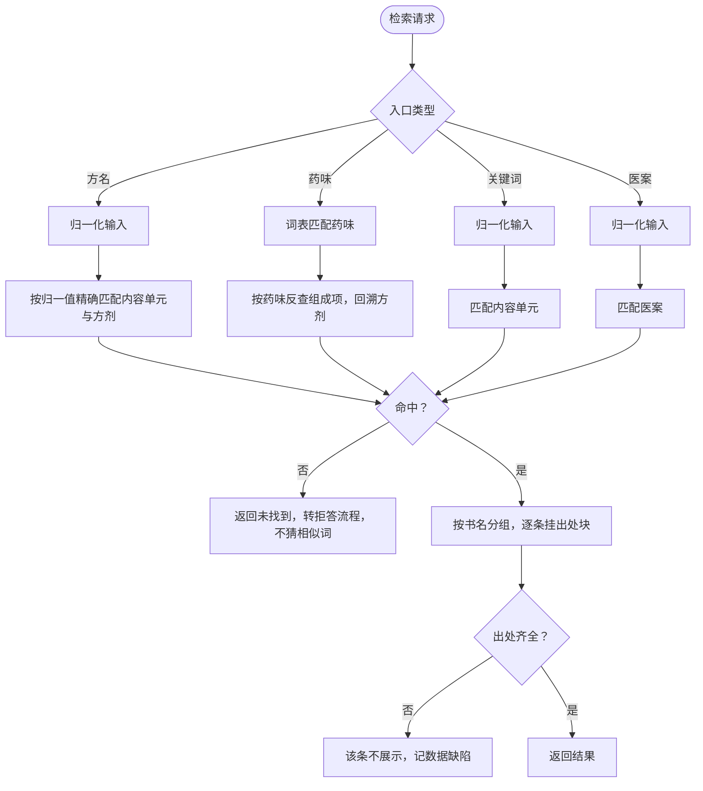

图 4-4 检索活动图。这是典型的事务型数据流：四个入口互斥分派，之后汇入同一"匹配—校验—输出"路径。回答的问题是：**未命中和出处不全这两种情况分别怎么处理**——前者拒答，后者不展示且记缺陷，都不允许"凑一个结果出来"。

#### 4.1.3 导入链（变换型五阶段）

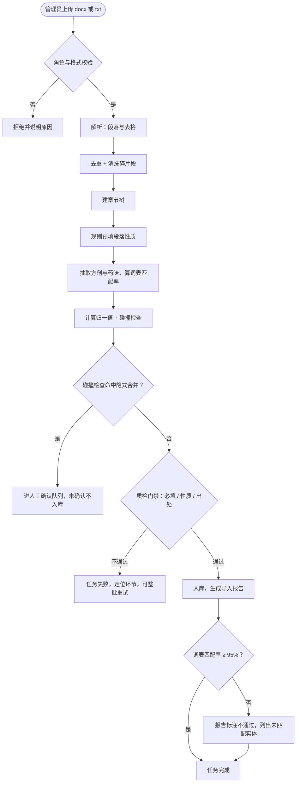

图 4-5 导入活动图。这是变换型数据流：解析→切分→标注→质检→入库，每一步的输出是下一步的输入，中间没有分派。回答的问题是：**哪些失败会阻断入库、哪些只是标记**——碰撞与质检阻断，匹配率不足只标"不通过"不阻断（否则首版永远导不进来，因为这正是需要人工补词表的常态）。

#### 4.1.4 出题与判分

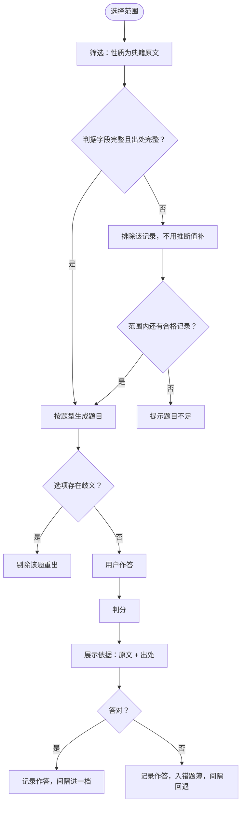

图 4-6 出题判分活动图。回答的问题是：**题目不够时会不会降级用不完整数据**——不会，宁可提示"题目不足"（BR-09）。

#### 4.1.5 提问与拒答

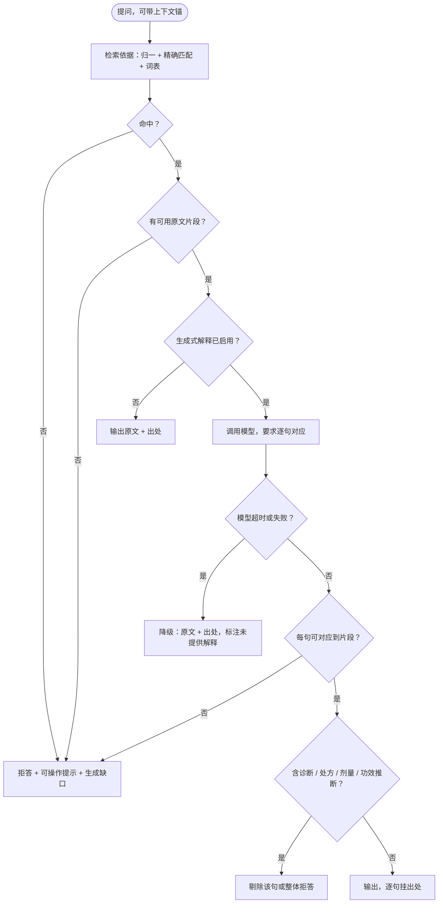

图 4-7 提问与拒答活动图。回答的问题是：**红线在流水线的哪一步被拦**——不在最后"审核"，而在逐句对应与内容类型判定两处，任一不满足即拒答或剔除，不进入输出。

### 4.2 时序图

#### 4.2.1 检索请求

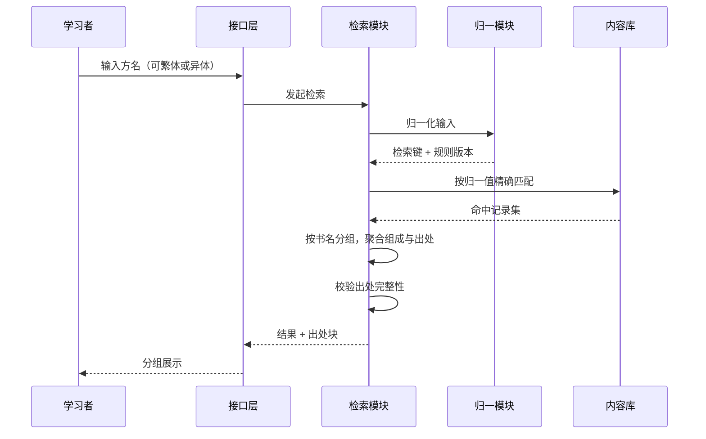

图 4-8 检索时序图。回答的问题是：**归一在链条的哪个环节发生**——请求进入检索模块后、访问数据库前，且返回值里带规则版本，便于排查"同一输入结果变了"。

#### 4.2.2 导入任务

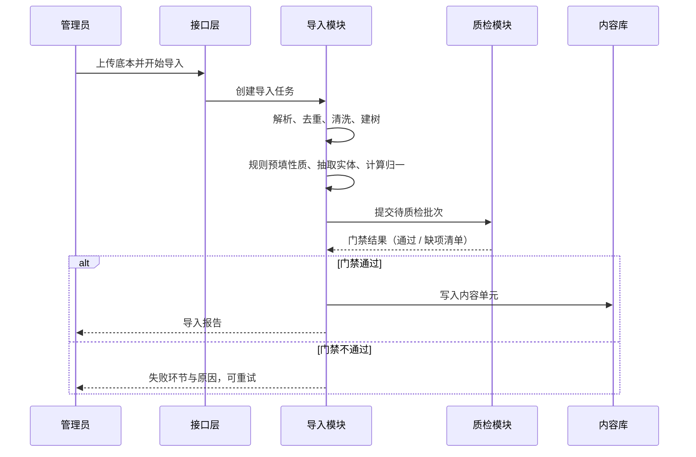

图 4-9 导入时序图。回答的问题是：**质检是在写库前还是写库后**——写库前，因此失败不会留下半成品（NFR-20）。

#### 4.2.3 提问（含降级与拒答）

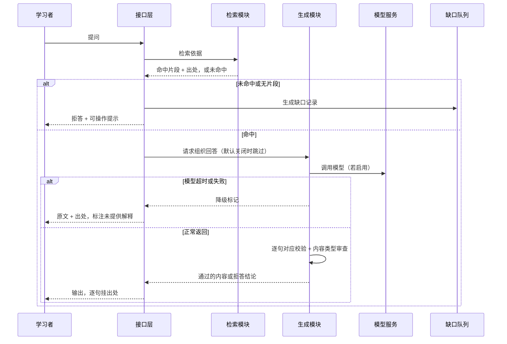

图 4-10 提问时序图。回答的问题是：**缺口记录在什么时候写**——只在判定为"查不到"之后写，模型故障不写缺口，避免把系统故障当成内容缺失（NFR-23）。

### 4.3 状态图

#### 4.3.1 导入任务

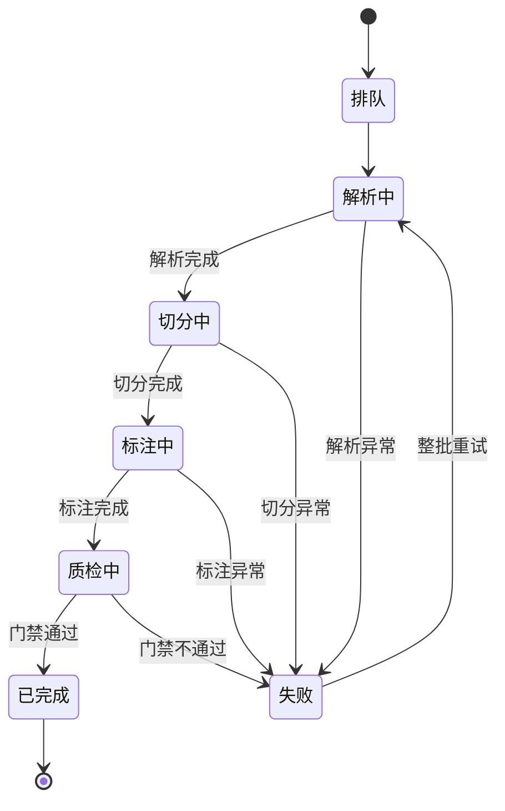

图 4-11 导入任务状态图。对象即类图中的 `ImportTask`，与 `docs/03` §9.3 一致。回答的问题是：**失败后能否原地重试**——可以，回到解析起点整批重跑，不做局部续跑，避免半成品。图中没有"取消"迁移：FR-803 只要求进度、失败原因与重试，取消属于本期范围外，若后续增加须同时定义"已解析数据的清理"。

#### 4.3.2 缺口

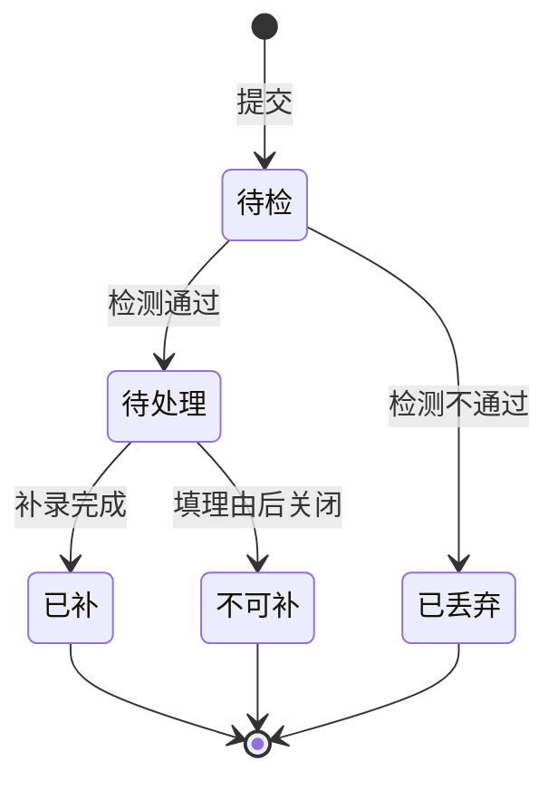

图 4-12 缺口状态图。这张图合并了两层状态：前三个态（待检／丢弃）来自父类 `Submission` 的检测流程，后三个态（待处理／已补／不可补）是 `Gap` 自身的治理流程。合并画是因为 FR-902 要求"待检内容对管理员不可见"，若拆成两张图就要在两张图之间约定可见性，反而容易漏；但对象层次在类图里是分开的（`Submission` 为父类），不是把两个对象压成一个。`Gap` 的治理三态另有约束：`handler` 与 `handledAt` 未填不得离开"待处理"，标"不可补"时理由非空（FR-603）。

#### 4.3.3 冲突

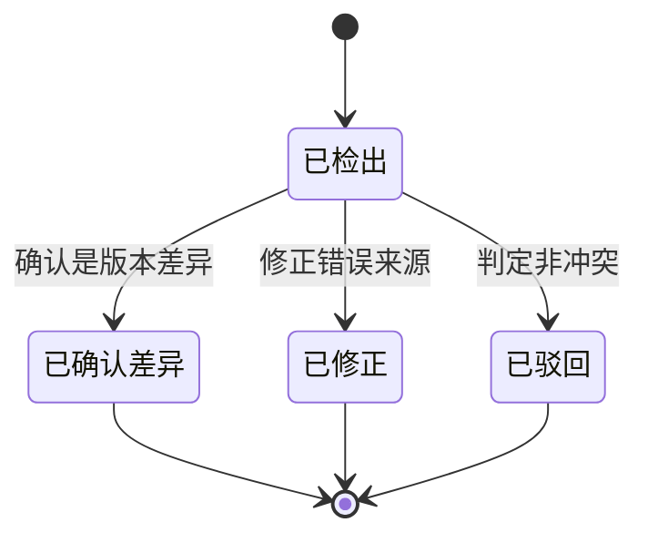

图 4-13 冲突状态图。回答的问题是：**有没有"合并"或"选定正确值"的迁移**——没有，这是 BR-07 在模型上的体现。

#### 4.3.4 复习条目

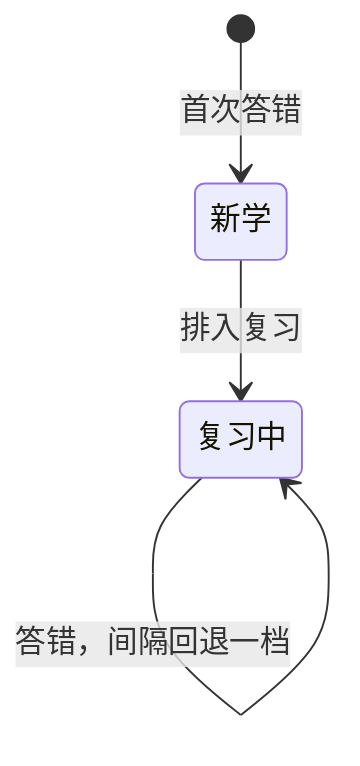

图 4-14 复习条目状态图。回答的问题是：**有没有终态**——没有"已掌握"终态，与 `docs/03` §9.3 的刻意设计一致（D-046、FR-409）；到期清理由 DR-11 的保留期负责，不靠状态迁移。

两处口径需说明。其一，起点写"首次答错"而不是 03 §9.3 的"首次作答"：FR-408 只把错题排入复习，答对不建复习条目，两者字面有出入，本文按 FR-408 更严的口径执行，并记入 §7.2 的 C-05。其二，"到期"不单设状态：间隔档有 1／2／4／7／15／30 六档，若把每一档都画成状态，状态图会变成排期表的翻版；是否到期由 `dueAt` 与当前时间比较得出，状态只区分"未排期"与"已排期"。

### 4.4 状态较少、不单独画图的两个对象

| 对象 | 状态集 | 为什么不画图 |
|---|---|---|
| 书目申请 `BookApplication` | 待检 → 待审 → 已通过／已驳回；检测不通过直接丢弃、不产生申请记录；已驳回 → 重新提交生成新记录 | 检测三态与缺口共用（父类 `Submission`，已在图 4-12 画过一次），剩余三态无并发分支，表格比图清楚；要点是"驳回后可重提、旧记录不被覆盖"（FR-106）、"拦截不入库"（FR-901） |
| 提交内容 `Submission`（抽象） | 待检 → 通过／拦截 | 与图 4-12 的检测态重复，只在缺口上画一次；书目申请与缺口都按这组状态判定可见性（FR-902） |

## 5. 判定表

### 5.1 拒答判定

表 5-1 拒答判定表（条件—动作横表，每列为一种组合）

| 条件／动作 | R1 | R2 | R3 | R4 | R5 | R6 | R7 |
|---|---|---|---|---|---|---|---|
| 检索命中 | N | Y | Y | Y | Y | Y | Y |
| 有可用原文片段 | — | N | Y | Y | Y | Y | Y |
| 出处（书名 + 篇名）完整 | — | — | Y | Y | Y | Y | N |
| 生成式解释已启用 | — | — | N | Y | Y | Y | — |
| 生成内容可逐句对应 | — | — | — | N | Y | Y | — |
| 模型服务可用 | — | — | — | — | N | Y | — |
| 输出原文与出处（逐句挂出处） | | | ✓ | | | ✓ | |
| 降级输出并标注"未提供解释" | | | | | ✓ | | |
| 拒答 + 记缺口 | ✓ | ✓ | | ✓ | | | |
| 该条不输出 + 记数据缺陷 | | | | | | | ✓ |

读法：R1 未命中、R2 无片段、R4 生成不可对应，三种都拒答并记缺口（FR-502、FR-503）；R3 未启用生成，直接输出原文与出处；R5 模型不可用，降级输出并标注（NFR-21）；R6 全部通过；R7 命中且有片段，但出处缺书名或篇名，按 FR-504 不得输出。七列互斥且覆盖全部组合。

三处与"拒答"容易混淆，须明确：R5 属于降级，不是拒答，**不记缺口**——否则会把系统故障记成内容缺失（NFR-23）；R3 虽然没调用模型，也不记缺口，因为用户拿到了原文与出处；**R7 不记缺口，记数据缺陷**——内容其实存在，缺的是质检漏网的出处字段，记成缺口会让管理员去补一段本已在库的内容，真正该走的是 FR-122 的质检返工（活动图 4-4 的"该条不展示，记数据缺陷"）。

v0.1 的表只有五个条件、没有"出处完整"，与活动图 4-4 的"出处齐全？否 → 不展示"以及 FR-504 直接冲突：按 v0.1 的表，一条命中且有片段、出处却不全的记录会走到 R3／R6 被当作可输出。这是判定表与活动图不一致，v0.2 补上第六个条件与 R7 列。

这张表要证明的是：拒答的触发条件互不重叠，且覆盖"没有依据"的全部情形，不存在"命中但无依据却仍然输出"的空档；同时把"故障""查不到""数据缺陷"三种情况在判定表层面分开。

### 5.2 出题资格

表 5-2 出题资格判定表

| 条件／结果 | Q1 | Q2 | Q3 | Q4 |
|---|---|---|---|---|
| 段落性质为典籍原文 | N | Y | Y | Y |
| 判据字段完整 | — | N | Y | Y |
| 出处（书名 + 篇名）完整 | — | — | N | Y |
| 可出题 | | | | ✓ |
| 不可出题，记原因 | ✓ | ✓ | ✓ | |

Q1 注释与教学论述、Q2 判据缺项、Q3 出处不全，三者都不得出题（BR-04、BR-09、BR-01）。这张表要证明的是：出题门槛的三个资格条件没有遗漏"出处不全"这一条——03 的 FR-406 只写了判据字段，本表按 BR-01 补上出处，属于模型阶段发现的需求表述不完整，已在 §7.2 记录。（v0.1 正文写"四个条件"而表里只有三个，是笔误。）

本表判的是"资格"，不判"这一次能不能生成出题"。FR-404 要求每题恰有一个可由库内数据唯一确定的正解、歧义选项剔除，这条在生成阶段逐题校验（活动图 4-6）：资格成立但生成时发现正解不唯一，处理是剔除该题重出，**不是**判该记录"不可出题"——否则一条判据完整的记录会因为一次生成失败被永久排除在题库外。v0.1 的表只列资格条件，没有交代 FR-404 落在哪一层，是缺口；v0.2 明确它属于生成阶段校验，并把校验结果记在 `Question.uniqueAnswer` 上。

题目与依据单元是 1..n 而不是 1..1：选择题与组成匹配题的依据是 1 个内容单元，**类方比较题（FR-306、FR-401）的依据至少 2 个**——它要并排两方的组成，也必须能回溯到两方的原文。v0.2 修订中曾把 `Question` 画成只挂一个单元，类方比较题就无法落到模型上，现已改为多对多，并在类图标签注明 1..n。

### 5.3 提交内容可见性

表 5-3 提交内容可见性判定表

| 条件／动作 | V1 | V2 | V3 | V4 |
|---|---|---|---|---|
| 场景对他人可见（书目申请、缺口上报） | N | Y | Y | Y |
| 检测接口可用 | — | Y | Y | N |
| 检测通过 | — | Y | N | — |
| 入库且管理员可见 | ✓ | ✓ | | |
| 拒绝提交并提示（不保存正文） | | | ✓ | |
| 暂存待检，对任何人不可见 | | | | ✓ |

V1 私有笔记不检测直接入库（本人可见）；V2 检测通过入队；V3 拦截不入库、不保存正文；V4 检测接口不可用，暂存待检（FR-901、FR-902、FR-903）。这张表要证明的是：检测范围按"是否他人可见"划分，不是无差别检测。

v0.1 把"接口不可用"直接写进"检测已通过"这一行的取值，等于在 Y/N 二值条件里塞了第三个状态值，判定表的条件就不再可穷举。v0.2 拆成"检测接口可用"与"检测通过"两个条件，V4 即"接口可用=N"，四列仍互斥且穷尽。

## 6. 模型与需求追踪

| 模型元素 | 覆盖需求 | 用例 |
|---|---|---|
| 图 4-1 用例图 | 全部 17 个用例（需求条目见各详规约与 §2.4 简表） | UC-01～UC-17 |
| §2.2 用例关系 | FR-209、FR-408、FR-601 | UC-05、06、10、12、13 |
| UC-03 详规约 | FR-111～FR-118、FR-122、DR-12 | UC-03 |
| UC-05 详规约 | FR-201～FR-209 | UC-05 |
| UC-06 详规约 | FR-301～FR-304、FR-307 | UC-06 |
| UC-10 详规约 | FR-401～FR-407 | UC-10 |
| UC-12 详规约 | FR-501～FR-507 | UC-12 |
| UC-13 详规约 | FR-601、FR-602、FR-901、FR-902 | UC-13 |
| UC-14 详规约 | FR-603～FR-607、FR-805 | UC-14 |
| UC-16 详规约 | FR-801、FR-806、FR-903 | UC-16 |
| 图 4-2 类图 | DR-01～DR-03、DR-08～DR-10、BR-01、BR-04、BR-07、FR-101～FR-106、FR-401～FR-407、FR-601～FR-607、FR-703、FR-806、FR-901～FR-903 | UC-01、02、03、06、10、13、14、16 |
| 图 4-3 阅读活动图 | FR-201～FR-209、NFR-01、NFR-13 | UC-05 |
| 图 4-4 检索活动图 | FR-301～FR-305、FR-307、FR-310、BR-01 | UC-06、07、09、17 |
| 图 4-5 导入活动图 | FR-111～FR-122、NFR-20、DR-12 | UC-03 |
| 图 4-6 出题活动图 | FR-401～FR-408、BR-08、BR-09 | UC-10 |
| 图 4-7 提问活动图 | FR-501～FR-506、BR-02、BR-05、BR-06 | UC-12 |
| 图 4-8 检索时序图 | FR-301、FR-307、DR-10 | UC-06 |
| 图 4-9 导入时序图 | FR-803、NFR-20 | UC-03 |
| 图 4-10 提问时序图 | FR-501、FR-502、FR-601、NFR-21、NFR-23 | UC-12、13 |
| 图 4-11 导入状态图 | FR-803、NFR-20 | UC-03 |
| 图 4-12 缺口状态图 | FR-601～FR-603、FR-901、FR-902 | UC-13、14 |
| 图 4-13 冲突状态图 | FR-604～FR-607、BR-07 | UC-14 |
| 图 4-14 复习状态图 | FR-408～FR-410、D-046 | UC-11 |
| 表 5-1 拒答判定 | FR-502、FR-503、NFR-21、NFR-23 | UC-12 |
| 表 5-2 出题资格 | FR-404、FR-406、BR-04、BR-09、BR-01 | UC-10 |
| 表 5-3 可见性判定 | FR-901～FR-903、DR-09 | UC-01、13、16 |

覆盖检查：77 条待验收需求中，FR-101～FR-106（书目申请与审核）与 FR-701～FR-706（账号与跨端）没有详规约，只由 §2.4 简规约加类图的属性落点覆盖（`BookApplication`、`User.role`、`Favorite`、`Progress`）。这是刻意的：这两组流程状态少、分支少，画图不如写规约。但与 v0.1 不同的是，现在它们有模型落点——v0.1 的类图里既没有 `BookApplication` 也没有 `Favorite`，简规约实际上没有对象可依。5 条延后项（FR-311、411、505、608、807）不在本期建模范围。

## 7. 与 `docs/03` 的一致性检查

### 7.1 检查结果

| 检查项 | 方法 | 结果 |
|---|---|---|
| 用例数量与编号 | 与 03 §4 逐条比对 | 一致，17 个 |
| 用例与需求的关联 | 与 03 §4 与 §12.2 逐条比对 | 17 个用例中 15 个完全一致；UC-03 原漏 FR-803（已补，04 的漏记）；UC-13 的 FR-902 属于 03 的漏记（C-08） |
| 有状态对象 | 与 03 §9.3 比对 | 03 列 6 个，全部在类图中有对应类：`ImportTask`、`Gap`、`Conflict`、`ReviewItem` 画状态图，`BookApplication`、`Submission` 用表（4.4）。v0.1 有 3 个对象在类图中缺类，v0.2 已补 |
| 状态迁移与约束 | 逐条核对下一状态与约束条款 | 一致；检测三态由父类 `Submission` 承载，与缺口治理三态分属两层（图 4-12 合并展示，类图分层） |
| 实体与基数 | 与 03 §9.2 比对 | 03 §9.2 的 10 个实体与三条基数约束原样保留；另补 5 个 03 §9.3 与功能需求已在用、§9.2 未列的对象（`BookApplication`、`ImportTask`、`Question`、`Submission`、`Favorite`）与 1 个关联类 `Mention`。v0.1 声称"17 个概念类"而图中实为 16 个（漏 `Favorite`），v0.2 类图与 3.1 表均为 22 个类 |
| 硬约束落点 | 逐条找模型位置 | 出处、冲突、判据三条均有落点（3.3 表） |

### 7.2 建模过程中发现的问题

| 编号 | 问题 | 处理 |
|---|---|---|
| C-01 | `docs/03` FR-406 只要求"判据字段完整"即出题，但 BR-01 要求任何输出带书名篇名；若某记录判据完整而出处不全，按 FR-406 可出题，按 BR-01 不可输出 | 本文档表 5-2 按 BR-01 收紧为"出处完整"也是出题条件；`docs/03` 已确认，不改条款，按更严的规则执行，并在 `docs/08` 用例中固定该口径 |
| C-02 | 03 的"提交内容"与"缺口"两个对象都承载检测状态，状态表重复 | 本文把检测状态上移到抽象父类 `Submission`，`Gap` 与 `BookApplication` 继承；状态图 4-12 只画一次，类图上分层，不重复表达 |
| C-03 | 03 §9.3 未说明拒答与写缺口的先后 | 本文档明确：先判拒答，再写缺口；系统故障不写缺口（NFR-23） |
| C-04 | 03 §8.3 数据词典没有"篇内序号"，但 FR-201 要求按原书顺序呈现、FR-202 要求任一节点可定位、FR-209 要求返回原位置；仅靠可空的条号（DI-04）无法保证顺序与定位 | 本文在 `ContentUnit` 上增 `seq`，明确它不参与归一、不由底本归纳；**已由 03 v1.1 增 DI-19 落实**，与 DI-04 的分工同步写入数据词典 |
| C-05 | 03 §9.3 写"复习条目：新学 —首次作答→ 复习中"，字面上任何首次作答都建条目；FR-408 只要求错题进入错题簿 | 本文按 FR-408 的严口径执行：只有答错才建复习条目，答对不建（图 4-14 起点为"首次答错"）。03 §9.3 该行需改为"首次答错" |
| C-06 | 03 §9.3 把"书目申请""导入任务""提交内容"列为有状态对象，§9.2 实体表却没有这三个；FR-401～FR-407 的"题目"、FR-703 的"收藏"同样未列 | 本文补 5 个类（`BookApplication`、`ImportTask`、`Question`、`Favorite`、`Submission`），不改 §9.2 已列实体的基数；**已由 03 v1.1 §9.2 增"支持对象"行落实** |
| C-07 | FR-806 要求审计可查"操作人、时间、对象"，DI-18 也写"对象"，但 v0.1 类图的 `AuditLog` 只有 actor／action／at；同类缺口还有 `Gap.bookRef`（FR-601）、`Conflict.entityType/entityId`（DI-17）、`Attempt.answer`（FR-407）、`User.role`（FR-801） | 本文补齐上述属性；均属需求已写明而模型漏记，不是需求变更 |
| C-08 | 03 §4 与 §12.2 的 UC-13 关联需求只列 FR-601、FR-602、FR-901，但 UC-13 的扩展流（检测接口不可用暂存、恢复后补检）用的正是 FR-902，而 FR-902 只挂在 UC-01 | 本文 UC-13 保留 FR-902；**已由 03 v1.1 在两表同时补齐**（03 §4 约定两表须同步改） |

八处都不是需求变更，是模型细化时暴露的表述不完整或追踪断链。C-04、C-06、C-08 已由 03 v1.1 落实并在数据词典、实体表、用例关联表三处同步；C-02、C-03、C-05、C-07 已在本文档内部消除；只剩 C-01 的验收口径须在 `docs/08` 固定。

### 7.3 本文档不覆盖的内容

- 界面布局、交互细节、组件 → `docs/05`；
- 表、字段类型、索引、约束的物理实现 → `docs/06`；
- 测试用例与判定表的逐行覆盖 → `docs/08`；
- 模块划分与耦合内聚判定 → `docs/05` 第一部分。

## 8. 待确认事项

无未决。v0.2 曾登记三条待确认（Q-04-1 篇内序号升为数据项、Q-04-2 §9.2 补支持对象、Q-04-3 UC-13 补 FR-902），均已随 `docs/03` v1.1 一并关闭。存量待确认沿用 `docs/03` 的 Q-111（小程序主体资质）与 `plan/00` §10 的 T-01～T-03（归一化规则顺序、碰撞阈值、反向验收集）。

## 9. 变更记录

| 日期 | 版本 | 变更 |
|---|---|---|
| 2026-11-25 | v0.1 | 首次形成正文：用例图 1 张、详规约 8 份、简规约 9 份、类图 1 张（17 个概念类）、活动图 5 张、时序图 3 张、状态图 4 张、判定表 3 张、模型—需求追踪表 1 张。建模中查出 3 处 03 的表述不完整（C-01 出题资格漏"出处完整"、C-02 检测状态重复表达、C-03 拒答与写缺口顺序未定），均按 03 的硬约束处理并记录，不改需求条款。 |
| 2026-11-26 | v0.5 | 与 `docs/03` v1.3 对齐：`ContentUnit` 增 `quotedFrom`（原典归属，书名／篇名／条号三段均可空），三处同步——§「领域类图」`ContentUnit` 增 `+string quotedFrom`、实体属性清单增"原典归属"并把 DI-20 写进追溯编号、§3.3 约束表增"引文须区分底本与原典"（非空时出处块追加"转引自《X》"，检索与定位仍以底本为准，只对"典籍原文"段有意义）。正文模型结构未变。 |
| 2026-11-26 | v0.7 | 关闭 G4 前的三处模型待定：①`CaseRecord` 的 `text` 改为 `unitId`，删去 `ContentUnit—CaseRecord` 的 M:N "相关条文"关系；相关条文改由 `case_formula → formula → mention → content_unit` 派生，避免同一正文两处存储与第 31 张关联表；②`data_defect` 登记为设计补充对象、不升类，类数仍 22，仍按 `05` §11.5 的第 9 张支撑表建；③`Question` 的 `fingerprint`／`invalidatedAt` 归设计层，不进类图。§3.1 增三条注记，§3.2 类图与关系各改一处。`05` 升 v0.19 同步 `question.invalidated_at` 的写者归属。 |
| 2026-11-26 | v0.6 | 与 `docs/03` v1.5 对齐：§12 覆盖检查的"76 条待验收需求"改为"77 条"（`03` 补 FR-808 管理员登录／登出）。`ContentUnit` 等实体无增删，用例与类图不变。 |
| 2026-11-26 | v0.4 | 与 `docs/03` v1.2 对齐：`sourceNature` 扩为五值（补"其他（非正文）"），§3.3 的两条约束（枚举值域、只有原文可作判据）同步写明"其他"段不进检索、不作引用。正文模型结构未变。 |
| 2026-11-25 | v0.3 | 与 `docs/03` v1.1 对齐：C-04（篇内序号）、C-06（支持对象）、C-08（UC-13 补 FR-902）三处在需求基线中落实，本文 §7.2 处理列与 §8 待确认项同步改为已关闭；状态由草稿改为待评审。正文模型无改动。 |
| 2026-11-25 | v0.2 | 模型层缺陷修正。①类图补 5 个 03 已在用但 §9.2 未列的对象（书目申请、导入任务、题目、提交内容、收藏），并把"提及"改为带 `isPrimary` 的关联类 `Mention`，类数由 16 补到 22，与 3.1 表对齐；②修正 `Attempt`／`ReviewItem` 的基数方向（原写成一作答一条目，与间隔进退矛盾）；③补 `Chapter` 父子自关联、`Book→Formula`、`ReviewItem→ContentUnit` 三条缺失关联；④补 `User.role`、`Gap.bookRef`、`Conflict.entityType/entityId`、`AuditLog.target`、`Attempt.answer`、`ContentUnit.criteriaMissingNote` 等与上游数据词典对不上的属性；⑤`ContentUnit` 增 `seq` 并写明与 `clauseNo` 的职责边界；⑥用例图标注外部系统、消除"模型服务是角色"的图文矛盾；⑦UC-10／UC-12 前置条件与扩展流对齐；⑧表 5-1 补"出处完整"条件与 R7 数据缺陷列，表 5-2 明确 FR-404 属生成阶段校验，表 5-3 条件二值化；⑨§7.2 新增 C-04～C-08，§8 新增 Q-04-1／Q-04-2；⑩UC-03 补 FR-803、扩展流"预期偏差""31% 阈值"改为重导基线与参考值，`Question` 依据改为 1..n（类方比较题需 ≥2 方），用例—需求关联改为逐条实核后的结果（15 个一致、2 个已登记）。 |
