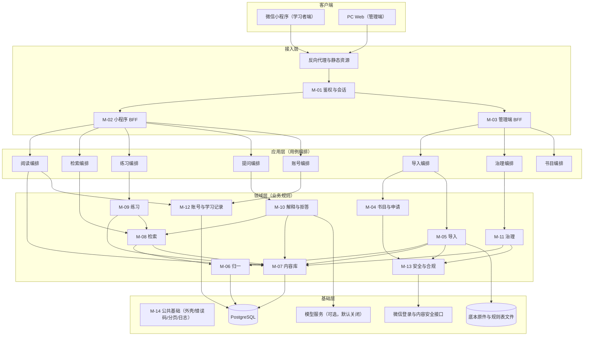
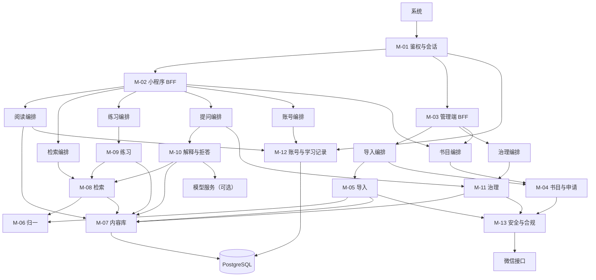
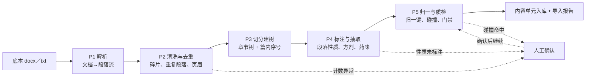
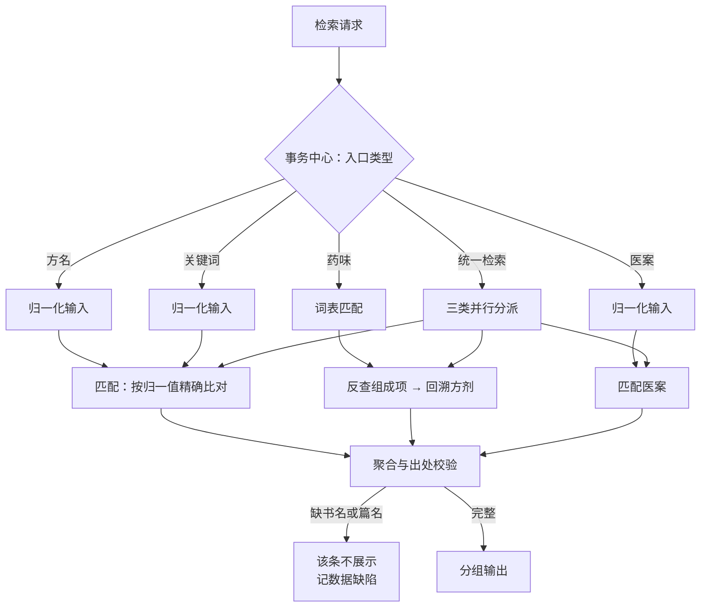
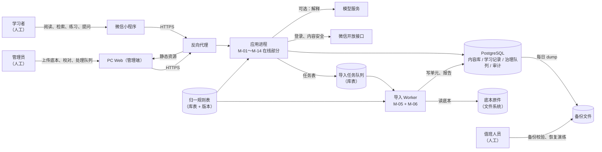
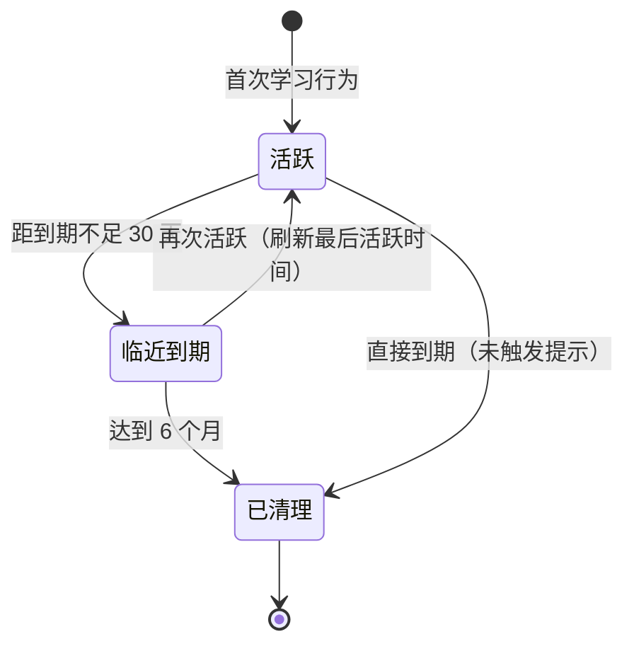

# 05 系统设计说明书

**版本：** v0.19
**状态：** 草稿
**最后更新：** 2026-11-26
**变更摘要：** v0.19 与 `04` v0.7 对齐，只改两处口径、不改表数：①§19.1.2 的失效写入由"M-05／M-07 写 `question.invalidated_at`"改为"M-05／M-07 在同一事务调用 M-09 的失效入口，仍由 M-09 写"——原写法与 §11.5 的"`question` 唯一写者是 M-09"冲突，破坏一表一主；②§11.5 的 `data_defect` 说明补"设计补充对象、不升类，领域类仍 22 个"，与 `04` v0.7 的注记一致。表数 30、索引 37 不变。
**变更摘要（历史）：** v0.18 补齐第二部分余下三节：①§20 用 Jackson 方法设计底本解析——输入树（底本→篇→节→段落／表格）、输出树（书→章节树→内容单元／方剂／药味）、三步导出与操作分配，并定两条边界（重复段落去重放输出侧、结构冲突不猜）；②§21 复杂度度量——固定 McCabe 计数口径，导入 V(G)=12 超阈值、需拆成解析／抽取／质检三个子过程，检索 10 压线，出题 9、拒答 7 通过；说明 Halstead 为何首版不测；③§22 详细设计评审——两级评审、八项清单、G5 的四个签字条件与当前缺口（§18 未写，G5 只能记为部分评审）。另补 §19.2 的 N-S 图（图 5-7），与 §19.0 的工具选用呼应。
**变更摘要（历史）：** v0.17 补齐 §19 剩余四节，至此 §19 六节完整：①§19.2 导入链 PDL，把"阻断"（碰撞未确认、质检缺项）与"只标记"（匹配率 <95%、去重偏差 >20%）分开，碰撞只挂起涉事单元、匹配率不设门禁，两阶段只改 `book.status` 可见性；②§19.3 检索链 PDL，四入口互斥、归一值等值匹配、不做相似度，出处不全的单条不展示并写 `data_defect`；③§19.5 拒答链 PDL，按 `04` 表 5-1 的 R1～R7 短路求值，R1／R2／R4 写缺口、R5 降级不写、R7 写数据缺陷，且 R7 在调用模型之前；④§19.6 判定表执行口径，定求值顺序、`—` 的含义、列不可增删与"动作必须落表"。§18 与 §20～§22 待补。
**变更摘要（历史）：** v0.16 开写第二部分：①§17 结构程序设计落地约束七条（单出口、循环必须有界、嵌套≤4、过程≤50 行且判定点≤10、事务只在编排层、SQL 参数化、错误只走一条路），每条给定验收方式，供 §19 的 PDL 与 §21 的度量逐条对照。②§19.0 过程设计工具选用：判定表用于三张多条件表、PDL 用于四条链、N-S 只用于导入的段落流，PAD 不用；并统一 PDL 写法。③§19.1 题型规则：三类题各一行（题面、正解、选项与干扰、判分、最少依据），题目生命周期（首次落库→复用→源头修正即失效→有作答不删），`options` 为 `[{id,text}]`、`answer_key` 存选项 id，候选与干扰按稳定键排序不用随机数，资格沿用 `04` 表 5-2，冻结"选择题只做条文→方名、组成匹配是选项题、选项 2～4 个"三条口径。④§19.4 出题与判分 PDL，含候选集、装配、生成选项、不唯一校验与判分五个子过程。同步 §11.5 的 `question` 说明补指纹与失效时间、§11.10 补 `question.fingerprint` 唯一索引与 `question_unit.unit_id` 反查索引（19 行→21 行），`06` 升 v0.4 落三列与两条 DDL。§18 与 §20～§22 仍待补。
**变更摘要（历史）：** v0.15 评审 `06` 时接受两项设计补充，只加关系与索引，不改表数：①§11.6 补 `BookApplication—Book` 关系（`book.application_id`，唯一、可空），把 `04` §3.2 类图"通过后建书目"落到关系模型，否则 FR-104 的"通过后生成导入入口"只能靠书名版本去猜，而 FR-106 允许多条申请共存，猜法会指错；§11.5 的 `book` 说明同步补该列。②§11.10 补四条索引：`herb_alias.norm_alias`（药味异名反查，与 `formula_alias` 对称）、`correction(unit_id, created_at)`（修正历史）、`norm_collision(import_task_id, verdict)`（碰撞确认队列）、`data_defect(status, created_at)`（质检返工队列），表由 15 行变 19 行。v0.14 回填 `06` 编写时查出的三处口径：§11.13 字段白名单补 `password_hash`；§10.5 的篇内唯一键改为 `(book_id, chapter_id, seq)`；§11.10 表末声明索引条数以该表为准。v0.13 §11.15 改指 `03` v1.6 新增的 DR-13 保留期总表，删除"表中四项属本设计定的口径…"整段。原写法把缺口原文、检测记录、数据缺陷三项期限留在设计层，等于需求未写、设计自定，验收时无法判定对错；保留期是可外部检查的合规承诺，应回到需求层。本节只改指向与措辞，期限数值不变，30 天备份保留仍属 §11.14 的运维口径、不升需求。输入基线改 `03` v1.6（13 条 DR）。v0.12 补齐 §11 数据设计（§11.4～§11.16，13 节）：22 个概念类落为 21 张表 + 9 张支撑表（共 30 张），表名与唯一写者在此冻结；20 个数据项逐条给承载位置与三级分级；枚举与取值域 15 项；约束按"数据库／应用层／表权限"三层分工；索引逐条对应查询路径并列出五类不建索引的理由；事务边界按场景定（导入单事务、超 5 万单元改可见性两阶段、任务 `SKIP LOCKED`、失败独立事务）；安全、隐私、备份、保留期与学习记录存储生命周期图（图 5-6）。新增两处待 `04` 评审时同步的模型补充：`case_record` 不复制正文、`data_defect` 表承载"数据缺陷"。本节不改需求、不改架构，下游 `docs/06` 按 §11.4 的八项交接清单落 DDL。v0.11 订正两处过期表述（不影响结论）：§1.4 章节表把 §10 的规模写成"45 项端点"，实际已随 v0.9 扩为 48 项（51 个方法）；§5.6"标签生态"段仍写段落性质为"封闭 4 值"，与 §5.8／IP-04 及 `03` v1.2、`04` v0.4 的五值冲突，改为五值并补"其他（非正文）"。v0.10 落实 `03` v1.5 的 FR-808：§10.3 的两个管理员鉴权端点由“无需求认领”转为 FR-808 的实现，对账归零（82 条需求、51 个方法、82 行边表；漏设计 0、部分覆盖 0、无主端点 0、断链 0），输入基线改为 `03` v1.5；同时在 §10.3 冻结 12 条规则类需求清单（无端点可挂，靠测试与代码审查保证），作为后续接口契约的约束来源。v0.9 按需求→端点对账（`scripts/trace_check.py` + `track/02_需求到端点.csv`）修订 §10.3：端点由 45 项（48 方法）增至 48 项（51 方法）。补三处——抽样复核任务 `POST/GET /api/admin/import-tasks/{id}/sampling`（`FR-121` 原先落空）、删除学习记录 `DELETE /api/app/me/learning-records`（`FR-705` 原先落空）、冲突队列补 `overdue` 参数（`FR-606` 要求超期可筛，原端点只有 `status`）。对账后"漏设计 0、部分覆盖 0、断链 0、漏登记 0"，仅剩 2 个无主端点（管理员登录与登出：`UC-16` 有用例、`03` 无对应功能需求，属需求缺口，待确认是否补 FR）。v0.8 用真实底本（8980 段、41.6 万字）跑检索与归一实验，据此定三件事：①§3.4 决策 4 改口径——实体走归一值 B-tree 等值、段落查找走 `norm_text` + `pg_trgm` GIN，**不建 `search_tsv` 主链**（实测 zhparser 漏检 6.3%～12.8%，根因是词典把"汤加"当词，致"桂枝汤加"被切碎）；②新增决策 10（不用消息队列，异步走表状态机 + `SKIP LOCKED`）与决策 11（不用 Elasticsearch，不用中文分词）；③新增 §3.5 实验记录与 §11.1～§11.3（T-01 规则顺序 `zh-norm-1.0` 与三张规则表落盘、T-02 碰撞检查实测误合并 0 组、检索字段口径）。Q-06-2 于 v0.7 关闭：§5.8.5 由"A/B/C 待定"改为"已定 A"（单元加 `quotedFrom`），并补三条定稿内容——出处块书名分底本／原典两栏、原典不参与检索与条号计算、导入识别"解析不出就留空"；同步登记 `03` v1.3（DI-20）与 `04` v0.5（类图属性与约束），`06` 表结构仍待 §11。首次形成正文，先写第一部分总体设计的 §1～§9（v0.1）。v0.2 按跨文档一致性检查修正三处断头：结构图补 `M-02 → O8`（学习者提交书目申请）、`O4 → M-11`（用户手动上报缺口）、`M-01 → M-12`（登录后账号绑定），三处原为设计路径缺失；新增 §5.5 用例到模块的路径表（17 个用例逐条给路径）与 §5.6 业务规则与逆向需求的设计落点表（13 条 BR + 8 条 INV 逐条给措施）；`M-09` 需求覆盖补 FR-412；§1.2 的下游引用由 §4 改为 §11、§16～§21 改为 §17～§21。§10～§16 与第二部分详细设计待续；详细设计按教材第 6 章组织（结构程序设计、人机界面详细设计、过程设计工具、面向数据结构的设计、复杂度度量），章节对应见 §1.4。
**输入基线：** `docs/03` v1.6（需求，77 条待验收 + 31 条 NFR + 8 条 INV + 13 条 DR + 20 个数据项）、`docs/04` v0.5（用例与领域模型）、`docs/02` v1.1（方案选择与约束）。本版基于已确认的上游，未确认项在文中显式标注。

## 1. 文档信息

### 1.1 目的

`docs/03` 说明"做什么"，`docs/04` 说明"谁和系统做什么、有哪些对象"，本文档说明"系统由哪些部分组成、各部分怎么连接、关键处理怎么实现"。判断标准有三条：每个模块能指回需求；模块之间的依赖能说清类型而不只是"低耦合"；关键处理能直接交给编码，不需要再猜。

### 1.2 与上下游的分工

- **上游**：`docs/03` §5／§7（功能与综合需求）、§8（数据要求）、§9（需求层逻辑模型）；`docs/04` §2（用例）、§3（领域模型）、§4（行为模型）、§5（判定表）。冲突时以 `docs/03` 为准并回改本文档。
- **下游**：`docs/06` 取 §11 的数据设计要点与 §5 的模块—实体对应关系建表；`docs/08` 取 §17～§21 的过程设计与判定表写测试用例；编码取 §9 的 IPO 与 §19 的 PDL。
- **不重复的内容**：需求条款、用例流程、判定表的条件取值不在本文档重写，只引用编号。

### 1.3 设计约束（不可协商）

| 约束 | 内容 | 来源 |
|---|---|---|
| 交付形态 | 窄原型，2026-12-10 前可运行；学习者端只有小程序，管理端只有 PC Web | NFR-28、NFR-29 |
| 规模上限 | 不超过 5 本书、单书不超过 50 万字、内容单元不超过 10 万 | NFR-04、NFR-02 |
| 性能 | 首屏 ≤2s、检索 ≤1s、出题 ≤1s；50 并发下 P95 不劣化 50% | NFR-01～03、NFR-16 |
| 导入 | 单书 50 万字 30 分钟内完成；失败不留半成品、可整批重试 | NFR-15、NFR-20 |
| 可用性 | 学习时段可用率 ≥99%，单次中断 ≤30 分钟；每日备份，RPO ≤24h、RTO ≤4h | NFR-17、NFR-18 |
| 安全 | 模型密钥只在服务端；管理员操作留审计；只收集学习行为 | NFR-07、NFR-08、NFR-09 |
| 人力 | 3 人（有效 1.5 人），无专职运维 | D-048 |

最后一条不是需求，但它决定了架构选择的边界：任何需要专职运维的方案在本项目里都不可行。

### 1.4 本文档结构与教材对应

| 本文档 | 内容 | 对应教材 |
|---|---|---|
| 第一部分 §1～§16 | 总体设计 | 第 5 章：设计过程、设计原理、启发规则、描绘软件结构的工具、面向数据流的设计方法、人机界面设计 |
| §1～§3 | 设计概述、设计原理应用、方案选择 | 5.1～5.3 |
| §4～§6 | 逻辑架构、模块划分与独立性、软件结构图 | 5.2、5.4 |
| §7～§9 | 变换／事务分析、系统流程图、IPO | 5.5 |
| §10 接口设计（已完成） | REST 总则、错误码、48 项端点（51 个方法）、三个关键接口字段、接口与数据模型的校验清单 | 5.6 |
| §11（已完成） | 数据设计：表归属、DI 承载与分级、取值域、约束分工、索引、事务、安全、保留与生命周期 | 5.6～5.9 |
| §12～§16（待补） | 业务流程、界面总体、安全、性能与部署、决策与评审 | 5.6～5.9 |
| 第二部分 §17～§22（§17、§19～§22 已完成，§18 待补） | 详细设计 | 第 6 章：结构程序设计、人机界面设计、过程设计工具、面向数据结构的设计、复杂度度量 |
| §17 | 结构程序设计的落地约束 | 6.1 |
| §18 | 人机界面详细设计（4 个设计问题 + 3 类指南） | 6.2 |
| §19 | 过程设计工具（判定表、PDL、N-S 的选用；四条链的过程设计；判定表执行口径） | 6.3 |
| §20 | 面向数据结构的设计（Jackson 方法用于底本解析，已完成） | 6.4 |
| §21 | 复杂度度量（McCabe；Halstead 首版不测，已完成） | 6.5 |
| §22 | 详细设计评审（两级评审、G5 条件，已完成） | 6.6 |

变更记录固定在文末，不占正文编号；正文补节时只顺延正文编号，不动变更记录。

### 1.5 术语

沿用 `docs/03` §1.4 与 `docs/04` §3.1。本文档新增三个设计层术语：

- **模块**：本文档的模块指"职责单一、可独立测试的代码单元"，不等于部署单元。一个部署进程里可以有多个模块。
- **用例编排**：把若干领域模块的调用按用例顺序串起来的薄层，本身不含业务规则。
- **领域服务**：承载业务规则、可被多个用例复用的模块（如归一、内容库、检索）。

## 2. 设计原理的应用

教材的四条原理在本项目里不是口号，每条都有落点，也有对应的反例——反例是用来防止实现时走回去的。

### 2.1 抽象

**落点**：把"出处块"抽象为一个统一结构（书名 + 篇名 + 条号 + 原文片段），由内容库模块统一组装，任何输出（检索结果、判据解析、拒答提示、练习依据）都取同一个结构。

**为什么必须抽象**：`docs/03` 的 BR-01 与 FR-504 要求"任何输出带出处、缺书名或篇名不得输出"。若每个功能各自拼出处，一定会出现某处漏篇名、某处条号格式不同，验收时逐条检查的成本高于抽象一次。

**反例**：检索接口返回 `bookName`／`chapterName` 两个字段，练习接口返回 `source: "《XX》·XX篇"` 一个拼接串。两者都能显示，但前者能校验完整性（两个字段都非空），后者无法校验（拼接后分不清缺了哪个）。设计上禁止拼接串作为出处载体。

### 2.2 模块化

**落点**：把系统切成 14 个模块（§5），每个模块有明确的职责边界与对外接口；模块内部可自由重构，跨模块改动必须改接口。

**模块化的判据不是"文件多"**：拆得过细会产生大量跨模块调用与参数传递（标记耦合），拆得过粗会让一个模块承担多种变化原因。本项目的切分依据是"变化原因"——归一规则会变、内容结构会变、出题规则会变、界面会变，四类变化分别落在不同模块里，改一类不牵动其他。

### 2.3 信息隐藏

**落点**：

| 隐藏的内容 | 藏在哪个模块 | 对外只暴露 |
|---|---|---|
| 数据表结构与 SQL | 内容库 M-07 | 按标识取单元、按条件查单元、批量写入、组装出处块 |
| 归一规则表的表结构与规则顺序 | 归一 M-06 | 归一(文本) → (归一键, 规则版本) |
| 导入的中间结构（段落流、章节树、待校对项） | 导入 M-05 | 创建任务、查进度、取报告、整批重试 |
| 出题算法与干扰项生成 | 练习 M-09 | 出题(范围, 题型) → 题目；判分(题目, 作答) → 结果 |
| 模型调用协议与降级判定 | 解释 M-10 | 回答(问题, 上下文锚) → 内容或拒答 |

**为什么**：`docs/04` 已经把这些细节定为模型内部属性（如归一规则版本、判据完整标记）。如果表结构泄漏到接口层，改一个字段要动多处；如果把规则顺序写进检索模块，T-01 定稿后要改两个地方。

### 2.4 逐步求精

**落点**：`docs/04` 的活动图（图 4-3～4-7）是第一层求精；本文档 §7 的变换／事务分析是第二层；§9 的 IPO 是第三层；§19 的 PDL 是第四层，可直接编码。

**反例**：跳过 IPO 直接写 PDL。本项目导入链有 5 个处理、十余个分支（去重、碎片、页眉重复、碰撞、质检、匹配率），直接写伪码会出现"先写了解析、写到质检发现解析阶段少留了一个字段"的返工。

## 3. 架构方案选择

`docs/02` 已在业务层面选定 PA（纯确定性、生成默认关闭）。本节选的是技术架构形态，属于 `docs/05` 的职责，不在 02 重做。

### 3.1 三个候选

| 方案 | 形态 | 优点 | 缺点 |
|---|---|---|---|
| **SA** 模块化单体 + 独立导入 Worker | 一个后端应用（内部 14 个模块）+ 一个独立的导入进程 + 一个数据库 | 单库事务，导入失败可整体回滚（NFR-20 直接满足）；部署只有一个应用与一个 Worker；本地演示与线上同构 | 模块边界靠代码纪律维持，缺少进程级隔离；单进程故障影响全部功能 |
| **SB** 按域拆微服务 | 内容、检索、导入、学习、治理各一个服务，独立库或共享库 | 单模块故障不拖垮全站；可独立扩容 | 跨服务一致性要补偿，NFR-20 的"不留半成品"要写补偿逻辑；5 本书的规模用不上扩容；运维面（服务发现、链路追踪、多容器编排）超过 1.5 人能承担的范围 |
| **SC** 微信云开发 | 云函数 + 云数据库 + 云存储 | 无服务器运维，小程序侧集成方便 | 云开发免费额度（Q-009）未确认；模型密钥虽可放云函数，但本地演示依赖网络；备份与恢复（NFR-18 的 RPO/RTO）不可控；复杂查询与事务能力受限 |

### 3.2 评价与选择

| 评价维度 | SA | SB | SC |
|---|---|---|---|
| NFR-20 导入失败不留半成品 | 强（单库事务） | 弱（需补偿） | 中（云数据库事务有限） |
| NFR-15 导入 30 分钟 | 满足（异步 Worker） | 满足 | 受云函数超时限制，需拆批 |
| NFR-16 50 并发 | 满足 | 超出需求 | 满足 |
| NFR-18 备份 RPO≤24h／RTO≤4h | 满足（每日 dump + 恢复演练） | 满足但成本高 | 弱 |
| 1.5 人可维护 | 强 | 弱 | 中 |
| 本地演示 | 强 | 中 | 弱（依赖云环境） |

**选择 SA**。决定性理由有两条：

1. **NFR-20 的"失败不留半成品"在单库里是一句事务边界，在多服务里是一套补偿机制**。后者在 1.5 人、12-10 截止的条件下不可能做对，做不对就等于违反需求。
2. **规模不支持拆服务的收益**。NFR-04 上限 5 本书、10 万单元；NFR-16 的 50 并发用单机足够。拆服务换来的是运维复杂度，不是容量。

### 3.3 被否方案与保留余地

- SB 被否，但不是永久否：模块边界按 SB 的方式切（§5 的 14 个模块与微服务的域边界一致），将来若某模块（如导入）需要独立扩容，可以整体抽出成独立服务，不需要重划边界。这是"模块化单体"的标准退路。
- SC 被否的原因是备份与本地演示，不是技术落后。若 Q-009 与主体资质（Q-111）落地且项目转为长期运营，可重新评估。

### 3.4 技术栈决策

技术栈要逐条给"为什么选它"和"被否了什么"，不能只写"因为项目里已有"。下表 9 个决策点定完，接口设计才有落笔的依据。

| # | 决策点 | 选择 | 理由 | 被否方案与原因 |
|---|---|---|---|---|
| 1 | 小程序端 | 微信原生（WXML／WXSS／JS） | 只有一个端（NFR-29），无跨端需求；原生对 `wx.login` 与内容安全接口的调用链最短，调试时没有中间层 | Taro／uni-app：跨端收益为零，多一层构建与兼容成本；H5 复用不在范围内 |
| 2 | 后端语言与框架 | Java 17 + Spring Boot 3 | 既有实现的主体语言与框架，团队熟悉；事务、校验、定时任务、健康检查开箱即用 | Python FastAPI（域 3 已有，但业务侧重写成本高且要维护两套事务边界）；Node（团队无积累） |
| 3 | 持久层 | MyBatis-Plus + 手写 SQL | 复杂检索与生成列必须手写 SQL；MyBatis-Plus 覆盖单表 CRUD 与分页 | JPA／Hibernate：生成列映射即报错（数据契约规定生成列不得被 ORM 映射），且不易控制执行计划 |
| 4 | 数据库与检索 | PostgreSQL 16；实体检索走归一值 B-tree 等值，段落站内查找走 `norm_text` + `pg_trgm` 的 GIN 索引 + `LIKE`；首版不建 `search_tsv` 检索链 | 与既有库一致；实测首版底本 8980 段上三条路径的耗时是 0.016 ms／0.19 ms／0.51 ms（见 §3.5），子串匹配零漏检且不依赖词典 | `pg_trgm` 的相似度（`%`、`similarity()`）：违反 BR-12，只用其 GIN 索引加速 `LIKE`；`tsvector` + zhparser：实测漏检（见 §3.5）；向量检索：空间锁死 1024 维，属二期；Elasticsearch：见决策 11 |
| 5 | 鉴权 | JWT（无状态）+ 服务端可吊销清单 | 小程序与 PC 两端要同一账号（FR-701），无状态令牌跨端最简；吊销清单解决退出与越权 | Session + Cookie：小程序端处理 Cookie 麻烦；纯无状态不设吊销：无法处理账号封禁 |
| 6 | 管理端前端 | Vue 3 + TypeScript + Vite，自研组件 | 与既有前端一致；团队有积累 | Element Plus 等 UI 库：项目规范禁止（`CODEBUDDY.md` §6），代价是表格／树／表单要自己写（约 +3 天）；Ant Design Vue 同理 |
| 7 | 数据库迁移 | Flyway，SQL 脚本版本化 | DDL 与 `docs/06` 一一对应，评审时能逐条核对；不依赖 ORM 自动建表 | Hibernate `ddl-auto`：线上不可控，且生成列与索引表达不了 |
| 8 | 部署形态 | Docker Compose 单机（应用 + Worker + PostgreSQL + 反向代理） | 与本地演示同构；备份用 `pg_dump` 定时任务；NFR-18 的 RTO 4h 可在单机恢复演练验证 | 裸机 systemd：配置分散、迁移麻烦；K8s：5 本书的规模用不上，运维成本超过承受范围 |
| 9 | 测试栈 | JUnit 5 + MockMvc（后端）、Vitest（前端纯逻辑）、脚本化接口用例（`docs/08`）、小程序手工 | 与既有后端测试一致；判定表可逐列转成接口用例 | Postman 集合：不便进版本库与 CI；纯手测：判定表 7 列无法回归 |
| 10 | 异步与消息 | **不引入消息队列**。异步一律为"表状态机 + `@Scheduled` 扫描"，取任务用 `SELECT … FOR UPDATE SKIP LOCKED`，任务带幂等键 | 提交类是日级几十条的量（NFR-16 上限 50 并发），单库事务天然满足 NFR-20 的"不留半成品"；MQ 会把一次写入拆成投递与消费两段，反而制造最终一致问题；多一个 broker 容器（起步约 150 MB）与幂等、死信、重复消费、监控一整套运维 | RabbitMQ／Kafka：团队 1.5 人、12-10 截止，运维面超过收益。**何时才该上**：同一条提交要被两个以上消费者各自独立处理，或峰值写入达每秒数百条，或需向外部系统广播——三条都不成立 |
| 11 | 检索分词与 Elasticsearch | **不引入 Elasticsearch，也不引入 zhparser 分词**；站内查找用归一值子串匹配 | BR-12 要求归一后精确匹配，ES 的 BM25 相关度打分在这里是负资产；10 万单元对 PG 是小表，分布式与聚合用不上；ES 起步 512 MB～1 GB 堆内存，与后端 256 MB 的部署约束冲突；ES 有刷新延迟，导入后立刻搜不到，会打断"导入→检索→出处"的演示路径 | Elasticsearch：运维面（双写一致、索引重建、快照备份）与内存都不划算；zhparser：见 §3.5 的实测漏检数据 |

**"沿用"的边界**：沿用指语言、框架、数据库与测试栈；**架构形态不沿用**——既有实现按域拆了多个服务，本文档按 §3.2 收敛为模块化单体 + 异步 Worker。两者的差异逐项记在 §16 的差异清单里（G5 要求），不在本节展开。

三条与技术栈绑定的实现约束：

1. **生成列不可映射**：凡数据库生成列（如 `search_tsv`）只能出现在手写 SQL 里，任何实体类出现该字段即视为缺陷。首版不建该列，口径见 §11.3。
2. **密钥与模型调用只在服务端**：小程序与 PC 的任何产物里不得出现模型密钥；模型调用统一经 M-10 的适配层（BR-11、NFR-26）。
3. **定时任务单实例**：复习到期、治理超期、备份校验三类定时任务用 Spring `@Scheduled`，部署时只允许一个实例开启，避免重复执行；将来多实例须改为数据库锁。

### 3.5 检索路径与中文分词的实测（2026-11-26）

决策 4 与决策 11 不是推断出来的，是在首版底本上跑出来的。实验脚本与可复算数据在 `thinkForProject/track/exp/`（`extract_docx.py`、`collision_check.py`、`dup_check.py`），镜像定义在 `pg16-zhparser.Dockerfile`。

**环境**：PostgreSQL 16（官方镜像，Debian trixie）+ SCWS 1.2.3 + zhparser 2.4，词典 `dict.utf8.xdb`（14.3 MB）。构建方式：容器内 `apt-get install build-essential postgresql-server-dev-16` → 编译 SCWS → `SCWS_HOME=/usr/local make install` 编译 zhparser。**全流程可复现，约 5 分钟**，说明"装不上"不是风险——真正的风险在下面。

**数据**：底本 10522 个段落，其中非空正文 8710 段、表内段落 270 段，导入 8980 行、416367 字。

| 环节 | 结果 |
|---|---|
| 全表 `to_tsvector` 计算 | 373 ms |
| GIN 索引建立 | 84 ms |
| 表 + 索引体积 | 7.6 MB（其中 tsvector 索引 1.3 MB） |

**三条检索路径的耗时**（同一台机、同一份数据、`EXPLAIN ANALYZE` 实测）：

| 路径 | 计划 | 执行时间 | 规模外推（10 万单元） |
|---|---|---|---|
| 实体等值匹配（归一值 B-tree） | Index Scan | **0.016 ms** | 仍为常数级 |
| 段落子串匹配（`norm_text LIKE '%词%'` + `pg_trgm` GIN） | Bitmap Index Scan | **0.189 ms** | 约 2 ms |
| 段落子串匹配（无 trgm 索引，全表扫） | Seq Scan | 3.9 ms | 约 44 ms |
| 分词检索（`tsv @@ to_tsquery`，zhparser） | Bitmap Index Scan | 0.513 ms | 约 5.7 ms，但漏检率不变 |

**子串匹配的代价：查询长度决定索引可用性**。`pg_trgm` 的索引单位是字符三元组，查询短于 3 字时提不出完整三元组，索引失效、退化为全表扫。这不是配置问题，是 trigram 的定义决定的：

| 查询 | 长度 | 计划 | 耗时 | 说明 |
|---|---|---|---|---|
| 芪 | 1 字 | Seq Scan | 3.0 ms | 索引不可用 |
| 桂枝 | 2 字 | Seq Scan | 3.1 ms | 索引不可用 |
| 桂枝汤 | 3 字 | Bitmap Index Scan | 0.111 ms | 索引可用 |
| 桂枝汤加 | 4 字 | Bitmap Index Scan | 0.035 ms | 索引可用 |
| 桂枝汤主之 | 5 字 | Bitmap Index Scan | 0.043 ms | 索引可用 |

而中医检索里**两字查询极常见**（桂枝、麻黄、脉浮、恶寒），所以这条限制会实际触发。代价是可控的：8980 段全扫 3.1 ms，按 10 万单元外推约 33 ms，仍在接口预算内。索引体积方面，trigram 索引 9.0 MB 对 1.66 MB 的表约 5.4 倍，10 万单元约 100 MB，可接受。

若将来两字查询的延迟成为问题（判据：10 万单元下超过 100 ms），换 `pg_bigm`（二元组，索引约 2 倍，支持 2 字查询），不换架构、不改 SQL——这也是这里选 n-gram 而不是分词的原因：**换 n-gram 的粒度是同一套机制的参数调整，换分词器是换一套机制**。

**分词检索会漏检，这是决定性的一条**：

| 查询词 | 分词命中 | 子串命中 | 漏检率 |
|---|---|---|---|
| 桂枝汤 | 83 | 89 | 6.7% |
| 小柴胡汤 | 41 | 47 | 12.8% |
| 脉浮 | 133 | 142 | 6.3% |
| 清营汤 | 25 | 25 | 0 |
| 桂枝 | 336 | 336 | 0 |
| 恶寒 | 220 | 220 | 0 |
| 太阳中风 | 12 | 12 | 0 |

根因不是参数没调好，而是**词典驱动的最大匹配**：

- 段落 859「……桂枝汤加……」的分词结果是 `'桂枝':58, '汤加':59`；
- 段落 1848「方用柴胡桂枝汤加减」的分词结果是 `'柴胡':15,20, '桂枝':16,41, '汤加':17`；
- 词典把"汤加"（国名 Tonga）收为一个词，于是"桂枝汤加"被切成"桂枝 + 汤加"。查询侧 `to_tsquery('桂枝汤')` 变成 `'桂枝' <-> '汤'` 短语，要求"桂枝"紧邻"汤"，而文档侧没有"汤"这个词元，**短语匹配失败**。

这类错误无法通过加词典消除：方名 + 加减的组配是开放的（桂枝汤加桂、桂枝汤加芍药、桂枝汤加附子……），穷举不现实；而分词错误的后果是"查不到"，与"查得到"这一硬要求直接冲突，且错误是静默的——用户只会看到"未找到"。索引侧的代价也不小：同一查询里 `Rows Removed by Index Recheck: 123`，即索引召回了 206 行、精确匹配只剩 83 行。

**因此三条路径的分工是**：

1. **实体检索（方名、药名、证候名）走归一值等值匹配**，不用分词、不用子串。`norm_name = ?` 精确、零漏检、可解释，且能直接支撑 FR-307 的跨书比对（比对的是实体不是段落）。
2. **段落站内查找走归一值 `LIKE` + `pg_trgm` GIN**。零漏检（子串必中）、不依赖词典、导入即生效（无刷新延迟）。`pg_trgm` 在这里只用索引能力，**不用**其相似度运算符——这与 BR-12 不冲突，因为"用 GIN 加速 `LIKE`"与"按相似度排序"是两件事，前者是索引手段，后者才是匹配语义。
3. **不建 `search_tsv` 主链**。该列若保留，只能作为二期中文分词的试验位，不得出现在首版检索路径上，也不得被 ORM 映射。

**换一个分词器能不能解决？** 用 jieba 在同样 8980 段上做了对照（`track/exp/jieba_probe.py`、`jieba_recall.py`）。做法是按 jieba 切出的词元序列模拟"分词索引 + 短语匹配"的语义，与子串匹配比命中数：

| 查询词 | 子串命中 | jieba 词元命中 | jieba 漏检率 | 对照：zhparser 漏检率 |
|---|---|---|---|---|
| 桂枝汤 | 89 | 86 | 3.4% | 6.7% |
| 小柴胡汤 | 47 | 24 | **48.9%** | 12.8% |
| 脉浮 | 142 | 49 | **65.5%** | 6.3% |
| 桂枝 | 336 | 265 | **21.1%** | 0% |
| 恶寒 | 220 | 220 | 0% | 0% |
| 太阳中风 | 12 | 12 | 0% | 0% |
| 清营汤 | 25 | 25 | 0% | 0% |

不是改善，是换了一组错误，且部分指标更差。根因是词典分词的**固有悖论**，两头都堵：

- 词典收了"桂枝汤"（jieba 频次 3）→ 文档侧"桂枝汤"被整体吃成一个词元，于是单独查"桂枝"时词元不存在，漏 21.1%。
- 词典没收录"小柴胡汤"→ 被切成"小柴胡 + 汤"，而"汤"在文档侧与后字粘成"汤证／汤去／汤加减"，于是查"小柴胡汤"漏 48.9%。
- jieba 词典里同样有"汤加"（频次 189），与 SCWS 犯了同一个错。

结论：**正确的换法不是换词典，而是放弃词典**。`pg_trgm` 本质就是一个 n-gram 分词器，只不过它切的是字符三元组而不是词——它是确定的、无词典的函数，同一字符串在索引侧与查询侧必然切出同样的结果，不存在"两侧不一致"。这解释了为什么决策 4 改的是路线而不是组件。

**本实验的局限，必须一并写明**：

- 只测了一本书、一种用字（简体、无繁简混用），换书须按 `docs/03` §8.3 重测归一与切分，不得沿用本节结论。
- 只测了单用户串行查询，**未测并发下 GIN 索引的争用**；NFR-16 的 50 并发要靠压测验证，不靠本节。
- 未测 `pg_bigm`。原因是退化路径（子串匹配）已经满足零漏检与耗时要求，再测一个同样依赖编译安装、同样有词典或分词假设的组件，收益不足以抵消运维面。
- 上表的分词命中数是"分词结果与子串结果之差"，其中可能包含少量分词更优的情形（如词与词被标点隔开时子串会漏、分词不会）。首版底本上未观察到这一类，但不能断言不存在。

## 4. 逻辑架构

### 4.1 分层



图 5-1 逻辑架构图。画的是"层"与"模块归属"，不是调用顺序；调用关系见 §6 的软件结构图。M-14 被全部模块使用，为避免图上出现十几条交叉线，未画它的入边——它在基础层，任何模块都可以调用它，但反向不成立。

### 4.2 依赖方向规则（设计红线）

1. **只能向下依赖**：客户端 → 接入层 → 应用层 → 领域层 → 基础层。反向依赖一律禁止，包括"领域层回调接入层做提示文案组装"。
2. **接入层不得直连存储**：M-02／M-03 只能调应用层，不得出现 SQL 或直接读表。违反这一条等于把 BFF 变成业务层。
3. **领域层不得依赖 M-02／M-03**：领域模块不知道自己被哪个端调用。否则同一规则会出现两套（小程序一套、管理端一套）。
4. **横切能力只经 M-14**：响应外壳、错误码、分页、日志格式统一由 M-14 提供，禁止各模块自造。
5. **外部系统只能经领域层适配**：微信接口由 M-13 封装，模型服务由 M-10 封装；应用层与接入层不得直接调用外部 HTTP。

第 2、3 条是 `docs/03` §7.6 接口需求与 NFR-24 的落地：如果 BFF 能直连表，统一外壳与命名规范就守不住。

### 4.3 部署单元与进程划分

| 部署单元 | 内容 | 为什么单独 |
|---|---|---|
| 应用进程 | M-01～M-14 的在线部分 | 处理同步请求，满足 NFR-01～03 |
| 导入 Worker | M-05 的异步部分 + M-06 归一 | 单书 50 万字导入可能持续数十分钟（NFR-15），不能占用请求线程；失败重试与中间数据清理需要独立生命周期（NFR-20） |
| 数据库 | PostgreSQL 单实例 + 每日备份 | 单库事务保证导入原子性；5 本书规模不需要读写分离 |
| 反向代理 | TLS 终止、静态资源、/api 转发 | 小程序要求 HTTPS；管理端与接口同域，避免跨域配置分散 |

**Worker 与应用进程共享同一套代码与同一个库**，只是启动参数不同。这样既满足异步，又不引入服务间通信——这是 SA 相对 SB 的具体收益。

## 5. 模块划分与模块独立性判定

### 5.1 模块清单

| 编号 | 模块 | 职责（一句话） | 主要需求 |
|---|---|---|---|
| M-01 | 鉴权与会话 | 登录、角色判定、会话与令牌、越权拒绝 | FR-701、FR-801、NFR-25、NFR-22 |
| M-02 | 小程序 BFF | 学习者端用例编排与参数校验 | FR-201～FR-209、FR-301～FR-310、FR-401～FR-410、FR-501～FR-504、FR-601～FR-602、FR-703 |
| M-03 | 管理端 BFF | 管理员端用例编排与参数校验 | FR-101～FR-122、FR-603～FR-607、FR-801～FR-806 |
| M-04 | 书目与申请 | 书目申请、审核、书目状态 | FR-101～FR-106、FR-802 |
| M-05 | 导入 | 解析、去重清洗、切分建树、性质标注、实体抽取、质检、报告、任务管理、待校对项与修正留痕 | FR-111～FR-122、FR-803、NFR-15、NFR-20 |
| M-06 | 归一 | 规则表、归一计算、碰撞检查、规则版本 | FR-307、DR-02、DR-10、DR-12、NFR-06 |
| M-07 | 内容库 | 书／篇／单元／方／药／案的读写、出处块组装、判据筛选 | FR-117、FR-201～FR-209、FR-302～FR-305、BR-01 |
| M-08 | 检索 | 四入口分派、精确匹配、分组聚合、类方比较、统一检索 | FR-301～FR-310 |
| M-09 | 练习 | 出题、判分、错题、复习排期、错题与原文互跳 | FR-401～FR-412 |
| M-10 | 解释与拒答 | 依据组装、逐句校验、降级、缺口生成 | FR-501～FR-507 |
| M-11 | 治理 | 缺口与冲突队列、处理轨迹、超期筛选 | FR-601～FR-607、FR-805 |
| M-12 | 账号与学习记录 | 账号绑定、进度、收藏、笔记、作答记录 | FR-702～FR-706 |
| M-13 | 安全与合规 | 内容安全检测适配、处置记录、审计写入、保留与脱敏 | FR-901～FR-903、FR-806、NFR-08、NFR-09 |
| M-14 | 公共基础 | 响应外壳、错误码、分页、日志、配置注入 | NFR-19、NFR-22、NFR-24 |

模块数与 `docs/03` 的 9 个功能模块不是一一对应：03 的模块是按用户视角的功能分组，本文档的模块按"变化原因 + 可独立测试"切。对应关系见 §5.4。

### 5.2 耦合与内聚判定

教材要求逐个模块给出耦合类型与内聚类型，不能只写"高内聚低耦合"。下表每行都给出判定依据与不达标时的处理。

| 模块 | 内聚类型 | 判定依据 | 主要对外耦合 | 判定 | 处理 |
|---|---|---|---|---|---|
| M-01 | 功能内聚 | 只做"确认身份与角色"一件事 | 对应用层：数据耦合（传用户标识与角色） | 合格 | — |
| M-02 | 逻辑内聚 | 按端内功能分派（阅读／检索／练习／提问） | 对应用层：数据耦合 | 偏低但可接受 | BFF 只做参数校验与编排，不含业务规则；一旦出现业务判断，下沉到领域层 |
| M-03 | 逻辑内聚 | 同上，管理端分派 | 对应用层：数据耦合 | 偏低但可接受 | 同上 |
| M-04 | 功能内聚 | 书目与申请是一个业务对象 | 对 M-13：数据耦合（送检文本+场景） | 合格 | — |
| M-05 | 过程内聚 | 按导入步骤（解析→清洗→切分→标注→抽取→质检）顺序执行 | 对 M-06／M-07：数据耦合 | 中等，保留 | 步骤共享同一份中间结构与报告，拆开会产生标记耦合；对外只暴露"创建任务／查进度／取报告／重试"四个入口，步骤细节隐藏 |
| M-06 | 功能内聚 | 只做"文本→归一键"，含规则表与版本 | 对调用者：数据耦合（返回键与版本） | 合格 | 规则表结构不上浮；调用者不得自行拼接规则 |
| M-07 | 功能内聚 | 只做内容数据的存取与出处组装 | 对 DB：数据耦合 | 合格 | **唯一允许读写内容库表（书／篇／单元／方／药／案）的模块**；其他模块取内容一律走它的接口，不得直接写 SQL（否则形成公共耦合） |
| M-08 | 通信内聚 | 四个入口操作同一数据集（内容单元与方剂） | 对 M-06／M-07：数据耦合 | 合格 | 入口分派薄、匹配聚合厚；禁止把"入口类型"作为参数传进核心匹配函数（否则变控制耦合） |
| M-09 | 功能内聚 | 出题与判分是同一业务能力 | 对 M-07／M-08：数据耦合 | 合格 | 出题规则用配置表而非 if 链；题型扩展不改调用方 |
| M-10 | 功能内聚 | 只做"给依据或拒答" | 对 M-08／M-07：数据耦合；对模型服务：外部耦合 | 合格 | "是否启用生成"由 M-10 内部读配置决定，**不得由上游传布尔标志**（控制耦合） |
| M-11 | 功能内聚 | 队列与轨迹 | 对 M-07：数据耦合 | 合格 | 与 M-05 的补录回流不得直接调用 M-05，改为写补录任务记录（避免 M-11↔M-05 双向依赖） |
| M-12 | 功能内聚 | 学习记录 | 无跨模块调用 | 合格 | 只存学习行为，不存正文（FR-704） |
| M-13 | 功能内聚 | 检测、审计、脱敏三件事同一类约束 | 对 M-04／M-05／M-11：被调；对外部：外部耦合 | 合格 | 横切能力必须单一入口，禁止各模块自己调微信接口 |
| M-14 | 功能内聚 | 外壳与基础设施 | 被全部模块依赖 | 合格 | 只提供只读配置与无状态工具；**禁止共享可变全局状态**（否则是公共耦合） |

### 5.3 不允许出现的耦合（编码审查项）

| 禁止项 | 为什么 | 检查方式 |
|---|---|---|
| 模块直接读写他模块的表 | 公共耦合，一处改表牵连多个模块 | 按"表归属清单"审查：书目与申请表只由 M-04 写、导入任务与校对表只由 M-05 写、归一规则表只由 M-06 写、内容库表只由 M-07 写、治理队列表只由 M-11 写、学习记录表只由 M-12 写、审计与检测表只由 M-13 写；跨模块取数必须走对方接口 |
| 传整个实体或整个请求对象进领域模块 | 标记耦合，领域模块被数据结构绑架 | 接口签名检查：领域入参只含用到的字段 |
| 用布尔／枚举参数改变被调模块行为 | 控制耦合，调用方要知道被调方内部逻辑 | 审查"是否还有 `if (isXxx)` 进入领域层" |
| 领域层反向调用 BFF 拼文案 | 反向依赖，管理端与小程序会出现两套文案 | 依赖图检查 |
| 各模块自行捕获异常并拼响应 | 错误外壳不统一（违反 NFR-19） | 全局异常处理只允许一处 |

### 5.4 与 `docs/03` 功能模块的对应

| 03 的功能模块 | 本文档模块 | 说明 |
|---|---|---|
| 1 内容与导入 | M-04、M-05、M-06、M-07（部分） | 申请与审核进 M-04；导入链进 M-05；归一是独立能力（检索也用） |
| 2 阅读 | M-02（编排）、M-07（取数）、M-12（进度） | 阅读没有独立领域模块——它只读内容、写进度，单独建模块会产生空壳 |
| 3 检索 | M-08 | 四入口与统一检索同属一个模块 |
| 4 练习 | M-09 | — |
| 5 解释与拒答 | M-10 | — |
| 6 治理 | M-11 | — |
| 7 账号与学习记录 | M-12（记录）、M-01（身份） | 身份与记录分开：令牌会变，记录不会 |
| 8 管理端 | M-03（编排）、M-04／M-05／M-11（领域） | 管理端不是独立领域，是编排 + 复用 |
| 9 内容安全与合规 | M-13 | 横切，被三处调用 |

"阅读没有独立领域模块"这一条要说明：`docs/03` 的模块 2 是用户视角的功能分组，设计上它由编排 + 取数 + 进度三部分组成，没有自己的业务规则——阅读规则（按原顺序、不合并段落）已经落在 M-07 的查询接口里。

### 5.5 用例到模块的路径

`docs/03` §12.2 的 17 个用例必须每个都能在设计里走通一条完整路径。v0.1 的结构图有三处断头，v0.2 已补，逐条如下。

| 用例 | 入口 | 编排 | 领域模块 | 状态 |
|---|---|---|---|---|
| UC-01 提交书目申请 | 小程序 | O8 书目编排 | M-04（经 M-13 送检） | v0.2 补 `M-02 → O8`，v0.1 只有管理端能到 O8 |
| UC-02 审核书目申请 | 管理端 | O8 | M-04 | 通 |
| UC-03 导入底本 | 管理端 | O5 导入编排 | M-05 → M-06／M-07 | 通 |
| UC-04 校对导入结果 | 管理端 | O5 | M-05 | 通 |
| UC-05 阅读并定位 | 小程序 | O1 阅读编排 | M-07、M-12 | 通 |
| UC-06 按方名查方剂 | 小程序 | O2 检索编排 | M-08 → M-06／M-07 | 通 |
| UC-07 按药味反查 | 小程序 | O2 | M-08 | 通 |
| UC-08 比较类方组成 | 小程序 | O2 | M-08 | 通 |
| UC-09 由医案回溯 | 小程序 | O2 | M-08 | 通 |
| UC-10 机判练习 | 小程序 | O3 练习编排 | M-09 → M-08／M-07 | 通 |
| UC-11 复习错题 | 小程序 | O3 | M-09、M-12 | 通 |
| UC-12 提问并获取带出处的回答 | 小程序 | O4 提问编排 | M-10 → M-08／M-07 | 通 |
| UC-13 上报内容缺口 | 小程序 | O4 | M-11、M-13 | v0.2 补 `O4 → M-11`，v0.1 缺口只能由拒答自动写入，没有用户手动上报的路径 |
| UC-14 处理冲突与缺口队列 | 管理端 | O6 治理编排 | M-11 | 通 |
| UC-15 登录与跨端同步 | 两端 | O7 账号编排 | M-01、M-12 | v0.2 补 `M-01 → M-12`，v0.1 登录后没有账号绑定的路径 |
| UC-16 权限隔离与审计 | 管理端 | — | M-01（角色）、M-13（审计） | 通 |
| UC-17 三类对象统一检索 | 小程序 | O2 | M-08 | 通 |

三处断头的共同原因是 v0.1 按"管理端做内容、小程序做学习"的直觉画图，漏掉了两个端的交叉动作：学习者也提交内容（书目申请、缺口上报），管理员也要经过鉴权。补边的代价是 M-02 的扇出由 5 升到 6（`O8` 同时挂两个端），`O4 → M-11` 与 `M-01 → M-12` 不新增编排节点。§6.2 对这个扇出给了不拆的理由与将来拆分的触发条件。

### 5.6 业务规则与逆向需求的设计落点

G5 要求"安全与设计红线有对应措施"。`docs/03` 的 13 条 BR 与 8 条 INV 逐条给落点，不能只写"已在设计中考虑"。

| 规则 | 设计措施 | 位置 |
|---|---|---|
| BR-01 输出必须含书名与篇名 | 出处块由 M-07 统一组装；匹配链末端统一校验，缺项不输出且记数据缺陷 | §7.2、表 5-1 的 R7 口径 |
| BR-02 无依据拒答 | M-10 在检索无命中或无片段时直接拒答，不进入生成分支 | IP-11 |
| BR-03 显示值不改、归一值不展示 | 内容接口只返回 displayText；normalizedText 不出 M-07 的接口边界 | §2.3 信息隐藏表 |
| BR-04 只有原文可作判据 | 两处校验：M-07 的判据筛选固定加 `sourceNature = 典籍原文`；M-07 组装出处块时再校验一次，非原文不进 citations。标注错不至于漏到输出层 | IP-08、IP-09 |
| BR-05 不推演功效、不推演证治 | M-10 逐句对应校验 + 内容类型审查，任一句不合格即剔除或拒答 | 图 5-2、`docs/04` 表 5-1 |
| BR-06 不给处方与剂量建议 | M-10 判定涉及诊断／处方／剂量时只给原文；M-02／M-03 在阅读页与医案页固定渲染免责声明 | IP-11、§13 界面总体 |
| BR-07 冲突不合并、不裁决 | M-11 只提供"并列查看／标记处理结果"两类操作，不提供合并接口，也没有"设为主值"的字段 | §5.2 M-11 行 |
| BR-08 练习只做可判题型 | M-09 的题型取自白名单配置（选择题、组成匹配、类方比较），新增题型须改配置与判定器 | §5.2 M-09 行 |
| BR-09 判据缺失不出题 | M-09 出题前按"性质＋判据完整＋出处完整"三项筛选，缺项直接排除，不做推断补填 | IP-09、`docs/04` 表 5-2 |
| BR-10 导入管理员独占 | M-01 角色校验 + M-03 只暴露管理端路由，学习者侧没有导入接口 | §5.1 M-01／M-03 |
| BR-11 生成默认关闭、密钥只在服务端 | M-10 读服务端配置项决定是否调用；任何接口不回传密钥，客户端无配置入口 | §5.2 M-10 行 |
| BR-12 查不到就说查不到 | M-08 只做归一后精确匹配，不引入编辑距离与向量检索；未命中直接返回未找到 | 图 5-4 |
| BR-13 时间／命名／标识约定 | M-14 统一序列化：时间带偏移、JSON camelCase、标识符一律字符串 | §5.2 M-14 行 |
| INV-01 不诊断、不给方、不给剂量 | 同 BR-05／BR-06，M-10 单点拦截 | IP-11 |
| INV-02 不补答 | M-10 的生成分支以"检索命中的片段"为唯一输入，无片段不生成 | IP-11 |
| INV-03 不自动合并冲突 | M-11 无合并逻辑；冲突记录只有状态迁移，没有裁决字段 | §5.2 M-11 行 |
| INV-04 不推演证治、不评分病案 | M-09 题型白名单不含病案分析；M-10 不输出证治结论 | IP-09、IP-11 |
| INV-05 不采集实名医疗信息 | M-12 的记录表只有学习行为字段（对象标识、时间、结果），无患者字段 | §5.3 表归属清单 |
| INV-06 不承诺考纲口径 | 学习者端与管理端文案统一由 M-02／M-03 提供，不出现"考点""大纲"表述 | §13 界面总体 |
| INV-07 不把注释当判据 | 同 BR-04，判据筛选在 M-07 内部固定条件，调用方无法绕过 | IP-09 |
| INV-08 不接 OCR 与第三方知识库 | M-05 的上传校验只接受 docx／txt；M-13 只封装微信登录与内容安全两个接口 | §5.1 M-05／M-13 |

表里有两行（BR-06 的免责声明位置、INV-06 的文案审查）指向 §16 的界面规范，该节尚未写。这是当前文档唯一"有措施但细则未落"的两处，不是缺措施。

**关于段落性质标注的三个判断（v0.4 补，回应"标注会不会直接影响检索"）**

1. **性质不参与检索匹配，但决定结果能不能被引用。** 检索的召回靠归一后的文本精确匹配（BR-12），与性质无关；性质只决定两件事：这条结果能不能作出处与判据（BR-04），以及这段能不能出题（IP-09）。因此标错的后果不是"搜不到"，而是"搜到了但被过滤掉"（功能缩水）或"把注释当原文引用了"（合规事故）。
2. **两类错误的代价不对称，所以验收按假阳性设计。** 把非原文标成原文（假阳性）会直接把注释、教学论述当原文引用，违反红线一与红线五，而且界面上看不出来；把原文标成非原文（假阴性）只是少了几条可引用段，校对时能发现。因此：抽样复核从"已标为原文"的段里分层抽，不做全库随机抽；`docs/08` 的性质用例单列"注释→原文"的错标场景；导入报告给出各性质占比，原文占比异常（如超过 90%）本身就是预标过宽的信号。
3. **代码层兜底，不依赖标注 100% 正确。** 出处组装前二次校验（§5.6 的 BR-04 行）：即使某段被误标为原文，只要它的内容不是原文形态，二次校验仍会拦住它进 citations。这条兜底不替代人工确认，只保证错误不外泄到用户面前。

**关于"标签生态"**：段落性质是封闭五值（典籍原文／注释／教学论述／医案／其他（非正文）），来自 BR-04 的判定需要，不需要持续扩张——将来若要细分"方后注""夹注"，是加在"注释"下的展示用子类，不影响检索与判据。会持续增长的是方剂与药味词表、别名表，那部分由 FR-118 的词表匹配率门禁（≥95%）与校对队列管。两者的风险性质不同：性质标错是合规风险，词表不全或别名缺失是召回风险（搜不到、漏检），不要用同一套指标衡量。

### 5.7 引用规则

"引用"在本系统里有两个含义，混用会导致医案被塞进方剂的出处列表，所以先分开定义。

| 类型 | 出现在哪 | 允许的性质 | 作用 |
|---|---|---|---|
| **证据性引用**（citation） | 回答的每一句后面、练习解析的"依据" | 仅典籍原文 | 证明这句话不是推演出来的，是底本里写着的 |
| **展示性引用**（source block） | 检索结果、阅读页、医案详情、方剂详情 | 原文、注释、医案 | 告诉用户"这段出自哪本书哪一篇"，可以带性质标记 |

#### 5.7.1 谁能被引用：四级判定链

一条内容单元要成为引用的目标，必须依次通过四关，任一关不过就不输出：

1. **所属书目已入库且质检通过**（FR-117、FR-122）。半成品不出现在任何读接口。
2. **出处四字段齐全**：书名、篇名非空，片段非空；条号可空但字段本身要存在（BR-01、FR-117）。缺书名或篇名的不进任何输出。
3. **性质符合引用类型**：证据性引用只接受 `典籍原文`；展示性引用接受原文、注释、医案（BR-04）。
4. **内容未被安全检测拦截**（FR-901～FR-903）。

第 3 关是最容易被绕过的一关。绕过的方式通常不是"故意放行"，而是"某条查询路径忘了带条件"——因此它不靠调用方自觉，而是由 M-07 的组装接口在返回前统一加条件（§5.6 的 BR-04 行），调用方拿不到未过滤的结果。

#### 5.7.2 三道校验的分工

| 校验点 | 做什么 | 不过怎么办 | 对应 |
|---|---|---|---|
| 入库时 | 检查四字段齐全、性质已标、判据字段结构合法 | 整批阻断，列出缺项条目 | FR-117、FR-122、NFR-20 |
| 组装时 | 组装出处块前再查一次性质与四字段 | 该条静默剔除，记数据缺陷（不进缺口） | BR-01、BR-04、表 5-1 的 R7 |
| 输出时 | 判定表 5-1 的七列：命中、片段、出处完整、生成开关、逐句对应、模型可用 | 拒答、降级或该条不输出 | FR-502～FR-504、NFR-21 |

三道不是重复：入库拦的是"数据没准备好"，组装拦的是"查询路径漏了条件"，输出拦的是"这一次的组合不可交付"。任何一道被跳过，另外两道都补不上它的位置。

#### 5.7.3 引用后展示什么

- `displayText` 原样输出，标点与顺序不改（BR-03、D-043）。
- 出处块给书名、篇名、条号；条号缺失时显示"（无条号）"，不能用空格或省略蒙混——省略会让读者以为没有这个字段。
- **不展示也不返回归一值**。归一值只用于匹配，出现在响应里就等于允许前端拿它做二次比对。
- 注释作为展示性引用时必须带"注"标记，不能与原文同格式呈现；医案带"医案"标记。否则用户会把注文当条文。

#### 5.7.4 引用失败时用户看到什么

| 情形 | 系统动作 | 用户看到 |
|---|---|---|
| 无命中 | 拒答 + 写缺口 | "未检索到可引用的原文" |
| 命中但无可用片段 | 拒答 + 写缺口 | 同上 |
| 命中、有片段、但出处缺书名或篇名 | 该条不输出 + 记数据缺陷 | 还有其他条目则正常展示；全被剔除则按拒答处理 |
| 生成内容无法逐句对应 | 拒答（表 5-1 的 R4） | 同上，不展示半成品回答 |
| 模型不可用 | 降级（R5） | 原文 + 出处 + "本次未提供解释" |

第三行是最容易做错的一行：它既不是"查不到"，也不是"系统故障"，而是数据缺陷。记成缺口会让管理员去补一段本已在库的内容；记成故障会让用户反复重试。所以判定表单独给它一列（R7），错误码里也不给它编码。

#### 5.7.5 医案与注释的特殊处理

- **医案可以展示，不能充当出处条文**。FR-302 要的"出处条文"是方的记载，FR-308 要的"相关医案"是病例记录，两者在方剂详情页分两个区块，不能合并成一张列表。
- **注释可以展示，不能作判据**。注释常含"此方治某病"之类的功效推断，一旦进入回答的 citation，就等于用注文冒充原文（红线五）。
- **教学论述不参与任何引用**。它只能作为整理者的观点被检索到（带"整理者论述"标记），不能进入回答的逐句对应，否则等于用现代论述冒充底本。

### 5.8 段落性质的标签齐全性

`docs/03` DI-07 原定 4 值：典籍原文／注释／教学论述／医案。用首版底本 `中医经典方证原文.docx` 实测（8710 个正文段落、78 个表格、40.9 万字），逐一对表，有 3 类归不进去。

实测的结构特征（用于后面所有判定规则）：

| 项 | 实测值 | 含义 |
|---|---|---|
| 正文段落 / 表格 / 字数 | 8710 / 78 / 409424 | 与 `02` §7.9 的 10522 段口径不同：后者用 python-docx 的段落计数，含表格内段落；此处只计正文直属段落，表格单列 |
| 全角标记 `【X】` | 约 1292 段 | 原文回顾 232、问题解答 232、证治归纳 230、问题 228、案例 207、注意事项 71、提要 43、讨论 42，其余零星 |
| 半角标记 `[X]` | 约 1420 段 | 证 233、理 233、法 233、方 233、原文 194、讨论 192、提要 130、药 73、加减 49，其余零星 |
| `案例N：` 开头 | 95 段 | 医案正文的起始标记 |
| `按：` 开头 | 13 段 | 整理者按语 |
| 含书名号 / 含经典书名 | 709 / 435 段 | 引文规模，见 5.8.5 |
| 目录、页码、页眉重复 | 目录 1 个 1000 字巨型段、纯页码 395 段、含引导点 83 段、短标题 406 段、"第四章"重复 85 次 | 清洗的主要对象 |

| 段落形态 | 现有 4 值能否覆盖 | 应归入 | 能否作判据与出处 |
|---|---|---|---|
| 方证条文（"太阳病……桂枝汤主之"） | 能 | 典籍原文 | 能 |
| 底本原有的组成条目（"桂枝三两 芍药三两……"） | 能 | 典籍原文 | 能 |
| 底本原有注文、小字注、方后注 | 能 | 注释 | 不能 |
| 现代整理者的按语、评述、用药心得 | 能 | 教学论述 | 不能 |
| 医案记录（"某，男，……治以……"） | 能 | 医案 | 不能（可作展示性引用） |
| 章节标题、分节标签 | 不适用 | 不入库，作为章节树节点 | — |
| 目录行 | 不适用 | 不入库（`docs/02` 已定目录行表不进单元） | — |
| **序、前言、凡例** | **不能** | 无对应值 | 不能 |
| **跋、后记、附录、索引** | **不能** | 无对应值 | 不能 |
| **编校说明、出版说明、致谢** | **不能** | 无对应值 | 不能 |
| **表格转成的单元**（78 个表中 2 个真表格） | **不能** | 实证：2 个真表都是整理者归纳表 → 教学论述；76 个伪表（标题＋引导点）不建单元 | 不能 |
| **医案专著的主体条目**（如《名医类案》） | **冲突**：既是底本主体，又是医案 | 无法判定 | 取决于书 |

三个缺口的后果不同：

1. **序跋凡例这类"非正文"没有值可填**。FR-116 要求"每段落必须标注"，但这类段落在 4 值里没有合法取值，导入时只能硬塞进"教学论述"或"原文"。塞进论述会污染论述统计；塞进原文就直接制造错引风险（序里的"某方治某病"会被当成条文引用）。**这是现在就该补的一档。**
2. **表格转单元的归属未定义**。首版底本 78 个表里只有 2 个真表格，量小但性质必须定：组成表算原文，统计表算论述，混在一档会出错。
3. **"医案"与"原文"是两个维度**。医案是体裁（记录形式），原文是角色（底本主体）。在方证书里两者不重叠（条文是主体、医案是附属），但在医案专著里主体条目本身就是医案，单枚举无法同时表达"这是医案"和"这是底本主体、可作判据"。**这是当前 4 值枚举对"方证类整理本"的过拟合。**

#### 5.8.1 要不要为药草类、病理类书扩展标签

**不建议按书类型建标签**。四值描述的是"这段文字在书里扮演什么角色"，与书的学科类别无关：

| 书类 | 原文 | 注释 | 论述 | 医案 |
|---|---|---|---|---|
| 方证类 | 方证条文 | 方后注 | 整理者按语 | 附案 |
| 本草类 | 药物条目（"味辛，温……"） | 陶弘景注、李时珍释 | 现代用药经验 | 附案 |
| 病机类 | 病机条文 | 成无己注 | 病机分析 | 附案 |

三类书的角色结构一致，差别在**"哪段算原文"的判据**与切分规则——这正是 `docs/02` A-07／A-08 已写的"换书须重测"，不是重建标签。若按书类型各建一套标签，跨书检索与统计立刻失效（同一条"桂枝汤治中风"在不同书里被标成不同值），且每加一类书就要改枚举与判定表。

#### 5.8.2 建议

| 动作 | 做不做 | 理由 |
|---|---|---|
| 补一档"其他（非正文）" | **已做**（`docs/03` v1.2、`docs/04` v0.4） | 序跋凡例必须有合法取值，否则 FR-116 的"每段必标"会把它们逼进"原文"或"论述"，直接制造错引或污染统计 |
| 定义表格转单元的性质规则 | **已定**，见 5.8.3 | 实证 2 个真表都是整理者归纳表，须写死为"教学论述"，否则会被误标为原文 |
| 把性质拆成"是否可作判据 + 体裁"两个字段 | **暂不做，记为已知过拟合** | 拆字段要改 `03` DI-07／FR-116、`04` 类图与表 5-2、`05` IP-04 与 §11，首版只做一本书用不上；但要在换书类型前重做，不能默认单枚举永远成立 |
| 用药草／病理类底本验证标签 | **不做**，等换书时随 A-07／A-08 的重测一起做 | 现在没有这两类底本，扩了也无法验证，属于为未发生的需求设计 |

补"其他（非正文）"已随 `docs/03` v1.2 与 `docs/04` v0.4 落地（Q-06-1 关闭）：DI-07 与 FR-116 扩为五值，§1.4 术语同步；本文档的 IP-04 与 §5.8.3～5.8.4 按五值编写。

#### 5.8.3 表格转单元的规则

| 表格类型 | 数量（首版底本） | 处理 | 性质 |
|---|---|---|---|
| 伪表格：每行只有 1 个非空单元格且含连续引导点（"三、化燥入血证治 \| …………"） | 76 | **不建单元**；若单元格文字与章节名一致，只用于校验章节树，不重复建节点 | — |
| 真表格：多列多行、有表头 | 2（"方剂比较：桂枝去芍加麻辛附子汤 vs 枳术汤"；"方剂／证候／病机／治则／用药特点"） | **整表转 1 个单元**，表头与各行按行列顺序拼成结构化文本 | **教学论述** |

三条规则：

1. 伪表格的判据是"每行仅 1 个非空单元格 + 连续引导点"，不靠行数猜；本底本 78 个表里 76 个是目录的排版产物。
2. 真表格整表一单元，不拆行——拆行会丢表头，判据与出处都会失真。
3. 真表格**不因"含方名与组成"就标原文**：本书两张表都是编者做的对比与归纳，标原文等于把编者结论当条文引用，违反红线五。

#### 5.8.4 非正文的判定与处置

| 形态 | 判定依据 | 处理 | 性质 |
|---|---|---|---|
| 目录段（1 段 1000 字，"目 录"重复 4 次） | 连续引导点计数 ≥3 或重复标题词 ≥3 | 整段丢弃，不建单元 | — |
| 纯页码（395 段） | 1～4 位数字且无其他字符 | 丢弃 | — |
| 页眉重复的章标题（"第四章"出现 85 次） | 同名标题已建节点后再出现 | 丢弃，不重复建树 | — |
| 页眉重复的书名（"中医经典方证案例研究"188 段，v0.8 补录） | 与书目名归一后相等，且长度 < 20 字、非句中位置 | 丢弃 | — |
| 序、前言、凡例、附录、跋、编校说明、出版说明 | 章节标题关键词 + 位置（正文前或正文后） | 建单元，标"其他（非正文）" | 其他 |
| 封面、版权页、致谢 | 同上 | 丢弃 | — |

"其他"段的处置：不进检索结果、不作引用、不出题，但保留在库中，便于管理员查看与校对留痕。直接丢弃也是一个选项，取"标其他"的理由是校对时要能解释"这一段为什么没入库"。

#### 5.8.5 引文原典归属（已定：加字段，Q-06-2 关闭）

本书是教学整理本，正文大量引用《伤寒论》《金匮要略》《温病条辨》原文。实测含经典书名的段落 435 个、以书名号开头 49 个，例如：

- "《温病条辨·上·30》"脉虚夜寐不安……清营汤主之……""
- "原文：厥阴之为病，消渴，气上撞心……"（《伤寒论》厥阴病提纲）
- "1.《金匮要略》中用肾气丸者有五……"

若这些段落标为"典籍原文"，出处块会写成"《中医经典方证案例研究》·第三章·第 12 条"。读者能在本书里查到，但**"这是《伤寒论》条文"这一信息丢失**。两个后果：

1. FR-307 要"聚合其他典籍对同一方的记载差异"，首版只入库一本书时，系统无法区分"本书引用的《伤寒论》原文"与"本书作者的论述"，只能退化为篇章间比较，与需求描述不符。
2. 用户核对时，"桂枝汤出处在《方证案例研究》"这句话没错但不完整，容易被质疑"你引的是《伤寒论》，为什么标成现代书"。

三个方案：

| 方案 | 做法 | 代价 | 效果 |
|---|---|---|---|
| A 加字段 | 单元加 `quotedFrom`（原典书名／篇名／条号，可空），导入时识别"《X》"模式填入 | 改 `03` 数据字典、`04` 类图、`06` 表结构 | 支撑 FR-307；出处块可显示"转引自《温病条辨》" |
| B 加性质值 | 把"引文"作为第六个性质值 | 改枚举，但仍无法区分引自哪本 | 只能提示"这是引文"，做不了跨书差异 |
| C 不处理 | 出处只写本书 | 零成本 | FR-307 在单书场景退化 |

**结论：取 A（2026-11-26 用户确认，Q-06-2 关闭）。**

已同步落地的三处：`docs/03` 升 v1.3 新增 **DI-20 原典归属**（书名／篇名／条号三段均可空）；`docs/04` 升 v0.5 在 `ContentUnit` 类图加 `quotedFrom`、实体属性清单加"原典归属"、约束表加"引文须区分底本与原典"一行；本文档 §5.6 的出处块组装与 §10 的单元字段一并按此口径写。**`docs/06` 表结构尚未落**（`content_unit` 加 `quoted_from_*` 列），随 §11 数据设计一起改，届时须回来核对本节的导入识别规则。

一条从方案 A 里单拎出来的硬约定：**出处块里的书名分两栏，底本在前、原典另列**。底本用于检索命中、定位与"引用于本书第几章第几节"；原典只以"转引自《X》"追加显示，不参与检索匹配、不参与出处条号计算。若不这样切，BR-01 的"出处准确"只能做到"在本书里查得到"，做不到"知道它原本出自哪"。

导入识别规则（`05` 内定，写入 §11 前先用真实底本验证召回）：以"《书名》"开头的段、以及正文首句含"《书名·篇·条》"的段，尝试解析为原典三段；解析不出的整段留空而不是猜——宁缺不错，空值只损失一条"转引自"，猜错会写出错误原典出处（违反 BR-01）。

## 6. 软件结构图与扇入扇出

### 6.1 结构图（调用关系）



图 5-2 软件结构图（层次图）。画的是调用关系，不画部署与网络拓扑——后者在图 5-5。图中省略了全部模块对 M-14 的依赖（若画出会让图糊掉），M-14 被 14 个模块调用，扇入最高。

### 6.2 深度、宽度、扇出、扇入

| 指标 | 取值 | 评价 |
|---|---|---|
| 深度 | 4 层（BFF → 编排 → 领域 → 基础） | 合适。教材建议结构图深度不宜过深，4 层足以隔离端差异与业务规则 |
| 宽度 | 最宽在领域层，10 个模块（M-04～M-13） | 合适。接入层 3 个（M-01～M-03）、编排层 8 个、基础层 1 个（M-14），合计 22 个模块节点 |
| 扇出 | 最大为 M-02（6：O1～O4、O7、O8）、M-03（3）；领域模块最大为 2（M-05、M-08、M-09、M-10、M-11 各有 2 个下级） | M-02 的 6 高于教材建议的 3～4。**理由**：BFF 本质是编排，扇出必然高，且学习者端只有一个入口，按用例分 6 个编排是它的职责。**约束**：M-02 不得含业务判断，只做校验与组装。**拆分触发条件**：若编排数超过 8 个，或出现第二个学习者端（如 H5），则按"内容类（O1～O4、O8）／账号类（O7）"拆成两个 BFF；现在不拆，因为拆了仍要经过同一个 M-01，只增加一层转发 |
| 扇入 | M-14 最高（14）；M-07 次之（6：阅读编排、M-05、M-08、M-09、M-10、M-11）；M-06 为 3（M-05、M-08、M-09） | 高扇入的 M-07 是好事（公共内容能力），但也是风险点：M-07 接口一改，6 个调用方受影响。**对策**：M-07 的对外接口按"用例需要"设计（如"取某篇的单元序列"而不是"执行任意查询"），避免它变成通用 DAO |

### 6.3 作用域与控制域检查

教材要求：一个模块的作用域（受它决策影响的模块集合）应落在它的控制域（它及其下级模块）内。本设计查出两处不满足，已调整：

| 问题 | 分析 | 处理 |
|---|---|---|
| 归一规则版本 | **作用域**：M-05（导入时写入）、M-08（检索时比对）、M-09（判分时比对），三个模块都受"用哪个版本"影响。**控制域**：若 M-06 只被 M-08 调用，则 M-05／M-09 使用版本信息就超出了 M-08 的控制域 | 把 M-06 放在与 M-07 同层，由 M-05、M-08、M-09 直接调用；版本随归一结果一起返回，不由调用方自行记录 |
| 出处块的格式 | **作用域**：检索结果、练习依据、拒答提示、阅读页四个输出。**控制域**：若格式由各调用方拼装，四个调用方各自决定字段，等于格式分散在四处的控制域之外 | 出处块由 M-07 统一组装并作为返回值的一部分；M-02／M-08／M-09／M-10 只透传，不得改写字段名或拼接 |

第一处调整的代价是 M-06 的扇入从 1 升到 3，但避免了"导入用 v1、检索用 v2"这种只有上线后才会暴露的不一致（DR-10 要求归一值可重算且版本可查）。

## 7. 面向数据流的设计

`docs/03` §9.1 已给出需求层的数据流（顶层图 + 7 个加工）。本节用教材的变换分析与事务分析把它转成软件结构。

### 7.1 导入链：变换分析

判定依据：导入的数据流有清晰的"输入—变换—输出"三段。输入流是原始文档，输出流是已质检的内容单元与报告，中间的每一步都在改变数据形态而不是分派路径。



图 5-3 导入链变换分析图。变换中心边界定在 P2～P5：P1 之前是"输入流"（外部格式），P5 之后是"输出流"（库内结构）。三个虚线出口是人工资格点，对应 `docs/04` 图 4-5 的三个扩展分支。

**为什么这样切五个处理，而不是一个"导入"大处理**：五个处理的失败后果不同——解析失败整批退、清洗异常可人工确认后继续、切分错误要改规则重跑、标注缺失可挂起、碰撞必须人工裁决（DR-12）。失败处理不同就必须是不同模块层级，否则错误处理会退化成大 try-catch。

**结构图导出**（教材变换分析的四步：确定变换中心、确定输入输出流边界、导出上层模块、逐层细化）：上层模块"导入任务"控制顺序与失败分支，五个处理为其下级；P2、P4、P5 各有一个"人工确认"子分支，但确认动作统一由 M-03 的导入编排承接，不在处理内部直接弹窗。

### 7.2 检索：事务分析

判定依据：检索有明确的"按入口分派"特征，四条路径互斥，分派后汇入同一匹配链。教材的事务分析适用于"存在事务中心、有多条事务路径"的数据流。



图 5-4 检索事务分析图。事务中心是入口分派；五条路径共享"匹配—聚合—出处校验"这一后半段，因此在结构图上后半段是公共下级模块（M-08 内部的匹配子模块），不是每条路径各写一遍。

**设计要点**：事务中心只做分派，不含匹配逻辑。`docs/04` §3.3 与表 5-1 已把"出处不全不输出、记数据缺陷"定为规则，这里把它落成匹配链末端的统一校验点，而不是各入口各自判断。

### 7.3 两种分析与需求层的对应

| 本文档 | `docs/03` §9.1 | `docs/04` 行为模型 | 说明 |
|---|---|---|---|
| 图 5-3 | P1 导入与校对 | 图 4-5 导入活动图 | 04 画控制流（判断与分支），本文画数据变换（输入→变换→输出），两者互补 |
| 图 5-4 | P3 检索 | 图 4-4 检索活动图 | 同上 |

两套图不是重复：活动图回答"哪一步做判断"，变换／事务图回答"模块该切成几块、哪块是公共的"。

## 8. 系统流程图

系统流程图（system flowchart）画的是物理元素：程序、文件、数据库、人工过程、文档。它与 §4 的逻辑架构差别在于：逻辑架构讲"层与模块"，系统流程图讲"数据在哪些物理载体之间流动"。



图 5-5 系统流程图（物理元素视角）。人工过程画成带"（人工）"的节点；文件与数据库区分开；微信接口与模型服务是外部物理系统。

**与图 5-1 的区别**：图 5-1 里 M-05 只是一个模块框，图 5-5 里它分裂成"应用进程中的任务创建"与"独立 Worker 中的执行"两部分——这是部署决策（§4.3）在物理视图上的体现。

## 9. 核心处理的 IPO 一览

IPO 图（输入—处理—输出）是变换分析的落点，也是详细设计的输入。下表只列需要编码时"不能猜"的处理；简单 CRUD 不列。

| 处理 | 输入 | 处理要点 | 输出 | 对应 |
|---|---|---|---|---|
| IP-01 解析 | 底本文件（docx／txt） | 只取正文段落与表格；递归解析后按文本去重（实测多出 1638 段重复）；目录行表不进单元 | 段落流 + 表格清单 | FR-114、`docs/02` §7.9 |
| IP-02 清洗去重 | 段落流 | 去重复段落；清洗页码、引导点、孤立标点；不足阈值的碎片段不入库；两类数量分别计数 | 清洗后段落流 + 计数 | FR-112、FR-113、FR-118 |
| IP-03 切分建树 | 清洗后段落流 | 按章／节／序号规则建父子树；同层序号从 1 起；重复页眉章名不合树 | 章节树 + 篇内序号 | FR-115、DI-19 |
| IP-04 性质标注 | 单元 + 底本标记 | 按标记状态机预填五值：`【原文回顾】`后→原文、`【提要】【讨论】【证治归纳】【问题解答】【注意事项】`后→论述、`【案例】`／`案例N：`／`医案：`→医案、`按：`→论述、`[方][药]`→原文、`[理][法][证]`→论述、序跋凡例附录→其他；未命中标记的留空待人工 | 每单元的段落性质 + 各值计数与未命中数 | FR-116、`docs/03` DI-07、§5.8.3～5.8.4 |
| IP-05 实体抽取 | 单元文本 | 抽方名、药味、用量文本；与词表匹配；未匹配进校对队列 | 方剂／药味／组成项 + 匹配率 | FR-118、FR-305 |
| IP-06 归一与碰撞 | 单元显示值 + 规则表版本 | 按固定顺序跑规则；对同批单元做碰撞检查；差异不能由规则逐字解释的挂起 | 归一键 + 版本 + 挂起清单 | DR-02、DR-10、DR-12 |
| IP-07 质检门禁 | 待入库批次 | 书名、篇名、性质、出处四项检查；缺一项则整批阻断并列条目 | 通过／缺项清单 | FR-117、FR-122、NFR-20 |
| IP-08 检索匹配 | 归一键（±药味）+ 范围 | 精确匹配，不做相似度；按书名分组；出处校验在聚合后统一做 | 分组结果 + 出处块 | FR-301～FR-304、BR-02 |
| IP-09 出题 | 范围 + 题型 | 先筛资格（原文＋判据完整＋出处完整），再生成选项并校验唯一正解；歧义题剔除重出 | 题目 + 依据单元（1..n） | FR-401～FR-406 |
| IP-10 判分与复习排期 | 题目 + 作答 | 判对错；答错建／回退复习条目；答对进一档；封顶 30 天 | 作答记录 + 复习条目 | FR-405、FR-407～FR-409 |
| IP-11 拒答与降级 | 问题 + 上下文锚 | 检索依据→无依据即拒答并写缺口；有依据则按配置决定是否调用模型；模型失败降级 | 原文与出处／拒答提示／缺口 | FR-501～FR-506、NFR-21、NFR-23 |
| IP-12 内容安全检测 | 文本 + 场景 | 只在"他人可见"的场景调用；接口不可用则暂存待检；不保存违规正文 | 通过／拦截／待检 + 处置记录 | FR-901～FR-903 |

## 10. 接口设计

### 10.1 总则

| 项 | 约定 | 依据 |
|---|---|---|
| 风格 | REST + JSON，路径带主版本号：学习者端 `/api/app/**`，管理端 `/api/admin/**` | NFR-24、`docs/03` §7.6 |
| 响应外壳 | 一律 `{code, msg, data}`，`code=0` 为成功；错误响应也套外壳，不出现裸 `{"detail": ...}` | `docs/03` §7.6 |
| HTTP 状态 | 业务成功与业务拒绝都返回 200（用 `code` 区分）；未登录 401、无权 403、未捕获异常 500，三者同样套外壳 | NFR-19、NFR-22 |
| 分页 | `PageResult = {list, total, page, size}`；`size` 上限 100，正文单元页上限 40 | NFR-02、NFR-22 |
| 时间 | ISO-8601 带偏移（`2026-11-26T10:00:00+08:00`），库内 `TIMESTAMPTZ` | BR-13 |
| 命名 | JSON 全 camelCase，与库内 snake_case 由 M-14 统一转换 | BR-13 |
| 标识 | 一律字符串，客户端不得解释其内部结构 | BR-13 |
| 鉴权 | `Authorization: Bearer <JWT>`；`/api/admin/**` 在 M-01 强制角色校验 | FR-801、NFR-22 |
| 幂等 | 写接口接受 `clientRequestId`（UUID），同一键 10 分钟内重复提交返回首次结果；作答接口不幂等 | NFR-05、NFR-20 |
| 字段来源 | 每个响应字段必须能追溯到 `docs/04` 的实体属性或明确定义的派生量；追溯不到说明模型缺属性，回改 04 而不是在接口里临时拼 | `docs/04` §3.1 |
| 不返回 | 归一值 `normalizedText`、内部规则表、密钥、堆栈、SQL、第三方原文 | BR-03、NFR-22 |

三条容易被违反、必须写进代码审查清单的：

1. **正文接口不返回归一值**。归一值只在 M-07 内部用于匹配；一旦返回，客户端就可能展示或缓存它，违反 BR-03“显示值不改”。
2. **错误信息不拼接内部细节**。业务错误只给“可指导下一步”的话（如“该章节暂未通过质检，无法阅读”），不出现表名、字段名、异常类名。
3. **管理端接口不复用学习者端路径**。两端路径前缀不同不是洁癖：它让 M-01 的角色校验可以按前缀统一拦截，减少漏检。

### 10.2 错误码

| code | 含义 | 前端处理 |
|---|---|---|
| 0 | 成功 | — |
| 1001 | 参数缺失或格式不合法 | 高亮字段并提示具体哪一项 |
| 1002 | 分页参数越界 | 重置为默认分页 |
| 2001 | 未登录或令牌失效 | 跳登录；小程序静默重新登录一次 |
| 2002 | 角色无权访问 | 提示无权限，不透露资源是否存在 |
| 3001 | 目标不存在或已删除 | 提示并返回上一级 |
| 3002 | 所选范围内无合格记录 | 提示换范围，不提示“系统繁忙” |
| 3003 | 内容安全检测未通过 | 提示“内容含违规信息”，保留草稿 |
| 3004 | 重复提交（幂等键命中） | 直接展示首次结果，不重复提示 |
| 3005 | 当前状态不允许该操作 | 提示当前状态与可做的操作 |
| 5001 | 系统内部错误 | 提示重试并给出请求号 |
| 5002 | 依赖服务不可用（微信接口等） | 提示稍后重试 |

**模型服务不可用不占错误码**：它按 NFR-21 降级为 `status=degraded` 的成功响应，用户拿到原文与出处并看到“本次未提供解释”。给它错误码会让前端把降级当成失败，与 NFR-23 的“故障与查不到可区分”冲突。

### 10.3 端点清单

按 17 个用例逐条落端点，共 48 项（其中 3 项把 GET 与 POST、PATCH 与 DELETE 合并登记，实际方法 51 个）。括号内是用例号。

v0.9 依据需求→端点对账（`scripts/trace_check.py`）补了三处：抽样复核任务（原无端点，`FR-121` 落空）、删除学习记录（原无端点，`FR-705` 落空）、冲突队列的 `overdue` 参数（`FR-606` 要求超期可筛，原端点只有 `status`）。对账脚本的判据是"每条功能需求必须有端点认领，或明确属于界面行为／规则约束／延后项"。

**鉴权与会话（UC-15、UC-16）**

| 方法 | 路径 | 说明 |
|---|---|---|
| POST | `/api/app/auth/login` | 小程序 `code` 换令牌；首次登录自动建用户 |
| POST | `/api/app/auth/bind` | 用 PC 端显示的 6 位绑定码把小程序账号并入 PC 账号 |
| GET | `/api/app/auth/me` | 当前用户、角色、已绑定端 |
| POST | `/api/admin/auth/login` | 管理员账号密码登录 |
| POST | `/api/admin/auth/logout` | 令牌加入吊销清单 |
| GET | `/api/admin/audit-logs` | 审计查询（操作人、对象、动作、时间区间） |

**书目与申请（UC-01、UC-02）**

| 方法 | 路径 | 说明 |
|---|---|---|
| POST | `/api/app/book-applications` | 学习者提交书目申请 |
| GET | `/api/app/book-applications/mine` | 我的申请与状态 |
| GET | `/api/admin/book-applications?status=` | 申请队列 |
| POST | `/api/admin/book-applications/{id}/approve` | 通过并生成书目 |
| POST | `/api/admin/book-applications/{id}/reject` | 驳回，`reason` 必填 |
| GET | `/api/admin/books?status=` | 书目列表 |

**导入与校对（UC-03、UC-04）**

| 方法 | 路径 | 说明 |
|---|---|---|
| POST | `/api/admin/import-tasks` | `multipart`：底本文件 + `bookId`；返回任务号 |
| GET | `/api/admin/import-tasks/{id}` | 状态、环节、进度计数 |
| POST | `/api/admin/import-tasks/{id}/retry` | 整批重试（先清理半成品） |
| GET | `/api/admin/import-tasks/{id}/report` | 导入报告（FR-118 的各项计数与门禁结论） |
| GET | `/api/admin/import-tasks/{id}/review-items?type=&page=` | 待校对项（性质未确认、实体未匹配、碰撞挂起） |
| POST | `/api/admin/import-tasks/{id}/sampling` | 创建抽样复核任务：`ratio`（≥10%）、`minCount`（≥100）、按章分层（`FR-121`） |
| GET | `/api/admin/import-tasks/{id}/sampling` | 抽样结果：样本数、错误数、错误率、可导出（`FR-121`、`FR-804`） |
| PATCH | `/api/admin/units/{id}` | 修正单元（性质、所属章节、篇内序号），写修正留痕 |

**阅读（UC-05）**

| 方法 | 路径 | 说明 |
|---|---|---|
| GET | `/api/app/books` | 已入库书目 |
| GET | `/api/app/books/{id}/chapters` | 章节树（多层） |
| GET | `/api/app/chapters/{id}/units?page=&size=` | 单元分页（默认 40） |
| GET | `/api/app/units/{id}` | 单元详情（含出处块） |
| PUT | `/api/app/progress` | 记录最后阅读位置 |

**检索（UC-06～UC-09、UC-17）**

| 方法 | 路径 | 说明 |
|---|---|---|
| GET | `/api/app/search?q=&scope=&bookId=` | 三类对象统一检索 |
| GET | `/api/app/formulas?name=` | 按方名查（同名列多书时返回分组） |
| GET | `/api/app/formulas?herb=` | 按药味反查 |
| GET | `/api/app/formulas/{id}` | 方剂详情（组成 + 出处条文） |
| POST | `/api/app/formulas/compare` | 类方比较，`ids` 2～4 个 |
| GET | `/api/app/cases/{id}` | 医案详情（所用方 + 原文） |
| GET | `/api/app/cases?formulaId=` | 某方的相关医案 |

**练习与复习（UC-10、UC-11）**

| 方法 | 路径 | 说明 |
|---|---|---|
| POST | `/api/app/exercises` | 出题：范围 + 题型 + 数量（≤20） |
| POST | `/api/app/exercises/{id}/answer` | 作答，返回正误、正解、依据原文、复习条目变化 |
| GET | `/api/app/reviews/due?limit=` | 今日到期条目（返回题目，不带答案） |
| GET | `/api/app/reviews/summary` | 今日待复习数量、连续学习天数 |

**提问与缺口（UC-12、UC-13）**

| 方法 | 路径 | 说明 |
|---|---|---|
| POST | `/api/app/ask` | 提问，返回回答或拒答（`status` 三值） |
| POST | `/api/app/gaps` | 用户手动上报缺口，入队前经内容安全检测 |

**治理（UC-14）**

| 方法 | 路径 | 说明 |
|---|---|---|
| GET | `/api/admin/gaps?status=&overdue=` | 缺口队列，`overdue=true` 筛超 7 天 |
| GET | `/api/admin/conflicts?status=&overdue=` | 冲突队列，`overdue=true` 筛超 7 天（`FR-606` 与缺口队列同一口径） |
| PATCH | `/api/admin/gaps/{id}` | 处理结果 + 理由；不可补时理由必填 |
| PATCH | `/api/admin/conflicts/{id}` | 处理结果 + 理由 |

**学习记录（FR-703～FR-705）**

| 方法 | 路径 | 说明 |
|---|---|---|
| GET／POST | `/api/app/favorites` | 收藏列表／新增（`targetType` + `targetId`） |
| DELETE | `/api/app/favorites/{id}` | 取消收藏 |
| GET／POST | `/api/app/notes` | 笔记列表／新增（绑定对象） |
| PATCH／DELETE | `/api/app/notes/{id}` | 修改／删除笔记 |
| GET | `/api/app/wrong-answers?page=` | 错题簿 |
| DELETE | `/api/app/me/learning-records` | 删除本人全部学习记录（进度、作答、错题、复习状态）；收藏与笔记由各自端点删除，不在此列（`FR-705`） |

### 10.4 三个关键接口的字段定义

选这三个是因为它们承载了最容易设计错的部分：拒答与降级的三态、出处块的完整性、导入进度的可观测性。

**（1）`POST /api/app/ask`——三态响应**

请求：

```json
{
  "question": "桂枝汤的组成是什么",
  "anchor": { "unitId": "u-4-12-3", "bookId": "b-4" },
  "clientRequestId": "6f1c2f0e-..."
}
```

响应（成功，三种 `status` 互斥）：

```json
{
  "code": 0,
  "msg": "ok",
  "data": {
    "status": "answered | degraded | refused",
    "answer": {
      "segments": [
        {
          "text": "桂枝汤由桂枝、芍药、生姜、大枣、甘草组成。",
          "citations": [
            { "unitId": "u-4-12-3", "bookTitle": "中医经典方证案例研究", "chapterTitle": "第三章 桂枝汤类方", "clauseNo": "12" }
          ]
        }
      ]
    },
    "sources": [
      {
        "unitId": "u-4-12-3",
        "displayText": "桂枝汤 治太阳中风……",
        "source": { "bookTitle": "中医经典方证案例研究", "chapterTitle": "第三章 桂枝汤类方", "clauseNo": "12" }
      }
    ],
    "notice": null,
    "gapId": null
  }
}
```

三态的字段约束：

| status | answer | sources | notice | gapId |
|---|---|---|---|---|
| `answered` | 逐句挂 citations，每条 citation 的四个字段齐全 | 至少 1 条 | `null` | `null` |
| `degraded` | `null` | 至少 1 条 | `"本次未提供解释"` | `null` |
| `refused` | `null` | 空数组 | `"未检索到可引用的原文"` | 缺口号 |

约束来自 `docs/04` 表 5-1：`answered` 对应 R6，`degraded` 对应 R5，`refused` 对应 R1／R2／R4。**没有第四种组合**——例如“有 answer 但没有 sources”在 service 层就要被拒绝，不能靠前端兜。

**（2）`GET /api/app/chapters/{id}/units`——正文分页与出处块**

```json
{
  "code": 0,
  "msg": "ok",
  "data": {
    "list": [
      {
        "id": "u-4-12-3",
        "seq": 3,
        "clauseNo": "12",
        "displayText": "桂枝汤 治太阳中风……",
        "sourceNature": "典籍原文",
        "criteriaComplete": true,
        "source": { "bookTitle": "中医经典方证案例研究", "chapterTitle": "第三章 桂枝汤类方", "clauseNo": "12" },
        "mentions": [ { "formulaId": "f-1024", "name": "桂枝汤", "isPrimary": true } ]
      }
    ],
    "total": 239,
    "page": 1,
    "size": 40
  }
}
```

要点：`normalizedText` 不出现；`source` 是完整出处块（BR-01），缺任一字段的单元不会出现在列表里；`mentions` 只带 `isPrimary`，用它决定方名是否可点（D-055）。

**（3）`POST /api/admin/import-tasks` 与 `GET /api/admin/import-tasks/{id}`**

创建请求为 `multipart/form-data`：`file`（docx／txt，≤50MB）+ `bookId`。响应 `{ "taskId": "t-20261126-01", "status": "queued" }`。

查询响应：

```json
{
  "code": 0,
  "msg": "ok",
  "data": {
    "id": "t-20261126-01",
    "status": "running",
    "stage": "P4 标注与抽取",
    "progress": { "parsed": 10522, "deduped": 8884, "cleaned": 7418, "units": 0, "tables": 2 },
    "startedAt": "2026-11-26T09:12:00+08:00",
    "failureStage": null,
    "report": null
  }
}
```

要点：`stage` 与 `docs/04` 图 4-5 的环节名一致；失败时 `failureStage` 取解析／清洗／切分／标注／质检之一（NFR-20 要求“定位到具体环节”）；`report` 只在任务成功后返回，避免前端读到半成品计数。

### 10.5 接口与数据模型的校验规则

本节不是重申 10.1，而是给 `docs/06` 一份可核对的清单：**接口要求的每个约束，数据模型里必须有对应的字段或约束，否则就是 06 漏了**。

| 接口约束 | 数据模型必须提供 | 落在 06 的哪里 |
|---|---|---|
| 出处块四字段齐全才可输出 | `content_unit` 的 `book_id`、`chapter_id` 非空，`clause_no` 可空 | 单元表 + 外键 |
| 篇内顺序稳定 | `seq` 非空、篇内唯一 | 唯一索引 `(book_id, chapter_id, seq)` |
| 归一值不返回但可重算 | `normalized_text` + `normalize_version` 两列 | 单元表 |
| 判据筛选固定条件 | `source_nature` 有枚举约束、`criteria_complete` 非空 | 单元表 + CHECK |
| 缺口 7 天超期可筛 | `queued_at` 非空 + 处理人／处理时间可空 | 缺口表 |
| 治理结论可追溯到人 | `handler`、`handled_at`、`handle_result` 三列，状态为“不可补”时理由非空 | 缺口表／冲突表 |
| 幂等键 10 分钟内有效 | `client_request_id` + `created_at` | 缺口表（其他写接口可选） |
| 审计只增不改 | 审计表无 `updated_at`，仅 `created_at` | 审计表 |
| 冲突并列不合并 | `values` 与 `sources` 为数组或 JSONB，长度可校验 | 冲突表 |

反过来也要查：06 里每张表若有一个“必填”字段，接口侧必须有对应的校验与 `1001` 提示，否则约束只存在于库里，用户看到的是 500。

### 10.6 版本与变更

- 路径带 `/v1`，破坏性变更（删字段、改语义、改错误码含义）升 `/v2` 并保留一期并行；新增可选字段不算破坏。
- 接口变更必须同步三处：本文档端点表、`docs/06` 的约束清单（10.5）、`docs/08` 的接口用例。
- 契约冻结的时点：§10 与 `docs/06` 的逻辑模型互校通过后冻结；冻结后前端可以按契约造 mock 并行开发（实现节奏按 B：纵向切片，先用“导入 1 章 → 检索 → 阅读”验证契约）。

### 10.7 两条已确认事项（2026-11-26）

| 编号 | 事项 | 结论 | 落地 |
|---|---|---|---|
| Q-05-1 | 段落性质的规则预标 | **做**：规则预填 + 人工逐段确认，规则不做自动判定 | IP-04 保留；`review-items` 支持按“性质未确认”筛选；导入报告含预填覆盖率；`02` v1.1 同步 |
| Q-05-2 | 可注入的模型适配层 | **保留**：生产默认关闭且不加载密钥；测试配置可指向本地 stub，用于验收 NFR-21 与表 5-1 的 R4／R5 | M-10 的适配层与 stub 只由测试配置加载，生产配置缺失即拒绝启动；`02` v1.1 同步 |

两条都只影响导入链与解释链两个局部，不改变 §3 的架构选择与 §5 的模块划分。

## 11. 数据设计

本节回答四个问题：数据放在哪张表、由哪个模块写、靠什么索引查得到、保留多久。**不写建表 DDL**——字段类型、长度、外键级联与索引语句是 `docs/06` 的正文，本节给的是 `06` 的输入与约束。两者冲突时，按"本节定设计判断、`06` 定实现口径"的顺序回改其中一方并记变更。

本节先落三块必须先定、且定了才能进 `docs/06` 的内容：归一化规则表（T-01）、碰撞检查实测（T-02）、检索字段口径（§11.1～§11.3）；v0.12 补齐 §11.4～§11.16。

### 11.1 归一化规则表与执行顺序（T-01 关闭）

规则顺序不是实现细节，是规则本身的一部分——同一份表换个顺序会得出不同结果，重算就对不上账。本版定稿为固定九步，版本号 **`zh-norm-1.0`**，随规则表一起版本化；任一步的表内容变更即升版本，已入库的归一值按 `DR-10` 记录其生成版本。

| 步 | 动作 | 范围与做法 | 不得做 |
|---|---|---|---|
| 1 | 全半角映射 | 仅全角 ASCII 区 `U+FF01..U+FF5E` 与全角空格 `U+3000` | 不做全量 NFKC（`①`→`1` 会改符号语义） |
| 2 | 删零宽与控制字符 | `U+200B/200C/200D/FEFF/00A0` 及 C0／C1 控制符 | 不删可见字符 |
| 3 | 删标点 | 中英文标点全集，**删除**而非替换 | 不替换为半角（`桂枝汤。` 仍不等于 `桂枝汤`） |
| 4 | 删空白 | 全部空白，含全角空格与制表符 | 不折叠为单空格（`桂枝 汤` 折叠后仍不等） |
| 5 | 拉丁字母小写 | `A-Z` 与带变音符的拉丁字母 | 不做变音符剥离（会抹掉拼音声调，反而增碰撞） |
| 6 | **词组级白名单替换** | 按词长从长到短匹配，命中即整词替换 | 不做正则模糊匹配；不做同义词替换（属名称层） |
| 7 | 歧义字保护 | 歧义字清单内的字不参与第 8、9 步，只允许经第 6 步整词改形 | 不按上下文猜读音（猜即推断，违反 §8.3 三条判定原则） |
| 8 | 字级繁简（转简体） | 字表内、且不在歧义字清单中的字 | 不做简繁双键（一条记录只出一个检索键，`DR-02`） |
| 9 | 字级异体转换 | 异体表内条目 | 不写"常用异体"这类无判定标准的表述；表外一律不转 |

**第 6 步必须早于第 8 步，这是顺序定稿的核心。** 若先做字级繁简，`乾` 已被转成 `干`，`乾隆` 就无法再被白名单保护成 `乾隆`，结果是"乾薑→干姜"与"乾隆→干隆"同时发生——正是 `docs/03` §8.3 列的第一号误合并来源。反过来先做词组替换，`乾薑` 整词改形、`乾隆` 整词保持，字级转换对已被替换的文本不再起作用。

规则表落盘为四份数据，实现资产与规则结构分离：

| 文件 | 内容 | 规模与来源 | 维护人 |
|---|---|---|---|
| `rules.v1.json` | 版本号、九步顺序、逐步范围与禁令、五条不变量 | 本项目定义 | 项目负责人 |
| `phrase_whitelist.csv` | 词组级白名单，含"不转"保护条目（乾隆、著作、显著） | 19 条示例；来源为 OpenCC `STPhrases`、《中国药典》2020 一部药材正名、`docs/03` §8.3 举例 | 项目负责人 |
| `ambiguous_chars.csv` | 一对多字清单及是否允许字级转换 | 14 条，每条带"本书实测出现次数与上下文" | 项目负责人 |
| `variant_pairs.csv` | 异体→正体 | 11 条；来源为《异体字字典》、《中国药典》 | 项目负责人 |
| 字级繁简表 | 实现时取自 OpenCC `STCharacters` 全表 | **不在本文档内复制**，避免两处并存两套表 | 实现方 |

**"不转"也要入表**，这条容易漏：白名单如果只登记正例，将来有人为了修一个漏检去放宽规则时，没有任何东西拦住他把`乾隆`转掉。把`乾隆→乾隆`、`著作→著作`显式登记成"保护条目"，规则变更时就有一个可对着看的清单。

落盘位置：`thinkForProject/track/exp/norm/`（本项目实验与规则草案），生产实现应迁入后端资源目录并随规则版本发布。参考实现 `normalize.py` 只用于验证顺序与用例，不作为生产代码。

四条不变量（与 `docs/03` §8.3 一致，此处只落可执行形式）：确定性（同输入同输出）、幂等（对结果再跑不变）、可重算（带版本号）、不上屏（`BR-03`）；另加一条**两侧同源**：索引侧与查询侧必须调用同一份实现，不允许各写一份。

### 11.2 碰撞检查（DR-12）的实测结果（T-02 关闭）

在首版底本上跑了两类碰撞检查，结论是**不设阈值、全量进人工确认队列**——理由是量级本身很小，设阈值只会增加一个需要维护的判断环节。

**实体层**（方名候选）：2604 个不同显示值、共出现 5336 次，按 `zh-norm-1.0` 的字符层归一后，**碰撞组 0 组**。原因是底本用字统一（简体、无繁简混用、方名内部无标点），字符层规则在本书上不产生任何合并。

**段层**（长段 ≥8 字，共 6629 段）：归一后重复 861 段（13.0%），分两类：

| 类别 | 组数 | 说明 | 处置 |
|---|---|---|---|
| 显示值也相同 | 98 组 | 底本自身重复：书名页眉 188 段、章标题 86／63 段、目录引导线（省略号）76 段、重复设问 34 段 | 导入去重阶段处理，不是归一问题 |
| 显示值不同但归一后相同 | 23 组 | 逐组核对，**全部是标点、空白、括号全半角、编号写法差异**（如 `(3)本案例…` 与 `3.本案例…`、`服法：温服一升日三服。` 与 `服法：温服一升，日三服。`），没有一组是不同实体被并合 | 判为合法合并，放行 |

误合并 0 组。这条数字的意义不在于"规则正确"，而在于**验证了检查机制本身能跑出结果**：如果一个检查器在真实数据上永远返回 0，它和没装没有区别；这里的 98 组证明它能抓到重复，23 组证明它能把"显示值不同"分出来，剩下的人工只需判断"这 23 组是不是同义"，而不是从 861 段里捞。

顺带得到两条可回填的数据：

1. **页眉书名 188 段**是 §5.8.4 清洗表此前未记录的形态（原表只记了"第四章出现 85 次"）。页眉书名与章标题同属"同名标题再出现即丢弃"，处置不变，但清洗量要按 188 段计。
2. 23 组"编号写法差异"说明编号不是稳定标识：`(3)` 与 `3.` 归一后同为 `3`。这不影响判据抽取——`docs/03` §8.3 已定判据从**显示值**抽取，归一值不参与——但足以说明"用归一值当编号"是错的，`DI-19` 篇内序号必须由切分生成。

**人工确认耗时**：本次 23 组的逐组核对由维护者本人完成，含写说明约 7 分钟，单组约 18 秒；这是单人一次性核对的量级，不是流水线测量的稳定值。按一本书 23 组估算，全量人工确认的成本可以接受，故不设阈值。

### 11.3 检索字段与索引口径

与 §3.5 的实测对应，三张表各管一条路径，互相不替代：

| 路径 | 字段 | 索引 | 不做什么 |
|---|---|---|---|
| 实体检索 | `formula.norm_name`、`herb.norm_name`、证候名同类列 | B-tree（唯一键含 `book_id`，见 `FR-301` 同名跨书不合并） | 不走向量子串；不用 `LIKE` 做实体匹配（`桂枝` 会命中 `桂枝汤`） |
| 段落站内查找 | `content_unit.norm_text` | `pg_trgm` 的 GIN（`gin_trgm_ops`） | 不用相似度运算符与 `similarity()` 排序（违反 `BR-12`） |
| 首版不建 | `content_unit.search_tsv` | 无 | 若二期保留该列，只作分词试验位，不得进首版检索路径，不得被 ORM 映射 |

`search_tsv` 在实现侧曾被当作检索主链（生成列 + GIN）。本版把口径定为"**首版不建**；若二期建，则仍受'生成列不可映射'约束"，改动原因见 §3.5 的漏检数据。

### 11.4 设计口径与和 `docs/06` 的分工

数据设计要守五条口径，它们是后面所有表、索引与约束的判断依据：

1. **一表一主**：每张表只有一个写者模块，读可以多方。写者清单与 §5.3 的表归属清单逐条对应；跨模块取数一律走对方接口，不直接写表。
2. **显示值与归一值分列**，归一值可由显示值按固定规则重建并带版本（DR-02、DR-10）；归一值不出接口边界（§2.3）。
3. **状态用封闭枚举 + `CHECK`，不建枚举表**；唯一例外是题型白名单——BR-08 要求"新增题型改配置与判定器"，允许停用而不改代码（§5.2 M-09）。
4. **标识由应用生成字符串**，不用自增序列。理由不是风格：NFR-18 要求恢复后内容单元标识不变，自增序列在重建或跨环境恢复时会重号；字符串标识还能让导入批次在生成阶段就定好引用关系，便于整批回滚。
5. **留痕表只增不改**：修正记录、审计记录、检测记录都不提供更新与删除语义，靠表权限与代码两层保证（DR-04、DI-18）。

与 `docs/06` 的分工：本节定"有哪些表、谁写、关键列与查询路径、保留多久"；`06` 定"每列的类型与长度、`CHECK` 全集、外键级联策略、索引语句、初始化数据"。交接时 `06` 必须逐项回答下表，缺一项即视为 06 未完成：

| # | `06` 必须给出的内容 | 本节对应 |
|---|---|---|
| 1 | 30 张表的字段全集、类型、长度、可空性 | §11.5、§11.7 |
| 2 | 全部枚举的取值域与 `CHECK` 写法 | §11.8 |
| 3 | 外键、级联策略与删除顺序 | §11.6、§11.13 |
| 4 | 主键、唯一键与跨表一致性校验方式 | §11.9 |
| 5 | 索引清单与 DDL，含不建索引的理由 | §11.10 |
| 6 | 审计与留痕表的权限（禁止 `UPDATE`／`DELETE`） | §11.12 |
| 7 | 初始化数据：题型白名单、复习间隔档、免责声明文案键 | §11.8、§11.15 |
| 8 | 备份脚本与恢复演练步骤的落点 | §11.14 |

### 11.5 实体到表的物理落点

`docs/04` §3.1 的 22 个概念类中，`Submission` 是抽象类，不单独建表（检测三态分别落在 `book_application` 与 `gap` 上）；其余 21 个各落一张表。另有 9 张支撑表承载多对多、留痕、清单与配置，**合计 30 张表**。表名与写者在此冻结，`06` 不得自行改名；若 `06` 因实现需要增删表，须回改本表并记变更。

| 表 | 来源（类／用途） | 唯一写者 | 说明 |
|---|---|---|---|
| `book` | Book | M-04 书目与申请 | 书目登记与可用状态；`application_id` 指向通过的申请（可空、唯一）；停用不删行 |
| `book_application` | BookApplication | M-04 | 含 `check_status`（继承 Submission）；驳回后重提生成新行，旧行不覆盖（FR-106） |
| `import_task` | ImportTask | M-05 导入 | 任务状态、当前环节、报告各计数、幂等键 |
| `correction` | 支撑：修正留痕 | M-05 | 原值／新值／操作人／时间，只增不改（FR-120、DR-04） |
| `norm_collision` | 支撑：碰撞清单 | M-05 | 批次、两条显示值、两条单元、判定结果；未确认不得入库（DR-12） |
| `chapter` | Chapter | M-05 建树后交由 M-07 读写 | 自关联父子树，`level` 与同级 `seq` 从 1 起 |
| `content_unit` | ContentUnit | M-07 内容库 | 最小可检索单元；显示值、归一值、性质、序号、条号、原典归属都在这张表 |
| `formula` | Formula | M-07 | 挂 `book_id`；唯一键为（`book_id`, 归一后方名），同名跨书不合并（FR-301） |
| `formula_alias` | 支撑：方名别名 | M-07 | 名称层召回的载体（Q-107），别名同样存归一值 |
| `herb` | Herb | M-07 | 药味跨书共享，归一后标准名唯一 |
| `herb_alias` | 支撑：药味异名 | M-07 | 与 `herb` 多对一 |
| `formula_herb` | Composition | M-07 | 组成项；`dosage_text` 只存原文用量表述，不存换算值（BR-06） |
| `mention` | Mention | M-07 | 单元与方剂的提及关系，`is_primary` 区分"记载该方"与"顺带提及" |
| `case_record` | CaseRecord | M-07 | 医案与所用方的关联；正文引用 `content_unit`，不复制 |
| `case_formula` | 支撑：医案所用方 | M-07 | 医案与方剂多对多 |
| `question` | Question | M-09 练习 | 题型、题干、选项、正解、唯一正解标记、指纹、失效时间 |
| `question_unit` | 支撑：题目依据单元 | M-09 | 1..n；选择题与组成匹配题 1 条，类方比较题 ≥2 条（D-057） |
| `question_type` | 支撑：题型白名单 | M-09 | 启用／停用；只控制可选题型，判定器仍随题型发布（BR-08） |
| `app_user` | User | M-01／M-12 | 账号、角色、登录失败计数与锁定时间 |
| `revoked_token` | 支撑：令牌吊销清单 | M-01 | 无状态令牌的退出与封禁兜底 |
| `reading_progress` | Progress | M-12 | 每用户一行，记录书／篇／段与时间 |
| `favorite` | Favorite | M-12 | 对象类型 + 对象标识 + 时间，同一对象去重 |
| `note` | Note | M-12 | 仅本人可见，不参与内容安全检测（FR-901 的边界） |
| `attempt` | Attempt | M-12 | 题目引用、作答、正误、时间 |
| `review_item` | ReviewItem | M-12 | 间隔档与下次到期，无"已掌握"终态（D-046） |
| `gap` | Gap | M-11 治理 | 含 `check_status` 与治理三态；处理三字段同填才可离开待处理 |
| `conflict` | Conflict | M-11 | 取值与来源两个等长数组，无"主值"字段（BR-07） |
| `safety_check` | SafetyCheck | M-13 安全与合规 | 只存场景、结果、匿名对象标识与时间，不存正文 |
| `audit_log` | AuditLog | M-13 | 只增不改；治理状态迁移也写这里（§11.9） |
| `data_defect` | 支撑：数据缺陷 | M-07 记录、M-05 处理 | 组装出处时被剔除的单元、跨表不一致项；走质检返工，不进缺口（D-056）。**设计补充对象，不升类**：它是为落库内要求补的最小表，领域类仍 22 个（`04` v0.7 §3.1 注记） |

两处需要说明，否则会被当成模型与设计不一致：

- **`case_record` 不复制正文**。`04` 把"文本"列为 `CaseRecord` 的属性，但 FR-116 又要求医案段落必须有 `sourceNature = 医案`，同一段正文存两处必然漂移。本设计定为：医案正文以 `content_unit` 为准，`case_record` 只存 `unit_id` 与所用方关联。`04` v0.6 仍未冻结，评审时按此同步一条属性注记即可，不改需求。
- **`data_defect` 是新对象**。§5.6／§5.7 要求"记数据缺陷、走质检返工"，但 `04` 没有对应类；若不落表，这条要求在实现时无处存放。本设计补一张最小表，并在 `04` 评审时登记为模型补充项。

**覆盖检查**：21 个具体类全部有落点（`Submission` 由两处 `check_status` 承担），`03` 的 20 个数据项全部有承载列（DI-09 为派生结构，不建列），见 §11.7。

### 11.6 关系、基数与多对多的实现

| 关系 | 基数 | 实现 | 约束与说明 |
|---|---|---|---|
| BookApplication—Book | 1:0..1 | `book.application_id`（唯一、可空） | 通过后建书目（`04` §3.2）；驳回后重提生成新申请，旧行不覆盖（FR-104、FR-106）；手工补录的书为空 |
| Book—Chapter | 1:N，自关联 | `chapter.parent_id` | 不得成环；同级 `seq` 从 1 起、连续（04 §3.3） |
| Book—ContentUnit | 1:N | `content_unit.book_id`（冗余） | 必须等于所属章 `chapter.book_id`，不一致即数据缺陷（DR-01） |
| Chapter—ContentUnit | 1:N | `content_unit.chapter_id` + `seq` | 唯一键（`book_id`, `chapter_id`, `seq`） |
| ContentUnit—Formula | M:N | `mention` | `is_primary` 决定是否进入方剂详情的"出处条文" |
| Formula—Herb | M:N | `formula_herb` | 同一方同一药只允许一行；用量为原文文本 |
| CaseRecord—Formula | M:N | `case_formula` | 医案不参与组成差异比对（仅展示） |
| Question—ContentUnit | M:N（1..n） | `question_unit` | 写入后校验条数 ≥1；类方比较题 ≥2（D-057） |
| User—Attempt | 1:N | `attempt.user_id` | 按（`user_id`, `created_at`）查询历史 |
| User—ReviewItem | 1:N | `review_item.user_id` | 唯一键（`user_id`, `object_type`, `object_id`） |
| User—Progress | 1:1 | `reading_progress.user_id` 唯一 | 恢复阅读位置（FR-203） |
| User—Favorite／Note | 1:N | 各自 `user_id` | 同一对象去重；笔记不检测（FR-901 边界） |
| Book—ImportTask | 1:N | `import_task.book_id` | 失败重试生成新任务，旧任务保留供对账 |

三处多态引用不建外键：`review_item`、`favorite`、`note` 的（`object_type`, `object_id`），以及 `conflict` 的（`entity_type`, `entity_id`）。理由是目标表随类型变化，外键只能靠触发器或应用层拼 SQL 实现，而触发器会让"哪条约束在什么时候生效"变得不可见。替代手段是两条：写入前由应用层校验目标存在；每日对账 SQL 扫描孤儿行并写 `data_defect`。这项取舍的代价是对账存在最长 24 小时的滞后，换来的是约束行为可读、可测。

### 11.7 数据项承载与分级

`03` §8.3 的 20 个数据项逐条给出承载位置与分级。分级沿用 D-020 的三级：**结构性必填**（缺了记录不成立）、**功能性判据**（缺了该记录不参与判据／出题）、**选择性增强**（可空，缺了只减少信息）。

| 数据项 | 承载 | 分级 | 缺失后果 |
|---|---|---|---|
| DI-01 内容单元标识 | `content_unit.id` | 结构性必填 | 记录不成立 |
| DI-02 书名 | `book.name`；单元冗余 `book_id` | 结构性必填 | 出处块不完整，不得输出（BR-01） |
| DI-03 篇名 | `chapter.name`；单元 `chapter_id` | 结构性必填 | 同上 |
| DI-04 条号 | `content_unit.clause_no` | 选择性增强 | 出处显示"（无条号）"，不得编造 |
| DI-05 显示值 | `content_unit.display_text` | 结构性必填 | 无法展示 |
| DI-06 归一值 | `content_unit.norm_text` + `norm_version` | 结构性必填 | 该单元不进检索（可重建，不阻断入库） |
| DI-07 段落性质 | `content_unit.source_nature` | 结构性必填 | 质检门禁拦截（FR-122） |
| DI-08 判据字段 | `formula`／`formula_herb`／`criteria_complete` | 功能性判据 | 不参与出题，显式标缺失（DR-08） |
| DI-09 出处块 | 派生：`book` + `chapter` + `clause_no` + 片段 | — | 不建列（§2.1 抽象） |
| DI-10 方剂实体 | `formula`（+ `formula_alias`） | 结构性必填 | 检索与详情不可用 |
| DI-11 药味 | `herb`（+ `herb_alias`） | 功能性判据 | 反查与组成比对排除该药 |
| DI-12 组成项 | `formula_herb` + `dosage_text` | 功能性判据 | 组成匹配题排除该方（FR-406） |
| DI-13 医案 | `content_unit`（医案性质）+ `case_record` + `case_formula` | 选择性增强 | 医案检索少一条，不影响条文 |
| DI-14 作答记录 | `attempt` | 结构性必填 | 无法判分留痕与复习 |
| DI-15 复习状态 | `review_item.interval_index`／`due_at` | 结构性必填 | 无法排期 |
| DI-16 缺口记录 | `gap` | 结构性必填 | 无法治理 |
| DI-17 冲突记录 | `conflict`（两个等长数组） | 结构性必填 | 无法并列展示 |
| DI-18 审计记录 | `audit_log` | 结构性必填 | 违规（NFR-08） |
| DI-19 篇内序号 | `content_unit.seq` | 结构性必填 | 无法定位与顺序呈现（DR-01） |
| DI-20 原典归属 | `content_unit.quoted_from_book／chapter／clause` | 选择性增强 | 只损失"转引自"，不得猜 |

### 11.8 关键字段与取值域

枚举一律写成封闭值域加 `CHECK`，不用自由文本；"缺失"用 `NULL` 加原因字段表达，不用空串（DR-08）。

| 字段 | 取值域 | 依据 |
|---|---|---|
| `book.status` | 待导入／已入库／已停用 | FR-104 |
| `content_unit.source_nature` | 典籍原文／注释／教学论述／医案／其他（非正文） | DI-07、FR-116 |
| `content_unit.norm_version` | 规则版本串，首版 `zh-norm-1.0` | §11.1、DR-10 |
| `book_application.check_status`、`gap.check_status` | 待检／通过／拦截 | DR-09、FR-901 |
| `gap.status` | 待处理／已补／不可补 | FR-603 |
| `conflict.status` | 已检出／已确认差异／已修正／已驳回 | FR-606 |
| `question.type` | 选择题／组成匹配／类方比较（受 `question_type` 启用状态约束） | FR-401、BR-08 |
| `question.answer_unique` | 真／假；首版写入时必须为真 | FR-404 |
| `app_user.role` | 学习者／管理员 | FR-801 |
| `app_user.status` | 正常／锁定 | FR-808 |
| `review_item.interval_index` | 0～5，对应 1／2／4／7／15／30 天；答对 +1、答错 −1，封顶 5 | FR-409 |
| `import_task.status` | 排队／解析中／切分中／标注中／质检中／已完成／失败 | FR-803、图 4-11 |
| `safety_check.result` | 通过／拦截 | FR-903 |
| `correction.field` | 被修正的列名，须在允许清单内 | FR-120 |
| `data_defect.kind` | 出处不全／跨表不一致／归一碰撞未确认 | §5.7、DR-12 |

复习间隔档与题型白名单存配置而不是硬编码（FR-409 的"参数可调"、BR-08 的"改配置"）；配置变更只影响新写入的记录，`review_item.interval_index` 按写入时的档位解释，不改历史。

### 11.9 完整性约束的分工

约束分三层实现，不允许把三层混在一起"哪方便写哪"：

| 约束 | 由谁保证 | 理由与做法 |
|---|---|---|
| 主键、外键、唯一键 | 数据库 | 唯一键必须能兜住并发重复写入（§11.11） |
| 非空、枚举、数值区间、定长数组 | 数据库 `CHECK` | 越靠近数据越难绕过 |
| 跨行、跨表、时序约束 | 应用层 + 每日对账 SQL | 见下 |
| 只增不改 | 表权限 + 代码无更新方法 | `REVOKE UPDATE, DELETE`；应用账号不持有该权限 |
| 判据只能取原文 | 查询条件固定 + 组装前二次校验 | §5.6 BR-04 两道；`CHECK` 只管值域，管不住"查询忘了带条件" |
| 冲突不得合并 | 表结构无"主值／胜出值"字段，且无合并接口 | BR-07 的结构性保证 |
| 修正留痕不可缺 | `correction` 插入与单元更新同事务 | 少写一条即回滚（DR-04） |
| 数据缺陷必须可追踪 | 组装时剔除即写 `data_defect` | 与"缺口"分开，避免混进用户可见队列（D-056） |

四类跨行约束与判定方式：

1. **单元归属一致**：`content_unit.book_id = chapter.book_id`。导入写入前校验，另设每日对账 SQL；不使用数据库触发器，因为触发器失败会让整批导入回滚，而这属于"数据缺陷"不是"导入失败"。
2. **冲突数组等长**：`conflict` 的取值与来源必须一一对应。写入前校验，长度不等即拒写。
3. **题目依据数**：`question_unit` 条数 1..n，类方比较题至少 2 条。写入后校验，不合格的题目直接作废重出。
4. **治理结论可追溯**：`handler`、`handled_at`、`handle_result` 三者同填才允许离开待处理态；`status` 迁移写 `audit_log`（动作类型 `GAP_STATUS_CHANGE`／`CONFLICT_STATUS_CHANGE`，详情存前后状态与理由），这样"处理轨迹"不必再建一张事件表。

### 11.10 索引清单与查询路径

索引只按已存在的查询建，不为"可能用到"预建。每条索引对应 §11.3 的三条检索路径或一个确定的列表页。

| 索引 | 表 | 支撑的查询 | 依据 |
|---|---|---|---|
| 唯一（`book_id`, `chapter_id`, `seq`） | `content_unit` | 阅读顺序、定位、跳转 | DR-01、FR-201～FR-205 |
| `pg_trgm` GIN（`norm_text`） | `content_unit` | 段落站内查找 `LIKE '%词%'` | §3.5、§11.3 |
| B-tree（`book_id`, `source_nature`） | `content_unit` | 判据池筛选、逐书统计性质占比 | BR-04、IP-09 |
| 唯一（`book_id`, `norm_name`） | `formula` | 方名精确检索、同名跨书分组 | FR-301、FR-307 |
| B-tree（`norm_alias`） | `formula_alias` | 别名命中 | Q-107、FR-307 |
| B-tree（`norm_alias`） | `herb_alias` | 药味异名反查（与 `formula_alias` 对称） | FR-305 |
| 唯一（`norm_name`） | `herb` | 药味反查入口 | FR-305 |
| B-tree（`herb_id`） | `formula_herb` | 药味 → 方剂反查 | FR-305 |
| 唯一（`formula_id`, `herb_id`） | `formula_herb` | 组成项去重、类方比较 | FR-303、FR-306 |
| B-tree（`unit_id`）、B-tree（`formula_id`） | `mention` | 方剂详情取出处条文、单元反查方 | FR-302 |
| B-tree（`user_id`, `due_at`） | `review_item` | 当日待复习数量与列表 | FR-410 |
| B-tree（`user_id`, `created_at`） | `attempt` | 历史作答、错题回流 | FR-407、FR-408 |
| B-tree（`status`, `created_at`） | `import_task`、`gap`、`conflict` | 队列扫描与超期筛选 | FR-603、FR-606、FR-803 |
| B-tree（`status`, `created_at`） | `data_defect` | 质检返工队列（D-056） | `05` §5.7 |
| B-tree（`import_task_id`, `verdict`） | `norm_collision` | 碰撞人工确认队列（DR-12） | DR-12 |
| B-tree（`unit_id`, `created_at`） | `correction` | 单元修正历史（FR-120） | FR-120、DR-04 |
| B-tree（`check_status`） | `book_application`、`gap` | 管理员列表只取"通过"的记录 | FR-902、DR-09 |
| B-tree（`target_type`, `target_id`）、B-tree（`at`） | `audit_log` | 按对象查轨迹、按时间审计 | FR-806 |
| 唯一（`idempotency_key`） | `import_task` | 重复提交不产生第二个任务 | NFR-05、§11.11 |
| 唯一（`fingerprint`） | `question` | 同一题不重复生成（双击、并发） | §19.1.2 |
| B-tree（`unit_id`） | `question_unit` | 范围 → 已生成题反查，题目复用入口 | §19.1.2、FR-403 |

本表共 21 行，按表展开为 26 条索引语句（其中 `mention.unit_id` 一条被唯一键 `(unit_id, formula_id)` 的前缀覆盖，`06` 不单独建，见 `06` §5.3）。v0.12 的变更摘要与变更记录曾把索引组数写作"17 组"与"14 组"，两处均为早期估计；**以本表为准**，具体语句由 `06` §5 逐条落 DDL。

不建的索引与理由：

- **`content_unit.search_tsv` 及其 GIN**：首版不建该列（§11.3），索引自然不存在。
- **`norm_name` 上的 trigram**：实体只做等值匹配，`LIKE` 会让"桂枝"命中"桂枝汤"，违反 BR-12。
- **`display_text` 上的任何索引**：展示不做匹配，建了也不会被用到，只会拖慢导入。
- **JSON 列上的 GIN**：`question.options`、`conflict.values` 首版没有按内容检索的需求；等出现"按选项内容查题"再建，届时须评估写入放大。
- **`app_user` 上的 `openid` 以外索引**：账号查询只有两个入口（openid、id），都已是唯一键或主键。

### 11.11 事务边界与并发控制

| 场景 | 事务边界 | 并发与幂等 |
|---|---|---|
| 导入整批 | **一个事务**：写单元、组成项、报告与 `book.status` 一起提交，失败全回滚（NFR-20） | 幂等键唯一约束兜住重复提交；同一书同时只允许一个进行中任务（部分唯一索引或应用层锁） |
| 导入体量超限 | 单元数超过 5 万时改为"可见性两阶段"：先写 `book.status = 导入中`，提交时切到"已入库" | 读接口只取"已入库"，半成品不可见；这是单事务撑不住时的退路，不是默认路径 |
| 任务领取 | `SELECT … FOR UPDATE SKIP LOCKED` 取一条，更新状态后提交 | 多 Worker 不重复执行；任务无"取消"态（图 4-11） |
| 答题 | 写 `attempt`、更新 `review_item`、刷新 `reading_progress` 同一事务 | `review_item` 用（`user_id`, `object_type`, `object_id`）唯一键做 upsert |
| 删除学习记录 | 一个事务删除进度、收藏、笔记、作答、复习条目 | 依赖 §11.13 的删除顺序；不允许部分成功 |
| 管理端操作 + 审计 | 同事务：操作与 `audit_log` 一起提交 | 操作失败则审计也不写，避免"有记录无操作" |
| 登录失败计数 | **独立事务** | 登录失败必须留痕，即使认证事务回滚；失败计数与锁定时间在同一行上原子递增 |
| 定时清理 | 每日一次、单实例（§3.4 实现约束第 3 条），按批 500 行删除并提交 | 分批避免长事务；删除数量写日志，不写审计（非管理操作） |

并发兜底统一用唯一约束，不用"先查后写"：`formula` 的（`book_id`, `norm_name`）、`formula_herb` 的（`formula_id`, `herb_id`）、`review_item` 的三元组、`import_task.idempotency_key` 都靠唯一键拦住重复写入，冲突时由应用转为"已存在"的正常响应而不是 500。

### 11.12 安全、权限与审计的数据落点

| 要求 | 数据落点与做法 |
|---|---|
| FR-801 权限隔离 | `app_user.role`；`/api/admin/**` 全前缀在接入层拦截，领域层不重复判断角色 |
| FR-808 管理员登录 | 密码只存不可逆哈希（bcrypt，成本参数随实现定），不存明文与可逆密文；失败计数与锁定时间同列，登录成功与失败都写 `audit_log` |
| NFR-07／FR-507 密钥只在服务端 | 密钥不入库、不入日志、不入响应；模型调用凭据由部署环境注入，数据库里没有任何密钥列 |
| NFR-08 审计 | `audit_log` 记录操作人、动作、对象、时间、结果摘要；不记正文与密钥 |
| DI-18 审计不可改 | 表权限层 `REVOKE UPDATE, DELETE`；应用账号无 DDL 权限，迁移使用独立账号 |
| NFR-22 错误不泄露 | 错误响应只含 `code`、可读 `msg`、追踪标识；堆栈与 SQL 只进服务端日志 |
| 令牌吊销 | `revoked_token.jti` + 过期时间；过期行由清理任务删除，不靠业务代码判断 |

审计与业务同事务的例外已在 §11.11 说明。这里补一条边界：**审计不记录被拦截的违规正文**（FR-903），`safety_check` 只存场景、结果、匿名对象标识与时间；若要复查拦截原因，只能凭时间与场景，这是有意牺牲可调试性换取不留违规内容。

### 11.13 隐私与最小收集

- **字段白名单**：账号表只有 openid、角色、状态、失败计数、锁定时间、口令哈希与创建时间；学习记录只有对象标识、结果、时间。姓名、手机号、患者信息、通讯录、位置一律不建列（INV-05、FR-704），不是"暂不使用"而是"没有这个字段"。其中 `password_hash` 是凭证列（仅管理员非空、不可逆哈希，见 §11.12），不属于个人身份信息，与"最小收集"不冲突。
- **删除范围**（FR-705、DR-07）：删除某用户的学习记录指删除进度、收藏、笔记、作答、复习条目五类行；账号本身保留（可继续登录），但不再关联任何行为记录。删除顺序按外键从子到父，整事务提交。
- **不留残片**：`attempt` 删除后，`question` 仍保留（题目是规则生成物，不含个人信息）；`gap` 中的问题原文属于用户提交内容，处理关闭 6 个月后清空正文（§11.15）。
- **检测记录的匿名性**：`safety_check` 的对象标识用不可反查的匿名串，不与 `app_user` 建外键。
- **分享的前置条件**：FUT-06（笔记导出与分享）一旦启用，笔记就从"仅本人可见"变为"可能被他人看到"，必须接入内容安全检测；在此之前不检测是合规的，之后不检测是违规。

### 11.14 备份与恢复

| 项 | 设计 |
|---|---|
| 备份对象 | 数据库全量、底本原件、归一规则表与白名单文件；三者分开存，缺任一项都恢复不出可检索的系统 |
| 频率与保留 | 每日一次全量，保留 30 天；导入批次完成后额外打一次快照，便于回滚到"导入前"（RISK-17） |
| RPO／RTO | RPO ≤ 24 小时、RTO ≤ 4 小时（NFR-18）；单机恢复演练每学期至少一次，记录耗时 |
| 标识稳定性 | 应用生成字符串标识，恢复后内容单元标识不变，外部引用不失效（NFR-18 的验收点） |
| 备份位置 | 不与数据库同盘、不同目录；备份文件不进入代码仓库 |
| 恢复后校验 | 核对 30 张表行数、抽查 10 条单元的书名／篇名／序号，并跑一次"检索→出处"冒烟 |

备份不是"有文件就算"：没有恢复演练的备份只证明复制成功，不证明能恢复。本项目的判据是演练记录里的实际耗时与校验结果。

### 11.15 数据保留与生命周期

| 数据类 | 起算点 | 期限 | 到期动作 | 依据 |
|---|---|---|---|---|
| 底本显示值、章节树、性质标注、规则表、校勘记录 | 写入 | 永久 | 不删除 | DR-13；原始资产，丢失须重新导入并重标 |
| 导入任务与报告 | 任务结束 | 永久 | 不删除 | DR-13；体量小，供质量对账与重试追溯 |
| 学习行为记录（进度、收藏、笔记、作答、复习） | 用户最后一次活跃 | 6 个月 | 删除 | DR-13（同 DR-11）、NFR-09 |
| 距到期不足 30 天 | — | — | 小程序内提示"将于某日清理"，不静默删除 | `03` §8.2 保留期口径 |
| 审计记录 | 写入 | 6 个月 | 脱去可关联到个人的标识，保留动作类型与时间 | DR-13（同 DR-11） |
| 检测记录 | 写入 | 6 个月 | 同上（本就无正文） | DR-13、FR-903 |
| 缺口记录 | 关闭 | 6 个月 | 清空问题原文，保留类型与涉及书目 | DR-13；正文属用户提交内容 |
| 冲突记录 | 检出 | 随被比较实体保留 | 不单独删除 | DR-13；删除后无法复核"不合并"的结论 |
| 令牌吊销清单 | 令牌过期 | 即删 | 删除 | DR-13；无保留价值 |
| 碰撞清单 | 导入批次 | 随批次保留 | 不删除 | DR-13；归一规则复核的证据 |
| 数据缺陷 | 检出 | 关闭后 6 个月 | 删除记录 | DR-13；与缺口同口径 |

上表的期限与到期动作由 `03` §8.2 的 **DR-13 保留期总表**规定，本节不另设默认值：需求层定"保留多久、到期做什么"，本节只定"由哪个任务执行、按什么批量方式执行"。备份保留 30 天仍属 §11.14 的运维口径，不升为需求——它回答的是"能回退多久的误删"，不是对用户数据的保留承诺。期限若需调整，改 DR-13 并重走验收，不改本节。

两条口径要写清：**"最后活跃"按读写刷新**，避免复习到一半被清空；**清理按批执行并记录数量**，不做全表单事务删除。清理任务属于 §3.4 实现约束第 3 条的三类定时任务之一，部署时只允许一个实例开启。

### 11.16 存储生命周期状态图

业务状态（导入、缺口、冲突、复习条目）已在 `docs/04` §4.3 画过，本节不重复。这里画的是**存储生命周期**——决定一行数据什么时候还在、什么时候被清理或脱敏。



图 5-6 学习记录存储生命周期。回答的问题是：**"到期"是不是一个业务状态**——不是。`04` 的复习条目状态图只有"新学／复习中"，没有"到期"态；到期由 `last_active + 6 个月` 与当前时间比较得出，清理后行直接消失。这样避免把保留策略写进业务状态机，也避免"到期但未清理"这种中间态被上游误用。

其余数据类的生命周期不用状态图，用 §11.15 的规则表即可：内容是永久资产，审计与检测是"保留后脱敏"，令牌吊销是"过期即删"。三类动作的触发点分别是：清理任务（每日）、脱敏任务（每日，与清理同批）、过期删除（随清理任务顺带执行）。

（写作顺序说明：§12～§16 属第一部分，尚未写；第二部分先落 §17 与 §19 的前四节，§18 依赖 §13 的界面总体，暂缺。编号按教材第 6 章固定，不因写作顺序重排。）

## 17. 结构程序设计的落地约束

本节对应教材 6.1，只写本项目必须遵守、且能在 §19 的 PDL 与 §21 的度量里验收的约束，不重复结构化程序的通用原理。

| # | 约束 | 验收方式 |
|---|---|---|
| 1 | 单入口单出口：每个 PDL 过程只有一个出口；中途失败统一走错误返回，不在多层循环里 `break` | §19 的 PDL 逐条检查，评审时数出口 |
| 2 | 不用 goto；循环只允许"当／对每个"，且必须有上界或明确终止条件（批处理同时给行数与时间上界） | PDL 检查 |
| 3 | 嵌套不超过 4 层，超过则抽子过程 | PDL 缩进层次 |
| 4 | 单个过程不超过 50 行 PDL、判定点不超过 10 个 | §21 的 McCabe 度量（拟取阈值 10） |
| 5 | 事务边界只在编排层（M-01～M-04 与 M-05 的任务提交），领域模块不自行开事务；写操作必须幂等，例外见 §11.11 的登录失败独立事务 | §11.11、§19 的 PDL 注释 |
| 6 | PDL 中不出现拼接 SQL，所有参数化 | 代码审查与 §19 的 SQL 片段 |
| 7 | 错误只走一条路：返回错误码或抛异常，同一模块内不混用 | 代码审查 |

为什么定得这么细：导入链与出题链的判定点最多，1.5 人维护时"少一层嵌套"比"少一个函数"更能降低改错概率。§17 的约束在 §19 的每条 PDL 上逐条对照，不做"原则上遵守"。

## 19. 过程设计工具

### 19.0 工具选用与写法约定

| 工具 | 用在哪 | 不用在哪 | 理由 |
|---|---|---|---|
| 判定表 | 多条件组合：出题资格（`04` 表 5-2）、拒答分级（`04` 表 5-1）、冲突处置（`04` 表 5-3） | 顺序流程 | 条件多于 3 个时，PDL 的 `若` 链读不出"有没有漏列"，表能一列一列数 |
| PDL | 导入、检索、出题与判分、拒答四条链 | 简单 CRUD | 可直接编码，评审时按行号引用 |
| N-S 图 | 导入链的"段落流＋表格"两层嵌套（图 5-7） | 其余三条链 | 只有这里循环内套分支，图比文字清楚 |
| PAD | 不用 | — | 与 N-S 表达力重叠，团队不熟，画了没人维护 |

PDL 约定：关键词 `过程／子过程／若／否则若／否则／对每个／当／返回／错误`；缩进表示层次；`←` 为赋值；每个过程首行写输入、输出与依赖。PDL 不是代码，不写类型声明与框架注解。

### 19.1 题型规则（出题链的输入）

#### 19.1.1 三类题各一行

| 题型 | 题面 | 正解 | 选项与干扰 | 判分 | 最少依据 |
|---|---|---|---|---|---|
| 选择题（条文→方名） | `《书》·篇：「原文片段」所载方剂是？` | 该段 primary 提及恰 1 条时的 `formula_id` | 同书其他方，按与正解组成的对称差升序取 3 | 选项 id 相等 | 1 |
| 组成匹配 | `《书》·篇所载「方名」的组成是？` | `formula_herb` 的药味 id 集合 | 同书其他方组成，同基数优先，按对称差升序取 3 | 选项 id 相等 | 1 |
| 类方比较 | `「方A」与「方B」共用的药味是？`／`「方A」比「方B」多出的药味是？` | `A ∩ B` 或 `A − B` | 另一方向差集、错一味变体、其他方对的结果 | 选项 id 相等 | 2 |

题面里的书名与篇名取自 `book.name` 与 `chapter.name`，原文片段取自 `display_text` 的截断；三者任一为空即不进候选（BR-01、DR-01）。选项文本用药味显示值，按 `formula_herb.seq` 的原序排列。

#### 19.1.2 题目生命周期

| 时点 | 动作 | 实现 |
|---|---|---|
| 首次 | 装配成功即写 `question` 与 `question_unit` | `question.fingerprint` 唯一，防双击与并发插重 |
| 复用 | 同范围同题型先取已生成题 | 经 `question_unit` 反查范围，按该用户最近作答升序，未做过的在前 |
| 失效 | 依据单元被修正（正文、性质、条号）或方剂组成被修正 | 由 M-05／M-07 在同一事务调用 M-09 的失效入口，仍由 M-09 写 `question.invalidated_at`；失效题不再进入新练习 |
| 保留 | 已作答的题不删 | `attempt.question_id` 为 `RESTRICT`，历史作答仍可回溯 |
| 清理 | 失效且无作答引用的题可删 | 清理任务按 `invalidated_at` + 无 `attempt` 判定 |

`fingerprint ← sha256(规则版本 | 题型 | 排序后的依据单元标识 | 主实体标识)`，主实体在选择题与组成匹配题为 `formula_id`、类方比较题为两方按 `norm_name` 排序后的标识对；规则版本首版取 `q-1.0`。规则一改，指纹随之改，旧题自然不再命中，不需要手工清库。

这是数据生命周期，不是业务状态：`04` 不为 Question 画状态图，理由同 §11.16 的"到期不是业务状态"。

#### 19.1.3 选项与答案的形状

```json
options = [
  {"id":"A","text":"桂枝、芍药、生姜、大枣、甘草"},
  {"id":"B","text":"麻黄、桂枝、杏仁、甘草"},
  {"id":"C","text":"桂枝、芍药、甘草"},
  {"id":"D","text":"柴胡、黄芩、半夏、人参、甘草"}
]
answer_key = "A"
```

- `answer_key` 存**选项 id**，不存文本。文本会因顿号、空格、顺序不同而误判；id 判分是精确相等。
- 选项 id 固定 A～D，选项数 2～4；不足不硬凑。
- 判分只有一句：`选项id = answer_key`。**无部分分**——组成题漏选一味也算错，因为它是选项题，不是填空题。

#### 19.1.4 确定性与可复现

- 候选按稳定键排序：选择题 `(book_id, chapter_id, seq)`；组成匹配 `(norm_name, id)`；类方比较 `(norm_name_a, norm_name_b)`。
- 干扰项按"与正解的对称差升序，再看 `norm_name`"取前三个，**不用随机数**。若将来要随机，seed 必须入库，否则 FR-403 的"同一规则可复现"不成立。
- 同基数优先：正解 5 味时，干扰也凑 5 味（取正解中 `norm_name` 最小的一味，换成全集里最小的、不在正解中的一味）。

#### 19.1.5 资格与失败处置

出题资格沿用 `04` 表 5-2 三关（原文、判据完整、出处完整），不另立规则。任一候选在装配阶段出现下列情况即跳过，不降级、不用推断值补（BR-09）：

- 选择题：该段 primary 提及 0 条或 ≥2 条；
- 组成匹配：方剂组成少于 2 味，或该方没有 primary 提及单元；
- 类方比较：两方组成完全相同，或任一方没有 primary 提及单元；
- 选项不足 2 个，或存在与正解相等的干扰项。

范围内一个都装配不出时返回"题目不足"（错误码见 §10.2），不返回半成品题目。

#### 19.1.6 首版冻结的三条口径

1. 选择题只做"条文→方名"一个子型；"药味→方剂"因同一味药常跨方出现，唯一性难保证，首版不做。
2. 组成匹配是"选一组组成"的选项题，不做拖拽匹配；拖拽要么引入部分分，要么引入交互态，都会让判分从集合运算退化成规则堆叠。
3. 选项 2～4 个，同基数优先；不为了凑满四个而跨书借干扰项。

### 19.2 导入链 PDL

导入是变换型五阶段（图 4-5），失败分两类：**阻断**（碰撞未确认、质检缺项）与**只标记**（匹配率低于 95%、去重偏差超 20%）。PDL 必须把这两类分开，否则会把"词表不全"这种常态误判成导入失败。

```text
过程 导入(书目, 文件, 操作人)
  输入：已通过审核的书目、docx／txt 文件、管理员
  输出：导入报告；失败时任务置失败并定位环节
  依赖：M-05 解析切分、M-06 归一、M-07 写库、M-08 词表

  若 操作人.role ≠ 管理员 或 文件.格式 ∉ {docx, txt}
      返回 错误(权限或格式)，不建任务            // FR-111、BR-10
  任务 ← 建 import_task(幂等键 = 书目标识 ＋ 文件哈希)
  若 同幂等键任务已存在 则 返回 已有任务          // NFR-05

  两阶段 ← 预计单元数 > 50000                    // §11.11 的退路，不是默认路径
  若 两阶段 则 书目.状态 ← 导入中

  开始事务
      段落流 ← 解析(文件)                         // IP-01：目录行表不进单元
      去重后, 去重数 ← 去重(段落流)                // IP-02
      清洗后, 碎片数 ← 清碎片(去重后)
      若 非首次 且 |去重数 − 上次报告.去重数| ÷ 上次 > 20%
          报告.异常 ← 真                          // 只标记，待人工确认
      章节树 ← 建树(清洗后)                       // IP-03：重复页眉不合树
      对每个 单元 in 展平(章节树)
          单元.性质 ← 预填性质(单元)              // 未识别留空，不猜（FR-116、DR-04）
          单元.归一 ← 归一(单元.显示值, 规则版本)   // IP-06
      方剂, 药味, 匹配率 ← 抽取实体(章节树)        // IP-05
      碰撞 ← 碰撞检查(单元.归一)
      对每个 组 in 碰撞.隐式合并
          写 norm_collision(import_task_id, verdict='待确认')
      待入库 ← 展平(章节树) − 碰撞.挂起单元         // DR-12：未确认不入库
      缺项 ← 质检(待入库, 方剂, 药味)              // IP-07：书名／篇名／性质／出处
      若 缺项 ≠ 空
          回滚
          任务.状态 ← 失败；任务.失败环节 ← 质检
          书目.状态 ← 原状态
          返回 错误(缺项清单)
      写 content_unit、formula、formula_herb、mention
      任务.状态 ← 已完成
      写报告(去重数、碎片数、预填覆盖率、匹配率、碰撞数、挂起数)
  提交事务

  若 两阶段
      开始事务；书目.状态 ← 已入库；提交         // 失败则按任务删除本批单元
  若 匹配率 < 95%
      报告.结论 ← 不通过，列出未匹配实体           // 只标记，不阻断（FR-118）
  返回 报告
```

四条实现约束：

1. **碰撞未确认不等于整批失败**：只把涉事单元挂起不入库，其余单元照常入库（DR-12）；确认后由校对流程补入，不重跑整批。
2. **匹配率不阻断**：95% 是报告口径（FR-118），不是门禁。写成门禁会让新书永远导不进来，因为首版词表本就不全。
3. **去重偏差只在有基线时判**：首次导入没有上一次报告，只记录不比较。
4. **两阶段只改可见性**：读接口只取 `book.status='已入库'`，半成品对学习者不可见；失败时按任务删除本批单元，不留孤儿。

```text
图 5-7 导入链段落流的 N-S 图（两层嵌套，只画结构，不画判定）

┌──────────────────────────────────────┐
│ 对每个 篇 in 章节树                   │
│ ┌──────────────────────────────────┐ │
│ │ 对每个 节 in 篇                   │ │
│ │ ┌──────────────────────────────┐ │ │
│ │ │ 对每个 段 in 节               │ │ │
│ │ │  ├ 段落 → 预填性质、算归一     │ │ │
│ │ │  └ 表格 → 判真伪表后转单元     │ │ │
│ │ └──────────────────────────────┘ │ │
│ └──────────────────────────────────┘ │
└──────────────────────────────────────┘
```

选 N-S 而不选 PAD 的理由见 §19.0：只有这一处是"循环里套选择"的两层结构，图比 PDL 直观；其余三条链用 PDL 已足够。

### 19.3 检索链 PDL

检索是事务型四入口（图 4-4）：四个入口互斥分派，之后走同一条"匹配—校验—输出"。两条硬规则：**不做相似度**（BR-12）、**出处不全的单条不展示并记数据缺陷**（不记缺口）。

```text
过程 检索(入口, 输入, 范围)
  输入：入口 ∈ {方名, 药味, 关键词, 医案}、原始输入、范围（可空）
  输出：按书名分组的结果，每条带出处块
  依赖：M-06 归一、M-07 查询、M-11 出处组装

  键 ← 归一(输入, 规则版本)
  若 入口 = 方名
      命中 ← formula WHERE norm_name = 键            // 等值，不用 LIKE
  否则若 入口 = 药味
      药 ← herb WHERE norm_name = 键
      命中 ← 经 formula_herb 回溯 formula
  否则若 入口 = 关键词
      命中 ← content_unit WHERE norm_text LIKE '%键%'  // pg_trgm 加速，不算相似度
              ∧ source_nature ≠ '其他（非正文）'          // FR-116
  否则若 入口 = 医案
      命中 ← case_record 关联的 content_unit WHERE norm_text LIKE '%键%'
  否则
      返回 错误(入口类型)

  若 命中 = 空 则 返回 未找到，转拒答流程（不猜相似词，BR-02）

  结果 ← 空；缺陷 ← 空
  对每个 项 in 命中
      块 ← 出处块(项)                                // 书名＋篇名＋条号＋片段
      若 块.书名 = 空 或 块.篇名 = 空
          缺陷 ＋= 项                                // 单条不展示
          继续
      结果[区块.书名] ＋= (项, 块)                    // 按书名分组
  若 缺陷 ≠ 空
      写 data_defect(kind='出处不全', unit_id=缺陷, detail='检索输出前校验')
  返回 结果
```

一条边界：**结果为空与"命中但全部被剔除"不是一回事**。前者转拒答并记缺口；后者说明内容存在、出处有缺陷，记数据缺陷、不记缺口，提示"该条内容整理中"。

### 19.4 出题与判分 PDL

```text
过程 出题(范围, 题型, 用户, N ← 10)
  输入：范围（书／章／方）、题型（question_type 中启用的）、用户、题量 N
  输出：题目列表；不足时返回"题目不足"
  依赖：M-07 取资格与实体、M-06 归一、`04` 表 5-2

  已有 ← 查已生成题目(范围, 题型, 用户)      // 经 question_unit 反查，按用户最近作答升序
  若 已有数 ≥ N 则 返回 已有前 N

  候选 ← 候选集(题型, 范围)                  // 19.1.4 的稳定序
  结果 ← 已有
  对每个 候选 in 候选
      若 结果数 = N 则 跳出
      题 ← 装配(题型, 候选)
      若 题 = 空 或 不唯一(题) 则 继续
      选项 ← 生成选项(题型, 题)
      若 选项数 < 2 或 选项有重复 则 继续
      写 question(fingerprint, invalidated_at ← 空)、question_unit
      结果 ← 结果 ＋ 题
  若 结果数 = 0 则 返回 "题目不足"
  返回 结果

子过程 候选集(题型, 范围)
  若 题型 = 选择题
      取 单元：source_nature='典籍原文' ∧ criteria_complete ∧ 书名篇名非空
              ∧ 该单元 primary 提及数 = 1
      排序 (book_id, chapter_id, seq)
  若 题型 = 组成匹配
      取 方剂：组成 ≥ 2 味 ∧ 至少 1 个 primary 提及单元
      排序 (norm_name, id)
  若 题型 = 类方比较
      取 同书方对：两方均有 primary 单元 ∧ 组成不同
      排序 (norm_name_a, norm_name_b)
  返回 上述列表

子过程 装配(题型, 候选)
  选择题   ← 题{题面=模板(书名, 篇名, 片段), 正解=formula_id, 依据=[单元]}
  组成匹配 ← 题{题面=模板(书名, 篇名, 方名), 正解=药味集合, 依据=[方剂的 primary 单元]}
  类方比较 ← 题{题面=模板(方A, 方B), 正解=交集或差集, 依据=[方A 单元, 方B 单元]}
  若 正解为空 则 返回 空
  返回 题

子过程 生成选项(题型, 题)
  选项 ← [正确项(题.正解)]
  对每个 干扰源 in 干扰候选(题型, 题)   // 同书其他方／另一方向差集／错一味变体
      若 干扰 ≠ 题.正解 ∧ 干扰 ∉ 选项 则 选项 ＋= 干扰
      若 选项数 = 4 则 跳出
  打乱? 否                              // 选项按稳定序，正确项位置由指纹末位决定
  返回 选项（标注 answer_key=正确项 id）

子过程 不唯一(题)
  若 题.正解 = 空 则 返回 真
  若 干扰候选中存在与正解相等的集合 则 返回 真
  返回 假

过程 判分(题, 选项id)
  若 选项id = 题.answer_key 则 返回 对
  返回 错
```

PDL 的三点说明：

1. **`打乱? 否`**：选项顺序固定，正确项位置由指纹十六进制末位对选项数取模后映射到 A～D，既避免"答案总在 A"，又不引入不可复现的随机。
2. **判分不查库**：`answer_key` 与选项 id 同时落库，判分是一次字符串比较，满足 NFR-03 的出题 1 秒内。
3. **失效不在本过程**：出题只读有效题（`invalidated_at IS NULL`），失效由修正链路写，见 §19.1.2。


### 19.5 拒答链 PDL

拒答的判定以 `04` 表 5-1 的七列（R1～R7）为准，本节只定求值顺序与三种动作的落库位置。

```text
过程 提问(问题, 锚, 用户)
  输入：问题文本、上下文锚（可空）、用户
  输出：原文＋出处（可选解释）／拒答提示／降级结果
  依赖：M-07 检索、M-10 模型适配、M-11 出处组装

  命中 ← 检索(关键词, 问题, 锚.范围)              // 同 19.3，不猜相似词
  若 命中 = 空
      记缺口(问题原文, 书目=锚.书目)                // FR-503、FR-601
      返回 拒答("换用更具体的篇名或方名")           // R1

  片段 ← 取可用片段(命中, 锚)
  若 片段 = 空
      记缺口(问题原文, 书目=锚.书目)
      返回 拒答("该篇有内容，但未找到可用片段")     // R2

  若 出处不全(片段)
      写 data_defect(kind='出处不全', unit_id=片段.单元, detail='拒答前校验')
      返回 不输出该条("内容整理中")                 // R7，不是缺口

  若 未启用生成
      返回 原文 ＋ 出处                             // R3

  内容 ← 调用模型(问题, 片段)                      // 只在服务端，BR-11
  若 内容 = 不可用（超时或失败）
      返回 原文 ＋ 出处 ＋ "未提供解释"              // R5，降级不记缺口

  若 内容 无法逐句对应到片段
      记缺口(问题原文, 书目=锚.书目)
      返回 拒答("现有原文不足以回答")                // R4

  返回 原文 ＋ 出处 ＋ 内容                        // R6
```

三条落库纪律：

1. **只有 R1、R2、R4 写缺口**；R5 是系统故障，不写缺口。NFR-23 要求的"查不到"与"系统故障"可区分，由"有没有缺口记录"天然表达，不需要再加类型列。
2. **R7 在调用模型之前**：出处不全时不该调用模型，否则会把"缺出处"变成"生成内容"，违反 FR-504。
3. **R7 记数据缺陷、不记缺口**：内容其实在库，缺的是质检漏掉的出处字段，该走 FR-122 的返工，而不是让管理员去补一段本已存在的内容。

### 19.6 判定表的执行口径

`04` §5 的三张表是条件的唯一来源，本节不重画，只定求值顺序、默认列与动作落点，防止编码时各自解释。

| 判定表 | 条件求值顺序（短路） | 首列／默认 | 动作落点 | 测试派生 |
|---|---|---|---|---|
| 表 5-1 拒答 | 命中 → 有片段 → 出处完整 → 生成启用 → 可逐句对应 → 模型可用 | R1 | 拒答写 `gap`；R5 降级不写；R7 写 `data_defect` | 每列一条用例；`—` 取不影响结果的值 |
| 表 5-2 出题资格 | 段落性质 → 判据完整 → 出处完整 | Q1 | 不可出题记原因；唯一正解在生成阶段再校验 | 每列一条；Q2／Q3 要能指出缺哪一项 |
| 表 5-3 可见性 | 是否他人可见 → 接口可用 → 检测通过 | V1 | 入库／拒绝／暂存待检 | 每列一条，必含"接口不可用"列 |

三条纪律：

1. **`—` 不是"假"**：它表示该条件在这一列不参与判定，编码时短路求值，不要求先算出值。
2. **列不可增删**：新增条件必须回改 `04` 对应表、补列并升版本；代码里出现表外的组合按缺陷处理，不允许"先写再说"。
3. **动作必须落到一张表**：拒答落 `gap`、数据缺陷落 `data_defect`、检测待检落 `check_status`；没有"只弹提示不落库"的拒绝路径，否则事后无法复核。

## 20. 面向数据结构的设计：底本解析

Jackson 方法适用于"输入与输出都是层次结构、且结构大体同构"的问题，底本解析正是这一类。检索链不用 Jackson——它是事务型分派，输入是一条查询，没有层次结构可分解。

### 20.1 输入结构

底本的层次（以首版 docx 实测为准：10522 段，其中非空 8710 段，表内 270 段，78 个表）：

```text
底本
  书名页
  目录
  篇（重复）
    篇名
    节（重复，可空）
      节名
      段落（重复）
      表格（重复，可空）
  附录／序跋（重复，可空）
```

Jackson 的三种基本结构在这里的对应：

| 结构 | 在底本里的表现 | 处置 |
|---|---|---|
| 顺序 | 篇名 → 节名 → 段落 | 按出现顺序建树，不重排（BR-03） |
| 选择 | 段落／表格；正文／目录／页眉 | 用标记判别；目录行表不进单元，页眉页码丢弃 |
| 重复 | 篇、节、段 | 按"次数不定"处理，不预设上限，但总段数受 NFR-02 约束 |

### 20.2 输出结构

```text
内容库
  书
    章节树（递归）
      内容单元（重复）
        显示值、归一值、性质、出处
      表格单元（重复，可空）
    方剂（重复）
      组成项（重复）
    药味（重复）
    导入报告
```

### 20.3 从输入结构导出程序结构

Jackson 三步在本项目里的落法：

1. **表示输入结构**：按 20.1 的树写解析器，一个节点对应一个解析子过程；解析器只认结构，不做业务判断。
2. **表示输出结构**：按 20.2 的树写写入器，单元、方剂、组成项分别落表。
3. **分配操作**：把"取文本、判性质、算归一、抽实体、计数"挂到对应节点上。

| 输入节点 | 操作 | 输出节点 |
|---|---|---|
| 篇名／节名 | 建 `chapter`，同名同级去重 | 章节树 |
| 段落 | 去重、清洗、判性质、算归一 | `content_unit` |
| 表格 | 判真伪表；伪表不进单元，真表转表格单元 | `content_unit`（性质按内容定） |
| 段落中的方名与药味 | 词表匹配、抽组成 | `formula`、`formula_herb` |
| 篇／节／段计数 | 去重数、碎片数、匹配率 | 导入报告 |

### 20.4 两条与 Jackson 有关的边界

1. **重复段落的去重放在输出侧，不在输入侧**：页眉重复章名在输入树里是合法节点，只有落到输出时才发现"同一段出现两次"。放在输入侧去重会把"底本真的重复收录"也删掉，而这种情况应保留并在报告里计数（FR-112）。
2. **结构冲突不猜**：篇名解析不出时留空，不用上一层的名字补（BR-01）；性质预填不出时留空待人工标注（FR-116）。Jackson 的结构冲突处理原则是回到输入重新识别，不是在输出侧编一个值。

## 21. 复杂度度量

### 21.1 度量口径

只对 §19 的四条主链 PDL 计 McCabe 圈复杂度，口径固定，避免各人算出不同数：

- 每个 `若`、`否则若`、`对每个`、`当` 记 1 个判定点；
- 复合条件里的每个 `且`／`或` 再加 1（短路求值会形成独立分支）；
- `V(G) = 判定点 + 1`；
- 子过程单独计，不并入主过程。

阈值取 §17 第 4 条的 10。

### 21.2 结果

| 过程 | 判定点 | V(G) | 结论 |
|---|---|---|---|
| 导入 | 11 | 12 | **超阈值**，按阶段拆成"解析／抽取／质检"三个子过程，各 ≤6 |
| 检索 | 9 | 10 | 压线，允许；若再加"范围过滤"须拆 |
| 出题 | 8 | 9 | 通过 |
| 拒答 | 6 | 7 | 通过 |

导入超阈值不是意外：它同时承担格式校验、去重、建树、标注、归一、抽实体、碰撞、质检、报告九件事。拆法按 §19.2 的事务边界切，拆完主过程只保留"编排＋失败分支"，判定点降到 4。

子过程：候选集 4、装配 5、生成选项 6、不唯一 3、判分 2，均在阈值内。

### 21.3 Halstead 为何不测

Halstead 的运算符／操作数计数以代码为单位；PDL 是自然语言与伪码混合，`若` 算不算运算符、中文短语算几个操作数，没有稳定口径，算出来的数不可比。首版用 McCabe 加 §17 的过程长度（≤50 行）两条硬指标；等代码落地后再补 Halstead，以实际代码为准，不用 PDL 回溯。

## 22. 详细设计评审

### 22.1 两级评审

| 级别 | 谁 | 看什么 | 产出 |
|---|---|---|---|
| 一级 自审 | 编写者 | §17 七条逐条对照、每条 PDL 的失败分支、判定表列是否与 `04` 一致 | 自审清单 |
| 二级 交叉评审 | 另一名成员 | 需求追踪、数据契约、可测试性、安全边界 | 问题清单与结论 |

### 22.2 评审清单

| # | 检查项 | 证据 | 结论 |
|---|---|---|---|
| 1 | 每条 PDL 能指回 FR 与 IP | §19 各节的引用 | 通过 |
| 2 | 单出口、循环有界、嵌套 ≤4 | §19 的 PDL 缩进与出口 | 通过 |
| 3 | V(G) ≤10 | §21 表 | 导入需拆分，其余通过 |
| 4 | 判定表列与 `04` 表 5-1／5-2／5-3 一致 | §19.6 对照 | 通过 |
| 5 | 失败路径都有落点（缺口／缺陷／任务失败） | §19.2、§19.5 | 通过 |
| 6 | 数据写入与 `06` 的列、约束一致 | §19 与 `06` §3 | 通过（v0.4 已补指纹与失效时间） |
| 7 | 不出现密钥、不拼接 SQL | §19 的 SQL 片段与 §17 第 6 条 | 通过 |
| 8 | 每条链至少一个负例可测 | §19.5 的 R1／R2／R4／R5／R7 | 通过 |

### 22.3 G5 的签字条件与当前缺口

G5 要同时满足四条才能签字：

1. §17～§22 全部完成；
2. `doc_audit.py` 与 `trace_check.py` 退出码为 0；
3. `06` 与 `05` 的字段、索引、约束无口径差；
4. 问题清单关闭或明确降级。

当前只满足第 2、3 条：**§18 人机界面详细设计未写**（依赖 §13 的界面总体），§20～§22 本轮才落。因此 G5 不能现在签，只能记为"§17／§19／§20／§21 已评审，§18 待补"。另有两项外部遗留不阻塞 G5、但阻塞最终验收：`02` §7.9.3 的四项指标未测、`03` 的 Q-111 未答。

## 变更记录

| 日期 | 版本 | 变更 |
|---|---|---|
| 2026-11-26 | v0.19 | 与 `04` v0.7 对齐，只改两处口径：①§19.1.2 的失效写者由 M-05／M-07 改为"M-05／M-07 调用 M-09 的失效入口，仍由 M-09 写"，消除与 §11.5"`question` 唯一写者 M-09"的冲突；②§11.5 的 `data_defect` 说明补"设计补充对象、不升类，领域类仍 22 个"。表数 30、索引 37 不变。 |
| 2026-11-26 | v0.18 | 补齐第二部分余下三节：①§20 Jackson 底本解析——输入树、输出树、三步导出与操作分配表，两条边界（重复段落去重放输出侧、结构冲突不猜）；②§21 复杂度度量——固定 McCabe 口径，导入 V(G)=12 超阈值需拆三子过程、检索 10 压线、出题 9、拒答 7，并说明 Halstead 首版不测的理由；③§22 详细设计评审——两级评审、八项清单、G5 四个签字条件与当前缺口（§18 未写，G5 只能部分评审）。另补 §19.2 的 N-S 图（图 5-7）。 |
| 2026-11-26 | v0.17 | 补齐 §19 剩余四节，§19 六节完整：①§19.2 导入链 PDL——五阶段、阻断与只标记两类失败分开、碰撞只挂起涉事单元、匹配率不设门禁、两阶段只改 `book.status`；②§19.3 检索链 PDL——四入口互斥、归一值等值、不做相似度、出处不全单条剔除并写 `data_defect`；③§19.5 拒答链 PDL——按表 5-1 的 R1～R7 短路求值，R1／R2／R4 写缺口、R5 降级不写、R7 写数据缺陷且在调用模型之前；④§19.6 判定表执行口径——求值顺序、`—` 的含义、列不可增删、动作必须落表。§18 与 §20～§22 待补。 |
| 2026-11-26 | v0.16 | 新增第二部分的第一批内容：①§17 结构程序设计落地约束（七条，含单出口、循环上界、嵌套≤4、判定点≤10、事务只在编排层）；②§19.0 过程设计工具选用（判定表、PDL、N-S 各用在哪、PAD 不用）；③§19.1 题型规则（三类题各一行、题目生命周期、`options`／`answer_key` 形状、确定性与复现、资格与失败处置、首版冻结的三条口径）；④§19.4 出题与判分 PDL（出题主过程、候选集、装配、生成选项、不唯一校验、判分）。§11.5 的 `question` 说明补"指纹与失效时间"，§11.10 补 `question.fingerprint` 唯一索引与 `question_unit.unit_id` 反查索引，表由 19 行增至 21 行。`06` 升 v0.4 同步三列与两条索引。§18 与 §20～§22 待补。 |
| 2026-11-26 | v0.15 | 评审 `06` v0.2 时接受两项补充，只加关系与索引、不改表数：①§11.6 补 `BookApplication—Book`（1:0..1，`book.application_id` 唯一、可空），把 `04` §3.2 的"通过后建书目"落到关系模型——不落这一列，FR-104 的导入入口只能靠书名版本猜，而 FR-106 允许多条申请共存；§11.5 的 `book` 说明同步。②§11.10 补四条索引（`herb_alias.norm_alias`、`correction(unit_id, created_at)`、`norm_collision(import_task_id, verdict)`、`data_defect(status, created_at)`），对应药味异名反查、修正历史、碰撞确认队列与质检返工队列；表由 15 行增至 19 行，展开 24 条语句。`06` 升 v0.3 同步列、外键与 DDL。 |
| 2026-11-26 | v0.14 | 回填 `06` v0.1 编写时查出的三处口径，不改设计结论：①§11.13 字段白名单补 `password_hash`（凭证列，仅管理员非空、不可逆；§11.12 已要求存哈希但未写列名），并说明不属个人身份信息、与最小收集不冲突；②§10.5 的篇内唯一键由 `(chapter_id, seq)` 改为 `(book_id, chapter_id, seq)`，与 §11.6 对齐；③§11.10 表末补权威说明——本表 15 行按表展开 20 条语句，`mention.unit_id` 被唯一键前缀覆盖，v0.12 摘要与变更记录中的"17 组／14 组"是早期估计，以本节为准。`06` 据此把 §8.3 的三条回填项关掉。 |
| 2026-11-26 | v0.13 | §11.15 改为引用 `03` v1.6 新增的 **DR-13 保留期总表**：表中 11 行的"依据"逐行改指 DR-13（学习行为记录与审计仍并引 DR-11），删除"表中与本节另处共四项属本设计定的口径"整段，改为一句话说明"需求定保留多久与到期动作、本节只定由哪个任务执行"，并写明备份 30 天仍属 §11.14 的运维口径、期限变更须改 DR-13 并重走验收。原因：原写法把缺口原文、检测记录、数据缺陷三项期限留在设计层，验收时只能检查"设计写了什么"，查不出"该写什么"；保留期是可外部检查的合规承诺，应回到需求层。仅改指向与措辞，期限数值与图 5-6 未变，输入基线改 `03` v1.6。 |
| 2026-11-26 | v0.12 | 补齐 §11 数据设计 §11.4～§11.16（13 节，替换原"待与 06 一起写"的占位）。①§11.4 定五条数据口径（一表一主、显示／归一值分列、封闭枚举用 `CHECK`、应用生成字符串标识、留痕只增不改）与 `06` 的八项交接清单。②§11.5 把 `04` 的 22 个类落为 21 表（`Submission` 为抽象类不建表）+ 9 张支撑表＝30 张，逐个给唯一写者。③§11.6 关系与基数，明确三处多态引用不建外键、改用写入校验 + 每日对账。④§11.7 把 20 个数据项逐条映射到承载列并分三级。⑤§11.8 六类枚举与取值域。⑥§11.9 约束三层分工，说明四类跨行约束为何不用触发器。⑦§11.10 索引 14 组对应查询路径，列出五类不建索引的理由（含 `search_tsv`、实体 trigram）。⑧§11.11 事务边界与并发兜底（导入单事务／超 5 万单元两阶段／`SKIP LOCKED`／登录失败独立事务）。⑨§11.12～§11.13 安全、权限、审计与隐私最小收集。⑩§11.14 备份 RPO≤24h／RTO≤4h 与恢复校验。⑪§11.15 保留期规则表（DR-11 六个月、审计脱敏、缺口清空正文）。⑫§11.16 学习记录存储生命周期图（图 5-6）。另登记两处待 `04` 同步的模型补充：`CaseRecord` 正文改为引用 `ContentUnit` 不复制、新增 `data_defect` 表。 |
| 2026-11-26 | v0.11 | 状态对账，只订正过期表述，不改设计结论。①§1.4 的"45 项端点"改为"48 项端点（51 个方法）"——§10.3 在 v0.9 已扩为 48 项／51 方法，章节表未同步。②§5.6"标签生态"段的"段落性质是封闭 4 值"改为五值并补"其他（非正文）"——与同文 §5.8、IP-04 及 `03` v1.2、`04` v0.4 冲突。同步 `docs/00` 索引、`plan/00` 头部与 §9 进度、`README` §5、`plan/01` 当前状态；`doc_audit.py`／`trace_check.py` 复跑 0 问题。 |
| 2026-11-26 | v0.9 | 需求→端点对账驱动的修订（D-067：追踪表全新编写，不用 `project_plan/09`，端点以本文档为准）。新增对账资产 `track/02_需求到端点.csv`（81 条 FR 逐条登记覆盖方式与端点）与 `scripts/trace_check.py`（三边比对：`03` 的需求定义、§10.3 的端点定义、边表；输出漏设计／部分覆盖／无主端点／断链／漏登记五类）。首轮查出 5 项：①`FR-121` 抽样复核无端点、②`FR-705` 删除学习记录无端点、③`FR-606` 冲突队列缺 `overdue` 参数、④⑤管理员登录与登出端点无需求认领。①②③已在本文档补端点／参数（§10.3 由 45 项 48 方法增至 48 项 51 方法）；④⑤判定为**需求缺口**——`UC-16`「管理员登录、权限隔离与操作审计」在用例层存在，但 `03` §5 无对应功能需求，是否补 FR-808 待用户确认，不在本文档擅自补需求。另明确 12 条规则类需求（显示值不转换、判据完整性、不得输出处方、密钥仅服务端、权限前缀拦截等）不靠端点保证，靠测试与代码审查，已在报告中单列供人工确认。 |
| 2026-11-26 | v0.10 | 用户选定方案甲，`03` 升 v1.5 补 FR-808（管理员账号密码登录与登出，含失败计数、阈值锁定、登录／登出入审计），§10.3 的 `POST /api/admin/auth/login` 与 `/logout` 由无主端点转为 FR-808 的实现，边表补 FR-808 一行。重跑 `scripts/trace_check.py`：82 条需求、51 个方法、82 行边表，漏设计／部分覆盖／无主端点／断链／漏登记全部为 0，脚本退出码归零。§10.3 的端点说明与输入基线同步改为 `03` v1.5。同日一致性体检（`scripts/doc_audit.py`）查出 §5.6 两处引用"§16 界面规范"，而 §1.4 的章节表里界面总体是 §13、§16 是决策与评审，已一并改正为 §13。同日建成**实现期接口契约**（`project_plan/10_api_contract/`，刻意放在课程文档目录之外）：由本档 §10.3 与边表生成骨架，51 个方法逐个成节，自动区不手改、字段手写区受生成器保护，文件头写源哈希以便对账脚本判过期；权威边界定为"端点集合听本档、字段细节听契约"。 |
| 2026-11-26 | v0.8 | 检索与归一的实测定稿（底本 10522 段中非空 8710 段 + 表内 270 段，导入 8980 行、416367 字）。**§3.4 决策 4 改口径**：实体检索走归一值 B-tree 等值（0.016 ms）、段落站内查找走 `norm_text LIKE` + `pg_trgm` GIN（0.189 ms）、首版不建 `search_tsv` 主链；原选型"`tsvector` + 中文分词"被实测否决——zhparser 2.4 在 PG16 上可正常编译安装（SCWS 1.2.3 + `dict.utf8.xdb`，5 分钟可复现），但分词检索对"桂枝汤"漏 6.7%（83/89）、"小柴胡汤"漏 12.8%（41/47）、"脉浮"漏 6.3%（133/142），根因是词典把"汤加"收为词，使"桂枝汤加"被切成 `桂枝 + 汤加`，而查询侧是 `'桂枝' <-> '汤'` 短语，匹配失败；此类错误由开放组配（方名 + 加减）决定，加词典消不掉。**新增决策 10**：不引入消息队列，异步统一为"表状态机 + `@Scheduled` 扫描 + `FOR UPDATE SKIP LOCKED` + 幂等键"，理由是提交类为日级几十条、MQ 会把单库事务拆成最终一致并新增 broker 运维面，同时给出"何时才该上 MQ"的三条界限。**新增决策 11**：不引入 Elasticsearch，理由为 BR-12 要精确匹配不需要相关度打分、10 万单元对 PG 是小表、ES 内存与后端 `-Xmx256m` 冲突、ES 刷新延迟会打断导入后立刻检索的演示路径。**新增 §3.5** 记录实验环境、耗时、命中数与四条局限（单书、未测并发、未测 `pg_bigm`、未排除分词更优的少量情形）。**新增 §11.1～§11.3**：T-01 关闭——归一化定为固定九步并版本化 `zh-norm-1.0`，明确"词组白名单必须早于字级繁简"（否则 `乾隆`→`干隆`），三张表 + 一张外部表落盘于 `track/exp/norm/`，并规定"不转"条目也要入表；T-02 关闭——实体层碰撞 0 组，段层 6629 段中归一后重复 861 段（13.0%，98 组为底本自身重复含页眉书名 188 段，23 组为标点/空白/编号写法差异，误合并 0 组），据此决定不设阈值、全量人工确认（单组约 18 秒）；§11.3 给出三张表的字段与索引口径（另补 jieba 对照实验：换分词器漏检 3.4%～65.5%，部分指标比 zhparser 更差，确认问题在"词典分词依赖上下文"这一机制本身，不在组件选型），并把 `03` §8.3 的"`search_tsv` 禁止映射"改为"若建则不可映射、首版不建"。 |
| 2026-11-26 | v0.7 | Q-06-2 关闭：§5.8.5 由待确认改为已定 A（单元加 `quotedFrom`，可空，三段：原典书名／篇名／条号）。补三条定稿口径：①出处块书名分两栏，底本在前（用于检索命中、定位与条号计算），原典只以"转引自《X》"追加显示，不参与检索与条号；②导入识别以"《书名》"开头段与首句含"《书名·篇·条》"的段为候选，解析不出的整段留空不猜（宁缺不错，猜错会违反 BR-01）；③只对"典籍原文"段有意义。已同步 `03` v1.3（DI-20）、`04` v0.5（`quotedFrom` 类图属性、实体属性表、约束表），`06` 表结构（`content_unit` 加列）待 §11 数据设计。 |
| 2026-11-26 | v0.6 | 用真实底本（8710 段、78 表、40.9 万字）实证 §5.8：补实测结构表（全角标记 1292 段、半角标记 1420 段、`案例N：` 95 段、含经典书名 435 段、纯页码 395 段）；"其他（非正文）"由建议转已落地（`03` v1.2、`04` v0.4）；新增 5.8.3 表格转单元规则（76 伪表不建单元、2 真表判教学论述）与 5.8.4 非正文判定处置；新增 5.8.5 引文原典归属（435 段引用经典原文，出处只写本书会丢原典信息并削弱 FR-307），列 A/B/C 三方案，建议 A 并登记 Q-06-2；IP-04 改为按标记状态机预填五值。 |
| 2026-11-26 | v0.5 | 新增 §5.7 引用规则（证据性／展示性两类引用的分界、四级判定链、三道校验的分工、展示约束、五种失败情形、医案与注释的特殊处置）与 §5.8 段落性质标签齐全性（12 种段落形态逐一对照，查出"非正文"无值可填、表格转单元无归属、医案与原文是两维度三个缺口；给出"不按书类建标签"的依据与四项取舍）。提出 Q-06-1：为 DI-07 补"其他（非正文）"一档。 |
| 2026-11-26 | v0.4 | Q-05-1／Q-05-2 经用户确认：规则预标做、模型适配层保留，§10.7 由“待确认”改为“已确认”；§5.6 的 BR-04 由“筛选一处”改为“筛选 + 出处组装前二次校验”两道；§5.6 后补“段落性质标注的三个判断”（不参与匹配但决定可否引用、假阳性代价高于假阴性、代码层兜底）与“标签生态”辨析（性质是封闭 4 值，会增长的是词表与别名）。 |
| 2026-11-26 | v0.3 | 补 §3.4 技术栈决策（9 个决策点逐条给选择、理由与被否方案，明确“沿用”只指语言／框架／库／测试栈，不含架构形态）与 §10 接口设计（REST 总则与 10 条约定、12 个错误码、45 项端点覆盖 17 个用例、ask 三态与正文分页和导入进度三个关键接口的字段级定义、接口与 06 数据模型的校验清单、版本与冻结时点）。规则预标按“做”写、模型路径按“可注入适配层 + 测试用 stub”写，分别标为 Q-05-1、Q-05-2 待确认。 |
| 2026-11-26 | v0.2 | 跨文档一致性检查后的修正：①结构图补三条缺失调用路径——`M-02 → O8`（UC-01 学习者提交书目申请，v0.1 只有管理端能到 O8）、`O4 → M-11`（UC-13 用户手动上报缺口）、`M-01 → M-12`（UC-15 登录后账号绑定）；②新增 §5.5 用例到模块路径表（17 个用例逐条）、§5.6 业务规则与逆向需求落点表（13 条 BR + 8 条 INV）；③`M-09` 需求覆盖补 FR-412，`M-02` 扇出由 5 改为 6 并给出拆分触发条件；④§1.2 下游引用修正（数据设计在 §11，过程设计在 §17～§21）。 |
| 2026-11-25 | v0.1 | 首次形成第一部分 §1～§9：设计概述与约束、设计原理的四条落点与反例、三方案比较并选模块化单体+异步 Worker、四层逻辑架构与五条依赖规则、14 个模块清单与逐个耦合／内聚判定、软件结构图与深度／宽度／扇出／扇入评价、两处作用域与控制域不满足的调整、导入链变换分析与检索事务分析、系统流程图、12 个核心处理的 IPO。§10～§16 与第二部分 §17～§22 待续。 |
