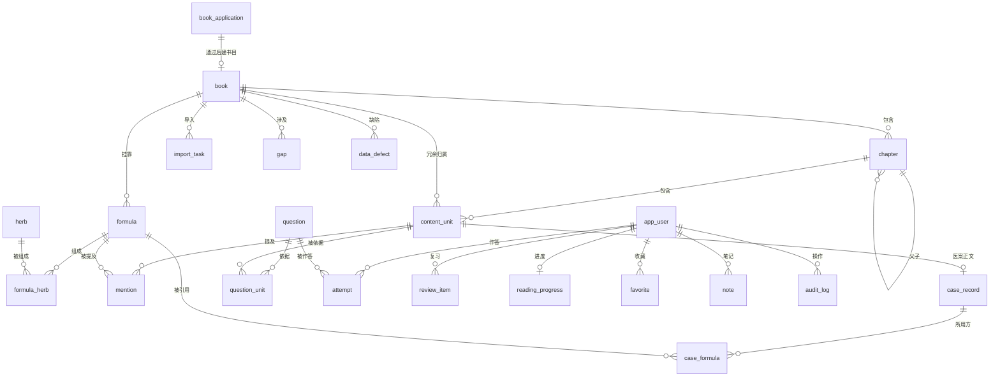

# 06 数据库设计说明书

**版本：** v0.4
**状态：** 草稿
**最后更新：** 2026-11-26
**输入基线：** `docs/03` v1.6（13 条数据要求、20 个数据项）、`docs/04` v0.6（22 个概念类）、`docs/05` v0.16（§11 数据设计与 §19.1 题型规则）。
**变更摘要：** v0.4 按 `05` v0.16 的 §19.1 补题目的生命周期与选项契约：①`question` 加 `fingerprint`（唯一，防双击与并发插重）与 `invalidated_at`（NULL 为有效，依据被修正时置值，失效题不再出新但已有作答保留）；②`options` 由"仅选择题使用"改为三类题均用的 `[{id,text}]`、2～4 项，`answer_key` 明确存正确选项 id 而非文本；③补第 36～37 条索引（`question.fingerprint` 唯一、`question_unit.unit_id` 反查），总数 35→37，§5.1 的展开口径改为 21 行→26 条；④§8.3 增第 6 项回填记录，输入基线改 `05` v0.16。v0.3 完成首轮评审并修正五类问题：`question.type` 的取值 `CHECK` 与外键冲突改为外键 → `question_type.code`；`safety_check.target_anon_id` 改可空；补 `book.application_id`；补四条索引；补第五条对账并把"题目作废"限定为发布前。v0.2 §8.3 随 `05` v0.14 的回填收口。v0.1 首次形成正文，按 `05` §11.4 的八项交接清单落 30 张表。

## 1. 文档信息

### 1.1 目的

`docs/05` 说明"系统由哪些部分组成、数据如何组织"；本文档说明"这些数据在关系数据库里怎么落"。判断标准有三条：

1. 每张表能指回 `docs/04` 的类或 `docs/05` §11.5 的支撑用途，每个字段能指回 `docs/03` 的数据项或一条需求。
2. 每条约束写清由谁保证：数据库、应用层还是表权限（`05` §11.9 的三层分工）。
3. 结构能被直接转成 Flyway 迁移脚本，编码时不需要再猜类型与长度。

### 1.2 与上下游的分工

- **上游**：`docs/05` §11 是本文档的唯一设计来源。表名、唯一写者、字段语义、枚举取值域以 `05` 为准；冲突时以 `05` 为准并回改本文档，若是 `05` 漏写（如未给列名），按 §8.3 登记回填，不擅自扩张表结构。
- **`docs/03`** 提供数据项与保留期口径（DR-01～DR-13、DI-01～DI-20）。
- **`docs/04`** 提供概念类与基数（22 个类，`Submission` 为抽象类）。
- **下游**：`docs/08` 取本文档的约束与索引写测试用例；实现取本文档的字段表写迁移脚本；`project_plan/10_api_contract/` 的字段手写区与本文档的列名必须一致。

### 1.3 读者对象

数据库实现者、接口实现者、课程评审者、`docs/08` 的测试设计者。

### 1.4 术语与约定

沿用 `docs/03` §1.4、`docs/04` §3.1、`docs/05` §1.5。本文档新增四条约定：

| 约定 | 内容 |
|---|---|
| 表名与列名 | 全小写、下划线分词；表名单数（`formula` 不写 `formulas`）。表名由 `05` §11.5 冻结，不得改名 |
| 标识 | `varchar(36)`，由应用生成（UUID 字符串），不用自增序列。理由见 `05` §11.4 第 4 条 |
| 时间 | `timestamptz`，序列化为带偏移的时间串（DR-05） |
| 枚举 | `varchar(n)` + `CHECK`，不用 PostgreSQL 枚举类型、不建枚举表；唯一例外是题型白名单 `question_type`（BR-08 要求可停用不改代码） |

## 2. 概念模型

### 2.1 实体与联系

概念模型沿用 `docs/04` §3.2 的类图，不重新建模。落到关系模型时只有一条转换规则：**类落表，多对多落关联表，抽象类不建表**。

`Submission` 是抽象类，没有独立表：它的 `check_status` 分别落在 `book_application` 与 `gap` 两列上，`submitted_at` 对应各表的提交时间列，`scene` 由表本身隐含（书目申请／内容缺口），不再单独存。

### 2.2 E-R 图（核心部分）

下图只画内容链路与学习链路的主干；9 张支撑表（`correction`、`norm_collision`、`formula_alias`、`herb_alias`、`case_formula`、`question_unit`、`question_type`、`revoked_token`、`data_defect`）为可读性省略，它们的基数在 §3 各表与 §4 中给出。



图 6-1 核心 E-R 图。要回答的问题是：**`content_unit` 是不是所有内容的唯一入口**——是。方剂、药味、医案、题目、作答都通过标识引用它，没有第二处存正文的地方。`case_record` 只存 `unit_id`，`question_unit` 只存 `unit_id`，`mention` 只存 `unit_id`，这是 `05` §11.5 定下的"正文不复制"在结构上的体现。

### 2.3 三类关系的处理方式

| 关系形态 | 处理 | 例子 |
|---|---|---|
| 1:N，子表有明确父 | 子表存父标识 + 外键 | `chapter.book_id`、`content_unit.chapter_id` |
| M:N，关系本身无属性 | 关联表，联合唯一键 | `formula_herb`、`case_formula`、`question_unit` |
| M:N，关系有属性 | 关联表带属性列 | `mention.is_primary`、`formula_herb.dosage_text` |
| 多态引用（对象类型 + 对象标识） | 不建外键，写入前校验 + 每日对账 | `favorite`、`note`、`review_item`、`conflict` |

多态引用不建外键的理由已由 `05` §11.6 给出：目标表随类型变化，外键只能靠触发器或应用层拼 SQL，触发器会让约束何时生效变得不可见。本文档的落实办法是 §4.4 的五条对账 SQL。

## 3. 逻辑模型

按业务分组给 30 张表的字段全集。每组开头写明唯一写者，与 `05` §11.5 一致；"可空"列写"是"的字段必须同时说明缺省含义，避免用空串冒充缺失（DR-08）。

### 3.1 书目与导入（7 张）

#### 3.1.1 `book` 书目

唯一写者：M-04 书目与申请。

| 列 | 类型 | 可空 | 默认 | 说明 |
|---|---|---|---|---|
| `id` | `varchar(36)` | 否 | — | 主键 |
| `application_id` | `varchar(36)` | 是 | NULL | 来源申请；外键 → `book_application.id`，唯一。通过后建书目（`04` §3.2），手工补录的书为空 |
| `name` | `varchar(200)` | 否 | — | 书名，与通过的书目申请一致（DI-02） |
| `author` | `varchar(100)` | 否 | — | 作者 |
| `dynasty` | `varchar(50)` | 是 | NULL | 朝代；无法确证时为空，不填"不详" |
| `edition` | `varchar(200)` | 否 | — | 版本或出版社（FR-105 的通过前置条件之一） |
| `status` | `varchar(16)` | 否 | `'待导入'` | `CHECK (status IN ('待导入','已入库','已停用'))`（FR-104） |
| `created_at` | `timestamptz` | 否 | `now()` | |
| `updated_at` | `timestamptz` | 否 | `now()` | |

停用不删行：`已停用` 的书不进入学习者列表，但其内容单元与学习记录仍在。

`application_id` 上一行是评审补的：`04` §3.2 类图有 `BookApplication --> Book: 通过后建书目`，若关系模型不落这一列，FR-104 的"通过后生成导入入口"只能靠书名与版本去猜书目，而 FR-106 允许同一书目有多条申请（旧记录不覆盖），猜法会指错。列可空是为手工补录的书；唯一约束保证"一份申请至多建一本书"。

#### 3.1.2 `book_application` 书目申请

唯一写者：M-04。

| 列 | 类型 | 可空 | 默认 | 说明 |
|---|---|---|---|---|
| `id` | `varchar(36)` | 否 | — | 主键 |
| `title` | `varchar(200)` | 否 | — | 申请书名 |
| `author` | `varchar(100)` | 否 | — | 作者 |
| `dynasty` | `varchar(50)` | 是 | NULL | 朝代 |
| `edition` | `varchar(200)` | 否 | — | 版本或出版社 |
| `catalog` | `text` | 否 | — | 目录；非空是 FR-105 的第一道保证 |
| `purpose` | `text` | 否 | — | 用途说明 |
| `status` | `varchar(8)` | 否 | `'待审'` | `CHECK (status IN ('待审','通过','驳回'))` |
| `reject_reason` | `text` | 是 | NULL | 驳回理由；`status='驳回'` 时非空 |
| `reviewer` | `varchar(36)` | 是 | NULL | 审核人；`status='通过'` 时非空 |
| `reviewed_at` | `timestamptz` | 是 | NULL | 审核时间；同上 |
| `check_status` | `varchar(8)` | 否 | `'待检'` | `CHECK (check_status IN ('待检','通过','拦截'))`（DR-09） |
| `submitted_at` | `timestamptz` | 否 | `now()` | 提交时间 |
| `created_at` | `timestamptz` | 否 | `now()` | |

表级 `CHECK`：

- `CHECK (status <> '驳回' OR (reject_reason IS NOT NULL AND btrim(reject_reason) <> ''))`
- `CHECK (status <> '通过' OR (reviewer IS NOT NULL AND reviewed_at IS NOT NULL))`

驳回后重提生成新行，旧行不覆盖（FR-106），因此本表不设"同书唯一"约束。

#### 3.1.3 `import_task` 导入任务

唯一写者：M-05 导入。

| 列 | 类型 | 可空 | 默认 | 说明 |
|---|---|---|---|---|
| `id` | `varchar(36)` | 否 | — | 主键 |
| `book_id` | `varchar(36)` | 否 | — | 外键 → `book.id` |
| `status` | `varchar(16)` | 否 | `'排队'` | `CHECK (status IN ('排队','解析中','切分中','标注中','质检中','已完成','失败'))`（FR-803、图 4-11） |
| `stage` | `varchar(8)` | 是 | NULL | 当前环节：`解析／切分／标注／质检`；失败时保留最后环节 |
| `started_at` | `timestamptz` | 是 | NULL | 领取任务的时间 |
| `finished_at` | `timestamptz` | 是 | NULL | 完成或失败的时间 |
| `total_units` | `integer` | 否 | 0 | 入库单元数 |
| `dedup_count` | `integer` | 否 | 0 | 去重数（FR-112） |
| `fragment_count` | `integer` | 否 | 0 | 碎片清洗数（FR-113） |
| `nature_prefill_rate` | `numeric(5,2)` | 是 | NULL | 段落性质规则预填覆盖率，0～100（Q-05-1） |
| `vocab_match_rate` | `numeric(5,2)` | 是 | NULL | 词表匹配率，0～100（FR-118） |
| `collision_pending_count` | `integer` | 否 | 0 | 进入人工确认的碰撞组数（DR-12） |
| `error_kind` | `varchar(32)` | 是 | NULL | 失败环节定位：`解析／切分／标注／质检`（NFR-20） |
| `idempotency_key` | `varchar(64)` | 否 | — | 幂等键，唯一（NFR-05、§11.11） |
| `created_at` | `timestamptz` | 否 | `now()` | |

表级 `CHECK`：各计数 `>= 0`；两个比率 `IS NULL OR BETWEEN 0 AND 100`。

#### 3.1.4 `correction` 修正留痕

唯一写者：M-05。只增不改，不提供更新与删除语义（FR-120、DR-04）。

| 列 | 类型 | 可空 | 默认 | 说明 |
|---|---|---|---|---|
| `id` | `varchar(36)` | 否 | — | 主键 |
| `unit_id` | `varchar(36)` | 否 | — | 外键 → `content_unit.id` |
| `field` | `varchar(32)` | 否 | — | 被修正列名，须在允许清单内 |
| `old_value` | `text` | 是 | NULL | 原值；原值为空时记 NULL，不记空串 |
| `new_value` | `text` | 是 | NULL | 新值 |
| `operator_id` | `varchar(36)` | 否 | — | 操作人 |
| `created_at` | `timestamptz` | 否 | `now()` | |

`field` 允许清单（`CHECK`）：`display_text`、`source_nature`、`clause_no`、`seq`、`chapter_id`、`quoted_from_book`、`quoted_from_chapter`、`quoted_from_clause`。清单外的列说明有人绕过导入链直接改数据，属于缺陷而非功能。

#### 3.1.5 `norm_collision` 碰撞清单

唯一写者：M-05。未确认的组不得入库（DR-12）。

| 列 | 类型 | 可空 | 默认 | 说明 |
|---|---|---|---|---|
| `id` | `varchar(36)` | 否 | — | 主键 |
| `import_task_id` | `varchar(36)` | 否 | — | 外键 → `import_task.id` |
| `display_a` | `text` | 否 | — | 第一条显示值 |
| `display_b` | `text` | 否 | — | 第二条显示值 |
| `unit_a` | `varchar(36)` | 是 | NULL | 对应单元；入库前可为空 |
| `unit_b` | `varchar(36)` | 是 | NULL | 同上 |
| `verdict` | `varchar(8)` | 否 | `'未确认'` | `CHECK (verdict IN ('未确认','确认重复','确认不同'))` |
| `resolved_by` | `varchar(36)` | 是 | NULL | 裁决人 |
| `resolved_at` | `timestamptz` | 是 | NULL | 裁决时间 |
| `created_at` | `timestamptz` | 否 | `now()` | |

表级 `CHECK`：`verdict='未确认'` 时 `resolved_by` 与 `resolved_at` 必须为空。

#### 3.1.6 `chapter` 篇章

唯一写者：M-05 建树，随后交 M-07 读写。

| 列 | 类型 | 可空 | 默认 | 说明 |
|---|---|---|---|---|
| `id` | `varchar(36)` | 否 | — | 主键 |
| `book_id` | `varchar(36)` | 否 | — | 外键 → `book.id` |
| `parent_id` | `varchar(36)` | 是 | NULL | 自关联 → `chapter.id`；根节点为空 |
| `name` | `varchar(200)` | 否 | — | 篇名（DI-03） |
| `level` | `smallint` | 否 | — | 层级，从 1 起（FR-115） |
| `seq` | `integer` | 否 | — | 同级序号，从 1 起连续 |
| `created_at` | `timestamptz` | 否 | `now()` | |

唯一键：`UNIQUE NULLS NOT DISTINCT (book_id, parent_id, seq)`。用 `NULLS NOT DISTINCT` 是因为根节点 `parent_id` 为空，默认的 NULL 互不相等会让"同一本书出现两个 1 号根节点"通过校验。

自关联的外键不使用 `ON DELETE CASCADE`：删章是禁止操作，只能停用整本书。

#### 3.1.7 `content_unit` 内容单元

唯一写者：M-07 内容库。这是全系统的核心表。

| 列 | 类型 | 可空 | 默认 | 说明 |
|---|---|---|---|---|
| `id` | `varchar(36)` | 否 | — | 主键（DI-01） |
| `book_id` | `varchar(36)` | 否 | — | 外键 → `book.id`；冗余，须与所属章一致 |
| `chapter_id` | `varchar(36)` | 否 | — | 外键 → `chapter.id` |
| `seq` | `integer` | 否 | — | 篇内序号，从 1 起（DI-19） |
| `display_text` | `text` | 否 | — | 显示值，等于底本（DI-05、BR-03） |
| `norm_text` | `text` | 否 | — | 归一值，可由显示值重算（DI-06、DR-02） |
| `norm_version` | `varchar(16)` | 否 | `'zh-norm-1.0'` | 归一规则版本（DR-10） |
| `source_nature` | `varchar(8)` | 否 | — | `CHECK (source_nature IN ('典籍原文','注释','教学论述','医案','其他（非正文）'))`（DI-07） |
| `clause_no` | `varchar(32)` | 是 | NULL | 底本原条号；无则空，不得编造（DI-04） |
| `quoted_from_book` | `varchar(200)` | 是 | NULL | 原典书名（DI-20） |
| `quoted_from_chapter` | `varchar(200)` | 是 | NULL | 原典篇名 |
| `quoted_from_clause` | `varchar(32)` | 是 | NULL | 原典条号 |
| `criteria_complete` | `boolean` | 否 | `false` | 判据是否完整（DI-08、DR-08） |
| `criteria_missing_note` | `text` | 是 | NULL | 缺哪项判据；完整时为空 |
| `created_at` | `timestamptz` | 否 | `now()` | |
| `updated_at` | `timestamptz` | 否 | `now()` | 修正经 `correction` 留痕后更新 |

键与 `CHECK`：

- `UNIQUE (book_id, chapter_id, seq)` —— 篇内顺序稳定（DR-01）。
- `CHECK (seq >= 1)`。
- `CHECK (NOT criteria_complete OR criteria_missing_note IS NULL)`。
- 不建 `search_tsv` 列（`05` §11.3）。任何实体类映射该列即缺陷。

### 3.2 内容实体（8 张）

#### 3.2.1 `formula` 方剂

唯一写者：M-07。

| 列 | 类型 | 可空 | 默认 | 说明 |
|---|---|---|---|---|
| `id` | `varchar(36)` | 否 | — | 主键 |
| `book_id` | `varchar(36)` | 否 | — | 外键 → `book.id`；同名跨书不合并（FR-301） |
| `name` | `varchar(200)` | 否 | — | 方名（DI-10） |
| `norm_name` | `varchar(200)` | 否 | — | 方名归一值（FR-307） |
| `created_at` | `timestamptz` | 否 | `now()` | |

唯一键：`UNIQUE (book_id, norm_name)`。并发兜底靠这条唯一键，不靠"先查后写"（`05` §11.11）。

#### 3.2.2 `formula_alias` 方名别名

唯一写者：M-07。名称层召回的载体（Q-107）。

| 列 | 类型 | 可空 | 默认 | 说明 |
|---|---|---|---|---|
| `id` | `varchar(36)` | 否 | — | 主键 |
| `formula_id` | `varchar(36)` | 否 | — | 外键 → `formula.id` |
| `alias` | `varchar(200)` | 否 | — | 别名原样 |
| `norm_alias` | `varchar(200)` | 否 | — | 别名归一值 |
| `created_at` | `timestamptz` | 否 | `now()` | |

唯一键：`UNIQUE (formula_id, norm_alias)`。

#### 3.2.3 `herb` 药味

唯一写者：M-07。药味跨书共享。

| 列 | 类型 | 可空 | 默认 | 说明 |
|---|---|---|---|---|
| `id` | `varchar(36)` | 否 | — | 主键 |
| `name` | `varchar(100)` | 否 | — | 标准名（DI-11） |
| `norm_name` | `varchar(100)` | 否 | — | 归一后标准名，全局唯一 |
| `created_at` | `timestamptz` | 否 | `now()` | |

唯一键：`UNIQUE (norm_name)`。

#### 3.2.4 `herb_alias` 药味异名

唯一写者：M-07。

| 列 | 类型 | 可空 | 默认 | 说明 |
|---|---|---|---|---|
| `id` | `varchar(36)` | 否 | — | 主键 |
| `herb_id` | `varchar(36)` | 否 | — | 外键 → `herb.id` |
| `alias` | `varchar(100)` | 否 | — | 异名原样 |
| `norm_alias` | `varchar(100)` | 否 | — | 异名归一值 |
| `created_at` | `timestamptz` | 否 | `now()` | |

唯一键：`UNIQUE (herb_id, norm_alias)`。

#### 3.2.5 `formula_herb` 组成项

唯一写者：M-07。对应 Composition（DI-12）。

| 列 | 类型 | 可空 | 默认 | 说明 |
|---|---|---|---|---|
| `id` | `varchar(36)` | 否 | — | 主键 |
| `formula_id` | `varchar(36)` | 否 | — | 外键 → `formula.id` |
| `herb_id` | `varchar(36)` | 否 | — | 外键 → `herb.id` |
| `dosage_text` | `text` | 是 | NULL | 原文用量表述；缺失为空，不换算、不推断（BR-06） |
| `seq` | `smallint` | 否 | — | 组成项顺序，从 1 起 |
| `created_at` | `timestamptz` | 否 | `now()` | |

唯一键：`UNIQUE (formula_id, herb_id)` —— 同一方同一药只允许一行。

#### 3.2.6 `mention` 提及项

唯一写者：M-07。区分"记载该方"与"顺带提到方名"。

| 列 | 类型 | 可空 | 默认 | 说明 |
|---|---|---|---|---|
| `id` | `varchar(36)` | 否 | — | 主键 |
| `unit_id` | `varchar(36)` | 否 | — | 外键 → `content_unit.id` |
| `formula_id` | `varchar(36)` | 否 | — | 外键 → `formula.id` |
| `is_primary` | `boolean` | 否 | `false` | 真＝该段记载此方，假＝顺带提及 |
| `created_at` | `timestamptz` | 否 | `now()` | |

唯一键：`UNIQUE (unit_id, formula_id)`。该唯一键已覆盖 `unit_id` 前缀，因此不再单建 `unit_id` 索引（理由见 §5.3）。

#### 3.2.7 `case_record` 医案

唯一写者：M-07。只存 `unit_id`，正文以 `content_unit` 为准。

| 列 | 类型 | 可空 | 默认 | 说明 |
|---|---|---|---|---|
| `id` | `varchar(36)` | 否 | — | 主键 |
| `unit_id` | `varchar(36)` | 否 | — | 外键 → `content_unit.id`，唯一 |
| `created_at` | `timestamptz` | 否 | `now()` | |

约束分两层：`UNIQUE (unit_id)` 由数据库保证；"该单元的 `source_nature` 必须是 `医案`"由应用层写入前校验，再加每日对账（§4.4）。不用触发器，理由同 `05` §11.9：触发器失败会连累整批导入，而这类不一致属于数据缺陷，不是导入失败。

#### 3.2.8 `case_formula` 医案所用方

唯一写者：M-07。

| 列 | 类型 | 可空 | 默认 | 说明 |
|---|---|---|---|---|
| `id` | `varchar(36)` | 否 | — | 主键 |
| `case_id` | `varchar(36)` | 否 | — | 外键 → `case_record.id` |
| `formula_id` | `varchar(36)` | 否 | — | 外键 → `formula.id` |
| `created_at` | `timestamptz` | 否 | `now()` | |

唯一键：`UNIQUE (case_id, formula_id)`。医案不参与组成差异比对，仅供展示（FR-309、BR-04）。

### 3.3 练习（3 张）

#### 3.3.1 `question` 题目

唯一写者：M-09 练习。

| 列 | 类型 | 可空 | 默认 | 说明 |
|---|---|---|---|---|
| `id` | `varchar(36)` | 否 | — | 主键 |
| `type` | `varchar(8)` | 否 | — | 外键 → `question_type.code`；**不写取值 `CHECK`**，新增题型只改白名单（BR-08、`05` §11.4 第 3 条的例外） |
| `stem` | `text` | 否 | — | 题干 |
| `options` | `jsonb` | 是 | NULL | 选项数组 `[{"id":"A","text":"…"}]`，2～4 项；三类题均使用（`05` §19.1.3） |
| `answer_key` | `text` | 否 | — | 正确选项 id（A～D）；唯一正解（FR-404） |
| `answer_unique` | `boolean` | 否 | `true` | `CHECK (answer_unique)` —— 首版只允许唯一正解 |
| `fingerprint` | `varchar(64)` | 否 | — | 去重指纹：`sha256(规则版本｜题型｜依据单元｜主实体)`；唯一，防双击与并发插重（`05` §19.1.2） |
| `invalidated_at` | `timestamptz` | 是 | NULL | 失效时间；NULL 表示有效。依据被修正时由写入方置值，失效题不再出新，已有作答保留 |
| `created_at` | `timestamptz` | 否 | `now()` | |

题目由规则生成、不含个人信息，因此删除作答记录时不删题目（`05` §11.13）。题目的复用、失效与清理规则见 `05` §19.1.2；`options` 与 `answer_key` 的形状见 §19.1.3。

#### 3.3.2 `question_unit` 题目依据单元

唯一写者：M-09。

| 列 | 类型 | 可空 | 默认 | 说明 |
|---|---|---|---|---|
| `id` | `varchar(36)` | 否 | — | 主键 |
| `question_id` | `varchar(36)` | 否 | — | 外键 → `question.id` |
| `unit_id` | `varchar(36)` | 否 | — | 外键 → `content_unit.id` |
| `ord` | `smallint` | 否 | — | 依据顺序，从 1 起 |
| `created_at` | `timestamptz` | 否 | `now()` | |

唯一键：`UNIQUE (question_id, unit_id)` 与 `UNIQUE (question_id, ord)`。

条数约束 1..n 由应用层在写入后校验：选择题与组成匹配题恰好 1 条，类方比较题至少 2 条（D-057）。不合格的题目在发布前作废重出、不进题池；已发布并被作答的题目不删除（`attempt.question_id` 为 `RESTRICT`），只随 `question_type` 停用而不再出新题。

#### 3.3.3 `question_type` 题型白名单

唯一写者：M-09。这是唯一一张"枚举落表"的例外，因为 BR-08 要求新增题型改配置、可停用而不改代码。

| 列 | 类型 | 可空 | 默认 | 说明 |
|---|---|---|---|---|
| `code` | `varchar(8)` | 否 | — | 主键，与 `question.type` 取值一致 |
| `name` | `varchar(32)` | 否 | — | 显示名 |
| `enabled` | `boolean` | 否 | `true` | 停用后不出新题，历史题目与作答保留 |
| `updated_at` | `timestamptz` | 否 | `now()` | |

停用不是删除：已有 `question` 行仍可展示与判分，避免"停用题型后错题打不开"。

### 3.4 账号与学习记录（7 张）

#### 3.4.1 `app_user` 用户

唯一写者：M-01 登录与账号、M-12 学习记录。

| 列 | 类型 | 可空 | 默认 | 说明 |
|---|---|---|---|---|
| `id` | `varchar(36)` | 否 | — | 主键 |
| `openid` | `varchar(64)` | 否 | — | 微信 openid，唯一（FR-701） |
| `role` | `varchar(8)` | 否 | `'学习者'` | `CHECK (role IN ('学习者','管理员'))`（FR-801） |
| `status` | `varchar(8)` | 否 | `'正常'` | `CHECK (status IN ('正常','锁定'))`（FR-808） |
| `failed_count` | `integer` | 否 | 0 | 连续登录失败次数 |
| `locked_until` | `timestamptz` | 是 | NULL | 锁定截止时间；未锁定为空 |
| `password_hash` | `varchar(100)` | 是 | NULL | 管理员口令的不可逆哈希（bcrypt）；学习者与纯微信登录的管理员为空 |
| `created_at` | `timestamptz` | 否 | `now()` | |
| `updated_at` | `timestamptz` | 否 | `now()` | |

`password_hash` 是 `05` §11.12 要求"只存不可逆哈希"的落点，`05` §11.13 的字段白名单漏列此列，已登记 §8.3 回填。它不是个人身份信息，且仅管理员非空，不改变"最小收集"的结论。

"最后活跃"不单独建列：清理任务按五张学习记录表的 `max(时间)` 计算（`05` §11.15），避免多写一处时间戳而出现两套口径。

#### 3.4.2 `revoked_token` 令牌吊销清单

唯一写者：M-01。

| 列 | 类型 | 可空 | 默认 | 说明 |
|---|---|---|---|---|
| `jti` | `varchar(64)` | 否 | — | 主键，令牌唯一标识 |
| `user_id` | `varchar(36)` | 否 | — | 外键 → `app_user.id` |
| `expires_at` | `timestamptz` | 否 | — | 令牌自然过期时间 |
| `revoked_at` | `timestamptz` | 否 | `now()` | 吊销时间 |

过期即删，由清理任务顺带执行（DR-13），不靠业务代码判断。

#### 3.4.3 `reading_progress` 阅读进度

唯一写者：M-12。

| 列 | 类型 | 可空 | 默认 | 说明 |
|---|---|---|---|---|
| `id` | `varchar(36)` | 否 | — | 主键 |
| `user_id` | `varchar(36)` | 否 | — | 外键 → `app_user.id`，唯一 |
| `book_id` | `varchar(36)` | 否 | — | 外键 → `book.id` |
| `chapter_id` | `varchar(36)` | 否 | — | 外键 → `chapter.id` |
| `unit_id` | `varchar(36)` | 否 | — | 外键 → `content_unit.id` |
| `updated_at` | `timestamptz` | 否 | `now()` | 最后阅读时间 |

唯一键：`UNIQUE (user_id)` —— 每用户一行，只记最后位置（FR-203）。

#### 3.4.4 `favorite` 收藏

唯一写者：M-12。

| 列 | 类型 | 可空 | 默认 | 说明 |
|---|---|---|---|---|
| `id` | `varchar(36)` | 否 | — | 主键 |
| `user_id` | `varchar(36)` | 否 | — | 外键 → `app_user.id` |
| `object_type` | `varchar(16)` | 否 | — | `CHECK (object_type IN ('content_unit','formula','case_record'))` |
| `object_id` | `varchar(36)` | 否 | — | 对象标识，多态引用不建外键 |
| `created_at` | `timestamptz` | 否 | `now()` | |

唯一键：`UNIQUE (user_id, object_type, object_id)` —— 同一对象去重（FR-703）。

#### 3.4.5 `note` 笔记

唯一写者：M-12。仅本人可见，不参与内容安全检测（FR-901 的边界）。

| 列 | 类型 | 可空 | 默认 | 说明 |
|---|---|---|---|---|
| `id` | `varchar(36)` | 否 | — | 主键 |
| `user_id` | `varchar(36)` | 否 | — | 外键 → `app_user.id` |
| `object_type` | `varchar(16)` | 否 | — | 同 `favorite` 的三值 |
| `object_id` | `varchar(36)` | 否 | — | 对象标识 |
| `text` | `text` | 否 | — | 笔记正文 |
| `created_at` | `timestamptz` | 否 | `now()` | |
| `updated_at` | `timestamptz` | 否 | `now()` | |

FUT-06（导出与分享）启用时，本表必须接入内容安全检测；在此之前不检测是合规的。

#### 3.4.6 `attempt` 作答

唯一写者：M-12。

| 列 | 类型 | 可空 | 默认 | 说明 |
|---|---|---|---|---|
| `id` | `varchar(36)` | 否 | — | 主键 |
| `user_id` | `varchar(36)` | 否 | — | 外键 → `app_user.id` |
| `question_id` | `varchar(36)` | 否 | — | 外键 → `question.id` |
| `answer` | `text` | 否 | — | 用户作答原样 |
| `is_correct` | `boolean` | 否 | — | 判定结果（DI-14） |
| `created_at` | `timestamptz` | 否 | `now()` | |

#### 3.4.7 `review_item` 复习条目

唯一写者：M-12。

| 列 | 类型 | 可空 | 默认 | 说明 |
|---|---|---|---|---|
| `id` | `varchar(36)` | 否 | — | 主键 |
| `user_id` | `varchar(36)` | 否 | — | 外键 → `app_user.id` |
| `object_type` | `varchar(16)` | 否 | — | 同上三值 |
| `object_id` | `varchar(36)` | 否 | — | 对象标识 |
| `interval_index` | `smallint` | 否 | 0 | `CHECK (interval_index BETWEEN 0 AND 5)`，对应 1／2／4／7／15／30 天 |
| `due_at` | `timestamptz` | 否 | — | 下次到期时间 |
| `updated_at` | `timestamptz` | 否 | `now()` | |

唯一键：`UNIQUE (user_id, object_type, object_id)` —— 答题时按该键 upsert（`05` §11.11）。无"已掌握"终态（D-046），因此没有 `status` 列。

### 3.5 治理与安全（5 张）

#### 3.5.1 `gap` 缺口

唯一写者：M-11 治理。

| 列 | 类型 | 可空 | 默认 | 说明 |
|---|---|---|---|---|
| `id` | `varchar(36)` | 否 | — | 主键 |
| `question_text` | `text` | 否 | — | 问题原文（DI-16）；关闭 6 个月后清空 |
| `book_id` | `varchar(36)` | 是 | NULL | 涉及书目；跨书问题可为空 |
| `check_status` | `varchar(8)` | 否 | `'待检'` | 同 `book_application` 的三值（DR-09） |
| `status` | `varchar(8)` | 否 | `'待处理'` | `CHECK (status IN ('待处理','已补','不可补'))`（FR-603） |
| `queued_at` | `timestamptz` | 否 | `now()` | 入队时间；7 天超期筛选依赖它（FR-606） |
| `handler` | `varchar(36)` | 是 | NULL | 处理人 |
| `handled_at` | `timestamptz` | 是 | NULL | 处理时间 |
| `handle_result` | `text` | 是 | NULL | 处理结果 |
| `client_request_id` | `varchar(64)` | 否 | — | 幂等键，10 分钟内相同即视为重复提交 |
| `created_at` | `timestamptz` | 否 | `now()` | |

表级 `CHECK`：

- `CHECK (status = '待处理' OR (handler IS NOT NULL AND handled_at IS NOT NULL AND handle_result IS NOT NULL))`
- `CHECK (status <> '不可补' OR btrim(handle_result) <> '')`

状态迁移同时写 `audit_log`（动作 `GAP_STATUS_CHANGE`），这样处理轨迹不必再建事件表。

#### 3.5.2 `conflict` 冲突

唯一写者：M-11。无"主值／胜出值"字段，这是 BR-07 的结构性保证。

| 列 | 类型 | 可空 | 默认 | 说明 |
|---|---|---|---|---|
| `id` | `varchar(36)` | 否 | — | 主键 |
| `entity_type` | `varchar(16)` | 否 | — | `CHECK (entity_type IN ('formula','herb','content_unit'))` |
| `entity_id` | `varchar(36)` | 否 | — | 实体标识，多态引用不建外键 |
| `field` | `varchar(32)` | 否 | — | 冲突字段名 |
| `values` | `text[]` | 否 | — | 各来源的取值，顺序与 `sources` 一一对应（DI-17） |
| `sources` | `text[]` | 否 | — | 各取值来源的书目或单元 |
| `status` | `varchar(16)` | 否 | `'已检出'` | `CHECK (status IN ('已检出','已确认差异','已修正','已驳回'))`（FR-606） |
| `handler` | `varchar(36)` | 是 | NULL | 处理人 |
| `handled_at` | `timestamptz` | 是 | NULL | 处理时间 |
| `handle_result` | `text` | 是 | NULL | 处理结果 |
| `created_at` | `timestamptz` | 否 | `now()` | |

表级 `CHECK`：

- `CHECK (cardinality("values") = cardinality(sources) AND cardinality("values") > 0)`
- `CHECK (status = '已检出' OR (handler IS NOT NULL AND handled_at IS NOT NULL AND handle_result IS NOT NULL))`

`values` 与 `sources` 是保留字，DDL 中必须加双引号；应用层 SQL 同样必须引用，否则 PostgreSQL 会把 `values` 解析成关键字。

#### 3.5.3 `safety_check` 检测记录

唯一写者：M-13 安全与合规。只存场景、结果、匿名对象标识与时间，不存正文。

| 列 | 类型 | 可空 | 默认 | 说明 |
|---|---|---|---|---|
| `id` | `varchar(36)` | 否 | — | 主键 |
| `scene` | `varchar(32)` | 否 | — | 场景：`书目申请／缺口上报／笔记分享` |
| `result` | `varchar(8)` | 否 | — | `CHECK (result IN ('通过','拦截'))`（FR-903） |
| `target_anon_id` | `varchar(64)` | 是 | NULL | 不可反查的匿名对象串，不与 `app_user` 建外键；保留期到期置空（DR-13） |
| `created_at` | `timestamptz` | 否 | `now()` | |

#### 3.5.4 `audit_log` 审计记录

唯一写者：M-13。只增不改，无 `updated_at`。

| 列 | 类型 | 可空 | 默认 | 说明 |
|---|---|---|---|---|
| `id` | `varchar(36)` | 否 | — | 主键 |
| `actor_id` | `varchar(36)` | 是 | NULL | 操作人；系统任务为空 |
| `action` | `varchar(32)` | 否 | — | 动作类型，如 `ADMIN_LOGIN`、`ADMIN_LOGIN_FAILED`、`IMPORT_DELETE`、`GAP_STATUS_CHANGE` |
| `target_type` | `varchar(32)` | 否 | — | 对象类型 |
| `target_id` | `varchar(36)` | 是 | NULL | 对象标识 |
| `result_summary` | `text` | 是 | NULL | 结果摘要；不记正文与密钥 |
| `detail` | `jsonb` | 是 | NULL | 结构化补充，如状态迁移的前后值与理由 |
| `created_at` | `timestamptz` | 否 | `now()` | |

#### 3.5.5 `data_defect` 数据缺陷

唯一写者：M-07 记录、M-05 处理。这是 `05` §11.5 新增的最小表，承载"组装出处时被剔除的单元、跨表不一致项"，走质检返工，不进用户可见的缺口队列（D-056）。

| 列 | 类型 | 可空 | 默认 | 说明 |
|---|---|---|---|---|
| `id` | `varchar(36)` | 否 | — | 主键 |
| `kind` | `varchar(16)` | 否 | — | `CHECK (kind IN ('出处不全','跨表不一致','归一碰撞未确认'))`（`05` §5.7、DR-12） |
| `status` | `varchar(8)` | 否 | `'待返工'` | `CHECK (status IN ('待返工','已返工','已关闭'))` |
| `book_id` | `varchar(36)` | 是 | NULL | 涉及书目；外键 → `book.id` |
| `unit_id` | `varchar(36)` | 是 | NULL | 涉及单元；外键 → `content_unit.id` |
| `batch_id` | `varchar(36)` | 是 | NULL | 涉及批次；外键 → `import_task.id` |
| `detail` | `text` | 否 | — | 缺陷描述，含定位信息 |
| `resolved_by_correction_id` | `varchar(36)` | 是 | NULL | 修复该缺陷的修正记录；外键 → `correction.id` |
| `created_at` | `timestamptz` | 否 | `now()` | |
| `resolved_at` | `timestamptz` | 是 | NULL | 关闭或返工完成时间 |

表级 `CHECK`：

- `CHECK (unit_id IS NOT NULL OR batch_id IS NOT NULL)` —— 缺陷必须能定位到一条单元或一个批次，否则退化为无主日志。
- `CHECK (status <> '待返工' OR resolved_at IS NULL)`。
- `CHECK (status <> '已返工' OR resolved_by_correction_id IS NOT NULL)` —— "已返工"必须能指回那次修正，否则无法复核。

## 4. 完整性约束与删除顺序

### 4.1 外键与级联策略

| 外键 | 指向 | `ON DELETE` | 理由 |
|---|---|---|---|
| `book.application_id` | `book_application` | `RESTRICT` | 通过后建书目；一本书至多对应一份通过的申请 |
| `import_task.book_id` | `book` | `RESTRICT` | 内容资产永不删除 |
| `correction.unit_id` | `content_unit` | `RESTRICT` | 留痕不能因正文删除而消失 |
| `norm_collision.import_task_id` | `import_task` | `RESTRICT` | 碰撞清单是归一规则的复核证据 |
| `norm_collision.unit_a`、`.unit_b` | `content_unit` | `RESTRICT` | 入库前可空，入库后须指向真实单元 |
| `chapter.book_id` | `book` | `RESTRICT` | 同上 |
| `chapter.parent_id` | `chapter` | `RESTRICT` | 删章禁止，只能停用整本书 |
| `content_unit.book_id`、`.chapter_id` | `book`、`chapter` | `RESTRICT` | 同上 |
| `formula.book_id` | `book` | `RESTRICT` | 同上 |
| `formula_alias.formula_id`、`herb_alias.herb_id` | 父表 | `RESTRICT` | 别名随实体，不单独清 |
| `formula_herb.formula_id`、`.herb_id` | `formula`、`herb` | `RESTRICT` | 组成关系不单独删 |
| `mention.unit_id`、`.formula_id` | `content_unit`、`formula` | `RESTRICT` | 同上 |
| `case_record.unit_id` | `content_unit` | `RESTRICT` | 医案正文不复制，不能孤立 |
| `case_formula.*` | `case_record`、`formula` | `RESTRICT` | 同上 |
| `question.type` | `question_type` | `RESTRICT` | 题型白名单，停用不删行（BR-08） |
| `question_unit.question_id` | `question` | `CASCADE` | 题目作废时依据随之删除，题目本身是规则生成物 |
| `question_unit.unit_id` | `content_unit` | `RESTRICT` | 正文资产不删 |
| `attempt.question_id` | `question` | `RESTRICT` | 删作答不删题目（`05` §11.13） |
| `reading_progress`、`favorite`、`note`、`attempt`、`review_item` 的 `user_id` | `app_user` | `CASCADE` | 仅用于"删账号"这种运维动作；日常删学习记录由应用按 §4.2 顺序执行 |
| `revoked_token.user_id` | `app_user` | `CASCADE` | 账号删除后令牌无意义 |
| `gap.book_id` | `book` | `RESTRICT` | 缺口记录保留 |
| `data_defect.book_id`、`.unit_id`、`.batch_id`、`.resolved_by_correction_id` | 各自父表 | `RESTRICT` | 缺陷与修正的追溯链不能断 |

全库只有三处 `CASCADE`：`question_unit → question`、学习记录五表 → `app_user`、`revoked_token → app_user`。其余一律 `RESTRICT`，因为本项目的数据基线是"内容与审计永不删除"，级联删除在这里不是便利，是风险。

### 4.2 删除学习记录的顺序

FR-705 要求"删除某用户的学习记录"，`05` §11.13 定的范围是五类行，账号保留。执行顺序：

1. `review_item`（引用面最广，且无外键指向它）
2. `attempt`
3. `favorite`
4. `note`
5. `reading_progress`

五步在同一事务内提交，任一步失败即全部回滚（`05` §11.11）。顺序在这里不影响外键（五表之间无引用），但固定顺序能让日志与测试用例可复现。

`gap.question_text` 不在删除范围：它属于"用户提交内容"，按 DR-13 在关闭 6 个月后清空正文、保留类型与书目，清理由定时任务执行。

### 4.3 数据库层与应用层的分工

| 约束 | 层 | 实现 |
|---|---|---|
| 主键、外键、唯一键、非空 | 数据库 | 见 §3 各表与 §4.1 |
| 枚举、数值区间、数组等长 | 数据库 `CHECK` | 见 §3 各表 |
| `correction.field` 允许清单 | 数据库 `CHECK` | §3.1.4 |
| 单元归属一致（`content_unit.book_id = chapter.book_id`） | 应用层 + 每日对账 | §4.4 第 1 条 |
| 医案单元性质为"医案" | 应用层 + 每日对账 | §4.4 第 2 条 |
| 题目依据条数 1..n | 应用层（写入后校验） | §3.3.2 |
| 治理三字段同填 | 数据库 `CHECK` + 应用层状态机 | §3.5.1、§3.5.2 |
| 只增不改 | 表权限 | §6 |

### 4.4 每日对账 SQL（五条）

对账结果写 `data_defect`（`kind='跨表不一致'`），由 M-05 在质检队列处理。"对账有最长 24 小时滞后"是 `05` §11.6 已接受的代价。

1. 单元归属不一致：`content_unit.book_id <> chapter.book_id`。
2. 医案单元性质错误：`case_record.unit_id` 对应的 `content_unit.source_nature <> '医案'`。
3. 多态引用孤儿：`favorite`、`note`、`review_item` 的 `(object_type, object_id)` 在目标表中不存在。
4. 冲突数组不等长：理论上被 `CHECK` 拦住，对账作为兜底，防止绕过应用层直接灌数据。
5. 章节跨书：`chapter.parent_id` 指向的父章与子章 `book_id` 不同。`chapter` 的自关联外键只能保证父存在，保证不了同书；跨书父子会让阅读路径把两本书的段落串起来，属应拦未拦。

## 5. 索引与 DDL

索引只按已存在的查询建。下表按表分组，`来源` 列标明依据：`05` §11.10 直接列出、`05` §11.6／§11.11 的唯一约束派生、或 `06` 补充（补充项在 §8.3 登记回填 `05`）。

### 5.1 索引清单

| # | 表 | 索引 | 类型 | 支撑查询 | 来源 |
|---|---|---|---|---|---|
| 1 | `chapter` | `(book_id, parent_id, seq)` | 唯一，`NULLS NOT DISTINCT` | 章节树读取、同级顺序 | `06` 补充（§3.1.6） |
| 2 | `content_unit` | `(book_id, chapter_id, seq)` | 唯一 | 阅读顺序、定位、跳转 | `05` §11.10 |
| 3 | `content_unit` | `norm_text` | GIN（`gin_trgm_ops`） | 段落站内 `LIKE` 查找 | `05` §11.10 |
| 4 | `content_unit` | `(book_id, source_nature)` | B-tree | 判据池筛选、逐书性质占比 | `05` §11.10 |
| 5 | `formula` | `(book_id, norm_name)` | 唯一 | 方名精确检索、同名跨书分组 | `05` §11.10 |
| 6 | `formula_alias` | `norm_alias` | B-tree | 别名命中 | `05` §11.10 |
| 7 | `formula_alias` | `(formula_id, norm_alias)` | 唯一 | 别名去重 | `05` §11.6 派生 |
| 8 | `herb` | `norm_name` | 唯一 | 药味反查入口 | `05` §11.10 |
| 9 | `herb_alias` | `(herb_id, norm_alias)` | 唯一 | 异名去重 | `05` §11.6 派生 |
| 10 | `formula_herb` | `herb_id` | B-tree | 药味 → 方剂反查 | `05` §11.10 |
| 11 | `formula_herb` | `(formula_id, herb_id)` | 唯一 | 组成项去重、类方比较 | `05` §11.10 |
| 12 | `mention` | `(unit_id, formula_id)` | 唯一 | 提及去重，兼作 `unit_id` 前缀 | `05` §11.6 派生 |
| 13 | `mention` | `formula_id` | B-tree | 方剂详情取出处条文 | `05` §11.10 |
| 14 | `case_record` | `unit_id` | 唯一 | 医案 1:1 正文 | `05` §11.5 派生 |
| 15 | `case_formula` | `(case_id, formula_id)` | 唯一 | 医案所用方去重 | `05` §11.6 派生 |
| 16 | `question_unit` | `(question_id, unit_id)` | 唯一 | 依据去重 | `05` §11.6 派生 |
| 17 | `question_unit` | `(question_id, ord)` | 唯一 | 依据顺序 | `05` §11.6 派生 |
| 18 | `review_item` | `(user_id, object_type, object_id)` | 唯一 | 答题 upsert | `05` §11.11 |
| 19 | `review_item` | `(user_id, due_at)` | B-tree | 当日待复习数量与列表 | `05` §11.10 |
| 20 | `attempt` | `(user_id, created_at)` | B-tree | 历史作答、错题回流 | `05` §11.10 |
| 21 | `favorite` | `(user_id, object_type, object_id)` | 唯一 | 同一对象去重 | `05` §11.6 派生 |
| 22 | `reading_progress` | `user_id` | 唯一 | 每用户一行 | `05` §11.6 派生 |
| 23 | `import_task` | `idempotency_key` | 唯一 | 重复提交不产生第二个任务 | `05` §11.10 |
| 24 | `import_task` | `(status, created_at)` | B-tree | 队列扫描 | `05` §11.10 |
| 25 | `import_task` | `(book_id)`，`WHERE status IN ('排队','解析中','切分中','标注中','质检中')` | 部分唯一 | 同一书同时只允许一个进行中任务 | `05` §11.11 |
| 26 | `gap` | `(status, created_at)` | B-tree | 超期筛选与队列扫描 | `05` §11.10 |
| 27 | `gap` | `check_status` | B-tree | 管理员列表只取"通过" | `05` §11.10 |
| 28 | `conflict` | `(status, created_at)` | B-tree | 队列扫描与超期筛选 | `05` §11.10 |
| 29 | `book_application` | `check_status` | B-tree | 同上 | `05` §11.10 |
| 30 | `audit_log` | `(target_type, target_id)` | B-tree | 按对象查轨迹 | `05` §11.10 |
| 31 | `audit_log` | `created_at` | B-tree | 按时间审计 | `05` §11.10 |
| 32 | `herb_alias` | `norm_alias` | B-tree | 药味异名反查（与 `formula_alias` 对称） | `06` 补充，`05` v0.15 回填 |
| 33 | `correction` | `(unit_id, created_at)` | B-tree | 单元修正历史（FR-120） | `06` 补充，`05` v0.15 回填 |
| 34 | `norm_collision` | `(import_task_id, verdict)` | B-tree | 碰撞人工确认队列（DR-12） | `06` 补充，`05` v0.15 回填 |
| 35 | `data_defect` | `(status, created_at)` | B-tree | 质检返工队列（D-056） | `06` 补充，`05` v0.15 回填 |
| 36 | `question` | `fingerprint` | 唯一 | 同一题不重复生成（双击、并发） | `06` 补充，`05` v0.16 回填 |
| 37 | `question_unit` | `unit_id` | B-tree | 范围 → 已生成题反查（复用入口） | `06` 补充，`05` v0.16 回填 |

`05` §11.10 的 21 行按表展开为 26 条语句，其中 `mention.unit_id` 一条因被唯一键 `(unit_id, formula_id)` 的前缀覆盖而省略，故落到 25 条；另有 10 条由 `05` §11.6／§11.11 的唯一约束派生、1 条章节树索引与 1 条部分唯一索引为 `06` 补充，合计 37 条。`05` v0.12 的变更摘要与变更记录对索引组数分别写"17 组"与"14 组"，两处口径均已由 v0.14 起以 §11.10 表为准；v0.15 补第 32～35 条，v0.16 再补第 36～37 条。

### 5.2 索引 DDL

```sql
-- 扩展
CREATE EXTENSION IF NOT EXISTS pg_trgm;

-- 章节树
CREATE UNIQUE INDEX uq_chapter_tree
  ON chapter (book_id, parent_id, seq) NULLS NOT DISTINCT;

-- 内容单元
CREATE UNIQUE INDEX uq_content_unit_pos
  ON content_unit (book_id, chapter_id, seq);
CREATE INDEX gin_content_unit_norm
  ON content_unit USING gin (norm_text gin_trgm_ops);
CREATE INDEX ix_content_unit_nature
  ON content_unit (book_id, source_nature);

-- 方剂与药味
CREATE UNIQUE INDEX uq_formula_book_norm
  ON formula (book_id, norm_name);
CREATE INDEX ix_formula_alias_norm
  ON formula_alias (norm_alias);
CREATE UNIQUE INDEX uq_formula_alias
  ON formula_alias (formula_id, norm_alias);
CREATE UNIQUE INDEX uq_herb_norm
  ON herb (norm_name);
CREATE UNIQUE INDEX uq_herb_alias
  ON herb_alias (herb_id, norm_alias);
CREATE INDEX ix_herb_alias_norm
  ON herb_alias (norm_alias);
CREATE INDEX ix_formula_herb_herb
  ON formula_herb (herb_id);
CREATE UNIQUE INDEX uq_formula_herb
  ON formula_herb (formula_id, herb_id);

-- 提及、医案
CREATE UNIQUE INDEX uq_mention
  ON mention (unit_id, formula_id);
CREATE INDEX ix_mention_formula
  ON mention (formula_id);
CREATE UNIQUE INDEX uq_case_record_unit
  ON case_record (unit_id);
CREATE UNIQUE INDEX uq_case_formula
  ON case_formula (case_id, formula_id);

-- 练习
CREATE UNIQUE INDEX uq_question_unit
  ON question_unit (question_id, unit_id);
CREATE UNIQUE INDEX uq_question_unit_ord
  ON question_unit (question_id, ord);

-- 学习记录
CREATE UNIQUE INDEX uq_review_item_obj
  ON review_item (user_id, object_type, object_id);
CREATE INDEX ix_review_item_due
  ON review_item (user_id, due_at);
CREATE INDEX ix_attempt_user_time
  ON attempt (user_id, created_at);
CREATE UNIQUE INDEX uq_favorite_obj
  ON favorite (user_id, object_type, object_id);
CREATE UNIQUE INDEX uq_reading_progress_user
  ON reading_progress (user_id);

-- 导入与治理队列
CREATE UNIQUE INDEX uq_import_task_idem
  ON import_task (idempotency_key);
CREATE INDEX ix_import_task_status
  ON import_task (status, created_at);
CREATE UNIQUE INDEX uq_import_task_active
  ON import_task (book_id)
  WHERE status IN ('排队','解析中','切分中','标注中','质检中');
CREATE INDEX ix_gap_status
  ON gap (status, created_at);
CREATE INDEX ix_gap_check
  ON gap (check_status);
CREATE INDEX ix_conflict_status
  ON conflict (status, created_at);
CREATE INDEX ix_book_app_check
  ON book_application (check_status);

-- 审计
CREATE INDEX ix_audit_target
  ON audit_log (target_type, target_id);
CREATE INDEX ix_audit_at
  ON audit_log (created_at);

-- 队列与留痕（评审补充）
CREATE INDEX ix_correction_unit
  ON correction (unit_id, created_at);
CREATE INDEX ix_norm_collision_batch
  ON norm_collision (import_task_id, verdict);
CREATE INDEX ix_data_defect_status
  ON data_defect (status, created_at);

-- 题目复用与去重（v0.16）
CREATE UNIQUE INDEX uq_question_fingerprint
  ON question (fingerprint);
CREATE INDEX ix_question_unit_unit
  ON question_unit (unit_id);
```

### 5.3 不建的索引与等价替代

| 不建 | 理由 |
|---|---|
| `content_unit.search_tsv` 及其 GIN | 首版不建该列（`05` §11.3）；实测分词漏检，改用归一值等值 + `pg_trgm` 子串 |
| `norm_name`／`norm_alias` 上的 trigram | 实体只做等值匹配；`LIKE` 会让"桂枝"命中"桂枝汤"，违反 BR-12（`05` §11.10） |
| `display_text` 上的任何索引 | 展示不做匹配，建了不会被用到，只拖慢导入 |
| `question.options`、`conflict."values"` 上的 GIN | 首版没有按内容检索的需求；出现"按选项内容查题"再评估写入放大 |
| `app_user` 上 `openid` 以外的索引 | 账号查询只有 openid 与 id 两个入口，已是唯一键或主键 |
| `mention.unit_id` 单独索引 | `UNIQUE (unit_id, formula_id)` 已覆盖该前缀，单建是冗余（对 `05` §11.10 的等价替代） |

## 6. 安全、权限与审计表禁改

### 6.1 数据库角色

| 角色 | 权限 | 用途 |
|---|---|---|
| `app_rw` | 业务表的 `SELECT／INSERT／UPDATE`；学习记录五表另给 `DELETE`（FR-705）；迁移对象无权限 | 应用进程 |
| `app_ro` | 只读，供报表与对账 | 对账脚本 |
| `db_migrate` | `DDL` | Flyway 迁移专用，应用进程不持有 |
| `db_maint` | 留痕表的 `DELETE`（仅限保留期清理） | 定时清理任务，与 `app_rw` 分离 |

### 6.2 留痕表权限

```sql
REVOKE UPDATE, DELETE ON audit_log  FROM app_rw;
REVOKE UPDATE, DELETE ON correction  FROM app_rw;
REVOKE UPDATE, DELETE ON safety_check FROM app_rw;
REVOKE DELETE ON data_defect FROM app_rw;
```

`data_defect` 保留 `UPDATE`（状态从待返工到已返工／已关闭），但不给 `DELETE`：到期删除由 `db_maint` 执行。`correction` 不给 `UPDATE`，因为改历史修正记录等于伪造留痕。

### 6.3 与安全需求的对应

| 要求 | 数据落点 |
|---|---|
| FR-801 权限隔离 | `app_user.role`；`/api/admin/**` 前缀在接入层拦截 |
| FR-808 管理员登录 | `app_user.password_hash`（bcrypt）、`failed_count`、`locked_until`；成功与失败都写 `audit_log` |
| NFR-07、FR-507 密钥只在服务端 | 库内无任何密钥列；模型凭据由部署环境注入 |
| NFR-08 审计 | `audit_log` 记录操作人、动作、对象、时间、结果摘要，不记正文 |
| DI-18 审计不可改 | §6.2 的 `REVOKE`；迁移使用 `db_migrate` 独立账号 |
| NFR-22 错误不泄露 | 错误响应只含 `code`、`msg`、追踪标识；SQL 与堆栈只进服务端日志 |
| FR-903 检测记录不含正文 | `safety_check` 只有场景、结果、匿名标识、时间 |
| INV-05、FR-704 无患者信息 | 全库无姓名、手机号、患者信息、位置列，不是"暂不使用"而是"没有这个字段" |

### 6.4 数据保留的实现位置

DR-13 的期限由每日清理任务执行（`05` §11.11 的第三类定时任务，单实例）：

| 动作 | 表 | 判据 |
|---|---|---|
| 删除学习记录 | `review_item`、`attempt`、`favorite`、`note`、`reading_progress` | 用户最后活跃超过 6 个月；按 §4.2 顺序、每批 500 行 |
| 审计脱标识 | `audit_log` | `created_at` 超过 6 个月，把 `actor_id` 置空、保留 `action` 与时间 |
| 检测记录脱标识 | `safety_check` | 同上，`target_anon_id` 置空 |
| 清空缺口原文 | `gap` | 关闭超过 6 个月，`question_text` 置为固定占位串，保留 `status` 与 `book_id` |
| 删除数据缺陷 | `data_defect` | 关闭超过 6 个月 |
| 删除过期令牌 | `revoked_token` | `expires_at < now()` |

保留期不做成表、不做成环境变量：写死在清理任务的常量里，改期限必须改 `docs/03` 的 DR-13 并重走验收。

## 7. 初始化数据

### 7.1 题型白名单

```sql
INSERT INTO question_type (code, name, enabled) VALUES
  ('选择题',   '选择题',   true),
  ('组成匹配', '组成匹配', true),
  ('类方比较', '类方比较', true);
```

停用只改 `enabled`，不删行。

### 7.2 复习间隔六档

不入库，作为应用配置（`05` §11.8 定"存配置而不是硬编码"）：

| 配置键 | 值 | 说明 |
|---|---|---|
| `review.intervals_days` | `[1, 2, 4, 7, 15, 30]` | 对应 `interval_index` 0～5；答对 +1、答错 −1、封顶 5（FR-409） |

`review_item.interval_index` 按写入时的档位解释，改配置不改历史。

### 7.3 免责声明文案键

不入库，作为应用资源键（FR-207）：

| 键 | 位置 |
|---|---|
| `disclaimer.reading` | 阅读页固定展示 |
| `disclaimer.exercise` | 练习页展示 |
| `disclaimer.answer` | 回答与判据依据旁展示 |

### 7.4 保留期参数

不设初始化参数。理由见 §6.4：保留期是需求承诺，不是运营配置。

## 8. 与 `docs/05` §10.5 的逐条对账

### 8.1 接口—数据校验清单

`05` §10.5 的九条，逐条给本文档的落点。

| # | 接口约束 | 本文档落点 | 结论 |
|---|---|---|---|
| 1 | 出处块四字段齐全才可输出 | `content_unit.book_id`、`chapter_id` 非空；`clause_no` 可空（§3.1.7） | 对上 |
| 2 | 篇内顺序稳定 | `UNIQUE (book_id, chapter_id, seq)`（§5.1 第 2 条） | 对上；`05` §10.5 简写为 `(chapter_id, seq)`，实际键含 `book_id`，见 §8.3 |
| 3 | 归一值不返回但可重算 | `norm_text` + `norm_version`（§3.1.7） | 对上 |
| 4 | 判据筛选固定条件 | `source_nature` 的 `CHECK`、`criteria_complete` 非空（§3.1.7） | 对上 |
| 5 | 缺口 7 天超期可筛 | `gap.queued_at` 非空、`handler` 与 `handled_at` 可空（§3.5.1） | 对上 |
| 6 | 治理结论可追溯到人 | 三列同填 `CHECK`；`不可补` 时理由非空（§3.5.1、§3.5.2） | 对上 |
| 7 | 幂等键 10 分钟内有效 | `gap.client_request_id` + `created_at`（§3.5.1）；导入用 `import_task.idempotency_key` | 对上 |
| 8 | 审计只增不改 | `audit_log` 无 `updated_at`，仅 `created_at`（§3.5.4）；权限见 §6.2 | 对上 |
| 9 | 冲突并列不合并 | `conflict."values"` 与 `sources` 为 `text[]`，`CHECK` 等长且非空（§3.5.2） | 对上 |

反向检查（每条必填字段接口侧要有 `1001` 校验）：本文档 §3 中标"否"的列，`05` §10 的对应写接口均已有必填校验；`password_hash` 由登录接口按角色条件校验，不对学习者返回或要求。

### 8.2 `05` §11.4 的八项交接清单

| # | `05` 要求 `06` 给出的内容 | 本文档位置 | 状态 |
|---|---|---|---|
| 1 | 30 张表的字段全集、类型、长度、可空性 | §3.1～§3.5 | 完成 |
| 2 | 全部枚举的取值域与 `CHECK` 写法 | §3 各表 | 完成 |
| 3 | 外键、级联策略与删除顺序 | §4.1、§4.2 | 完成 |
| 4 | 主键、唯一键与跨表一致性校验方式 | §3、§4.3、§4.4 | 完成 |
| 5 | 索引清单与 DDL，含不建索引的理由 | §5.1～§5.3 | 完成 |
| 6 | 审计与留痕表的权限 | §6.2 | 完成 |
| 7 | 初始化数据：题型白名单、复习间隔档、免责声明文案键 | §7 | 完成 |
| 8 | 备份脚本与恢复演练步骤的落点 | §9.3（DR 落点）＋ `05` §11.14 | 部分：脚本属实现产物，本文档只承接"备份对象与校验点" |

### 8.3 与 `05` 的口径回填（v0.14 三处、v0.15 两处、v0.16 一处）

评审分三轮：v0.14 回填三处"写了但不一致"，v0.15 补两处"没写但模型需要"，v0.16 落一处"新增规则带来的结构"。六处均已收口。

| # | 事项 | `06` 的处理 | `05` 的回填 |
|---|---|---|---|
| 1 | `app_user.password_hash` 未在 §11.13 的字段白名单列出，但 §11.12 要求"密码只存不可逆哈希" | §3.4.1 补列，说明是凭证列、仅管理员非空 | v0.14 §11.13 白名单补 `password_hash`，并注明不属个人身份信息 |
| 2 | §10.5 把篇内唯一键写成 `(chapter_id, seq)`，§11.6 写成 `(book_id, chapter_id, seq)` | §5.1 第 2 条按 §11.6 建键 | v0.14 §10.5 改为 `(book_id, chapter_id, seq)` |
| 3 | v0.12 的变更摘要写"索引 17 组"、变更记录写"索引 14 组"，实际 §11.10 列 15 行 | §5.1 按表逐条展开，不写总数断言 | v0.14 §11.10 表末声明以该表为准 |
| 4 | §11.6 未列 `BookApplication—Book`，而 `04` §3.2 有"通过后建书目" | §3.1.1 加 `application_id`（唯一、可空），§4.1 加外键 | v0.15 §11.6 补该关系，§11.5 的 `book` 说明同步 |
| 5 | §11.10 未列三张队列表与药味异名的四条索引 | §5.1 第 32～35 条，§5.2 相应 DDL | v0.15 §11.10 补四行，表由 15 行增至 19 行 |
| 6 | §19.1.2 定题目"首次落库→复用→修正即失效"，§19.1.3 定义选项与答案为 `[{id,text}]` ＋ 选项 id；`06` 的 `question` 缺去重指纹、失效时间，且 `options` 只写"仅选择题使用" | §3.3.1 补 `fingerprint`（唯一）、`invalidated_at`，改写 `options`／`answer_key`；§5.1 第 36～37 条与 §5.2 DDL | v0.16 §11.5 的 `question` 说明补"指纹、失效时间"，§11.10 补两行（19 行→21 行） |

## 9. 追踪矩阵

### 9.1 22 个概念类 → 表

| 类 | 表 | 备注 |
|---|---|---|
| Submission（抽象） | — | 不建表；检测三态落 `book_application.check_status` 与 `gap.check_status` |
| BookApplication | `book_application` | 通过后建 `book`，由 `book.application_id` 指回（唯一、可空） |
| Book | `book` | |
| ImportTask | `import_task` | |
| Chapter | `chapter` | |
| ContentUnit | `content_unit` | |
| Formula | `formula` | |
| Herb | `herb` | |
| Composition | `formula_herb` | |
| Mention | `mention` | |
| CaseRecord | `case_record` | 只存 `unit_id`，正文不复制 |
| Question | `question` | |
| User | `app_user` | |
| Progress | `reading_progress` | |
| Favorite | `favorite` | |
| Note | `note` | |
| Attempt | `attempt` | |
| ReviewItem | `review_item` | |
| Gap | `gap` | |
| Conflict | `conflict` | |
| AuditLog | `audit_log` | |
| SafetyCheck | `safety_check` | |

支撑表 9 张：`correction`、`norm_collision`、`formula_alias`、`herb_alias`、`case_formula`、`question_unit`、`question_type`、`revoked_token`、`data_defect`。

### 9.2 20 个数据项 → 列

| 数据项 | 列 | 表 |
|---|---|---|
| DI-01 内容单元标识 | `id` | `content_unit` |
| DI-02 书名 | `name` | `book` |
| DI-03 篇名 | `name` | `chapter` |
| DI-04 条号 | `clause_no` | `content_unit` |
| DI-05 显示值 | `display_text` | `content_unit` |
| DI-06 归一值 | `norm_text`、`norm_version` | `content_unit` |
| DI-07 段落性质 | `source_nature` | `content_unit` |
| DI-08 判据字段 | `criteria_complete`、`criteria_missing_note`；实体侧 `formula`／`formula_herb` | `content_unit` 等 |
| DI-09 出处块 | 派生：`book.name` + `chapter.name` + `content_unit.clause_no` + 片段 | 不建列 |
| DI-10 方剂实体 | `name`、`norm_name`；别名 `formula_alias` | `formula` |
| DI-11 药味 | `name`、`norm_name`；异名 `herb_alias` | `herb` |
| DI-12 组成项 | `dosage_text`、`seq` | `formula_herb` |
| DI-13 医案 | `unit_id`；所用方 `case_formula` | `case_record` |
| DI-14 作答记录 | `answer`、`is_correct`、`created_at` | `attempt` |
| DI-15 复习状态 | `interval_index`、`due_at` | `review_item` |
| DI-16 缺口记录 | `question_text`、`status` | `gap` |
| DI-17 冲突记录 | `"values"`、`sources` | `conflict` |
| DI-18 审计记录 | `action`、`target_type`、`target_id`、`created_at` | `audit_log` |
| DI-19 篇内序号 | `seq` | `content_unit` |
| DI-20 原典归属 | `quoted_from_book`、`quoted_from_chapter`、`quoted_from_clause` | `content_unit` |

20 个数据项全部有承载（DI-09 为派生结构，按设计不建列）。

### 9.3 13 条数据要求 → 落点

| 数据要求 | 落点 |
|---|---|
| DR-01 唯一定位 | `content_unit` 的 `UNIQUE (book_id, chapter_id, seq)` |
| DR-02 显示值与归一值分列 | `display_text`、`norm_text` 两列 |
| DR-03 冲突并列存储 | `conflict."values"`／`sources`，无主值列 |
| DR-04 修正留痕 | `correction`，只增不改 |
| DR-05 时间与标识类型 | 全库 `timestamptz`、`varchar(36)` |
| DR-06 学习记录按用户与对象检索 | `attempt`、`review_item` 的左前缀索引 |
| DR-07 删除不留残片 | §4.2 顺序 + 五表删除；`safety_check` 匿名标识 |
| DR-08 判据缺失显式记录 | `criteria_complete` + `criteria_missing_note`，不用空串 |
| DR-09 提交内容检测状态 | `book_application.check_status`、`gap.check_status` |
| DR-10 归一值带版本 | `norm_version` |
| DR-11 学习记录与审计保留口径 | 见 DR-13 |
| DR-12 碰撞未确认不得入库 | `norm_collision.verdict` + 导入事务门禁 |
| DR-13 保留期总表 | §6.4 的六类清理动作 |

## 10. 变更记录

| 日期 | 版本 | 变更 |
|---|---|---|
| 2026-11-26 | v0.4 | 按 `05` v0.16 的 §19.1 补题目生命周期与选项契约：①`question` 加 `fingerprint`（唯一）与 `invalidated_at`（NULL 为有效），前者防双击与并发插重、后者承载"依据被修正即失效"；②`options` 改为三类题均用的 `[{id,text}]`、2～4 项，`answer_key` 明确存选项 id；③补第 36～37 条索引（`question.fingerprint` 唯一、`question_unit.unit_id` 反查），总数 35→37，§5.1 展开口径由 19 行→24 条改为 21 行→26 条；④§8.3 增第 6 项，输入基线改 `05` v0.16。表数仍 30，外键与删除顺序未变。 |
| 2026-11-26 | v0.3 | 首轮评审的修正：①`question.type` 去掉取值 `CHECK`，改为外键 → `question_type.code`，消除与 BR-08／`05` §11.4 题型白名单例外的冲突；②`safety_check.target_anon_id` 改为可空，与 §6.4 的到期置空一致；③`book` 增 `application_id`（唯一、可空）并加外键，落实 `04` §3.2 的"通过后建书目"；④补四条索引（第 32～35 条）与 DDL，覆盖药味异名反查、修正历史、碰撞确认队列、质检返工队列；⑤对账由四条增至五条（加章节跨书），"题目作废"限定为发布前。§8.3 扩为两轮回填记录。`05` 升 v0.15 同步关系与索引，输入基线改为 `05` v0.15。 |
| 2026-11-26 | v0.2 | `05` 升 v0.14，回填本文档 v0.1 登记的三处口径；§8.3 改为"已回填"并逐条对照，输入基线由 `05` v0.13 改为 v0.14。字段表、约束、索引 DDL 与追踪矩阵未变。 |
| 2026-11-26 | v0.1 | 首次形成正文，按 `docs/05` §11.4 的八项交接清单落 30 张表：①§2 概念模型与核心 E-R 图，明确 `content_unit` 是内容唯一入口；②§3 逻辑模型按五组给字段全集、类型、可空性、主键、唯一键与表级 `CHECK`，`case_record` 只存 `unit_id`、`data_defect` 带 `status`／`batch_id`／`unit_id`／`resolved_by_correction_id`；③§4 外键级联（仅三处 `CASCADE`）、学习记录删除顺序、每日四条对账 SQL；④§5 索引清单 31 条与 DDL，逐条标注来源并给出六类不建索引的理由；⑤§6 四个数据库角色与留痕表 `REVOKE`，保留期六类清理动作落点；⑥§7 初始化数据（题型三行入表、复习六档与免责声明键入配置、保留期不设参数）；⑦§8 与 `05` §10.5 九条逐条对账并登记三处回填 `05`；⑧§9 三类追踪矩阵（22 类→表、20 数据项→列、13 数据要求→落点）。 |
